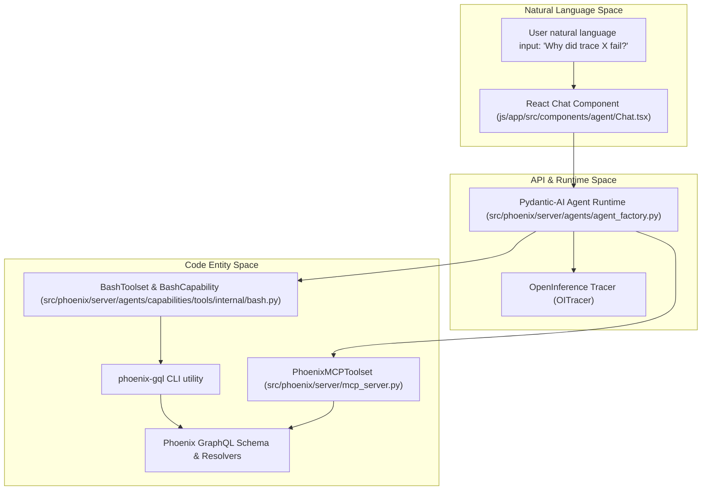
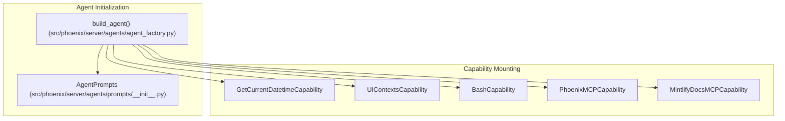

<!-- source: DeepWiki mcp.deepwiki.com · repo Arize-ai/phoenix · page 4.4 AI Assistant (PxI) Interface · fetched 2026-10-26 -->

# AI Assistant (PxI) Interface

Relevant source files

The following files were used as context for generating this wiki page:

- [docs/phoenix/pxi.mdx](docs/phoenix/pxi.mdx)
- [evals/harbor/jobs/trail-benchmark-dev-no-code-mode.yaml](evals/harbor/jobs/trail-benchmark-dev-no-code-mode.yaml)
- [js/app/src/components/agent/AgentChatInput.tsx](js/app/src/components/agent/AgentChatInput.tsx)
- [js/app/src/components/agent/Chat.tsx](js/app/src/components/agent/Chat.tsx)
- [js/app/src/components/agent/SkillPromptInput.tsx](js/app/src/components/agent/SkillPromptInput.tsx)
- [js/app/src/components/agent/SkillPromptInputBoundary.tsx](js/app/src/components/agent/SkillPromptInputBoundary.tsx)
- [js/app/src/components/agent/__tests__/SkillPromptInput.test.tsx](js/app/src/components/agent/__tests__/SkillPromptInput.test.tsx)
- [js/app/src/components/agent/__tests__/agentChatPlaceholder.test.ts](js/app/src/components/agent/__tests__/agentChatPlaceholder.test.ts)
- [js/app/src/components/agent/__tests__/promptHistory.test.ts](js/app/src/components/agent/__tests__/promptHistory.test.ts)
- [js/app/src/components/agent/agentChatPlaceholder.ts](js/app/src/components/agent/agentChatPlaceholder.ts)
- [js/app/src/components/agent/promptHistory.ts](js/app/src/components/agent/promptHistory.ts)
- [js/app/tests/app-frame-overlays.spec.ts](js/app/tests/app-frame-overlays.spec.ts)
- [js/app/tests/overlay-audit.spec.ts](js/app/tests/overlay-audit.spec.ts)
- [src/phoenix/server/agents/agent_factory.py](src/phoenix/server/agents/agent_factory.py)
- [src/phoenix/server/agents/capabilities/tools/external/__init__.py](src/phoenix/server/agents/capabilities/tools/external/__init__.py)
- [src/phoenix/server/agents/capabilities/tools/internal/bash.py](src/phoenix/server/agents/capabilities/tools/internal/bash.py)
- [src/phoenix/server/agents/prompts/__init__.py](src/phoenix/server/agents/prompts/__init__.py)
- [src/phoenix/server/agents/prompts/skills/phoenix-graphql/SKILL.md](src/phoenix/server/agents/prompts/skills/phoenix-graphql/SKILL.md)
- [src/phoenix/server/agents/prompts/static/base/BASE_INSTRUCTIONS.xml](src/phoenix/server/agents/prompts/static/base/BASE_INSTRUCTIONS.xml)
- [src/phoenix/server/agents/prompts/tools/PHOENIX_MCP_TOOL_INSTRUCTIONS.xml.j2](src/phoenix/server/agents/prompts/tools/PHOENIX_MCP_TOOL_INSTRUCTIONS.xml.j2)
- [src/phoenix/server/api/graphql_execute.py](src/phoenix/server/api/graphql_execute.py)
- [src/phoenix/server/mcp/graphql/__init__.py](src/phoenix/server/mcp/graphql/__init__.py)
- [src/phoenix/server/mcp/graphql/output.py](src/phoenix/server/mcp/graphql/output.py)
- [src/phoenix/server/mcp/graphql/tools.py](src/phoenix/server/mcp/graphql/tools.py)
- [src/phoenix/server/mcp/skills/__init__.py](src/phoenix/server/mcp/skills/__init__.py)
- [src/phoenix/server/mcp_server.py](src/phoenix/server/mcp_server.py)
- [tests/unit/server/agents/capabilities/test_external_tools.py](tests/unit/server/agents/capabilities/test_external_tools.py)
- [tests/unit/server/agents/capabilities/test_phoenix_mcp.py](tests/unit/server/agents/capabilities/test_phoenix_mcp.py)
- [tests/unit/server/agents/capabilities/tools/internal/test_bash.py](tests/unit/server/agents/capabilities/tools/internal/test_bash.py)
- [tests/unit/server/agents/prompts/test_static_prompts.py](tests/unit/server/agents/prompts/test_static_prompts.py)
- [tests/unit/server/agents/test_agent_factory.py](tests/unit/server/agents/test_agent_factory.py)
- [tests/unit/server/mcp/test_skills.py](tests/unit/server/mcp/test_skills.py)
- [tests/unit/server/test_app_mcp_mount.py](tests/unit/server/test_app_mcp_mount.py)

The Phoenix Intelligence (PxI) interface provides a built-in AI assistant chat system integrated directly into the Phoenix frontend UI and backed by a robust server-side agent framework (`pydantic-ai`). It enables users to interact with their observability data via natural language, perform ad hoc investigations, query traces, spans, and datasets, and execute safe code/GraphQL operations through specialized tools.

This page documents the technical details of the PxI interface, covering the React chat components in `js/app/src/components/agent/Chat.tsx`, the server-side agent factory (`src/phoenix/server/agents/agent_factory.py`), the Model Context Protocol (MCP) tool registry (`src/phoenix/server/mcp_server.py`), capabilities like `BashCapability`, and the prompt and skills systems.

---

## System Overview

PxI combines a React-based chat interface with a Python agent backend built on top of `pydantic_ai`. The agent is pointed directly at your observability datastore, allowing it to read context from the active page, invoke tools, run GraphQL queries via a virtual shell, and inspect traces.

### Key Architectural Components

- **Frontend Chat (`Chat.tsx`)**: Renders the conversation transcript, empty states, thinking indicators, and message components [js/app/src/components/agent/Chat.tsx:1-120]().
- **Agent Factory (`agent_factory.py`)**: Assembles the `Agent[AgentDependencies, AgentOutput]` instance, attaching capabilities based on runtime configurations and UI context [src/phoenix/server/agents/agent_factory.py:69-94]().
- **In-Process MCP Server (`mcp_server.py`)**: Generates an ASGI-compatible `FastMCP` server from Phoenix's REST API routes, allowing zero-network-hop tool calls [src/phoenix/server/mcp_server.py:1-24]().
- **Bash & GraphQL Toolset (`bash.py`)**: Provides a sandboxed virtual shell (`bashkit`) equipped with the `phoenix-gql` utility for querying the Phoenix GraphQL API [src/phoenix/server/agents/capabilities/tools/internal/bash.py:34-95]().

Sources: [js/app/src/components/agent/Chat.tsx:1-120](), [src/phoenix/server/agents/agent_factory.py:69-94](), [src/phoenix/server/mcp_server.py:1-24](), [src/phoenix/server/agents/capabilities/tools/internal/bash.py:34-95]()

---

## Data Flow: Natural Language to Code Entities

The PxI request lifecycle bridges user natural language intent with server-side code execution, database lookups, and OpenTelemetry tracing.

Sources: [src/phoenix/server/agents/agent_factory.py:63-126](), [src/phoenix/server/mcp_server.py:1-24](), [src/phoenix/server/agents/capabilities/tools/internal/bash.py:34-95](), [js/app/src/components/agent/Chat.tsx:1-120]()

---

## Server-Side Agent Factory

The server-side agent is instantiated via `build_agent()` in `src/phoenix/server/agents/agent_factory.py` [src/phoenix/server/agents/agent_factory.py:69-94](). It wires together core capabilities and optional toolsets depending on user permissions, edit permissions, and feature flags.

### Capabilities and Toolsets

- **`GetCurrentDatetimeCapability`**: Injects current timestamp awareness [src/phoenix/server/agents/agent_factory.py:104-105]().
- **`UIContextsCapability`**: Injects UI context instructions (`AgentPrompts.ui_contexts`) representing the page the user is currently viewing [src/phoenix/server/agents/agent_factory.py:107-114]().
- **`BashCapability`**: Provides a sandboxed virtual shell (`bash`) executing `phoenix-gql` and script utilities [src/phoenix/server/agents/capabilities/tools/internal/bash.py:34-95]().
- **`PhoenixMCPCapability`**: Exposes Phoenix REST endpoints as MCP tools via `PhoenixMCPToolset` [src/phoenix/server/agents/agent_factory.py:136-151]().
- **`MintlifyDocsMCPCapability`**: Integrates documentation searching tools for Phoenix docs [src/phoenix/server/agents/agent_factory.py:129-135]().

Sources: [src/phoenix/server/agents/agent_factory.py:69-151](), [src/phoenix/server/agents/prompts/__init__.py:43-53](), [src/phoenix/server/agents/capabilities/tools/internal/bash.py:34-95]()

---

## Tool Registry and In-Process MCP Server

Phoenix derives its agent tools directly from its OpenAPI / REST specifications and mounts an in-process FastMCP server at `/mcp` [src/phoenix/server/mcp_server.py:1-24]().

### Key Design Aspects

- **Internal Dispatch**: Tool calls are dispatched back into the Phoenix FastAPI application in-process via an ASGI transport, avoiding network hops and preserving middleware security [src/phoenix/server/mcp_server.py:1-17]().
- **Identity Propagation**: The authenticated principal is carried directly in the internal request's ASGI scope (`INTERNAL_PRINCIPAL_SCOPE_KEY`) via `_InternalIdentityDispatch`, ensuring proper authorization [src/phoenix/server/mcp_server.py:11-16]().
- **Code Mode**: To prevent context window bloat from advertising hundreds of REST endpoints individually, code-mode discovery tools (`search`, `execute`, `list_tools`) are used [src/phoenix/server/mcp_server.py:18-24]().

Sources: [src/phoenix/server/mcp_server.py:1-24](), [tests/unit/server/agents/capabilities/test_phoenix_mcp.py:1-35]()

---

## Bash Capability and GraphQL Execution

The `BashCapability` runs commands inside a server-side virtual shell (`bashkit`) [src/phoenix/server/agents/capabilities/tools/internal/bash.py:34-62](). It exposes the `phoenix-gql` command-line utility for running GraphQL queries and mutations against Phoenix.

### Execution Constraints & `phoenix-gql`

- **Sandboxed Execution**: Runs in a virtual shell with general-purpose network access disabled; host binaries (like `apt`, `brew`, `git`) are absent [src/phoenix/server/agents/capabilities/tools/internal/bash.py:56-62]().
- **Schema Discovery**: `phoenix-gql schema --search <text>` discovers types and fields without full introspection [src/phoenix/server/agents/capabilities/tools/internal/bash.py:67-68]().
- **Mutation Policies**: `GraphQLMutationPolicy` enforces approval requirements for state-changing operations [src/phoenix/server/agents/capabilities/tools/internal/bash.py:40-50]().

Sources: [src/phoenix/server/agents/capabilities/tools/internal/bash.py:34-95](), [tests/unit/server/agents/capabilities/tools/internal/test_bash.py:1-50]()

---

## Skills and Prompts System

PxI utilizes a structured skill and prompt template catalog located in `src/phoenix/server/agents/prompts/` and `src/phoenix/server/mcp/skills/`.

### Skill Structure

- **`phoenix-graphql` Skill**: Teaches the agent how to write efficient GraphQL queries, use entrypoints (`node(id:)`, connections, by-name helpers), and paginate properly [src/phoenix/server/agents/prompts/skills/phoenix-graphql/SKILL.md:1-49]().
- **Agent Prompts (`AgentPrompts`)**: Dataclass aggregating base instructions, viewer access rules, subagent instructions, and UI context prompt templates [src/phoenix/server/agents/prompts/__init__.py:43-53]().

Sources: [src/phoenix/server/agents/prompts/__init__.py:43-53](), [src/phoenix/server/agents/prompts/skills/phoenix-graphql/SKILL.md:1-49](), [tests/unit/server/mcp/test_skills.py:1-30]()

---

## Frontend Chat Interface (`Chat.tsx`)

The React frontend component `Chat` in `js/app/src/components/agent/Chat.tsx` manages the chat layout, input actions, thinking indicators, and scroll states [js/app/src/components/agent/Chat.tsx:1-120]().

### Key UI Features

- **Thinking Indicator**: `shouldShowThinkingIndicator()` dynamically tracks whether a request is in flight or waiting for assistant parts [js/app/src/components/agent/Chat.tsx:95-117]().
- **Scroll Management**: Coordinates turn placement, auto-scrolling during streaming, and user scroll interruptions without competing with native browser scroll anchoring [js/app/src/components/agent/Chat.tsx:204-212]().
- **Elicitation & Prompts**: Integrates prompt history, slash commands, and elicitation carousels for interactive tool outputs [js/app/src/components/agent/Chat.tsx:22-31]().

Sources: [js/app/src/components/agent/Chat.tsx:1-120](), [js/app/src/components/agent/Chat.tsx:95-117]()

---

