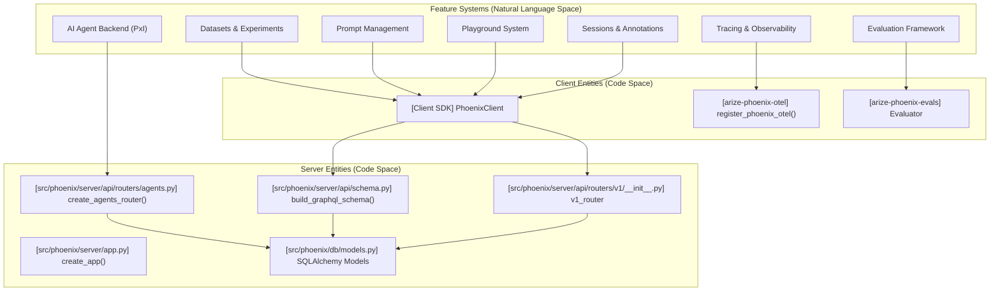
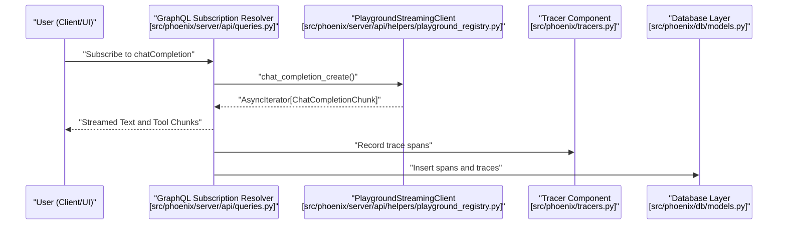

<!-- source: DeepWiki mcp.deepwiki.com · repo Arize-ai/phoenix · page 5 Feature Systems · fetched 2026-10-26 -->

# Feature Systems

Relevant source files

The following files were used as context for generating this wiki page:

- [docs/phoenix.mdx](docs/phoenix.mdx)
- [docs/phoenix/evaluation/concepts-evals/evaluating-multi-agent-systems.mdx](docs/phoenix/evaluation/concepts-evals/evaluating-multi-agent-systems.mdx)
- [docs/phoenix/evaluation/llm-evals.mdx](docs/phoenix/evaluation/llm-evals.mdx)
- [docs/phoenix/integrations/python/pydantic/pydantic-evals.mdx](docs/phoenix/integrations/python/pydantic/pydantic-evals.mdx)
- [docs/phoenix/production-guide.mdx](docs/phoenix/production-guide.mdx)
- [docs/phoenix/release-notes/01-2025/01-18-2025-automatic-and-manual-span-tracing.mdx](docs/phoenix/release-notes/01-2025/01-18-2025-automatic-and-manual-span-tracing.mdx)
- [docs/phoenix/resources/frequently-asked-questions.mdx](docs/phoenix/resources/frequently-asked-questions.mdx)
- [docs/phoenix/resources/frequently-asked-questions/what-is-the-difference-between-phoenix-and-arize.mdx](docs/phoenix/resources/frequently-asked-questions/what-is-the-difference-between-phoenix-and-arize.mdx)
- [docs/phoenix/resources/phoenix-to-arize-ax-migration.mdx](docs/phoenix/resources/phoenix-to-arize-ax-migration.mdx)
- [docs/phoenix/self-hosting.mdx](docs/phoenix/self-hosting.mdx)
- [docs/phoenix/self-hosting/architecture.mdx](docs/phoenix/self-hosting/architecture.mdx)
- [docs/phoenix/self-hosting/features/management.mdx](docs/phoenix/self-hosting/features/management.mdx)
- [docs/phoenix/self-hosting/security/privacy.mdx](docs/phoenix/self-hosting/security/privacy.mdx)
- [docs/phoenix/settings/access-control-rbac.mdx](docs/phoenix/settings/access-control-rbac.mdx)
- [docs/phoenix/settings/data-retention.mdx](docs/phoenix/settings/data-retention.mdx)
- [docs/phoenix/tracing/how-to-tracing/importing-and-exporting-traces/importing-existing-traces.mdx](docs/phoenix/tracing/how-to-tracing/importing-and-exporting-traces/importing-existing-traces.mdx)
- [docs/phoenix/tracing/llm-traces/metrics.mdx](docs/phoenix/tracing/llm-traces/metrics.mdx)
- [docs/phoenix/tracing/llm-traces/projects.mdx](docs/phoenix/tracing/llm-traces/projects.mdx)
- [docs/phoenix/user-guide.mdx](docs/phoenix/user-guide.mdx)

This document provides a high-level overview of Phoenix's major feature areas and how they integrate across client libraries, server components, and the user interface. Phoenix's functionality is organized into primary feature systems that work together to provide comprehensive AI observability, evaluation, and experimentation capabilities.

For detailed information about each system:
- Tracing and instrumentation setup: see [Tracing & Observability](#5.1)
- Evaluation framework implementation: see [Evaluation Framework](#5.2)
- Dataset and experiment management: see [Datasets & Experiments](#5.3)
- Prompt versioning and templating: see [Prompt Management](#5.4)
- LLM Playground and provider abstraction: see [Playground System](#5.5)
- AI Agent Backend: see [AI Agent Backend (PxI)](#5.6)
- Sessions and Annotations: see [Sessions & Annotations](#5.7)

## Feature System Architecture

Phoenix is organized into major feature systems that span the entire stack from client instrumentation to server storage to UI visualization. The following diagram bridges natural language feature spaces to underlying code entities:

Title: Feature System Architecture

Sources:  
[src/phoenix/server/app.py:97-115](),  
[src/phoenix/server/api/queries.py:118-119](),  
[src/phoenix/db/models.py:1-100](),  
[pyproject.toml:2-3](),  
[packages/phoenix-evals/pyproject.toml:2-3]()

## Core Feature Overviews

### Tracing & Observability

Phoenix provides an OpenTelemetry-native tracing backend that ingests spans via the OTLP protocol over gRPC and HTTP. It organizes spans into traces, which are grouped by projects representing different environments or applications. The tracing system supports complex AI architectures—such as Retrieval-Augmented Generation (RAG) pipelines and multi-agent workflows—by capturing detailed span attributes including inputs, outputs, intermediate steps, and metadata.

Span types are categorized using the `SpanKind` enum with values like `CHAIN`, `LLM`, `TOOL`, and `AGENT`, facilitating precise instrumentation and analysis of different stages in an AI pipeline. Status codes of spans are mapped via the `SpanStatusCode` enum to represent success, error, or unset statuses.

For details, see [Tracing & Observability](#5.1).

Sources:  
[src/phoenix/server/app.py:145-145]()

### Evaluation Framework

The evaluation system supports running automated assessments on traces and datasets using multiple evaluator types, including LLM-based, code-based, and heuristic evaluators. Evaluators transform span and trace data into evaluation inputs via input mapping functions and use templates to generate evaluation prompts.

Evaluation results are stored as annotations associated with spans, traces, or sessions, allowing rich feedback and metric computation (e.g., hallucination detection, toxicity scoring, faithfulness checks). Phoenix provides prebuilt classification evaluator configurations under prompt templates for standardized criteria.

For details, see [Evaluation Framework](#5.2).

Sources:  
[src/phoenix/server/api/queries.py:38-43](),  
[packages/phoenix-evals/CHANGELOG.md:22-23](),  
[packages/phoenix-evals/CHANGELOG.md:14-15]()

### Datasets & Experiments

Phoenix supports version-controlled datasets comprising `DatasetExample` entities. These datasets can be split into training/testing subsets with labeling support to facilitate systematic experimentation.

The experimentation framework runs defined tasks—such as prompt versions or evaluators—against dataset examples, recording results as `ExperimentRun` entities. Experiment lifecycle management, including execution and pruning of obsolete experiments, is handled by background daemons like `ExperimentRunner` and `ExperimentSweeper`.

For details, see [Datasets & Experiments](#5.3).

Sources:  
[src/phoenix/server/app.py:123-123](),  
[src/phoenix/server/api/dataloaders/__init__.py:20-20]()

### Prompt Management

Prompt management provides centralized versioning, templating, and tagging for prompt assets. The prompt system treats prompts as first-class entities with multiple versions defined via `PromptVersion`. Prompts include rich templates such as `PromptChatTemplate` supporting complex conversation structures, tool calls, and variable placeholders.

Prompts can be linked to evaluators and experiments for repeatable testing, and SDK helpers in the client libraries simplify prompt application at runtime.

For details, see [Prompt Management](#5.4).

Sources:  
[src/phoenix/server/api/queries.py:121-134]()

### Playground System

The Playground is an interactive environment for developers to test prompt variations and model responses in real-time. It abstracts multiple LLM providers including OpenAI, Anthropic, Google, and AWS Bedrock via a unified interface `PlaygroundStreamingClient` that supports streaming token-by-token responses over GraphQL subscriptions.

The Playground manages rate limiting, provider initialization, and exposes a registry for custom provider integrations, such as `AWSBedrockCustomProviderConfig`.

For details, see [Playground System](#5.5).

Sources:  
[src/phoenix/server/api/queries.py:159-160]()

### AI Agent Backend (PxI)

Phoenix Intelligence (PxI) is the server-side AI agent backend enabling intelligent automation, conversational flows, and tool orchestration. It includes an agent factory based on `pydantic-ai` for creating agents with selected language models and registered tools.

Context resolution facilitates retrieving relevant knowledge and session context for agent decisions. The system exposes `/agents` REST endpoints for agent interactions and introspection, along with evaluation harnesses in `evals/pxi/` and `evals/harbor/`.

For details, see [AI Agent Backend (PxI)](#5.6).

Sources:  
[src/phoenix/config.py:97-102](),  
[pyproject.toml:66-66](),  
[src/phoenix/server/app.py:100-100]()

### Sessions & Annotations

Sessions group related traces into multi-turn conversational contexts as `ProjectSession` objects, providing structured views into conversation history and AI interactions.

Annotations provide a flexible mechanism to attach metadata, feedback, labels, and evaluation results at the level of spans, traces, or sessions. Annotation configurations define schemas for annotation types and usage contexts, and the session filter DSL enables filtering sessions by annotation attributes.

For details, see [Sessions & Annotations](#5.7).

Sources:  
[src/phoenix/server/api/dataloaders/__init__.py:79-79]()

## Data Model Integration

The feature systems are unified by a shared database schema managed with SQLAlchemy ORM models. The following table shows key domain entities per feature system and their approximate database tables:

| Feature Area | Primary Code Entities | Database Table (Approximate) |
|---|---|---|
| **Tracing** | `Span`, `Trace`, `Project` | `spans`, `traces`, `projects` |
| **Evaluations** | `Annotation`, `Evaluator` | `span_annotations`, `trace_annotations`, `evaluators` |
| **Experiments** | `Dataset`, `Experiment`, `ExperimentRun` | `datasets`, `experiments`, `experiment_runs` |
| **Prompts** | `Prompt`, `PromptVersion` | `prompts`, `prompt_versions` |
| **Sessions** | `ProjectSession` | `project_sessions` |

Sources:  
[src/phoenix/db/models.py:1-100](),  
[src/phoenix/server/api/queries.py:72-145]()

## Cross-System Data Flow Example

The following sequence diagram bridges natural language runtime concepts to specific code entities across client, server, and database layers:

Title: Cross-System Data Flow

Sources:  
[src/phoenix/server/api/queries.py:159-160](),  
[src/phoenix/server/api/queries.py:115-115](),  
[src/phoenix/tracers.py:1-1](),  
[src/phoenix/db/models.py:1-100]()

## Common Infrastructure Features

### Cost Tracking

Phoenix estimates token usage and cost metrics for generative model spans via the `SpanCostCalculator` daemon, which runs asynchronously to process spans in batches. It relies on the `GenerativeModelStore` daemon to maintain the cost and pricing information of supported LLM models.

Token usage and cost information is stored in related span cost tables and summarized per project, session, or experiment.

Sources:  
[src/phoenix/server/app.py:126-127]()

### Authentication & Authorization

A unified authentication mechanism protects all feature systems. The `BearerTokenAuthBackend` middleware enforces token-based access control for API requests. Role-based permissions like `IsAdmin` guard sensitive operations across API layers.

Sources:  
[src/phoenix/server/app.py:116-117](),  
[src/phoenix/server/api/context.py:108-109](),  
[src/phoenix/server/api/queries.py:36-36]()

### DML Events and Real-Time Updates

Phoenix employs a `DmlEventHandler` to broadcast database insert, update, and delete events throughout the system. This event-driven mechanism enables real-time UI updates via GraphQL subscriptions, ensuring that client UIs reflect the latest state of traces, annotations, and experiments seamlessly.

Sources:  
[src/phoenix/server/app.py:129-129]()

---

