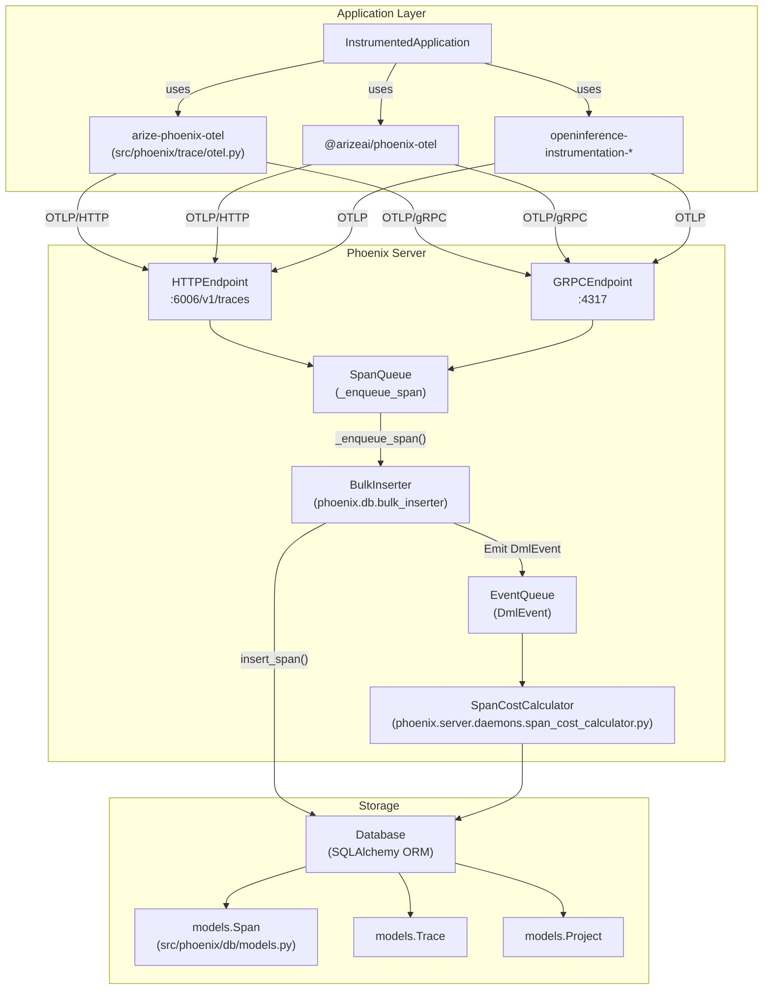

<!-- source: DeepWiki mcp.deepwiki.com · repo Arize-ai/phoenix · page 5.1 Tracing & Observability · fetched 2026-10-26 -->

# Tracing & Observability

<details>
<summary>Relevant source files</summary>

The following files were used as context for generating this wiki page:

- [.agents/skills/phoenix-tracing/references/fundamentals-required-attributes.md](.agents/skills/phoenix-tracing/references/fundamentals-required-attributes.md)
- [.agents/skills/phoenix-tracing/references/instrumentation-manual-python.md](.agents/skills/phoenix-tracing/references/instrumentation-manual-python.md)
- [.agents/skills/phoenix-tracing/references/instrumentation-manual-typescript.md](.agents/skills/phoenix-tracing/references/instrumentation-manual-typescript.md)
- [docs/phoenix/integrations/llm-providers/openai/openai-node-js-sdk.mdx](docs/phoenix/integrations/llm-providers/openai/openai-node-js-sdk.mdx)
- [docs/phoenix/integrations/llm-providers/openai/openai-tracing.mdx](docs/phoenix/integrations/llm-providers/openai/openai-tracing.mdx)
- [docs/phoenix/integrations/llm-providers/typesafe.mdx](docs/phoenix/integrations/llm-providers/typesafe.mdx)
- [docs/phoenix/integrations/llm-providers/typesafe/typesafe-python.mdx](docs/phoenix/integrations/llm-providers/typesafe/typesafe-python.mdx)
- [docs/phoenix/integrations/llm-providers/typesafe/typesafe-typescript.mdx](docs/phoenix/integrations/llm-providers/typesafe/typesafe-typescript.mdx)
- [docs/phoenix/integrations/typescript/vercel/vercel-ai-sdk-tracing-js.mdx](docs/phoenix/integrations/typescript/vercel/vercel-ai-sdk-tracing-js.mdx)
- [docs/phoenix/tracing/concepts-tracing/otel-openinference/semantic-conventions.mdx](docs/phoenix/tracing/concepts-tracing/otel-openinference/semantic-conventions.mdx)
- [docs/phoenix/tracing/concepts-tracing/otel-openinference/span-kinds.mdx](docs/phoenix/tracing/concepts-tracing/otel-openinference/span-kinds.mdx)
- [internal_docs/specs/span-filter-dsl.md](internal_docs/specs/span-filter-dsl.md)
- [js/app/src/agent/uiOperations/operations/spansFilter.ts](js/app/src/agent/uiOperations/operations/spansFilter.ts)
- [js/app/src/pages/project/traceFilterDSL.ts](js/app/src/pages/project/traceFilterDSL.ts)
- [js/examples/apps/ai-sdk-agent/README.md](js/examples/apps/ai-sdk-agent/README.md)
- [js/examples/apps/ai-sdk-agent/instrumentation.ts](js/examples/apps/ai-sdk-agent/instrumentation.ts)
- [src/phoenix/exceptions.py](src/phoenix/exceptions.py)
- [src/phoenix/server/api/helpers/experiment_run_filters.py](src/phoenix/server/api/helpers/experiment_run_filters.py)
- [src/phoenix/server/api/input_types/SpanSort.py](src/phoenix/server/api/input_types/SpanSort.py)
- [src/phoenix/trace/dsl/filter.py](src/phoenix/trace/dsl/filter.py)
- [src/phoenix/trace/dsl/query.py](src/phoenix/trace/dsl/query.py)
- [src/phoenix/trace/gen_ai/conversion.py](src/phoenix/trace/gen_ai/conversion.py)
- [src/phoenix/trace/otel.py](src/phoenix/trace/otel.py)
- [src/phoenix/trace/span_evaluations.py](src/phoenix/trace/span_evaluations.py)
- [src/phoenix/trace/trace_dataset.py](src/phoenix/trace/trace_dataset.py)
- [tests/unit/server/api/helpers/test_experiment_run_filters.py](tests/unit/server/api/helpers/test_experiment_run_filters.py)
- [tests/unit/server/api/types/test_Trace_span_aggregates.py](tests/unit/server/api/types/test_Trace_span_aggregates.py)
- [tests/unit/trace/dsl/test_filter.py](tests/unit/trace/dsl/test_filter.py)
- [tests/unit/trace/dsl/test_filter_error_messages.py](tests/unit/trace/dsl/test_filter_error_messages.py)
- [tests/unit/trace/dsl/test_filter_span_cost.py](tests/unit/trace/dsl/test_filter_span_cost.py)
- [tests/unit/trace/dsl/test_filter_spec_conformance.py](tests/unit/trace/dsl/test_filter_spec_conformance.py)
- [tests/unit/trace/dsl/test_query.py](tests/unit/trace/dsl/test_query.py)
- [tests/unit/trace/dsl/test_session_filter.py](tests/unit/trace/dsl/test_session_filter.py)
- [tests/unit/trace/gen_ai/test_conversion.py](tests/unit/trace/gen_ai/test_conversion.py)
- [tests/unit/trace/test_otel.py](tests/unit/trace/test_otel.py)
- [tests/unit/trace/test_span_evaluations.py](tests/unit/trace/test_span_evaluations.py)
- [tests/unit/trace/test_trace_dataset.py](tests/unit/trace/test_trace_dataset.py)

</details>


## Purpose and Scope

This document explains the tracing and observability architecture within Phoenix. It covers how Phoenix integrates OpenTelemetry (OTel) for instrumenting AI applications, the OTLP span ingestion pipeline, trace storage models, OpenInference semantic conventions, span kinds, the `TraceDataset` abstraction, and the custom Python AST-based domain-specific language (DSL) filter system.

Sources: `[src/phoenix/trace/otel.py:97-134]`, `[src/phoenix/trace/dsl/filter.py:1-126]`, `[src/phoenix/trace/trace_dataset.py:101-166]()`

---

## Architecture Overview

Phoenix adopts OpenTelemetry (OTel) standards and the OTLP protocol over HTTP and gRPC to collect distributed trace data from instrumented AI applications. The ingestion pipeline buffers and batch-inserts spans into relational databases via SQLAlchemy ORM models, while triggering asynchronous cost calculation and event emission.


**Diagram: Phoenix Tracing Architecture (Natural Language to Code Entity Space)**

Sources: `[src/phoenix/db/bulk_inserter.py:51-175]()`, `[src/phoenix/trace/otel.py:97-134]()`

---

## Phoenix OTEL Packages and Span Ingestion

Phoenix provides native OpenTelemetry integration packages (`arize-phoenix-otel` in Python and `@arizeai/phoenix-otel` in TypeScript) to simplify configuration and trace exporting.

### Python OTLP Decoding (`src/phoenix/trace/otel.py`)
Incoming OTLP protocol buffers are decoded into Phoenix `Span` domain objects. The function `decode_otlp_span` extracts identifiers, timestamps, attributes, events, and status codes:

- **Identifiers:** Hexadecimal encoding is decoded for trace IDs and span IDs (`_decode_identifier`) `[src/phoenix/trace/otel.py:137-142]()`.
- **Attributes:** Key-value pairs are coerced and unflattened (`decode_otlp_span`, `_merge_synthesized_attributes`) `[src/phoenix/trace/otel.py:97-134]()`.
- **GenAI Conversions:** OpenTelemetry GenAI semantic conventions (`gen_ai.*`) are automatically converted back into OpenInference attributes via `get_openinference_attributes` `[src/phoenix/trace/gen_ai/conversion.py:58-82]()`.

Sources: `[src/phoenix/trace/otel.py:59-134]()`, `[src/phoenix/trace/gen_ai/conversion.py:58-82]()`

---

## Data Model & Trace Representation

Phoenix models spans, traces, and datasets using SQLAlchemy ORM models and pandas dataframes.

### Core Schemas (`phoenix.trace.schemas`)
- `Span`: Represents a single unit of execution containing:
  - `name`, `context` (`SpanContext` with `trace_id` and `span_id`), `span_kind`, `parent_id`, `start_time`, `end_time` `[src/phoenix/trace/schemas.py:134-145]()`.
  - `status_code`, `status_message` `[src/phoenix/trace/schemas.py:146-147]()`.
  - `attributes` (nested dictionary conforming to OpenInference conventions) `[src/phoenix/trace/schemas.py:148-162]()`.
  - `events`: List of `SpanEvent` or `SpanException` items `[src/phoenix/trace/schemas.py:163-172]()`.

### TraceDataset (`phoenix.trace.trace_dataset`)
`TraceDataset` wraps a pandas DataFrame containing flattened representations of spans for bulk processing, evaluations, and visualization:
- Validates required columns (`REQUIRED_COLUMNS` including `name`, `span_kind`, `parent_id`, `start_time`, `end_time`, `context.span_id`, `context.trace_id`) `[src/phoenix/trace/trace_dataset.py:34-44]()`.
- Normalizes timestamps via `normalize_timestamps` and handles serialization conversions via `get_serializable_spans_dataframe` `[src/phoenix/trace/trace_dataset.py:59-98]()`.

Sources: `[src/phoenix/trace/schemas.py:134-172]()`, `[src/phoenix/trace/trace_dataset.py:34-166]()`

---

## OpenInference Semantic Conventions & Span Kinds

OpenInference extends OpenTelemetry semantic conventions with AI-specific attributes and span kinds.

### The Twelve Span Kinds
Span kinds drive UI icons and expected attribute sets (`docs/phoenix/tracing/concepts-tracing/otel-openinference/span-kinds.mdx`):
- **`LLM`**: Calls to large language models.
- **`CHAIN`**: Orchestration workflows or component links.
- **`AGENT`**: Multi-step reasoning loops encompassing LLMs and tools.
- **`TOOL`**: External function or API calls.
- **`RETRIEVER`**: Vector store or document database queries.
- **`EMBEDDING`**: Text-to-vector encodings.
- **`RERANKER`**: Relevance-based document re-ordering.
- **`GUARDRAIL`**: Input/output policy validations.
- **`EVALUATOR`**: Evaluation execution.
- **`DECISION`**: Decision model routing and classification calls.
- **`PROMPT`**: Prompt templating and construction.
- **`UNKNOWN`**: Fallback kind.

Sources: `[docs/phoenix/tracing/concepts-tracing/otel-openinference/span-kinds.mdx:32-50]()`

---

## Filtering System Using Custom DSL

Phoenix provides a domain-specific language (DSL) for filtering spans, traces, and sessions. Implemented in Python AST (`src/phoenix/trace/dsl/filter.py`), the DSL translates Python-like filter expressions into SQLAlchemy query criteria.

```mermaid
graph LR
    FilterExpr["AST Filter Expression<br>(e.g. 'latency_ms > 1000 and span_kind == \"LLM\"')"]
    SpanFilter["SpanFilter<br>(src/phoenix/trace/dsl/filter.py)"]
    SQLExpr["SQLAlchemy Column Element<br>(sqlalchemy.sql.expression.ColumnElement)"]
    Query["Database Query<br>(sqlalchemy.orm.Session / Select)"]
    ResultSet["Filtered Results"]

    FilterExpr --> SpanFilter
    SpanFilter --> SQLExpr
    SQLExpr --> Query
    Query --> ResultSet
```
**Diagram: Span Filtering DSL Flow (Natural Language to Code Entity Space)**

### Implementation Details (`src/phoenix/trace/dsl/filter.py`)
- **AST Parsing:** Filter strings are parsed using Python's `ast` module, validating operations (comparisons, logical operators, membership, and null checks) `[tests/unit/trace/dsl/test_filter.py:28-158]()`.
- **Column Mappings:** Reserved identifiers like `span_kind`, `latency_ms`, `start_time`, `status_code`, and `parent_id` map directly to `models.Span` columns (`_STRING_NAMES`, `_FLOAT_NAMES`, `_DATETIME_NAMES`) `[src/phoenix/trace/dsl/filter.py:114-140]`.
- **JSON Casting & Attributes:** Unstructured attributes and metadata are accessed dynamically and safely cast using helpers like `SafeJsonFloat` and `SafeJsonBoolean` `[src/phoenix/trace/dsl/filter.py:19-20]`.
- **Aliasing:** Backward-compatibility mappings translate deprecated paths (e.g., `context.span_id` $\to$ `span_id`) `[src/phoenix/trace/dsl/filter.py:150-159]`.

Sources: `[src/phoenix/trace/dsl/filter.py:1-164]`, `[tests/unit/trace/dsl/test_filter.py:28-158]()`

---

## Observability Features and UI Components

Phoenix exposes tracing and observability data through rich React UI components and GraphQL/REST APIs:
- **Trace Tree & Span Details:** The `TraceTree` component reconstructs parent-child execution hierarchies using `parent_id` properties `[app/src/components/trace/TraceTree.tsx]`. `SpanDetails` and `TraceDetails` display inputs, outputs, token counts, and latency metrics.
- **Annotations & Evaluations:** `SpanAnnotationsEditor` enables viewing and editing annotations (scores, labels, explanations) across spans and traces `[app/src/components/trace/SpanAnnotationsEditor.tsx]`.
- **Sorting & Metrics:** Table views support sorting by latency, token counts, evaluation scores, and total cost (`SpanColumn` in `[src/phoenix/server/api/input_types/SpanSort.py:18-31]()`).

Sources: `[src/phoenix/server/api/input_types/SpanSort.py:18-31]()`

---

