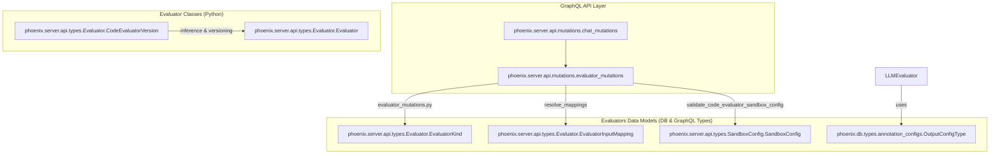
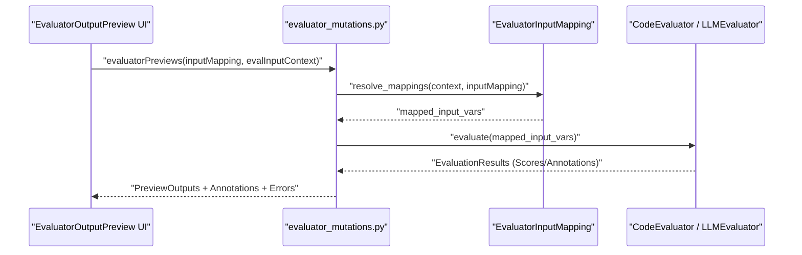
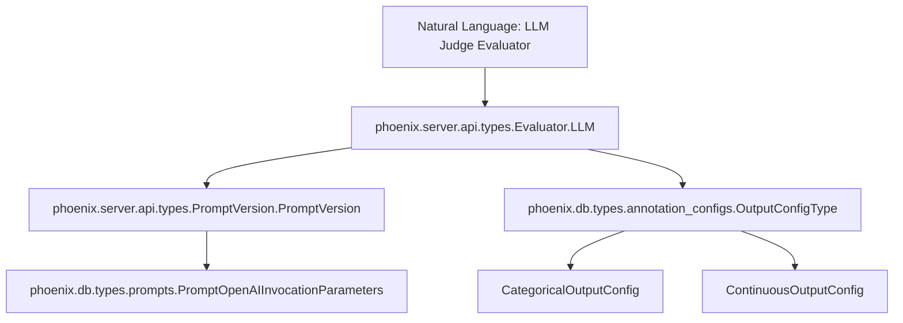
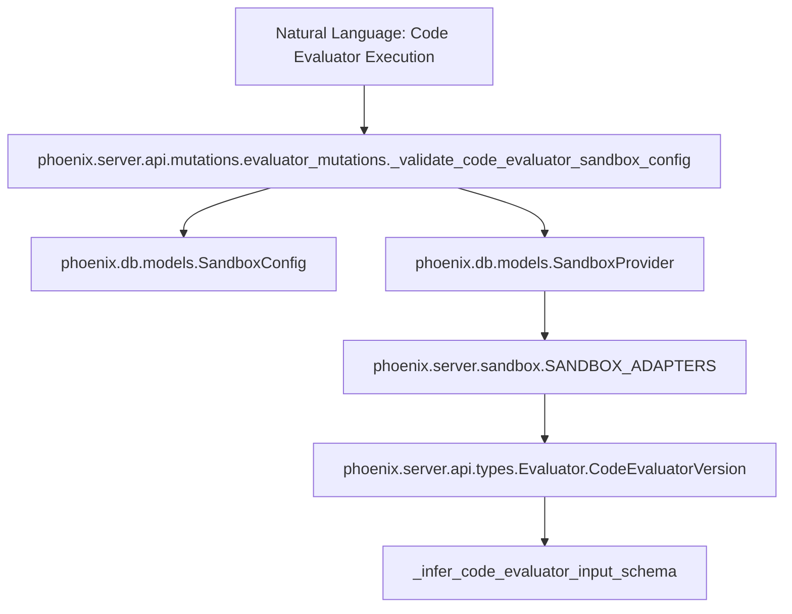

<!-- source: DeepWiki mcp.deepwiki.com · repo Arize-ai/phoenix · page 5.2 Evaluation Framework · fetched 2026-10-26 -->

# Evaluation Framework

<details>
<summary>Relevant source files</summary>

The following files were used as context for generating this wiki page:

- [.agents/skills/phoenix-evals/SKILL.md](.agents/skills/phoenix-evals/SKILL.md)
- [.agents/skills/phoenix-evals/references/common-mistakes-python.md](.agents/skills/phoenix-evals/references/common-mistakes-python.md)
- [.agents/skills/phoenix-evals/references/evaluators-llm-python.md](.agents/skills/phoenix-evals/references/evaluators-llm-python.md)
- [.agents/skills/phoenix-evals/references/evaluators-pre-built.md](.agents/skills/phoenix-evals/references/evaluators-pre-built.md)
- [.agents/skills/phoenix-evals/references/evaluators-rag.md](.agents/skills/phoenix-evals/references/evaluators-rag.md)
- [.agents/skills/phoenix-evals/references/fundamentals-anti-patterns.md](.agents/skills/phoenix-evals/references/fundamentals-anti-patterns.md)
- [.agents/skills/phoenix-evals/references/observe-tracing-setup.md](.agents/skills/phoenix-evals/references/observe-tracing-setup.md)
- [.agents/skills/phoenix-evals/references/validation-evaluators-python.md](.agents/skills/phoenix-evals/references/validation-evaluators-python.md)
- [.agents/skills/phoenix-evals/references/validation-evaluators-typescript.md](.agents/skills/phoenix-evals/references/validation-evaluators-typescript.md)
- [.agents/skills/phoenix-evals/references/validation.md](.agents/skills/phoenix-evals/references/validation.md)
- [docs/phoenix/evaluation/pre-built-metrics.mdx](docs/phoenix/evaluation/pre-built-metrics.mdx)
- [docs/phoenix/sdk-api-reference/typescript/packages/phoenix-evals/classification.mdx](docs/phoenix/sdk-api-reference/typescript/packages/phoenix-evals/classification.mdx)
- [js/packages/phoenix-evals/examples/decision_model_example.ts](js/packages/phoenix-evals/examples/decision_model_example.ts)
- [js/packages/phoenix-evals/src/__generated__/default_templates/index.ts](js/packages/phoenix-evals/src/__generated__/default_templates/index.ts)
- [js/packages/phoenix-evals/src/decision/decideClassification.ts](js/packages/phoenix-evals/src/decision/decideClassification.ts)
- [js/packages/phoenix-evals/src/decision/decisionPrompt.ts](js/packages/phoenix-evals/src/decision/decisionPrompt.ts)
- [js/packages/phoenix-evals/src/llm/ClassificationEvaluator.ts](js/packages/phoenix-evals/src/llm/ClassificationEvaluator.ts)
- [js/packages/phoenix-evals/src/llm/generateClassification.ts](js/packages/phoenix-evals/src/llm/generateClassification.ts)
- [js/packages/phoenix-evals/src/llm/index.ts](js/packages/phoenix-evals/src/llm/index.ts)
- [js/packages/phoenix-evals/src/telemetry/index.ts](js/packages/phoenix-evals/src/telemetry/index.ts)
- [js/packages/phoenix-evals/src/types/evals.ts](js/packages/phoenix-evals/src/types/evals.ts)
- [js/packages/phoenix-evals/src/utils/index.ts](js/packages/phoenix-evals/src/utils/index.ts)
- [js/packages/phoenix-evals/test/llm/generateClassificationTelemetry.test.ts](js/packages/phoenix-evals/test/llm/generateClassificationTelemetry.test.ts)
- [packages/phoenix-evals/src/phoenix/evals/__generated__/classification_evaluator_configs/__init__.py](packages/phoenix-evals/src/phoenix/evals/__generated__/classification_evaluator_configs/__init__.py)
- [packages/phoenix-evals/src/phoenix/evals/metrics/__init__.py](packages/phoenix-evals/src/phoenix/evals/metrics/__init__.py)
- [packages/phoenix-evals/tests/phoenix/evals/metrics/test_classification_evaluators.py](packages/phoenix-evals/tests/phoenix/evals/metrics/test_classification_evaluators.py)
- [src/phoenix/__generated__/classification_evaluator_configs/__init__.py](src/phoenix/__generated__/classification_evaluator_configs/__init__.py)
- [src/phoenix/db/migrations/versions/02463bd83119_add_evaluators.py](src/phoenix/db/migrations/versions/02463bd83119_add_evaluators.py)
- [src/phoenix/server/api/mutations/evaluator_mutations.py](src/phoenix/server/api/mutations/evaluator_mutations.py)
- [src/phoenix/server/api/schema.py](src/phoenix/server/api/schema.py)
- [src/phoenix/server/api/types/Dataset.py](src/phoenix/server/api/types/Dataset.py)
- [src/phoenix/server/api/types/Evaluator.py](src/phoenix/server/api/types/Evaluator.py)
- [tests/unit/db/test_models.py](tests/unit/db/test_models.py)
- [tests/unit/server/api/mutations/test_evaluator_mutations.py](tests/unit/server/api/mutations/test_evaluator_mutations.py)
- [tests/unit/server/api/types/test_Dataset.py](tests/unit/server/api/types/test_Dataset.py)
- [tests/unit/server/api/types/test_Evaluator.py](tests/unit/server/api/types/test_Evaluator.py)

</details>


## Purpose and Scope

The Evaluation Framework provides a comprehensive system to define, execute, and manage automated evaluators that assess the performance and behavior of LLM applications and code executions within Phoenix. It supports diverse evaluator types including:

- **LLM Evaluators**: Prompt-based evaluations leveraging generative language models from providers such as OpenAI, Anthropic, Google, Bedrock, and others (`src/phoenix/server/api/types/Evaluator.py:51-52`) [src/phoenix/server/api/types/Evaluator.py:51-52]().
- **Code Evaluators**: Execution of custom Python or TypeScript code within secure sandboxed environments for deterministic or programmatic evaluation metrics (`src/phoenix/server/api/types/Evaluator.py:53-53`) [src/phoenix/server/api/types/Evaluator.py:53-53]().
- **Built-in Evaluators**: Predefined standard evaluators implementing common metrics like hallucination detection, toxicity scoring, faithfulness, and more (`src/phoenix/server/api/types/Evaluator.py:54-54`) [src/phoenix/server/api/types/Evaluator.py:54-54]().
- **Flexible Input Mapping**: JSONPath-based and literal input mapping encapsulated by `EvaluatorInputMapping` allowing evaluation variables to be extracted or transformed from rich inputs including OpenTelemetry spans, traces, and dataset examples (`src/phoenix/server/api/types/Evaluator.py:58-63`) [src/phoenix/server/api/types/Evaluator.py:58-63]().

This evaluation framework underpins key Phoenix features including the Playground interactive interface, experiment execution, annotation management, and AI agent evaluation pipelines.

**Sources:**  
[src/phoenix/server/api/types/Evaluator.py:50-63]()

---

## Architecture Overview

The evaluation framework integrates closely with Phoenix's GraphQL API server and internal evaluator implementations. Evaluations are invoked primarily via GraphQL mutations and processed through concrete evaluator classes that produce scores or annotations persisted in the database.

### Evaluation Framework Architecture Diagram



This diagram connects the GraphQL API mutations with evaluator implementations and their associated data structures such as input mappings, annotations, and sandbox configuration for code execution.

**Sources:**  
[src/phoenix/server/api/mutations/evaluator_mutations.py:18-72](), [src/phoenix/server/api/types/Evaluator.py:50-102]()

---

## Evaluator Implementations

Phoenix implements three primary kinds of evaluators extending a shared abstract base class (`src/phoenix/server/api/types/Evaluator.py:71-73`) [src/phoenix/server/api/types/Evaluator.py:71-73]():

### LLMEvaluator

- Represents prompt-driven evaluators that interact with LLM APIs (`src/phoenix/server/api/types/Evaluator.py:52-52`) [src/phoenix/server/api/types/Evaluator.py:52-52]().
- Holds references to prompt versions and related invocation parameters (`tests/unit/server/api/types/test_Evaluator.py:31-46`) [tests/unit/server/api/types/test_Evaluator.py:31-46]().
- Validates prompt and output config consistency during creation/update (`src/phoenix/server/api/helpers/evaluators.py:41-42`) [src/phoenix/server/api/helpers/evaluators.py:41-42]().
- Executes evaluations by sending prompts, receiving responses, and parsing outputs into typed scores or annotations.

### CodeEvaluator

- Executes evaluation logic written in Python or TypeScript (`src/phoenix/server/api/types/Evaluator.py:53-53`) [src/phoenix/server/api/types/Evaluator.py:53-53]().
- Source code included with each evaluator version (`src/phoenix/server/api/types/Evaluator.py:132-132`) [src/phoenix/server/api/types/Evaluator.py:132-132]().
- Supports input schema inference via `_infer_code_evaluator_input_schema()` to validate inputs conformant with function signatures (`src/phoenix/server/api/types/Evaluator.py:137-145`) [src/phoenix/server/api/types/Evaluator.py:137-145]().
- Runs code securely within sandboxed environments validated by `_validate_code_evaluator_sandbox_config()` (`src/phoenix/server/api/mutations/evaluator_mutations.py:131-139`) [src/phoenix/server/api/mutations/evaluator_mutations.py:131-139]().
- Robust validation to ensure sandbox and evaluator language alignment (`src/phoenix/server/api/mutations/evaluator_mutations.py:172-172`) [src/phoenix/server/api/mutations/evaluator_mutations.py:172-172]().

### BuiltInEvaluator

- Wraps predefined evaluators implementing standard metrics (`src/phoenix/server/api/types/Evaluator.py:54-54`) [src/phoenix/server/api/types/Evaluator.py:54-54]().
- Accessed via key lookups internally.
- Provides evaluation functions embedded in Phoenix for common use cases.

**Sources:**  
[src/phoenix/server/api/types/Evaluator.py:50-145](), [src/phoenix/server/api/mutations/evaluator_mutations.py:131-172]()

---

## Input Mapping and Context Resolution

Evaluations require transforming rich context data into the input schema expected by the evaluator. Phoenix supports flexible input mappings encapsulated in the `EvaluatorInputMapping` type (`src/phoenix/server/api/types/Evaluator.py:58-62`) [src/phoenix/server/api/types/Evaluator.py:58-62]().

### GraphQL Input Mapping Schema

```python
@strawberry.type
class EvaluatorInputMapping:
    literal_mapping: JSON  # direct key-value mappings to evaluator inputs
    path_mapping: JSON     # JSONPath expressions to extract dynamic values from context
```

- **Literal Mapping:** Static values directly assigned to evaluator input keys (`src/phoenix/server/api/types/Evaluator.py:59-60`) [src/phoenix/server/api/types/Evaluator.py:59-60]().
- **Path Mapping:** JSONPath expressions evaluated on the context to dynamically select or compute input variables (`src/phoenix/server/api/types/Evaluator.py:61-62`) [src/phoenix/server/api/types/Evaluator.py:61-62]().

### Input Mapping Data Flow



This mechanism enables evaluator inputs to be derived from complex inputs like spans, traces, or dataset examples.

**Sources:**  
[src/phoenix/server/api/types/Evaluator.py:58-63]()

---

## Annotation Storage and Output Configuration

Evaluation results are serialized as annotations linked to spans or datasets. Output configurations govern the structure and semantics of the annotations (`src/phoenix/server/api/mutations/evaluator_mutations.py:75-110`) [src/phoenix/server/api/mutations/evaluator_mutations.py:75-110]().

### OutputConfig Types

| Type                     | Description                                | Notable Fields                      |
|--------------------------|--------------------------------------------|-----------------------------------|
| `CategoricalOutputConfig` | Categorical nominal labels (classification) | `name`, `values` (labels with scores), `optimization_direction` (`src/phoenix/server/api/mutations/evaluator_mutations.py:80-88`) [src/phoenix/server/api/mutations/evaluator_mutations.py:80-88]() |
| `ContinuousOutputConfig`  | Numeric scores with defined boundaries     | `name`, `lower_bound`, `upper_bound`, `optimization_direction` (`src/phoenix/server/api/mutations/evaluator_mutations.py:89-98`) [src/phoenix/server/api/mutations/evaluator_mutations.py:89-98]()  |
| `FreeformOutputConfig`    | Free-text or threshold-based outputs       | `name`, `thresholds`, `lower_bound`, `upper_bound` (`src/phoenix/server/api/mutations/evaluator_mutations.py:99-109`) [src/phoenix/server/api/mutations/evaluator_mutations.py:99-109]()              |

### OptimizationDirection Enum

- `MAXIMIZE` - Higher scores are better (`js/packages/phoenix-evals/src/types/evals.ts:148-148`) [js/packages/phoenix-evals/src/types/evals.ts:148-148]().
- `MINIMIZE` - Lower scores are better (`js/packages/phoenix-evals/src/types/evals.ts:148-148`) [js/packages/phoenix-evals/src/types/evals.ts:148-148]().
- `NEUTRAL` - Neutral direction (`js/packages/phoenix-evals/src/types/evals.ts:148-148`) [js/packages/phoenix-evals/src/types/evals.ts:148-148]().

### Annotations

- Stored as `SpanAnnotation` or dataset annotation entities in the database.
- Can represent scalar scores, categorical labels, explanations, and metadata.
- Used to drive experiment result aggregation and span-level insights.

**Sources:**  
[src/phoenix/server/api/mutations/evaluator_mutations.py:75-111](), [js/packages/phoenix-evals/src/types/evals.ts:145-149]()

---

## Built-in Metrics and Pre-built Classification Evaluator Configurations

Phoenix provides a suite of built-in metrics and pre-configured classification evaluators to streamline common evaluation tasks. These are available in both Python and TypeScript client libraries (`.agents/skills/phoenix-evals/references/evaluators-pre-built.md:5-7`) [.agents/skills/phoenix-evals/references/evaluators-pre-built.md:5-7]().

### Python Built-in Metrics

The `phoenix.evals.metrics` module offers a collection of evaluators for various aspects of LLM performance (`packages/phoenix-evals/src/phoenix/evals/metrics/__init__.py:1-17`) [packages/phoenix-evals/src/phoenix/evals/metrics/__init__.py:1-17]():

- `CompletenessEvaluator` (`packages/phoenix-evals/src/phoenix/evals/metrics/__init__.py:1-1`) [packages/phoenix-evals/src/phoenix/evals/metrics/__init__.py:1-1]()
- `ConcisenessEvaluator` (`packages/phoenix-evals/src/phoenix/evals/metrics/__init__.py:2-2`) [packages/phoenix-evals/src/phoenix/evals/metrics/__init__.py:2-2]()
- `CorrectnessEvaluator` (`packages/phoenix-evals/src/phoenix/evals/metrics/__init__.py:3-3`) [packages/phoenix-evals/src/phoenix/evals/metrics/__init__.py:3-3]()
- `DocumentRelevanceEvaluator` (`packages/phoenix-evals/src/phoenix/evals/metrics/__init__.py:4-4`) [packages/phoenix-evals/src/phoenix/evals/metrics/__init__.py:4-4]()
- `FaithfulnessEvaluator` (`packages/phoenix-evals/src/phoenix/evals/metrics/__init__.py:6-6`) [packages/phoenix-evals/src/phoenix/evals/metrics/__init__.py:6-6]()
- `HallucinationEvaluator` (`packages/phoenix-evals/src/phoenix/evals/metrics/__init__.py:7-7`) [packages/phoenix-evals/src/phoenix/evals/metrics/__init__.py:7-7]()
- `RefusalEvaluator` (`packages/phoenix-evals/src/phoenix/evals/metrics/__init__.py:11-11`) [packages/phoenix-evals/src/phoenix/evals/metrics/__init__.py:11-11]()
- `RetrievalRelevanceEvaluator` (`packages/phoenix-evals/src/phoenix/evals/metrics/__init__.py:12-12`) [packages/phoenix-evals/src/phoenix/evals/metrics/__init__.py:12-12]()
- `ToxicityEvaluator` (`packages/phoenix-evals/src/phoenix/evals/metrics/__init__.py:16-16`) [packages/phoenix-evals/src/phoenix/evals/metrics/__init__.py:16-16]()
- `UserFrictionEvaluator` (`packages/phoenix-evals/src/phoenix/evals/metrics/__init__.py:17-17`) [packages/phoenix-evals/src/phoenix/evals/metrics/__init__.py:17-17]()
- `ToolInvocationEvaluator` (`packages/phoenix-evals/src/phoenix/evals/metrics/__init__.py:13-13`) [packages/phoenix-evals/src/phoenix/evals/metrics/__init__.py:13-13]()
- `ToolResponseHandlingEvaluator` (`packages/phoenix-evals/src/phoenix/evals/metrics/__init__.py:14-14`) [packages/phoenix-evals/src/phoenix/evals/metrics/__init__.py:14-14]()
- `ToolSelectionEvaluator` (`packages/phoenix-evals/src/phoenix/evals/metrics/__init__.py:15-15`) [packages/phoenix-evals/src/phoenix/evals/metrics/__init__.py:15-15]()
- `exact_match` (`packages/phoenix-evals/src/phoenix/evals/metrics/__init__.py:5-5`) [packages/phoenix-evals/src/phoenix/evals/metrics/__init__.py:5-5]()
- `MatchesRegex` (`packages/phoenix-evals/src/phoenix/evals/metrics/__init__.py:8-8`) [packages/phoenix-evals/src/phoenix/evals/metrics/__init__.py:8-8]()
- `PrecisionRecallFScore` (`packages/phoenix-evals/src/phoenix/evals/metrics/__init__.py:10-10`) [packages/phoenix-evals/src/phoenix/evals/metrics/__init__.py:10-10]()

### TypeScript Built-in Metrics

The TypeScript client library exposes matching evaluators (`js/packages/phoenix-evals/src/llm/index.ts:1-20`) [js/packages/phoenix-evals/src/llm/index.ts:1-19]():

- `ClassificationEvaluator` (`js/packages/phoenix-evals/src/llm/index.ts:1-1`) [js/packages/phoenix-evals/src/llm/index.ts:1-1]()
- `createClassificationEvaluator` (`js/packages/phoenix-evals/src/llm/index.ts:2-2`) [js/packages/phoenix-evals/src/llm/index.ts:2-2]()
- `createClassifierFn` (`js/packages/phoenix-evals/src/llm/index.ts:3-3`) [js/packages/phoenix-evals/src/llm/index.ts:3-3]()
- `createConcisenessEvaluator` (`js/packages/phoenix-evals/src/llm/index.ts:5-5`) [js/packages/phoenix-evals/src/llm/index.ts:5-5]()
- `createCorrectnessEvaluator` (`js/packages/phoenix-evals/src/llm/index.ts:6-6`) [js/packages/phoenix-evals/src/llm/index.ts:6-6]()
- `createDocumentRelevanceEvaluator` (`js/packages/phoenix-evals/src/llm/index.ts:7-7`) [js/packages/phoenix-evals/src/llm/index.ts:7-7]()
- `createFaithfulnessEvaluator` (`js/packages/phoenix-evals/src/llm/index.ts:8-8`) [js/packages/phoenix-evals/src/llm/index.ts:8-8]()
- `createHallucinationEvaluator` (`js/packages/phoenix-evals/src/llm/index.ts:9-9`) [js/packages/phoenix-evals/src/llm/index.ts:9-9]()
- `createRefusalEvaluator` (`js/packages/phoenix-evals/src/llm/index.ts:11-11`) [js/packages/phoenix-evals/src/llm/index.ts:11-11]()
- `createRetrievalRelevanceEvaluator` (`js/packages/phoenix-evals/src/llm/index.ts:12-12`) [js/packages/phoenix-evals/src/llm/index.ts:12-12]()
- `createToxicityEvaluator` (`js/packages/phoenix-evals/src/llm/index.ts:16-16`) [js/packages/phoenix-evals/src/llm/index.ts:16-16]()

**Sources:**  
[packages/phoenix-evals/src/phoenix/evals/metrics/__init__.py:1-37](), [js/packages/phoenix-evals/src/llm/index.ts:1-19](), [.agents/skills/phoenix-evals/references/evaluators-pre-built.md:5-7]()

---

## Summary Diagrams Bridging Natural Language Evaluation Concepts to Code Entities

### 1. LLM Evaluator Code Entity Mapping



**Sources:**  
[src/phoenix/server/api/types/Evaluator.py:51-52](), [src/phoenix/server/api/mutations/evaluator_mutations.py:75-111]()

### 2. Code Evaluator Sandbox Validation Flow



**Sources:**  
[src/phoenix/server/api/mutations/evaluator_mutations.py:131-172](), [src/phoenix/server/api/types/Evaluator.py:128-145]()

---

# End of Evaluation Framework Documentation

---

