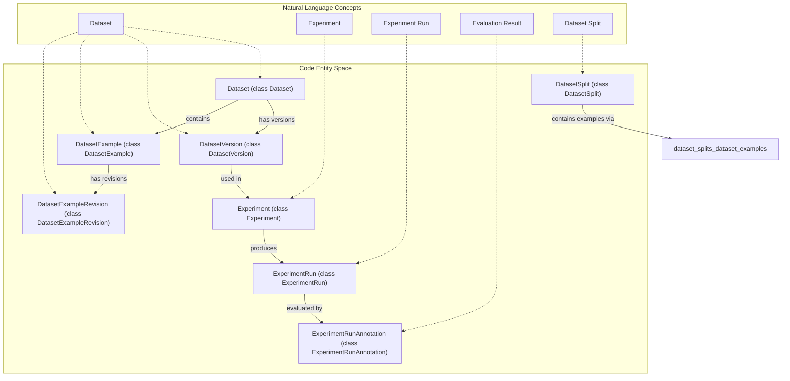
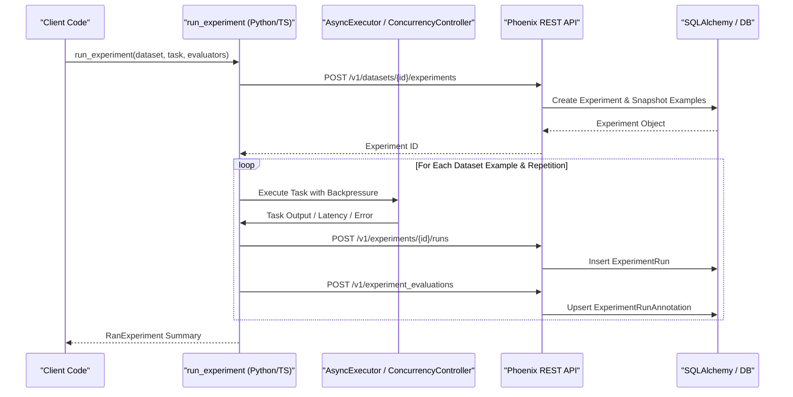

<!-- source: DeepWiki mcp.deepwiki.com · repo Arize-ai/phoenix · page 5.3 Datasets & Experiments · fetched 2026-10-26 -->

# Datasets & Experiments

<details>
<summary>Relevant source files</summary>

The following files were used as context for generating this wiki page:

- [packages/phoenix-client/examples/experiments/experiment_trace_evaluator.py](packages/phoenix-client/examples/experiments/experiment_trace_evaluator.py)
- [packages/phoenix-client/src/phoenix/client/experiments/__init__.py](packages/phoenix-client/src/phoenix/client/experiments/__init__.py)
- [packages/phoenix-client/src/phoenix/client/resources/experiments/__init__.py](packages/phoenix-client/src/phoenix/client/resources/experiments/__init__.py)
- [packages/phoenix-client/src/phoenix/client/resources/experiments/evaluators.py](packages/phoenix-client/src/phoenix/client/resources/experiments/evaluators.py)
- [packages/phoenix-client/src/phoenix/client/resources/experiments/types.py](packages/phoenix-client/src/phoenix/client/resources/experiments/types.py)
- [packages/phoenix-client/src/phoenix/client/utils/executors.py](packages/phoenix-client/src/phoenix/client/utils/executors.py)
- [packages/phoenix-client/src/phoenix/client/utils/rate_limiters.py](packages/phoenix-client/src/phoenix/client/utils/rate_limiters.py)
- [packages/phoenix-client/tests/client/resources/experiments/test_example_proxy.py](packages/phoenix-client/tests/client/resources/experiments/test_example_proxy.py)
- [packages/phoenix-client/tests/client/resources/experiments/test_trace_id_binding.py](packages/phoenix-client/tests/client/resources/experiments/test_trace_id_binding.py)
- [packages/phoenix-client/tests/client/utils/test_executors.py](packages/phoenix-client/tests/client/utils/test_executors.py)
- [packages/phoenix-evals/src/phoenix/evals/executors.py](packages/phoenix-evals/src/phoenix/evals/executors.py)
- [packages/phoenix-evals/tests/phoenix/evals/test_executor.py](packages/phoenix-evals/tests/phoenix/evals/test_executor.py)
- [src/phoenix/db/migrations/versions/01a8342c9cdf_add_user_id_on_datasets.py](src/phoenix/db/migrations/versions/01a8342c9cdf_add_user_id_on_datasets.py)
- [src/phoenix/db/migrations/versions/0df286449799_add_session_annotations_table.py](src/phoenix/db/migrations/versions/0df286449799_add_session_annotations_table.py)
- [src/phoenix/db/migrations/versions/58228d933c91_dataset_labels.py](src/phoenix/db/migrations/versions/58228d933c91_dataset_labels.py)
- [src/phoenix/db/migrations/versions/699f655af132_experiment_tags.py](src/phoenix/db/migrations/versions/699f655af132_experiment_tags.py)
- [src/phoenix/db/migrations/versions/ab513d89518b_add_user_id_on_dataset_versions.py](src/phoenix/db/migrations/versions/ab513d89518b_add_user_id_on_dataset_versions.py)
- [src/phoenix/db/migrations/versions/d0690a79ea51_users_on_experiments.py](src/phoenix/db/migrations/versions/d0690a79ea51_users_on_experiments.py)
- [src/phoenix/db/migrations/versions/deb2c81c0bb2_dataset_splits.py](src/phoenix/db/migrations/versions/deb2c81c0bb2_dataset_splits.py)
- [src/phoenix/server/api/dataloaders/dataset_example_splits.py](src/phoenix/server/api/dataloaders/dataset_example_splits.py)
- [src/phoenix/server/api/helpers/dataset_helpers.py](src/phoenix/server/api/helpers/dataset_helpers.py)
- [src/phoenix/server/api/mutations/dataset_split_mutations.py](src/phoenix/server/api/mutations/dataset_split_mutations.py)
- [src/phoenix/server/api/types/AnnotatorKind.py](src/phoenix/server/api/types/AnnotatorKind.py)
- [src/phoenix/server/api/types/ExperimentRun.py](src/phoenix/server/api/types/ExperimentRun.py)
- [src/phoenix/server/api/types/ExperimentRunAnnotation.py](src/phoenix/server/api/types/ExperimentRunAnnotation.py)
- [src/phoenix/server/daemons/db_disk_usage_monitor.py](src/phoenix/server/daemons/db_disk_usage_monitor.py)
- [tests/integration/_mock_llm_server.py](tests/integration/_mock_llm_server.py)
- [tests/integration/client/test_experiments.py](tests/integration/client/test_experiments.py)
- [tests/integration/experiments/conftest.py](tests/integration/experiments/conftest.py)
- [tests/integration/experiments/test_playground.py](tests/integration/experiments/test_playground.py)
- [tests/unit/db/test_helpers.py](tests/unit/db/test_helpers.py)
- [tests/unit/server/api/helpers/test_dataset_helpers.py](tests/unit/server/api/helpers/test_dataset_helpers.py)

</details>


This page documents Phoenix's dataset and experiment management functionality, which enables users to create test datasets, run experiments against those datasets, and evaluate the results. These capabilities are essential for benchmarking, comparing, and improving LLM application performance through structured testing.

For information about LLM evaluations outside the context of experiments, see [5.2. Evaluation Framework]().

## Overview

Phoenix datasets and experiments provide a structured approach to testing LLM applications:

1.  **Datasets** are collections of examples, each containing input data, reference output, and optional metadata.
2.  **Dataset versions** capture the evolution of datasets over time.
3.  **Dataset splits** allow grouping examples into logical subsets (e.g., train, test) via crosswalk tables (`src/phoenix/db/migrations/versions/deb2c81c0bb2_dataset_splits.py`).
4.  **Experiments** run LLM applications against dataset examples and collect results.
5.  **Experiment runs** are individual executions of an LLM application on a specific dataset example (`src/phoenix/server/api/types/ExperimentRun.py`).
6.  **Experiment evaluations** analyze the quality of experiment run outputs (`src/phoenix/server/api/types/ExperimentRunAnnotation.py`).

### Natural Language to Code Entity Mapping

The following diagram maps high-level concepts central to datasets and experiments to their specific implementations in the Phoenix codebase.



Sources:  
[src/phoenix/db/models.py:804-1017](), [src/phoenix/db/migrations/versions/deb2c81c0bb2_dataset_splits.py:54-135]()

---

## Database Schema

The dataset and experiment system is organized around core database tables, including dataset splits introduced in `deb2c81c0bb2_dataset_splits.py`.

```mermaid
erDiagram
    Dataset ||--o{ DatasetVersion : "has"
    Dataset ||--o{ DatasetExample : "contains"
    DatasetExample ||--o{ DatasetExampleRevision : "has"
    DatasetSplit ||--o{ DatasetSplitExample : "maps"
    DatasetExample ||--o{ DatasetSplitExample : "maps"

    Experiment }o--|| Dataset : "uses"
    Experiment }o--|| DatasetVersion : "uses"
    Experiment ||--o{ ExperimentRun : "has"

    ExperimentRun }o--|| DatasetExample : "uses"
    ExperimentRun ||--o{ ExperimentRunAnnotation : "annotated_by"

    Dataset {
        int id PK
        string name UK
        string description
        json metadata_
        datetime created_at
        datetime updated_at
    }

    DatasetVersion {
        int id PK
        int dataset_id FK
        string description
        json metadata_
        datetime created_at
    }

    DatasetExample {
        int id PK
        int dataset_id FK
        int span_rowid FK (nullable)
        datetime created_at
    }

    DatasetSplit {
        int id PK
        string name UK
        string description
        string color
        json metadata_
        datetime created_at
    }

    Experiment {
        int id PK
        int dataset_id FK
        int dataset_version_id FK
        string name
        string description
        int repetitions
        json metadata_
        string project_name (indexed)
        datetime created_at
        datetime updated_at
    }

    ExperimentRun {
        int id PK
        int experiment_id FK
        int dataset_example_id FK
        int repetition_number
        string trace_id (nullable)
        json output
        datetime start_time
        datetime end_time
        int prompt_token_count (nullable)
        int completion_token_count (nullable)
        string error (nullable)
    }

    ExperimentRunAnnotation {
        int id PK
        int experiment_run_id FK
        string name
        string annotator_kind
        string label (nullable)
        float score (nullable)
        string explanation (nullable)
        string trace_id (nullable)
        string error (nullable)
        json metadata_
        datetime start_time
        datetime end_time
    }
```

Sources:  
[src/phoenix/db/models.py:804-1017](), [src/phoenix/db/migrations/versions/deb2c81c0bb2_dataset_splits.py:54-135]()

---

## Datasets

Datasets are collections of input-output example pairs used to systematically test and evaluate LLM applications over time.

### Dataset Components & Example Extraction

-   **Dataset**: Represents a named collection with metadata, description, creation, and update timestamps.  
-   **DatasetVersion**: Captures a snapshot of the dataset at a specific point.  
-   **DatasetExample**: Abstract entity representing an example with a possible origin span linkage (`span_rowid`).  
-   **DatasetExampleRevision**: Stores the actual example content (`input`, `output`), metadata, and revision kind.  

The server extracts dataset inputs and outputs from spans using dedicated helper functions such as `get_dataset_example_input` and `get_dataset_example_output` [src/phoenix/server/api/helpers/dataset_helpers.py:20-79]().

### Dataset Splits

Dataset splits (e.g., `train`, `validation`) are managed via mutations defined in `src/phoenix/server/api/mutations/dataset_split_mutations.py`. These allow grouping examples using the `dataset_splits_dataset_examples` crosswalk table:
- `create_dataset_split` [src/phoenix/server/api/mutations/dataset_split_mutations.py:106-126]()
- `patch_dataset_split` [src/phoenix/server/api/mutations/dataset_split_mutations.py:129-168]()
- `SetDatasetExampleSplitsInput` [src/phoenix/server/api/mutations/dataset_split_mutations.py:46-49]()

### REST API Endpoints

-   `GET /v1/datasets`: Lists datasets with example counts aggregated by joining `DatasetExample` and `DatasetExampleRevision`.  
    [src/phoenix/server/api/routers/v1/datasets.py:103-173]()
-   `DELETE /v1/datasets/{id}`: Deletes a dataset by ID, cleaning associated projects and trace data.  
    [src/phoenix/server/api/routers/v1/datasets.py:176-202]()

Sources:  
[src/phoenix/server/api/helpers/dataset_helpers.py:20-79](), [src/phoenix/server/api/mutations/dataset_split_mutations.py:23-126](), [src/phoenix/server/api/routers/v1/datasets.py:103-202]()

---

## Experiments

Experiments are structured runs of user-defined tasks on datasets to evaluate model behavior and outputs.

### Experiment Model & Runs

-   An experiment is tied to a specific dataset and dataset version, containing a name, repetitions count, and project name.
-   Individual executions against examples are stored as `ExperimentRun` entities [src/phoenix/server/api/types/ExperimentRun.py:31-49](), capturing output, latency, errors, token counts, and trace IDs.
-   Evaluations are stored as `ExperimentRunAnnotation` entities [src/phoenix/server/api/types/ExperimentRunAnnotation.py:18-31](), which store quality scores, labels, explanations, and annotator kinds (`CODE` or `LLM`).

### Creating Experiments and Recording Runs

-   `POST /v1/datasets/{dataset_id}/experiments` creates an experiment snapshot.
-   `POST /v1/experiments/{experiment_id}/runs` records individual run results, enforcing uniqueness on `(experiment_id, dataset_example_id, repetition_number)`.
-   `POST /v1/experiment_evaluations` upserts experiment run evaluations.

Sources:  
[src/phoenix/server/api/types/ExperimentRun.py:31-183](), [src/phoenix/server/api/types/ExperimentRunAnnotation.py:18-172](), [tests/integration/client/test_experiments.py:74-157]()

---

## Python & TypeScript Experiment Runners

Phoenix provides client experiment runners in both Python (`packages/phoenix-client/src/phoenix/client/experiments/__init__.py`) and TypeScript (`js/packages/phoenix-client/src/experiments/runExperiment.ts`) to execute tasks concurrently using underlying execution utilities (`packages/phoenix-client/src/phoenix/client/utils/executors.py`).

### Key Features of `run_experiment` (Python)

-   Executes synchronous or asynchronous user tasks against dataset examples.
-   Supports automatic binding of arguments like `input`, `expected`, `metadata`, and `example` [packages/phoenix-client/src/phoenix/client/experiments/__init__.py:43-52]().
-   Supports evaluators returning scores, labels, and explanations [packages/phoenix-client/src/phoenix/client/experiments/__init__.py:54-76]().
-   Controls concurrency using AIMD (Additive Increase/Multiplicative Decrease) concurrency controllers (`ConcurrencyController` in `packages/phoenix-client/src/phoenix/client/utils/executors.py`).
-   Handles retries and error tracking via `ExecutionDetails` and `AsyncExecutor` [packages/phoenix-client/src/phoenix/client/utils/executors.py:58-200]().

### Data Flow for Experiment Execution



Sources:  
[packages/phoenix-client/src/phoenix/client/experiments/__init__.py:17-112](), [packages/phoenix-client/src/phoenix/client/utils/executors.py:58-200](), [tests/integration/client/test_experiments.py:74-157]()

---

## Database Migrations & Observability

-   Dataset and split migrations are executed via Alembic scripts such as `deb2c81c0bb2_dataset_splits.py` [src/phoenix/db/migrations/versions/deb2c81c0bb2_dataset_splits.py:54-135]().
-   Traces and spans link directly to experiment runs via `trace_id` on `ExperimentRun`, enabling deep inspection into why an experiment failed or succeeded.

Sources:  
[src/phoenix/db/migrations/versions/deb2c81c0bb2_dataset_splits.py:54-135](), [src/phoenix/server/api/types/ExperimentRun.py:62-69]()

---

# Summary Tables of Key Entities

| Entity                  | Description                                   | Key Attributes                                      |
| :---------------------- | :-------------------------------------------- | :-------------------------------------------------- |
| Dataset                 | Collection of testing examples                | `id`, `name`, `description`, `metadata_`            |
| DatasetVersion          | Snapshot/version of a dataset                 | `id`, `dataset_id`, `description`, `metadata_`      |
| DatasetExample          | Example record associated with a dataset      | `id`, `dataset_id`, `span_rowid`                    |
| DatasetSplit            | Logical subset grouping of dataset examples   | `id`, `name`, `color`, `metadata`                   |
| Experiment              | Execution config on dataset version           | `id`, `dataset_id`, `dataset_version_id`, `name`    |
| ExperimentRun           | A single run output of the experiment task    | `experiment_id`, `dataset_example_id`, `output`     |
| ExperimentRunAnnotation | Evaluation or annotation on an experiment run | `experiment_run_id`, `name`, `label`, `score`       |

---

Sources:  
- [src/phoenix/db/models.py:804-1017]()  
- [src/phoenix/db/migrations/versions/deb2c81c0bb2_dataset_splits.py:54-135]()  
- [src/phoenix/server/api/routers/v1/datasets.py:103-202]()  
- [src/phoenix/server/api/helpers/dataset_helpers.py:20-79]()  
- [src/phoenix/server/api/types/ExperimentRun.py:31-183]()  
- [src/phoenix/server/api/types/ExperimentRunAnnotation.py:18-172]()  
- [packages/phoenix-client/src/phoenix/client/experiments/__init__.py:17-112]()  
- [packages/phoenix-client/src/phoenix/client/utils/executors.py:58-200]()

---

