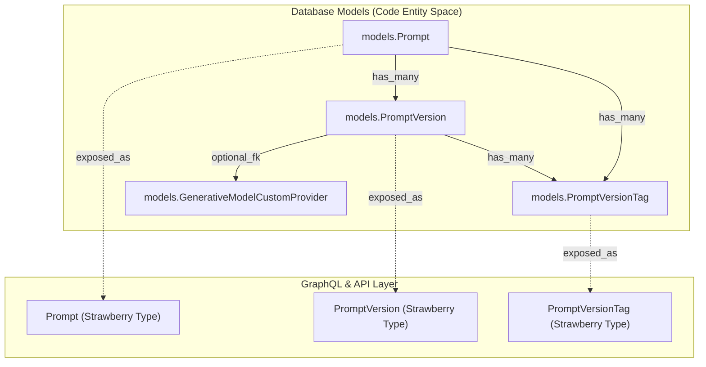
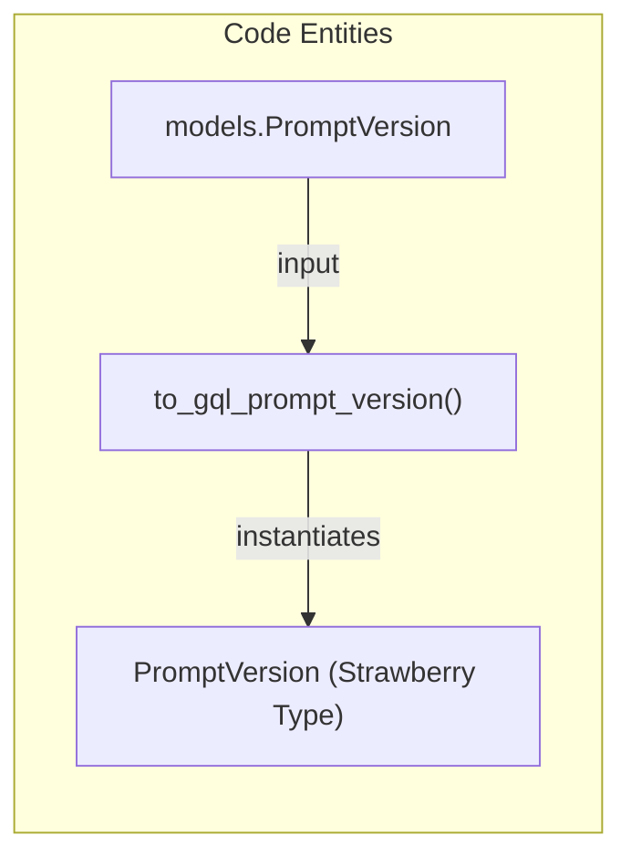
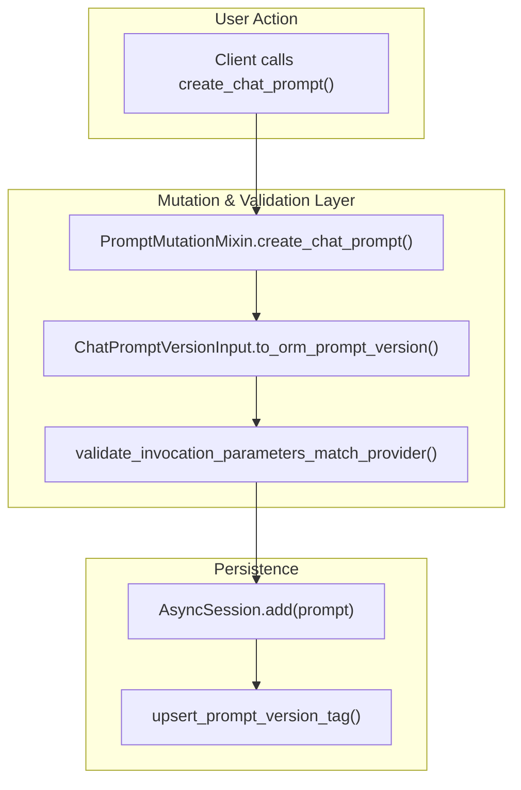
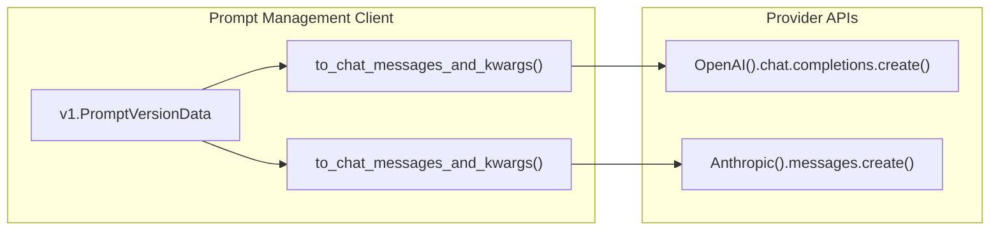

<!-- source: DeepWiki mcp.deepwiki.com · repo Arize-ai/phoenix · page 5.4 Prompt Management · fetched 2026-10-26 -->

# Prompt Management

<details>
<summary>Relevant source files</summary>

The following files were used as context for generating this wiki page:

- [js/packages/phoenix-client/src/prompts/createPrompt.ts](js/packages/phoenix-client/src/prompts/createPrompt.ts)
- [js/packages/phoenix-client/test/prompts/createPrompt.test.ts](js/packages/phoenix-client/test/prompts/createPrompt.test.ts)
- [packages/phoenix-client/src/phoenix/client/helpers/sdk/anthropic/messages.py](packages/phoenix-client/src/phoenix/client/helpers/sdk/anthropic/messages.py)
- [packages/phoenix-client/src/phoenix/client/helpers/sdk/openai/chat.py](packages/phoenix-client/src/phoenix/client/helpers/sdk/openai/chat.py)
- [packages/phoenix-client/src/phoenix/client/types/prompts.py](packages/phoenix-client/src/phoenix/client/types/prompts.py)
- [packages/phoenix-client/tests/canary/sdk/anthropic/test_messages.py](packages/phoenix-client/tests/canary/sdk/anthropic/test_messages.py)
- [packages/phoenix-client/tests/canary/sdk/openai/test_chat.py](packages/phoenix-client/tests/canary/sdk/openai/test_chat.py)
- [src/phoenix/db/types/identifier.py](src/phoenix/db/types/identifier.py)
- [src/phoenix/server/api/input_types/PromptVersionInput.py](src/phoenix/server/api/input_types/PromptVersionInput.py)
- [src/phoenix/server/api/mutations/prompt_label_mutations.py](src/phoenix/server/api/mutations/prompt_label_mutations.py)
- [src/phoenix/server/api/mutations/prompt_mutations.py](src/phoenix/server/api/mutations/prompt_mutations.py)
- [src/phoenix/server/api/mutations/prompt_version_tag_mutations.py](src/phoenix/server/api/mutations/prompt_version_tag_mutations.py)
- [src/phoenix/server/api/routers/v1/prompts.py](src/phoenix/server/api/routers/v1/prompts.py)
- [src/phoenix/server/api/types/DatasetLabel.py](src/phoenix/server/api/types/DatasetLabel.py)
- [src/phoenix/server/api/types/Prompt.py](src/phoenix/server/api/types/Prompt.py)
- [src/phoenix/server/api/types/PromptLabel.py](src/phoenix/server/api/types/PromptLabel.py)
- [src/phoenix/server/api/types/PromptVersion.py](src/phoenix/server/api/types/PromptVersion.py)
- [src/phoenix/server/api/types/PromptVersionTag.py](src/phoenix/server/api/types/PromptVersionTag.py)
- [tests/integration/client/test_prompts.py](tests/integration/client/test_prompts.py)
- [tests/unit/db/types/test_identifier.py](tests/unit/db/types/test_identifier.py)
- [tests/unit/server/api/mutations/test_prompt_mutations.py](tests/unit/server/api/mutations/test_prompt_mutations.py)
- [tests/unit/server/api/routers/v1/test_prompts.py](tests/unit/server/api/routers/v1/test_prompts.py)

</details>


## Purpose and Scope

The Prompt Management subsystem in Phoenix provides comprehensive capabilities for managing the full lifecycle of prompt templates used in large language model (LLM) applications. It handles prompt versioning, templating, tagging, label management, REST/GraphQL APIs, and integration with provider-specific SDK helpers (such as OpenAI and Anthropic formatters). 

This page details the implementation architecture, data flows, database models, GraphQL types, mutations, REST routers, and SDK integration logic.

Sources: [src/phoenix/server/api/routers/v1/prompts.py:1-50](), [src/phoenix/server/api/types/Prompt.py:1-35](), [src/phoenix/server/api/mutations/prompt_mutations.py:1-33]()

---

## Data Model & ORM Architecture

Phoenix stores prompt definitions and versions using SQLAlchemy ORM models. The system separates the logical prompt container (`models.Prompt`) from its immutable content revisions (`models.PromptVersion`) and aliases (`models.PromptVersionTag`).


*Diagram 1: Bridging Database Models to GraphQL Types*

Sources: [src/phoenix/server/api/types/Prompt.py:35-180](), [src/phoenix/server/api/types/PromptVersion.py:38-161](), [src/phoenix/server/api/mutations/prompt_mutations.py:76-156]()

---

## GraphQL API Types & Resolvers

Prompts and prompt versions are exposed through Strawberry GraphQL types. The `Prompt` node handles resolution of metadata, authors, and specific versions [src/phoenix/server/api/types/Prompt.py:35-180]().

```python
@strawberry.type
class Prompt(Node):
    id: NodeID[int]
    db_record: strawberry.Private[Optional[models.Prompt]] = None
    # ...
```

The `PromptVersion` type defines the model provider, model name, template structure, invocation parameters, tools, and response format schemas [src/phoenix/server/api/types/PromptVersion.py:38-55](). Conversion from ORM records is handled via `to_gql_prompt_version` [src/phoenix/server/api/types/PromptVersion.py:129-161]().


*Diagram 2: PromptVersion Conversion Flow*

Sources: [src/phoenix/server/api/types/Prompt.py:35-180](), [src/phoenix/server/api/types/PromptVersion.py:38-161]()

---

## Mutations & Input Validation

Prompt mutations are grouped within `PromptMutationMixin` [src/phoenix/server/api/mutations/prompt_mutations.py:76-171]() and `PromptVersionTagMutationMixin` [src/phoenix/server/api/mutations/prompt_version_tag_mutations.py:49-125](). They enforce permission classes such as `IsNotReadOnly`, `IsNotViewer`, and `IsLocked`.


*Diagram 3: Prompt Creation and Tagging Flow*

Sources: [src/phoenix/server/api/mutations/prompt_mutations.py:76-156](), [src/phoenix/server/api/mutations/prompt_version_tag_mutations.py:49-125](), [src/phoenix/server/api/input_types/PromptVersionInput.py:90-102]()

---

## REST API Endpoints (v1)

Phoenix also exposes a REST API router for prompts under `src/phoenix/server/api/routers/v1/prompts.py` [src/phoenix/server/api/routers/v1/prompts.py:149-200](). 

Key endpoints include:
- `GET /v1/prompts`: Retrieves a paginated list of all prompts [src/phoenix/server/api/routers/v1/prompts.py:152-174]().
- Prompt version resolution supporting IDs, tags, and latest version lookups [tests/unit/server/api/routers/v1/test_prompts.py:108-150]().

Sources: [src/phoenix/server/api/routers/v1/prompts.py:1-200](), [tests/unit/server/api/routers/v1/test_prompts.py:108-150]()

---

## Client SDK Helpers & Provider Converters

Client libraries and SDK helpers bridge Phoenix prompt versions to provider-specific client payloads (e.g., OpenAI chat completions and Anthropic messages).


*Diagram 4: SDK Prompt Conversion and Dispatch*

- OpenAI Chat Helper: Converts Phoenix prompt version definitions into OpenAI chat completion parameters [packages/phoenix-client/src/phoenix/client/helpers/sdk/openai/chat.py:110-164]().
- Anthropic Messages Helper: Converts Phoenix prompt structures into Anthropic message parameters [packages/phoenix-client/src/phoenix/client/helpers/sdk/anthropic/messages.py:120-205]().

Sources: [packages/phoenix-client/src/phoenix/client/helpers/sdk/openai/chat.py:110-192](), [packages/phoenix-client/src/phoenix/client/helpers/sdk/anthropic/messages.py:120-205]()

---

