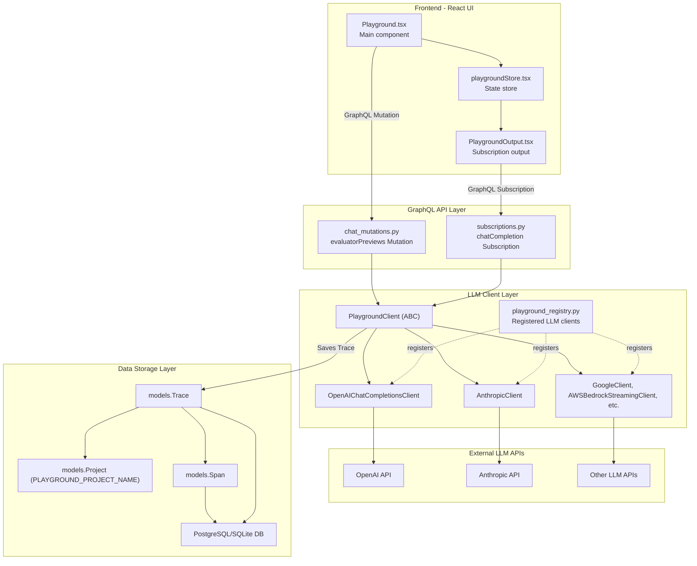
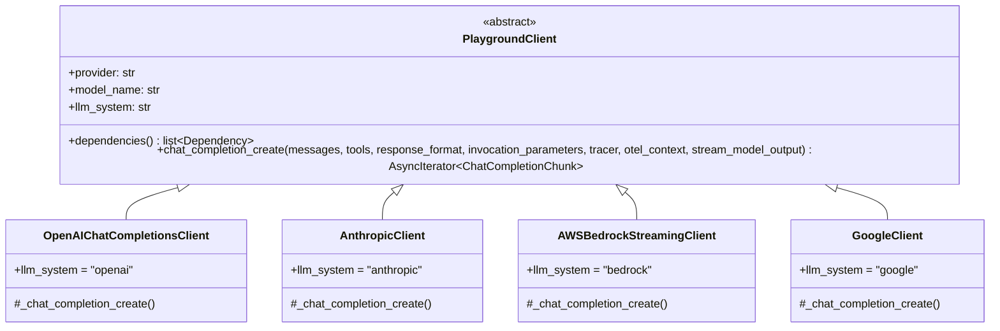
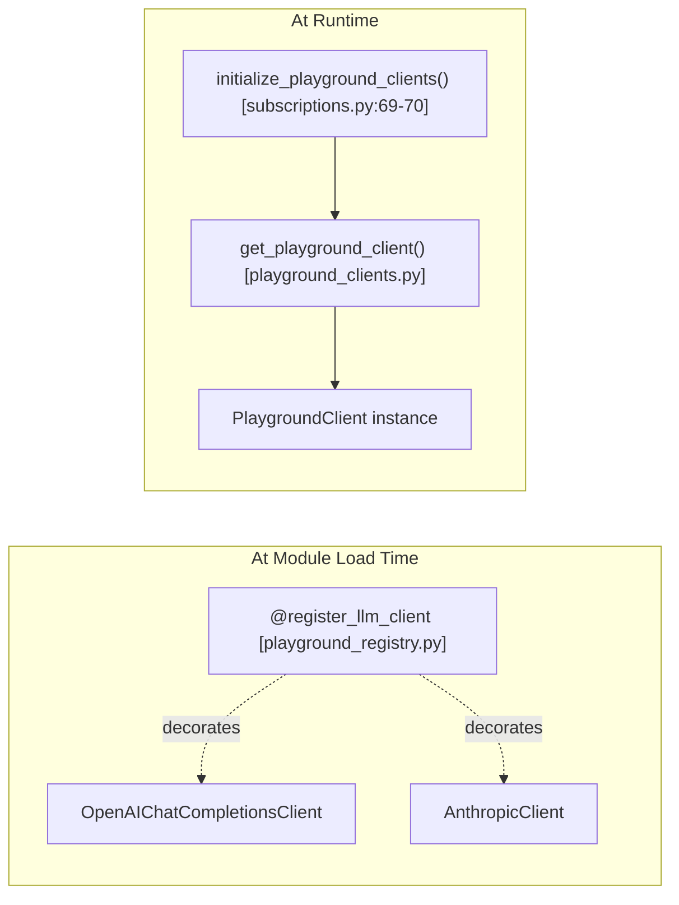
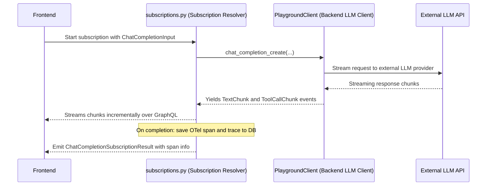
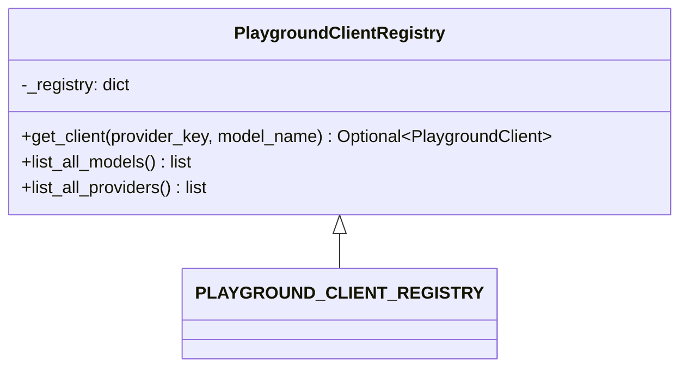
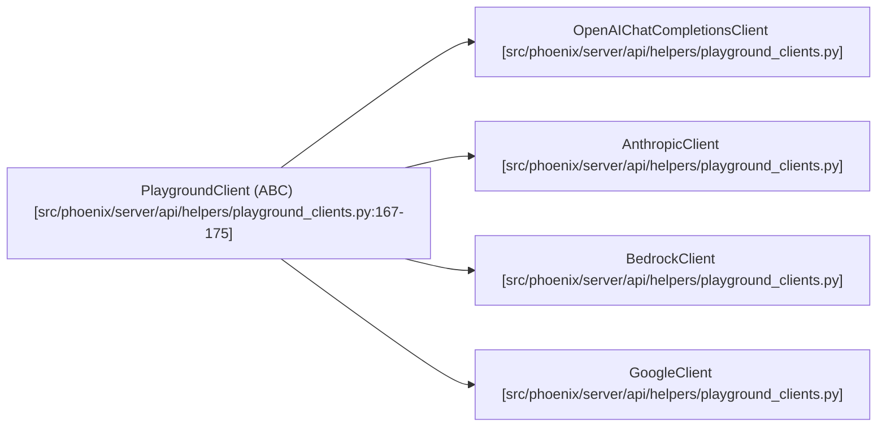
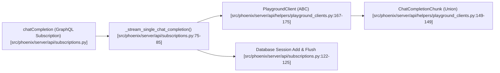

<!-- source: DeepWiki mcp.deepwiki.com · repo Arize-ai/phoenix · page 5.5 Playground System · fetched 2026-10-26 -->

# Playground System

Relevant source files

The following files were used as context for generating this wiki page:

- [.agents/skills/phoenix-rest-api/SKILL.md](.agents/skills/phoenix-rest-api/SKILL.md)
- [.agents/skills/phoenix-rest-api/references/endpoint-patterns.md](.agents/skills/phoenix-rest-api/references/endpoint-patterns.md)
- [.agents/skills/phoenix-rest-api/references/openapi-codegen.md](.agents/skills/phoenix-rest-api/references/openapi-codegen.md)
- [.agents/skills/phoenix-rest-api/references/testing-patterns.md](.agents/skills/phoenix-rest-api/references/testing-patterns.md)
- [scripts/cost_tracking/sync_models.py](scripts/cost_tracking/sync_models.py)
- [scripts/verify_threshold_cost.py](scripts/verify_threshold_cost.py)
- [src/phoenix/server/api/evaluators.py](src/phoenix/server/api/evaluators.py)
- [src/phoenix/server/api/helpers/evaluators.py](src/phoenix/server/api/helpers/evaluators.py)
- [src/phoenix/server/api/helpers/playground_clients.py](src/phoenix/server/api/helpers/playground_clients.py)
- [src/phoenix/server/api/helpers/secrets.py](src/phoenix/server/api/helpers/secrets.py)
- [src/phoenix/server/api/input_types/EvaluatorPreviewInput.py](src/phoenix/server/api/input_types/EvaluatorPreviewInput.py)
- [src/phoenix/server/api/mutations/chat_mutations.py](src/phoenix/server/api/mutations/chat_mutations.py)
- [src/phoenix/server/api/mutations/secret_mutations.py](src/phoenix/server/api/mutations/secret_mutations.py)
- [src/phoenix/server/api/routers/v1/secrets.py](src/phoenix/server/api/routers/v1/secrets.py)
- [src/phoenix/server/api/subscriptions.py](src/phoenix/server/api/subscriptions.py)
- [src/phoenix/server/api/types/GenerativeProvider.py](src/phoenix/server/api/types/GenerativeProvider.py)
- [src/phoenix/server/api/types/Secret.py](src/phoenix/server/api/types/Secret.py)
- [src/phoenix/server/cost_tracking/model_cost_manifest.json](src/phoenix/server/cost_tracking/model_cost_manifest.json)
- [tests/integration/client/test_secrets.py](tests/integration/client/test_secrets.py)
- [tests/unit/server/api/helpers/test_evaluators.py](tests/unit/server/api/helpers/test_evaluators.py)
- [tests/unit/server/api/helpers/test_playground_clients.py](tests/unit/server/api/helpers/test_playground_clients.py)
- [tests/unit/server/api/mutations/test_evaluator_preview_mutation.py](tests/unit/server/api/mutations/test_evaluator_preview_mutation.py)
- [tests/unit/server/api/mutations/test_secret_mutations.py](tests/unit/server/api/mutations/test_secret_mutations.py)
- [tests/unit/server/api/routers/v1/test_secrets.py](tests/unit/server/api/routers/v1/test_secrets.py)
- [tests/unit/server/api/test_create_llm_evaluator_from_inline.py](tests/unit/server/api/test_create_llm_evaluator_from_inline.py)
- [tests/unit/server/api/test_subscriptions.py](tests/unit/server/api/test_subscriptions.py)
- [tests/unit/server/api/types/test_GenerativeProvider.py](tests/unit/server/api/types/test_GenerativeProvider.py)
- [tests/unit/server/cost_tracking/test_model_cost_manifest.py](tests/unit/server/cost_tracking/test_model_cost_manifest.py)

The Playground System provides an interactive interface for developing, experimenting, and evaluating LLM prompts across multiple providers. It enables users to compose multi-turn conversations, configure model parameters, run prompts on isolated inputs or entire datasets, and evaluate the resulting outputs. All prompt executions are captured as OpenTelemetry traces, enabling observability and cost tracking.

This system forms a bridge from the frontend UI components to backend LLM client abstractions via fast streaming GraphQL subscriptions for real-time user feedback.

**Related Systems**:
- Prompt Management: [5.4 Prompt Management]()
- Datasets & Experiments: [5.3 Datasets & Experiments]()
- Evaluation Framework: [5.2 Evaluation Framework]()

---

## System Architecture

The Playground system spans three primary layers:

- **Frontend React Application**: maintains state via Zustand stores, renders UI components for multi-instance experimentation, and manages streaming updates.
- **GraphQL Server API**: supports queries, mutations, and subscriptions to run prompts, manage experiments, and stream outputs.
- **LLM Client Abstractions**: backend plugin architecture that encapsulates provider-specific API details behind a uniform streaming interface.

Sources:
- [src/phoenix/server/api/subscriptions.py:76-135]()
- [src/phoenix/server/api/helpers/playground_clients.py:166-200]()
- [src/phoenix/server/api/mutations/chat_mutations.py:115-150]()

---

## LLM Client Abstraction Layer

The Playground backend implements a polymorphic streaming interface for supported LLM providers. Each provider extends the abstract base class `PlaygroundClient` and implements provider-specific streaming chat completions.

### PlaygroundClient Abstract Base Class Details

- Defined in `src/phoenix/server/api/helpers/playground_clients.py`, the `PlaygroundClient` is a generic abstract base class parametrized by the provider-specific client type (`ClientT`) [src/phoenix/server/api/helpers/playground_clients.py:166-175]().
- It manages common attributes like `provider` (e.g., "openai") and `model_name`.
- The abstract `llm_system` property identifies the provider system string for semantic instrumentation [src/phoenix/server/api/helpers/playground_clients.py:181-183]().
- The primary async method `chat_completion_create` is an async generator streaming `ChatCompletionChunk` types, which includes `TextChunk` and `ToolCallChunk` [src/phoenix/server/api/helpers/playground_clients.py:190-201]().
- It integrates OpenTelemetry tracing spans using semantic attribute conventions from `openinference.instrumentation`.
- Each provider client declares static dependency metadata (Python package requirements, etc.) for runtime validation via the `dependencies` method [src/phoenix/server/api/helpers/playground_clients.py:185-189]().
- The LLM client lifecycle supports both synchronous and streaming outputs, converting raw provider responses into internal chunk models.

### Provider-Specific Implementations

- **OpenAIChatCompletionsClient**: Supports OpenAI chat APIs, integrates error handling, dependency injection, and custom invocation parameters [src/phoenix/server/api/helpers/playground_clients.py:1-201]().
- **AnthropicClient**: Uses Anthropic's streaming chat API with its own invocation parameters and evaluation of reasoning capabilities.
- **GoogleClient**: Connects with Google Gemini's streaming client, handling rate-limit, transient errors, and token usage.
- **AWSBedrockStreamingClient**: Handles AWS Bedrock API streaming response with decorated request parameters and retry logic.

Sources:
- [src/phoenix/server/api/helpers/playground_clients.py:166-201]()

---

### Provider Registration and Discovery

Provider clients register themselves using the decorator `@register_llm_client`. This decorator is defined in `playground_registry.py` and manages a singleton registry mapping providers and model names to client classes.

- The decorator takes a `GenerativeProviderKey` (e.g., `GenerativeProviderKey.OPENAI`) and a sequence of model name strings [src/phoenix/server/api/helpers/playground_clients.py:87-87]().
- It registers the decorated `PlaygroundClient` subclass in the singleton registry.
- At runtime, `initialize_playground_clients()` prepares this registry and is called during server startup [src/phoenix/server/api/subscriptions.py:69-70]().
- To select a client instance for a request, `get_playground_client()` queries the registry based on the generative provider key extracted from the connection configuration [src/phoenix/server/api/helpers/playground_clients.py:38-42]().

Sources:
- [src/phoenix/server/api/subscriptions.py:69-70]()
- [src/phoenix/server/api/helpers/playground_clients.py:38-42]()

---

## Streaming Execution via GraphQL Subscriptions

The Playground backend supports low-latency streaming of LLM outputs via the GraphQL subscription `chatCompletion` defined in `src/phoenix/server/api/subscriptions.py`.

### Subscription Workflow

- Incoming subscription requests provide input parameters wrapped in a `ChatCompletionInput` model [src/phoenix/server/api/subscriptions.py:75-81]().
- The subscription resolver calls `_stream_single_chat_completion()` which:
  - Converts the prompt template into internal `PlaygroundMessage` sequences [src/phoenix/server/api/subscriptions.py:88-96]().
  - Invokes the `chat_completion_create()` async generator on the resolved `PlaygroundClient` [src/phoenix/server/api/subscriptions.py:105-113]().
  - Yields `ChatCompletionChunk` events (text chunks, tool call partials) [src/phoenix/server/api/subscriptions.py:114-115]().
  - On completion, saves the OpenTelemetry trace and span records to the database [src/phoenix/server/api/subscriptions.py:122-125]().
  - Emits a final `ChatCompletionSubscriptionResult` containing the span ID and metadata [src/phoenix/server/api/subscriptions.py:128-131]().
- Errors during streaming are caught and emitted as `ChatCompletionSubscriptionError` [src/phoenix/server/api/subscriptions.py:116-120]().

### Concurrency and Cleanup

The subscription manages multiple concurrent repetitions by:
- Creating tasks for each repetition stream.
- On cancellation or errors, tasks are cancelled, awaited, and async generators are properly closed in sequence:
  1. Cancel all tasks [src/phoenix/server/api/subscriptions.py:163-165]().
  2. Await cancellation propagation [src/phoenix/server/api/subscriptions.py:168-172]().
  3. Close async generator streams with `aclose()` to trigger generator-finalization logic [src/phoenix/server/api/subscriptions.py:175-179]().
- This prevents resource leaks and ensures OpenTelemetry spans and DB writes are finalized.

### Message Chunk Types

| Payload Type | Emitted During | Description |
|---|---|---|
| `TextChunk` | Streaming text output | Incremental output text tokens |
| `ToolCallChunk` | Streaming tool calls | Partial function/tool call argument data |
| `ChatCompletionSubscriptionResult` | Completion | Final metadata with span reference |
| `ChatCompletionSubscriptionError` | On error | Error message payload |

Sources:
- [src/phoenix/server/api/subscriptions.py:75-135]()
- [src/phoenix/server/api/subscriptions.py:144-182]()
- [src/phoenix/server/api/helpers/playground_clients.py:190-201]()

---

## Multi-Provider Support and Rate Limiting

The Playground supports multiple LLM providers:

- **OpenAI**: Standard OpenAI API and Azure OpenAI endpoints.
- **Anthropic**: Claude models with support for Anthropic-specific invocation parameters such as "thinking" configurations.
- **Google**: Google Gemini with token usage tracking and retry policies.
- **AWS Bedrock**: AWS Bedrock Runtime client handling inferencing.
- Additional providers can register new clients and be exposed in the UI.

Rate limiting keys and error detection are implemented per provider in their client classes via helper functions such as `openai_rate_limit_key`, `anthropic_rate_limit_key`, `google_rate_limit_key`, and `bedrock_rate_limit_key` [src/phoenix/server/api/helpers/playground_clients.py:64-70](). Error classification in client code detects transient vs. permanent errors for retry logic.

Sources:
- [src/phoenix/server/api/helpers/playground_clients.py:64-70]()

---

## Playground Registry

The core registration and discovery of LLM clients is done via the registry module [src/phoenix/server/api/helpers/playground_registry.py]().

- Maintains a dictionary mapping providers and models to `PlaygroundClient` subclasses.
- Supports querying registered providers and available models.
- Enables fallback to a provider-level default client if a model-specific client is not found.
- This decouples client selection from API and session layers, enabling modular plug-in extensions.

Sources:
- [src/phoenix/server/api/helpers/playground_registry.py]()

---

## Summary

The Playground System tightly integrates frontend interactive prompt editing with backend LLM provider abstractions and OpenTelemetry observability. Its extensible, plugin-based architecture enables streaming multi-provider support, multi-turn conversations, tool calling, and dataset-backed prompt experiments—all streamed live via GraphQL subscriptions and persisted with trace metadata.

---

# Appendix: Mapping Natural Language to Code Entities

## Natural Language: LLM Client Layer — Code Entities

Sources:
- [src/phoenix/server/api/helpers/playground_clients.py:167-175]()

## Natural Language: GraphQL Subscription Handler — Code Entities

Sources:
- [src/phoenix/server/api/subscriptions.py:75-85]()
- [src/phoenix/server/api/subscriptions.py:122-125]()
- [src/phoenix/server/api/helpers/playground_clients.py:149-175]()

---

