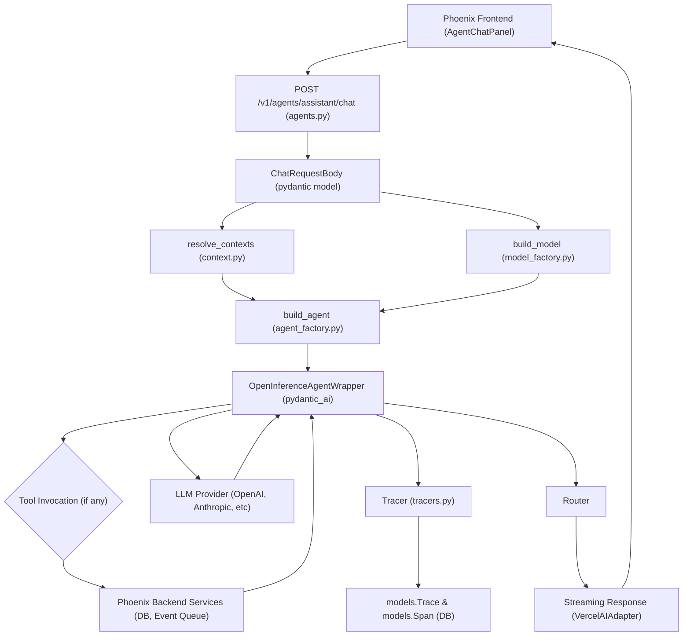
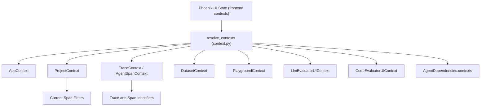
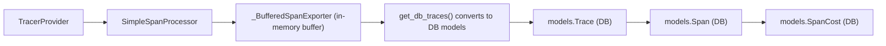

<!-- source: DeepWiki mcp.deepwiki.com · repo Arize-ai/phoenix · page 5.6 AI Agent Backend (PxI) · fetched 2026-10-26 -->

# AI Agent Backend (PxI)

Relevant source files

The following files were used as context for generating this wiki page:

- [.agents/skills/phoenix-harbor/SKILL.md](.agents/skills/phoenix-harbor/SKILL.md)
- [.github/workflows/pxi-evals.yml](.github/workflows/pxi-evals.yml)
- [docs/phoenix/integrations/evaluation-integrations/harbor.mdx](docs/phoenix/integrations/evaluation-integrations/harbor.mdx)
- [docs/phoenix/integrations/evaluation-integrations/images/harbor-phoenix-plugin-dark.svg](docs/phoenix/integrations/evaluation-integrations/images/harbor-phoenix-plugin-dark.svg)
- [docs/phoenix/integrations/evaluation-integrations/images/harbor-phoenix-plugin-light.svg](docs/phoenix/integrations/evaluation-integrations/images/harbor-phoenix-plugin-light.svg)
- [docs/phoenix/integrations/evaluation-integrations/images/harbor-trial-dark.svg](docs/phoenix/integrations/evaluation-integrations/images/harbor-trial-dark.svg)
- [docs/phoenix/integrations/evaluation-integrations/images/harbor-trial-light.svg](docs/phoenix/integrations/evaluation-integrations/images/harbor-trial-light.svg)
- [docs/phoenix/pxi.mdx](docs/phoenix/pxi.mdx)
- [evals/harbor/jobs/trail-benchmark-dev-no-code-mode.yaml](evals/harbor/jobs/trail-benchmark-dev-no-code-mode.yaml)
- [evals/pxi/README.md](evals/pxi/README.md)
- [evals/pxi/datasets/experiment_observations.yaml](evals/pxi/datasets/experiment_observations.yaml)
- [evals/pxi/datasets/experiments_skill_trigger.yaml](evals/pxi/datasets/experiments_skill_trigger.yaml)
- [evals/pxi/datasets/in_app_links.yaml](evals/pxi/datasets/in_app_links.yaml)
- [evals/pxi/datasets/set_spans_filter.yaml](evals/pxi/datasets/set_spans_filter.yaml)
- [evals/pxi/datasets/set_time_range.yaml](evals/pxi/datasets/set_time_range.yaml)
- [evals/pxi/evaluators/filters.py](evals/pxi/evaluators/filters.py)
- [evals/pxi/evaluators/links.py](evals/pxi/evaluators/links.py)
- [evals/pxi/evaluators/tools.py](evals/pxi/evaluators/tools.py)
- [evals/pxi/harness/agent_task.py](evals/pxi/harness/agent_task.py)
- [evals/pxi/harness/backend.py](evals/pxi/harness/backend.py)
- [internal_docs/specs/harbor-phoenix-plugin.md](internal_docs/specs/harbor-phoenix-plugin.md)
- [js/app/src/pages/trace/span/LLMInput.tsx](js/app/src/pages/trace/span/LLMInput.tsx)
- [js/app/src/pages/trace/span/LLMSpanInfo.tsx](js/app/src/pages/trace/span/LLMSpanInfo.tsx)
- [js/app/src/pages/trace/span/LLMToolSchemasList.tsx](js/app/src/pages/trace/span/LLMToolSchemasList.tsx)
- [packages/phoenix-client/src/phoenix/client/harbor/_adapter.py](packages/phoenix-client/src/phoenix/client/harbor/_adapter.py)
- [packages/phoenix-client/src/phoenix/client/harbor/_model.py](packages/phoenix-client/src/phoenix/client/harbor/_model.py)
- [packages/phoenix-client/src/phoenix/client/harbor/_plugin.py](packages/phoenix-client/src/phoenix/client/harbor/_plugin.py)
- [packages/phoenix-client/src/phoenix/client/harbor/_recorder.py](packages/phoenix-client/src/phoenix/client/harbor/_recorder.py)
- [packages/phoenix-client/src/phoenix/client/harbor/_scores.py](packages/phoenix-client/src/phoenix/client/harbor/_scores.py)
- [packages/phoenix-client/src/phoenix/client/harbor/_traces.py](packages/phoenix-client/src/phoenix/client/harbor/_traces.py)
- [packages/phoenix-client/tests/client/harbor/test_adapter.py](packages/phoenix-client/tests/client/harbor/test_adapter.py)
- [packages/phoenix-client/tests/client/harbor/test_harbor_contract.py](packages/phoenix-client/tests/client/harbor/test_harbor_contract.py)
- [packages/phoenix-client/tests/client/harbor/test_plugin.py](packages/phoenix-client/tests/client/harbor/test_plugin.py)
- [packages/phoenix-client/tests/client/harbor/test_recorder.py](packages/phoenix-client/tests/client/harbor/test_recorder.py)
- [packages/phoenix-client/tests/client/harbor/test_scores.py](packages/phoenix-client/tests/client/harbor/test_scores.py)
- [packages/phoenix-client/tests/client/harbor/test_traces.py](packages/phoenix-client/tests/client/harbor/test_traces.py)
- [src/phoenix/server/agents/agent_factory.py](src/phoenix/server/agents/agent_factory.py)
- [src/phoenix/server/agents/capabilities/tools/external/__init__.py](src/phoenix/server/agents/capabilities/tools/external/__init__.py)
- [src/phoenix/server/agents/capabilities/tools/internal/bash.py](src/phoenix/server/agents/capabilities/tools/internal/bash.py)
- [src/phoenix/server/agents/prompts/__init__.py](src/phoenix/server/agents/prompts/__init__.py)
- [src/phoenix/server/agents/prompts/skills/phoenix-graphql/SKILL.md](src/phoenix/server/agents/prompts/skills/phoenix-graphql/SKILL.md)
- [src/phoenix/server/agents/prompts/static/base/BASE_INSTRUCTIONS.xml](src/phoenix/server/agents/prompts/static/base/BASE_INSTRUCTIONS.xml)
- [src/phoenix/server/agents/prompts/tools/PHOENIX_MCP_TOOL_INSTRUCTIONS.xml.j2](src/phoenix/server/agents/prompts/tools/PHOENIX_MCP_TOOL_INSTRUCTIONS.xml.j2)
- [src/phoenix/server/agents/pydantic_ai/openinference_agent_wrapper.py](src/phoenix/server/agents/pydantic_ai/openinference_agent_wrapper.py)
- [src/phoenix/server/agents/pydantic_ai/openinference_capability_wrapper.py](src/phoenix/server/agents/pydantic_ai/openinference_capability_wrapper.py)
- [src/phoenix/server/agents/pydantic_ai/openinference_model_wrapper.py](src/phoenix/server/agents/pydantic_ai/openinference_model_wrapper.py)
- [src/phoenix/server/agents/pydantic_ai/tool_spans/_mixin.py](src/phoenix/server/agents/pydantic_ai/tool_spans/_mixin.py)
- [src/phoenix/server/api/graphql_execute.py](src/phoenix/server/api/graphql_execute.py)
- [src/phoenix/server/api/helpers/agent_sessions.py](src/phoenix/server/api/helpers/agent_sessions.py)
- [src/phoenix/server/api/routers/agents.py](src/phoenix/server/api/routers/agents.py)
- [src/phoenix/server/cost_tracking/token_cost_calculator.py](src/phoenix/server/cost_tracking/token_cost_calculator.py)
- [src/phoenix/server/daemons/experiment_runner.py](src/phoenix/server/daemons/experiment_runner.py)
- [src/phoenix/server/mcp/graphql/__init__.py](src/phoenix/server/mcp/graphql/__init__.py)
- [src/phoenix/server/mcp/graphql/output.py](src/phoenix/server/mcp/graphql/output.py)
- [src/phoenix/server/mcp/graphql/tools.py](src/phoenix/server/mcp/graphql/tools.py)
- [src/phoenix/server/mcp/skills/__init__.py](src/phoenix/server/mcp/skills/__init__.py)
- [src/phoenix/server/mcp_server.py](src/phoenix/server/mcp_server.py)
- [src/phoenix/tracers.py](src/phoenix/tracers.py)
- [tests/integration/harbor/run_plugin_e2e.py](tests/integration/harbor/run_plugin_e2e.py)
- [tests/unit/pxi/evals/test_agent_task_inputs.py](tests/unit/pxi/evals/test_agent_task_inputs.py)
- [tests/unit/pxi/evals/test_datasets.py](tests/unit/pxi/evals/test_datasets.py)
- [tests/unit/server/agents/capabilities/test_external_tools.py](tests/unit/server/agents/capabilities/test_external_tools.py)
- [tests/unit/server/agents/capabilities/test_phoenix_mcp.py](tests/unit/server/agents/capabilities/test_phoenix_mcp.py)
- [tests/unit/server/agents/capabilities/tools/internal/test_bash.py](tests/unit/server/agents/capabilities/tools/internal/test_bash.py)
- [tests/unit/server/agents/prompts/test_static_prompts.py](tests/unit/server/agents/prompts/test_static_prompts.py)
- [tests/unit/server/agents/pydantic_ai/test_openinference_agent_wrapper.py](tests/unit/server/agents/pydantic_ai/test_openinference_agent_wrapper.py)
- [tests/unit/server/agents/pydantic_ai/test_openinference_capability_wrapper.py](tests/unit/server/agents/pydantic_ai/test_openinference_capability_wrapper.py)
- [tests/unit/server/agents/pydantic_ai/test_openinference_model_wrapper.py](tests/unit/server/agents/pydantic_ai/test_openinference_model_wrapper.py)
- [tests/unit/server/agents/test_agent_factory.py](tests/unit/server/agents/test_agent_factory.py)
- [tests/unit/server/agents/test_agents_router.py](tests/unit/server/agents/test_agents_router.py)
- [tests/unit/server/api/cassettes/test_subscriptions/TestChatCompletionOverDatasetSubscription.test_example_dispatched_as_previous_example_finishes_is_not_dropped.yaml](tests/unit/server/api/cassettes/test_subscriptions/TestChatCompletionOverDatasetSubscription.test_example_dispatched_as_previous_example_finishes_is_not_dropped.yaml)
- [tests/unit/server/api/helpers/test_agent_sessions.py](tests/unit/server/api/helpers/test_agent_sessions.py)
- [tests/unit/server/api/mutations/test_agent_session_mutations.py](tests/unit/server/api/mutations/test_agent_session_mutations.py)
- [tests/unit/server/api/routers/test_agents.py](tests/unit/server/api/routers/test_agents.py)
- [tests/unit/server/daemons/test_experiment_runner.py](tests/unit/server/daemons/test_experiment_runner.py)
- [tests/unit/server/mcp/test_skills.py](tests/unit/server/mcp/test_skills.py)
- [tests/unit/server/test_app_mcp_mount.py](tests/unit/server/test_app_mcp_mount.py)
- [tests/unit/test_tracers.py](tests/unit/test_tracers.py)

The AI Agent Backend, known as Phoenix Intelligence (PxI), is the server-side system powering Phoenix's AI assistant capabilities. It enables the Phoenix frontend to interact seamlessly with diverse Large Language Models (LLMs) through a unified interface, facilitating agent orchestration, tool execution, and context enrichment based on the application's state. The backend also manages ingestion and export of OpenTelemetry traces from agent conversations, supporting observability and cost accounting.

---

## Purpose and Scope

PxI serves as the foundational system for:

- **AI Agent Orchestration**: Managing agent message flows, tool invocation, and response generation.
- **Model Selection**: Providing a flexible and extensible mechanism to select LLM providers or custom-defined models.
- **Tool Capabilities**: Offering Phoenix-specific tools (e.g., querying traces, annotations) and external tools to agents as first-class capabilities.
- **Context Resolution**: Incorporating rich contextual information derived from Phoenix’s data layer and UI state into agent interactions.
- **REST API Interface**: Exposing a `/agents` endpoint compatible with Vercel AI SDK enabling streaming chat responses.
- **Tracing and Telemetry**: Recording detailed OpenTelemetry traces from agent interactions for observability and cost tracking.
- **Evaluation Harness**: Running experiments to validate and benchmark agent behavior using live Phoenix datasets.

---

## Architecture Overview

The PxI backend is implemented primarily around a FastAPI router exposing the `/v1/agents/assistant/chat` REST API [src/phoenix/server/api/routers/agents.py:1-315](), which is the communication gateway for frontend AI agent requests. This router uses the `pydantic-ai` library to manage agent construction, message processing, and tool integration.

### Key Components and Relationships

- **Pydantic-AI Agent Factory (`build_agent`)**: Builds the main AI agent instance by assembling a model, prompts, capabilities, and tooling according to the request and server configuration [src/phoenix/server/agents/agent_factory.py:69-94]().
- **Model Factory (`build_model`)**: Resolves and constructs LLM clients from built-in providers or user-defined custom providers, fetching credentials securely from DB or environment [src/phoenix/server/agents/model_factory.py:102-185]().
- **Context Resolution (`resolve_contexts`)**: Parses frontend UI state and data selection into structured contexts that agents consume for prompts and tool execution [src/phoenix/server/agents/context.py:1-136]().
- **Tool Capabilities & Skills**: Implements a variety of tools dynamically registered, including Phoenix domain-specific tooling, external web access tools, internal Bash execution, and experiment skill sets [src/phoenix/server/agents/capabilities/__init__.py](), [src/phoenix/server/agents/capabilities/tools/internal/bash.py:34-95]().
- **OpenTelemetry Tracing (`Tracer`)**: Wraps each agent interaction in detailed trace spans persisted as Phoenix database models for analysis and cost computation [src/phoenix/tracers.py:116-183]().

---

### AI Agent Backend Data Flow

Sources:
- [src/phoenix/server/api/routers/agents.py:1-315]()
- [src/phoenix/server/agents/agent_factory.py:69-94]()
- [src/phoenix/server/agents/model_factory.py:102-185]()
- [src/phoenix/server/agents/context.py:1-136]()
- [src/phoenix/server/agents/capabilities/__init__.py]()
- [src/phoenix/server/agents/capabilities/tools/internal/bash.py:34-95]()
- [src/phoenix/tracers.py:116-183]()

---

## `/agents` REST Endpoint

The principal endpoint for AI agent communication is:

`POST /v1/agents/assistant/chat`

This endpoint manages chat-based AI agent message exchanges with support for streaming responses compatible with the Vercel AI SDK UI [src/phoenix/server/api/routers/agents.py:1-202]().

### Request Message Model

- **`contexts`**: An array of discriminated union types representing UI or domain contexts such as Project, Trace, Playground, Dataset, and Agent spans. These contexts provide rich information about the environment, filters, selected objects, and other state the agent needs [src/phoenix/server/agents/context.py:1-136]().

- **`messages`**: Array of chat messages preserving context, user metadata, role, and Phoenix UI attribution layers.

- **`model`**: An `AgentModelSelection` object specifying the requested model provider and model name. Used to invoke the LLM correctly and map to the registered backend models [src/phoenix/server/api/routers/agents.py:140-145]().

- **`ingest_traces`**: Boolean flag signaling if the entire agent interaction should be traced and persisted in Phoenix's trace storage.

### Response Model

- Streaming JSON chunks, chunked by the Vercel AI SDK-compatible `VercelAIAdapter` layer allow UX components to display tokens incrementally and handle tool invocation metadata [src/phoenix/server/api/routers/agents.py:41-70]().

Sources:
- [src/phoenix/server/api/routers/agents.py:41-70]()
- [src/phoenix/server/api/routers/agents.py:140-145]()
- [src/phoenix/server/api/routers/agents.py:1-202]()
- [src/phoenix/server/agents/context.py:1-136]()

---

## Agent Factory (`build_agent`)

The agent factory is the core function that assembles a pydantic-ai `Agent` instance with configured tools and model [src/phoenix/server/agents/agent_factory.py:69-94]().

### Inputs

- `model`: The resolved `pydantic_ai.Model` object for conversation completion.
- `prompts`: Optional prompt templates that provide instructions to tools and skills [src/phoenix/server/agents/agent_factory.py:95-95]().
- `docs_mcp_server`: Optional MCP (Model Context Protocol) toolset for Phoenix docs capabilities [src/phoenix/server/agents/agent_factory.py:76-76]().
- `enable_web_access`: Flag to enable internet-based web search and fetch capabilities [src/phoenix/server/agents/agent_factory.py:80-80]().
- `tracer_provider`: OpenTelemetry tracer provider for instrumentation [src/phoenix/server/agents/agent_factory.py:81-81]().
- Authentication flags and user id for permission enforcement.
- Optional support for subagents (nested agents or scripting via Bash) [src/phoenix/server/agents/agent_factory.py:82-93]().

### Capabilities Composed

- **GetCurrentDatetimeCapability**: Provides current date-time tooling [src/phoenix/server/agents/agent_factory.py:104-106]().
- **External Tool Capability**: Dynamically includes external tools (e.g., search, snippet tools) [src/phoenix/server/agents/agent_factory.py:107-115]().
- **UIContextsCapability**: Provides access to the resolved Phoenix UI/application context [src/phoenix/server/agents/agent_factory.py:113-113]().
- **BashCapability** (optional): Enables execution of shell commands in a sandboxed environment [src/phoenix/server/agents/agent_factory.py:116-126]().
- **MintlifyDocsMCPCapability** (optional): Integrates the MCP server for documentation tooling [src/phoenix/server/agents/agent_factory.py:129-135]().
- **PhoenixMCPCapability** (optional): Integrates the Phoenix MCP server for GraphQL API access [src/phoenix/server/agents/agent_factory.py:136-151]().
- **GitHubMCPCapability** (optional): GitHub interaction tools with configured access [src/phoenix/server/agents/agent_factory.py:152-166]().

All capabilities are combined and wrapped by an `OpenInferenceCapabilityWrapper` for tracing and to unify event instrumentation.

### Output

Returns a configured `AbstractAgent` ready to run with proper tooling and model backing [src/phoenix/server/agents/agent_factory.py:69-94]().

Sources:
- [src/phoenix/server/agents/agent_factory.py:69-94]()
- [src/phoenix/server/agents/agent_factory.py:95-166]()
- [src/phoenix/server/agents/capabilities/__init__.py]()
- [src/phoenix/server/agents/capabilities/tools/external/__init__.py]()
- [src/phoenix/server/agents/capabilities/tools/internal/bash.py:34-95]()
- [src/phoenix/server/agents/web_access.py]()

---

## Model Selection (`build_model`)

The model factory resolves an `AgentModelSelection` into a concrete LLM client for use by the AI agent.

### Model Provider Types

| Provider Type | Description | Credential Source | Supported Providers |
|---------------|-------------|-------------------|----------------------------------------|
| Built-in      | Common pre-integrated LLM providers with managed secrets | DB secrets, environment variables | OpenAI, Anthropic, Azure OpenAI, Google, Bedrock, Local, Dummy |
| Custom        | User-defined providers configured via a generative model and custom SDK configs | Database with GlobalID lookup | OpenAI-compatible, Anthropic-compatible |

### Credential Resolution Logic

- Attempts to load secrets for built-in providers from Phoenix credential storage.
- If secrets are missing, falls back to environment variables.
- Custom providers are resolved by `GlobalID` referencing `GenerativeModelCustomProvider` DB entries and using SDK config parameters.
- Raises runtime errors if required secrets or configurations are absent, ensuring secure setup.

### Wrapping and Instrumentation

All created model clients are wrapped for trace instrumentation and prompt-caching when applicable, supporting advanced internal optimizations and telemetry.

See [src/phoenix/server/agents/model_factory.py:102-185]() for detailed selection flow and provider-specific handling.

Sources:
- [src/phoenix/server/agents/model_factory.py:102-185]()

---

## Tool Capabilities

PxI enables AI agents to interact with various powerful tools encapsulated as capabilities:

- **External Tools**: Dynamically defined tools registered by frontend configuration and integrated by backend capability functions for extensibility [src/phoenix/server/agents/capabilities/tools/external/__init__.py]().
- **Phoenix Internal Tools**: Native tooling such as bash execution, current datetime, listing playground models, running experiments, and manipulating prompts [src/phoenix/server/agents/capabilities/tools/internal/bash.py:34-95]().
- **Skills Capability**: Domain-specific skill bundles that encapsulate complex operations across Phoenix datasets, experiments, and playgrounds [src/phoenix/server/mcp/skills/__init__.py]().
- **MCP Server Tool**: An optional tool integration that connects to an MCP protocol server (e.g., Mintlify Docs) to augment documentation queries inside agents [src/phoenix/server/mcp_server.py:1-73]().
- **Phoenix MCP Tool**: Integrates the Phoenix MCP server, allowing agents to interact with the Phoenix GraphQL API [src/phoenix/server/mcp_server.py:1-73]().
- **Web Access**: Optional internet search and fetch capabilities allow grounding responses with up-to-date information [src/phoenix/server/agents/web_access.py]().

Tools may emit special Vercel AI SDK streaming chunks for UI updates, approvals, or incremental outputs. The server enforces permissions and sandboxing especially for destructive or high-risk operations.

Sources:
- [src/phoenix/server/agents/capabilities/tools/external/__init__.py]()
- [src/phoenix/server/agents/capabilities/tools/internal/bash.py:34-95]()
- [src/phoenix/server/mcp/skills/__init__.py]()
- [src/phoenix/server/mcp_server.py:1-73]()
- [src/phoenix/server/agents/web_access.py]()

---

## Context Resolution

PxI includes a comprehensive context resolution system that converts frontend shapes into typed, unioned context classes that inform prompt generation and tool strategy.

### Context Types

- **AppContext**: Captures environment details like timezone offset, browser clock, and config flags [src/phoenix/server/agents/context.py:130-136]().
- **ProjectContext**: Includes project metadata, active span filters, and selected experiments [src/phoenix/server/agents/context.py:130-136]().
- **Trace and AgentSpanContext**: Details about the currently viewed trace, spans, and turn structures [src/phoenix/server/agents/context.py:130-136]().
- **DatasetContext**: Information about loaded datasets useful for prompt or evaluation tooling [src/phoenix/server/agents/context.py:130-136]().
- **PlaygroundContext**: Details from playground UI, prompt instances, and running experiments [src/phoenix/server/agents/context.py:130-136]().
- **LlmEvaluatorUIContext**: Context for LLM evaluators [src/phoenix/server/agents/context.py:130-136]().
- **CodeEvaluatorUIContext**: Context for code evaluators [src/phoenix/server/agents/context.py:130-136]().

This detailed context provides the agent with state mirroring the user's current focus inside Phoenix, thus enabling precise, relevant AI interaction [src/phoenix/server/agents/context.py:1-136]().

---

### Context Resolution Flow

Sources:
- [src/phoenix/server/agents/context.py:1-136]()
- [tests/unit/server/agents/test_agent_factory.py:81-94]()

---

## OpenTelemetry Tracing (PxI)

### Tracer Design

The `Tracer` class instrumenting the PxI backend is a wrapper around an OpenTelemetry `TracerProvider`. It buffers spans in-memory, builds Phoenix DB models (`Trace`, `Span`, `SpanCost`), and supports exporting spans to a remote collector if configured [src/phoenix/tracers.py:116-183]().

Key features include:

- Raising span attribute limits to allow large chat and context metadata [src/phoenix/tracers.py:159-162]().
- Synthetic span recording including agent message initiations, tool invocations, and sub-agent flows.
- Detached context propagation allowing agent spans to appear independent from HTTP server spans [src/phoenix/tracers.py:60-70]().
- Integration with Phoenix cost tracking via `SpanCostCalculator` [src/phoenix/tracers.py:148-154]().

### PxI Tracer Data Flow

Sources:
- [src/phoenix/tracers.py:60-183]()
- [tests/unit/test_tracers.py:105-107]()

---

## PXI Evaluation Harness

PxI maintains an evaluation suite to test and validate AI agent capabilities using live Phoenix data.

### Structure

- `evals/pxi/harness/agent_task.py`: Defines async harness infrastructure to construct and run agents with minimal Phoenix dependencies [evals/pxi/harness/agent_task.py]().
- `evals/pxi/gate.py`: Contains the `PxiGate` class, which defines the evaluation logic and assertions for PXI agents.
- `evals/pxi/tests/test_pxi_evals.py`: Contains unit tests for the PXI evaluation harness.
- Additional directories support datasets, evaluators, online trace evaluations, and trace ingest tooling [evals/pxi/README.md]().

### Capabilities

- Evaluators check correctness and quality of agent tool calls and control flows.
- The harness can run live against Phoenix datasets to verify system integration.
- Supports local and CI execution for regression and performance measurement. The `.github/workflows/pxi-evals.yml` workflow automates PXI evaluations in CI [.github/workflows/pxi-evals.yml:1-166]().
- Online evaluators consume PXI trace data stored in Phoenix and annotate spans with evaluation outcomes.

This evaluation layer ensures PxI's continuous monitoring and improvement in real-world use cases.

Sources:
- [evals/pxi/harness/agent_task.py]()
- [evals/pxi/README.md]()
- [.github/workflows/pxi-evals.yml:1-166]()

---

## Harbor Server-Agent Evaluation Framework

The Phoenix client library includes a plugin for the Harbor evaluation framework, enabling comprehensive testing of server-side agents.

### Integration

The `arize-phoenix-client` package includes an optional `harbor` extra dependency. When installed, it provides the `PhoenixJobPlugin` entry point for Harbor.

### Plugin Design

The `PhoenixJobPlugin` records Harbor evaluation jobs in Phoenix, allowing teams to compare results across agents, models, attempts, and time. Harbor remains responsible for running agents and verifiers.

Key aspects of the plugin:
- **Dataset Inference**: Infers a Phoenix dataset from the Harbor dataset.
- **Experiment Creation**: Creates one Phoenix experiment for each agent and model in a job.
- **Experiment Runs**: Records each Harbor trial as an experiment run.
- **Evaluation Scores**: Stores Harbor's aggregate reward and infrastructure status as dense evaluation scores, and step-level rewards as sparse diagnostic scores.
- **Trace Linkage**: Links each run to an ATIF (Agent Trace Import Format) or live OTLP trace when supported. ATIF is the default, not requiring agent instrumentation.

### Data Model Mapping

| Harbor Concept                | Phoenix Concept             | Mapping                                                           |
| ----------------------------- | --------------------------- | ----------------------------------------------------------------- |
| Dataset                       | Dataset                     | Name inferred from Harbor; optional override                      |
| Task                          | Dataset example             | Task ID, name, and instruction in input; other fields in metadata  |
| Task digest                   | Dataset example metadata    | Full Harbor task digest                                           |
| Resolved task snapshot        | Dataset version             | Complete synchronized task set                                    |
| Job × agent × model           | Experiment                  | One experiment for each agent and model                           |
| Logical trial                 | Experiment run              | One run for each planned task attempt                             |
| Planned attempt               | Repetition                  | Deterministic repetition number                                   |
| Trial exception               | Run error                   | Kept separate from behavioral failure                             |
| Trial `reward`                | Dense evaluation            | Stored on behaviorally completed runs                             |
| Infrastructure status         | Dense `infra_ok` evaluation | Stored on every attempted run                                     |
| Step reward                   | Sparse evaluation           | Named `<step_name>.<reward_key>`                                  |
| ATIF trajectory or OTLP spans | Trace                       | Linked to the experiment run when available                       |

### Usage

The Harbor plugin can be run using `harbor run --plugin arize-phoenix`. Specific targets in the `Makefile` facilitate Harbor evaluations, such as `harbor-stage-environments`, `harbor-publish-fixtures`, `harbor-plugin-e2e`, `harbor-oracle`, `harbor-run`, and `harbor-view`.

Sources:
- [internal_docs/specs/harbor-phoenix-plugin.md]()

---

## Summary

The AI Agent Backend (PxI) in Phoenix provides a comprehensive, extensible server-side AI agent framework. It manages:

- Model selection and invocation with built-in and custom LLMs.
- Rich tool integrations within the Phoenix domain and external resources.
- Context resolution translating frontend state into actionable agent input.
- Detailed OpenTelemetry tracing for visibility and cost management.
- A well-specified REST endpoint exposing streaming chat interfaces.
- An integrated evaluation harness to maintain agent quality over time.
- Integration with the Harbor framework for robust server-agent evaluation.

This design enables Phoenix to offer a potent AI assistant experience tightly coupled with domain data and observability workflows.

---

## References and Sources

- [`src/phoenix/server/api/routers/agents.py:1-202`]()
- [`src/phoenix/server/agents/agent_factory.py:69-166`]()
- [`src/phoenix/server/agents/model_factory.py:102-185`]()
- [`src/phoenix/server/agents/context.py:1-136`]()
- [`src/phoenix/tracers.py:60-183`]()
- [`evals/pxi/harness/agent_task.py`]()
- [`evals/pxi/README.md`]()
- [`internal_docs/specs/harbor-phoenix-plugin.md`]()
- [`tests/unit/server/agents/test_agent_factory.py:81-94`]()
- [`src/phoenix/server/cost_tracking/span_cost_calculator.py`]()
- [`tests/unit/test_tracers.py:105-107`]()
- [`src/phoenix/server/agents/capabilities/__init__.py`]()
- [`src/phoenix/server/agents/capabilities/tools/external/__init__.py`]()
- [`src/phoenix/server/agents/capabilities/tools/internal/bash.py:34-95`]()
- [`src/phoenix/server/agents/web_access.py`]()
- [`.github/workflows/pxi-evals.yml:1-166`]()
- [`src/phoenix/server/mcp_server.py:1-73`]()
- [`src/phoenix/server/mcp/skills/__init__.py`]()

---

