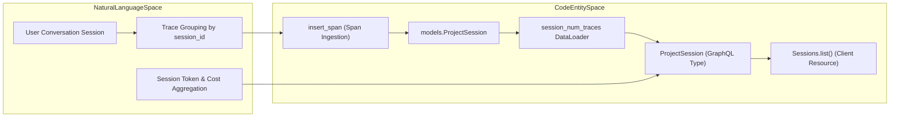
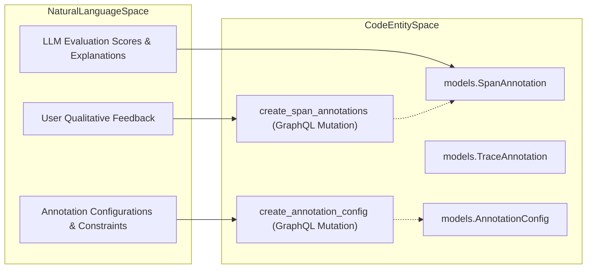

<!-- source: DeepWiki mcp.deepwiki.com · repo Arize-ai/phoenix · page 5.7 Sessions & Annotations · fetched 2026-10-26 -->

# Sessions & Annotations

Relevant source files

The following files were used as context for generating this wiki page:

- [js/packages/phoenix-client/examples/get_session_turns.ts](js/packages/phoenix-client/examples/get_session_turns.ts)
- [js/packages/phoenix-client/src/sessions/getSessionTurns.ts](js/packages/phoenix-client/src/sessions/getSessionTurns.ts)
- [js/packages/phoenix-client/src/sessions/index.ts](js/packages/phoenix-client/src/sessions/index.ts)
- [js/packages/phoenix-client/test/sessions/getSessionTurns.test.ts](js/packages/phoenix-client/test/sessions/getSessionTurns.test.ts)
- [packages/phoenix-client/examples/sessions/get_session_turns_example.py](packages/phoenix-client/examples/sessions/get_session_turns_example.py)
- [packages/phoenix-client/src/phoenix/client/resources/sessions/__init__.py](packages/phoenix-client/src/phoenix/client/resources/sessions/__init__.py)
- [packages/phoenix-client/tests/client/resources/sessions/__init__.py](packages/phoenix-client/tests/client/resources/sessions/__init__.py)
- [packages/phoenix-client/tests/client/resources/sessions/test_sessions.py](packages/phoenix-client/tests/client/resources/sessions/test_sessions.py)
- [src/phoenix/db/insertion/document_annotation.py](src/phoenix/db/insertion/document_annotation.py)
- [src/phoenix/db/insertion/span_annotation.py](src/phoenix/db/insertion/span_annotation.py)
- [src/phoenix/db/insertion/trace_annotation.py](src/phoenix/db/insertion/trace_annotation.py)
- [src/phoenix/db/insertion/types.py](src/phoenix/db/insertion/types.py)
- [src/phoenix/db/types/annotation_configs.py](src/phoenix/db/types/annotation_configs.py)
- [src/phoenix/server/api/auth.py](src/phoenix/server/api/auth.py)
- [src/phoenix/server/api/dataloaders/span_annotations.py](src/phoenix/server/api/dataloaders/span_annotations.py)
- [src/phoenix/server/api/input_types/CreateSpanAnnotationInput.py](src/phoenix/server/api/input_types/CreateSpanAnnotationInput.py)
- [src/phoenix/server/api/input_types/CreateTraceAnnotationInput.py](src/phoenix/server/api/input_types/CreateTraceAnnotationInput.py)
- [src/phoenix/server/api/input_types/PatchAnnotationInput.py](src/phoenix/server/api/input_types/PatchAnnotationInput.py)
- [src/phoenix/server/api/mutations/annotation_config_mutations.py](src/phoenix/server/api/mutations/annotation_config_mutations.py)
- [src/phoenix/server/api/mutations/api_key_mutations.py](src/phoenix/server/api/mutations/api_key_mutations.py)
- [src/phoenix/server/api/mutations/span_annotations_mutations.py](src/phoenix/server/api/mutations/span_annotations_mutations.py)
- [src/phoenix/server/api/mutations/trace_annotations_mutations.py](src/phoenix/server/api/mutations/trace_annotations_mutations.py)
- [src/phoenix/server/api/routers/v1/annotation_configs.py](src/phoenix/server/api/routers/v1/annotation_configs.py)
- [src/phoenix/server/api/types/Annotation.py](src/phoenix/server/api/types/Annotation.py)
- [src/phoenix/server/api/types/AnnotationConfig.py](src/phoenix/server/api/types/AnnotationConfig.py)
- [src/phoenix/server/api/types/SpanAnnotation.py](src/phoenix/server/api/types/SpanAnnotation.py)
- [src/phoenix/server/api/types/TraceAnnotation.py](src/phoenix/server/api/types/TraceAnnotation.py)
- [tests/integration/client/test_annotations.py](tests/integration/client/test_annotations.py)
- [tests/unit/db/types/test_annotation_configs.py](tests/unit/db/types/test_annotation_configs.py)
- [tests/unit/server/api/mutations/test_annotation_config_mutations.py](tests/unit/server/api/mutations/test_annotation_config_mutations.py)
- [tests/unit/server/api/mutations/test_span_annotation_mutations.py](tests/unit/server/api/mutations/test_span_annotation_mutations.py)
- [tests/unit/server/api/mutations/test_trace_annotation_mutations.py](tests/unit/server/api/mutations/test_trace_annotation_mutations.py)
- [tests/unit/server/api/routers/v1/test_annotation_configs.py](tests/unit/server/api/routers/v1/test_annotation_configs.py)
- [tests/unit/server/api/types/test_SpanAnnotation.py](tests/unit/server/api/types/test_SpanAnnotation.py)
- [tests/unit/server/api/types/test_TraceAnnotation.py](tests/unit/server/api/types/test_TraceAnnotation.py)

This page details Phoenix's implementation of project sessions (multi-turn conversation grouping), session annotations, and the comprehensive annotation system for spans and traces. Project sessions group related traces into logical units of conversation, while annotations enrich spans, traces, and sessions with qualitative and quantitative feedback crucial for LLM evaluation, debugging, and analytics.

---

## Project Sessions

Project sessions provide dynamic, time-bounded groupings of related traces, typically representing multi-turn conversations or execution sequences within a defined user context.

### Data Model and Lifecycle

The foundational data model for sessions is the SQLAlchemy model `models.ProjectSession` [src/phoenix/db/models.py:537-553](). This model stores key metadata:

- `id`: Internal primary key
- `session_id`: User-supplied string identifying the session
- `project_id`: Foreign key linking to the parent project
- `start_time` and `end_time`: Timestamps establishing the temporal boundaries of the session

Sessions are managed dynamically during span ingestion. The span insertion pipeline (`src/phoenix/db/insertion/span.py`) evaluates session associations:
- If a trace already belongs to a session (`project_session_rowid`), that relationship is retained to preserve session integrity [src/phoenix/db/insertion/span.py:67-75]().
- If a trace lacks a session but the incoming span specifies a `session_id`, Phoenix attempts to locate an existing `ProjectSession` matching that `session_id` and project [src/phoenix/db/insertion/span.py:82-98]().
  - If found, the session's time bounds (`start_time`, `end_time`) are expanded if the span extends them [src/phoenix/db/insertion/span.py:94-98]().
  - If not found, a new `ProjectSession` record is instantiated [src/phoenix/db/insertion/span.py:82-87]().

Sources: [src/phoenix/db/models.py:537-553](), [src/phoenix/db/insertion/span.py:25-110]()

### Session API and Client Resources

Sessions are exposed via GraphQL (`src/phoenix/server/api/types/ProjectSession.py`) and REST endpoints (`packages/phoenix-client/src/phoenix/client/resources/sessions/__init__.py`). Clients can programmatically list, retrieve, and inspect session records and their associated conversational turns using helper methods like `Sessions.get()` and `Sessions.list()` [packages/phoenix-client/src/phoenix/client/resources/sessions/__init__.py:114-193]().

Key GraphQL fields on `ProjectSession` include:
- `id`: Relay GlobalID
- `sessionId`: User-provided session identifier string
- `startTime` and `endTime`: Temporal range
- `numTraces` and `numTracesWithError`: Trace statistics resolved via DataLoaders
- `tracesConnection`: Paginated connection for child traces

Sources: [packages/phoenix-client/src/phoenix/client/resources/sessions/__init__.py:114-193](), [src/phoenix/server/api/types/ProjectSession.py:42-203]()

### Diagram: Natural Language to Code — Sessions

*Figure 1: Bridging conversational sessions to Phoenix server models and client SDKs.*

Sources: [src/phoenix/db/models.py:537-553](), [src/phoenix/db/insertion/span.py:25-110](), [packages/phoenix-client/src/phoenix/client/resources/sessions/__init__.py:114-193]()

---

## Annotation System

The annotation system allows attaching structured scores, categorical labels, explanations, and metadata to spans, traces, and project sessions.

### Core Annotation Models

Phoenix defines distinct SQLAlchemy models for each target entity level:
- `SpanAnnotation`: Attached to individual spans [src/phoenix/db/models.py:656-692]()
- `TraceAnnotation`: Attached to root traces [src/phoenix/db/models.py:700-720]()
- `ProjectSessionAnnotation`: Attached to project sessions [src/phoenix/db/models.py:730-750]()

Each annotation record stores:
- `name`: Feature or evaluation metric name (the reserved name `"note"` is prohibited for general annotations) [src/phoenix/server/api/mutations/span_annotations_mutations.py:28-33]()
- `label` and `score`: Categorical label and numeric evaluation score
- `explanation`: Textual reasoning or rationale
- `metadata_`: JSON dictionary for arbitrary extra attributes
- `annotator_kind`: Origin classification (`LLM`, `CODE`, `HUMAN`) [tests/integration/client/test_annotations.py:31-31]()
- `source` and `identifier`: Provenance tracking fields

Sources: [src/phoenix/db/models.py:656-750](), [src/phoenix/server/api/mutations/span_annotations_mutations.py:28-33](), [tests/integration/client/test_annotations.py:31-31]()

### Annotation Configuration

Annotation behavior, validation bounds, and allowed values are governed by `AnnotationConfig` entities:
- **Categorical**: Discrete choices with associated scores and optimization directions [src/phoenix/db/types/annotation_configs.py](), [src/phoenix/server/api/types/AnnotationConfig.py:59-78]()
- **Continuous**: Bounded numeric ranges [src/phoenix/server/api/types/AnnotationConfig.py:82-101]()
- **Freeform**: Unstructured text or thresholds [src/phoenix/server/api/types/AnnotationConfig.py:105-111]()

Mutations for managing annotation configurations are handled in `AnnotationConfigMutationMixin` [src/phoenix/server/api/mutations/annotation_config_mutations.py:163-201]().

Sources: [src/phoenix/server/api/mutations/annotation_config_mutations.py:163-201](), [src/phoenix/server/api/types/AnnotationConfig.py:59-111]()

### Annotation API Mutations

Annotations are managed through GraphQL mutations supporting upsert semantics (e.g., `create_span_annotations` in `SpanAnnotationMutationMixin` and `create_trace_annotations` in `TraceAnnotationMutationMixin`) [src/phoenix/server/api/mutations/span_annotations_mutations.py:43-150](), [src/phoenix/server/api/mutations/trace_annotations_mutations.py:43-148]().

Key mutation workflows:
1. Validate input payloads and enforce that annotation names do not equal `"note"` [src/phoenix/server/api/mutations/span_annotations_mutations.py:51-52]().
2. Resolve global IDs to internal database row IDs [src/phoenix/server/api/mutations/span_annotations_mutations.py:58-66]().
3. Verify target span or trace existence [src/phoenix/server/api/mutations/span_annotations_mutations.py:68-80]().
4. Perform an upsert (`SELECT` existing by `(rowid, name, identifier)` and update, or `INSERT` new record) [src/phoenix/server/api/mutations/span_annotations_mutations.py:103-127]().
5. Emit DML events (`SpanAnnotationInsertEvent`, `TraceAnnotationInsertEvent`) to update event queues and subscribers [src/phoenix/server/api/mutations/trace_annotations_mutations.py:133-136]().

Sources: [src/phoenix/server/api/mutations/span_annotations_mutations.py:43-150](), [src/phoenix/server/api/mutations/trace_annotations_mutations.py:43-148]()

### Diagram: Natural Language to Code — Annotations

*Figure 2: Mapping user feedback and evaluation metrics to Phoenix annotation database models and mutations.*

Sources: [src/phoenix/db/models.py:656-720](), [src/phoenix/server/api/mutations/annotation_config_mutations.py:163-201](), [src/phoenix/server/api/mutations/span_annotations_mutations.py:43-150]()

---

## Data Loading, Summaries, and Session Filter DSL

To support efficient frontend rendering and aggregation, Phoenix implements specialized data loading and filtering subsystems:

- **Annotation Summaries**: Backed by optimized DataLoaders that batch and cache annotation summary queries per project, annotation name, and entity type, leveraging two-tier TTL and LFU caches.
- **Session Filter DSL**: Implemented in `phoenix.server.session_filters`, this domain-specific language parses filter expressions to restrict project sessions based on multi-criteria attribute conditions across traces and annotations. These expressions integrate directly into GraphQL query resolvers and REST endpoints (e.g., `Sessions.list(filter=...)`) [packages/phoenix-client/src/phoenix/client/resources/sessions/__init__.py:138-193]().

Sources: [packages/phoenix-client/src/phoenix/client/resources/sessions/__init__.py:138-193](), [src/phoenix/server/session_filters.py]()

---

## Summary

Phoenix project sessions and annotations combine to deliver robust multi-turn conversation tracking and multi-tier feedback evaluation. Through dynamic span-based session grouping, strict upsert mutation semantics, configurable annotation definitions, and flexible DSL filtering, Phoenix provides a comprehensive environment for monitoring and evaluating complex LLM applications.

---

# Sources

- [src/phoenix/db/models.py:537-553, 656-750]()
- [src/phoenix/db/insertion/span.py:25-110]()
- [src/phoenix/server/api/types/ProjectSession.py:42-203]()
- [src/phoenix/server/api/types/AnnotationConfig.py:59-111]()
- [src/phoenix/server/api/mutations/annotation_config_mutations.py:163-201]()
- [src/phoenix/server/api/mutations/span_annotations_mutations.py:28-150]()
- [src/phoenix/server/api/mutations/trace_annotations_mutations.py:43-148]()
- [packages/phoenix-client/src/phoenix/client/resources/sessions/__init__.py:114-193]()
- [tests/integration/client/test_annotations.py:31-31]()
- [src/phoenix/server/session_filters.py]()

---

