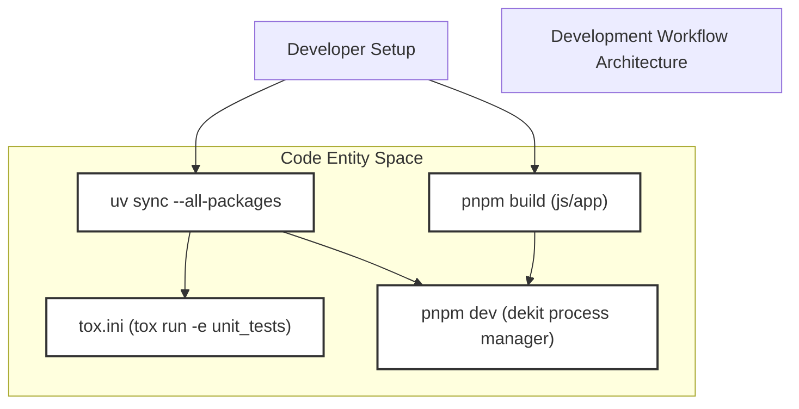
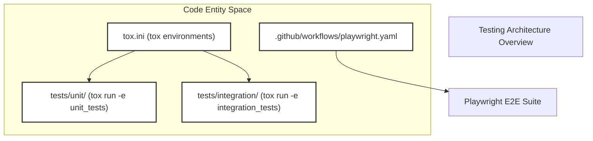
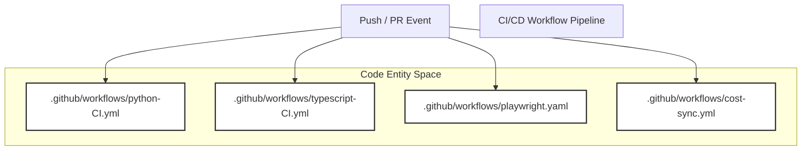
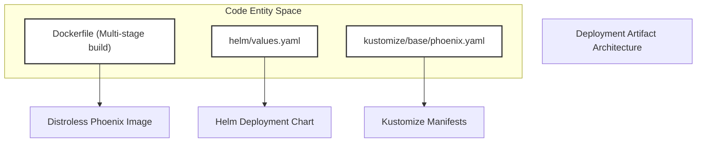
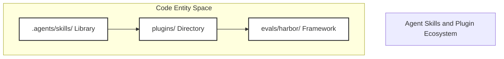

<!-- source: DeepWiki mcp.deepwiki.com · repo Arize-ai/phoenix · page 6 Development & Deployment · fetched 2026-10-26 -->

# Development & Deployment

Relevant source files

The following files were used as context for generating this wiki page:

- [.gitignore](.gitignore)
- [.vscode/extensions.json](.vscode/extensions.json)
- [DEVELOPMENT.md](DEVELOPMENT.md)
- [Makefile](Makefile)
- [evals/harbor/README.md](evals/harbor/README.md)
- [evals/harbor/tasks/regression/prompt-hill-climb/README.md](evals/harbor/tasks/regression/prompt-hill-climb/README.md)
- [evals/harbor/tasks/regression/prompt-hill-climb/steps/step_01_create_evaluator/tests/check.py](evals/harbor/tasks/regression/prompt-hill-climb/steps/step_01_create_evaluator/tests/check.py)
- [evals/harbor/tasks/regression/prompt-hill-climb/steps/step_02_hill_climb/tests/check.py](evals/harbor/tasks/regression/prompt-hill-climb/steps/step_02_hill_climb/tests/check.py)
- [evals/harbor/tasks/regression/prompt-hill-climb/steps/step_03_compare/tests/check.py](evals/harbor/tasks/regression/prompt-hill-climb/steps/step_03_compare/tests/check.py)
- [evals/harbor/tasks/regression/prompt-hill-climb/tests/hill_climb_checks.py](evals/harbor/tasks/regression/prompt-hill-climb/tests/hill_climb_checks.py)
- [evals/harbor/tasks/regression/prompt-hill-climb/tests/test.sh](evals/harbor/tasks/regression/prompt-hill-climb/tests/test.sh)
- [evals/harbor/tasks/trail-benchmark-dev/most-failing-tool/tests/expected.json](evals/harbor/tasks/trail-benchmark-dev/most-failing-tool/tests/expected.json)
- [evals/harbor/verifiers/harbor_verifiers/verify.py](evals/harbor/verifiers/harbor_verifiers/verify.py)
- [scripts/ci/test_skill_graphql_examples.py](scripts/ci/test_skill_graphql_examples.py)
- [tests/unit/harbor/cassettes/test_verify/test_reference_check_grades_semantic_answers.yaml](tests/unit/harbor/cassettes/test_verify/test_reference_check_grades_semantic_answers.yaml)
- [tests/unit/harbor/test_verify.py](tests/unit/harbor/test_verify.py)

This page provides an overview of the development workflows, testing strategies, continuous integration and delivery (CI/CD) pipelines, release management, and deployment architectures for the Phoenix monorepo. As a parent overview, it summarizes operational concerns across Python and TypeScript environments, linking to dedicated child pages for deep technical details.

---

## 6.1. Development Workflow & Tooling

Development at Phoenix relies on a unified workspace configuration supporting Python (`uv`, `tox`, `Makefile`) and TypeScript (`pnpm`, Vite, Relay) ecosystems [DEVELOPMENT.md:32-56](). Developers set up their environments by executing `uv sync --all-extras --all-packages` for Python dependencies and `pnpm install` alongside `pnpm build` under the `js/` directory for the React frontend [DEVELOPMENT.md:36-49](). Process orchestration is managed locally via `dekit` through `pnpm dev`, which spins up the FastAPI server, Vite dev server, and trace generator concurrently with hot-reloading [DEVELOPMENT.md:43-58]().

For details on setting up your environment, pre-commit hooks, code formatting with `ruff`, and local DevOps containers, see [Development Workflow & Tooling](#6.1).

Sources: [DEVELOPMENT.md:36-58](), [Makefile:33-118](), [tox.ini:1-165]()

---

## 6.2. Testing Strategy

Phoenix employs a multi-tiered testing strategy spanning unit tests, integration tests against both SQLite and PostgreSQL backends, and end-to-end browser tests powered by Playwright [DEVELOPMENT.md:120-158](). Test execution is primarily orchestrated using `tox`, which runs isolated virtual environments for distinct packages (`arize-phoenix`, `phoenix-client`, `phoenix-evals`, `phoenix-otel`) [tox.ini:1-165](). Integration and canary tests validate database migrations, mock LLM servers, and client SDK contracts.

For details on writing and executing tests, configuring database fixtures, and running E2E suites, see [Testing Strategy](#6.2).

Sources: [tox.ini:1-165](), [.github/workflows/playwright.yaml:1-132]()

---

## 6.3. CI/CD Pipeline

The continuous integration and deployment pipeline is driven by GitHub Actions, featuring conditional execution paths managed via path filters (`dorny/paths-filter`) to optimize build times [python-CI.yml:44-46](). Dedicated workflows handle Python matrix testing across multiple versions [python-CI.yml:114-184](), TypeScript type-checking and linting [typescript-CI.yml:41-101](), Playwright UI tests [playwright.yaml:44-136](), and automated cost-model synchronization [cost-sync.yml:1-89]().

For details on workflow triggers, quality gates, and Claude-driven automation tasks, see [CI/CD Pipeline](#6.3).

Sources: [.github/workflows/python-CI.yml:1-210](), [.github/workflows/typescript-CI.yml:1-91](), [.github/workflows/playwright.yaml:1-132](), [.github/workflows/cost-sync.yml:1-89]()

---

## 6.4. Release Management

Release management is automated using `release-please` configuration files, enforcing PEP 440-compliant semantic versioning across Python and TypeScript packages. The release pipeline generates changelogs, publishes production packages to PyPI and npm, and cuts pre-release development builds tied to specific commit SHAs [publish.yaml:18-22](). Container images are built for multiple architectures and pushed to registries alongside automatic manifest updates.

For release strategies, versioning schemes, and credential configuration, see [Release Management](#6.4).

Sources: [.github/workflows/publish.yaml:1-178](), [.github/workflows/release.yml:1-24]()

---

## 6.5. Kubernetes Deployment

Phoenix provides multi-stage `Dockerfile` definitions that bundle distroless Python container images with pre-compiled web assets and sandbox runtimes [Dockerfile:32-148](). Self-hosting is supported via Helm charts (`helm/`) and Kustomize manifests (`kustomize/`), enabling customizable deployments with PostgreSQL or SQLite persistence, secure ingress controllers, and built-in Prometheus metrics scraping [helm/values.yaml]().

For configuration parameters, authentication setups, and helm chart installation instructions, see [Kubernetes Deployment](#6.5).

Sources: [Dockerfile:1-148](), [helm/values.yaml](), [kustomize/base/phoenix.yaml:1-41]()

---

## 6.6. API Reference Documentation

Phoenix documentation is built using Sphinx with autodoc extensions to extract docstrings from core Python modules, hosting generated outputs on ReadTheDocs. Additionally, a Mintlify documentation site driven by `docs.json` configuration provides user guides, SDK references, and sitemap generation.

For instructions on updating docstrings, regenerating API references, and previewing documentation locally, see [API Reference Documentation](#6.6).

Sources: [.gitignore:85-87](), [DEVELOPMENT.md:150-176]()

---

## 6.7. Agent Skills & Plugin Distribution

The repository packages reusable AI agent capabilities under `.agents/skills` and distributes verified plugins for Claude and Codex environments via the `plugins/` directory. These configurations are tracked using `skills-lock.json` and tested against harness environments such as Harbor (`evals/harbor/`) to ensure reliable tool-calling and API interactions.

For details on creating custom skills, managing locks, and testing plugin integrations, see [Agent Skills & Plugin Distribution](#6.7).

Sources: [.gitignore:113-117](), [evals/harbor/README.md:1-22]()

---

