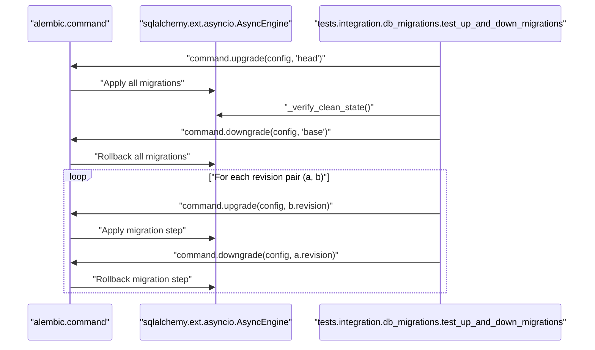
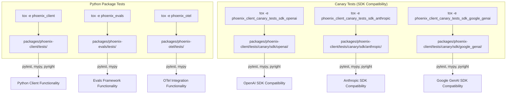
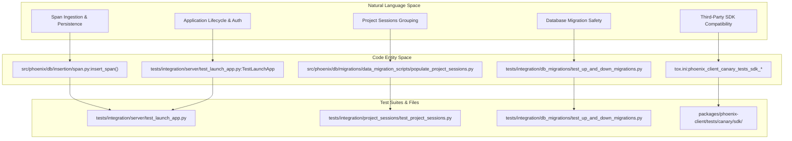

<!-- source: DeepWiki mcp.deepwiki.com · repo Arize-ai/phoenix · page 6.2 Testing Strategy · fetched 2026-10-26 -->

# Testing Strategy

<details>
<summary>Relevant source files</summary>

The following files were used as context for generating this wiki page:

- [.agents/skills/phoenix-evals/references/integrations-pytest.md](.agents/skills/phoenix-evals/references/integrations-pytest.md)
- [.agents/skills/phoenix-evals/references/integrations-vitest-jest.md](.agents/skills/phoenix-evals/references/integrations-vitest-jest.md)
- [docs/phoenix/datasets-and-experiments/how-to-experiments.mdx](docs/phoenix/datasets-and-experiments/how-to-experiments.mdx)
- [docs/phoenix/datasets-and-experiments/how-to-experiments/eval-ci-with-pytest.mdx](docs/phoenix/datasets-and-experiments/how-to-experiments/eval-ci-with-pytest.mdx)
- [docs/phoenix/datasets-and-experiments/how-to-experiments/how-to-dataset-evaluators.mdx](docs/phoenix/datasets-and-experiments/how-to-experiments/how-to-dataset-evaluators.mdx)
- [docs/phoenix/datasets-and-experiments/how-to-experiments/running-experiments-in-background.mdx](docs/phoenix/datasets-and-experiments/how-to-experiments/running-experiments-in-background.mdx)
- [docs/phoenix/datasets-and-experiments/how-to-experiments/running-experiments.mdx](docs/phoenix/datasets-and-experiments/how-to-experiments/running-experiments.mdx)
- [docs/phoenix/evaluation/how-to-evals/code-evaluators.mdx](docs/phoenix/evaluation/how-to-evals/code-evaluators.mdx)
- [docs/phoenix/evaluation/integrations/pytest.mdx](docs/phoenix/evaluation/integrations/pytest.mdx)
- [docs/phoenix/evaluation/integrations/vitest-jest.mdx](docs/phoenix/evaluation/integrations/vitest-jest.mdx)
- [docs/phoenix/evaluation/server-evals/builtin-evaluators.mdx](docs/phoenix/evaluation/server-evals/builtin-evaluators.mdx)
- [docs/phoenix/evaluation/server-evals/input-mapping.mdx](docs/phoenix/evaluation/server-evals/input-mapping.mdx)
- [docs/phoenix/evaluation/server-evals/llm-evaluators.mdx](docs/phoenix/evaluation/server-evals/llm-evaluators.mdx)
- [docs/phoenix/evaluation/server-evals/overview.mdx](docs/phoenix/evaluation/server-evals/overview.mdx)
- [docs/phoenix/release-notes/03-2025/03-20-2025-delete-experiment-from-action-menu.mdx](docs/phoenix/release-notes/03-2025/03-20-2025-delete-experiment-from-action-menu.mdx)
- [docs/phoenix/release-notes/04-2026/04-22-2026-secrets-ui-and-evaluator-trace-id.mdx](docs/phoenix/release-notes/04-2026/04-22-2026-secrets-ui-and-evaluator-trace-id.mdx)
- [docs/phoenix/release-notes/08-2026/08-12-2026-session-filters-rest-api-and-endpoint-config.mdx](docs/phoenix/release-notes/08-2026/08-12-2026-session-filters-rest-api-and-endpoint-config.mdx)
- [docs/phoenix/tracing/how-to-tracing/feedback-and-annotations/evaluating-phoenix-traces.mdx](docs/phoenix/tracing/how-to-tracing/feedback-and-annotations/evaluating-phoenix-traces.mdx)
- [requirements/integration-tests.txt](requirements/integration-tests.txt)
- [src/phoenix/db/helpers.py](src/phoenix/db/helpers.py)
- [src/phoenix/db/insertion/span.py](src/phoenix/db/insertion/span.py)
- [src/phoenix/db/migrations/data_migration_scripts/populate_project_sessions.py](src/phoenix/db/migrations/data_migration_scripts/populate_project_sessions.py)
- [src/phoenix/db/migrations/versions/4ded9e43755f_create_project_sessions_table.py](src/phoenix/db/migrations/versions/4ded9e43755f_create_project_sessions_table.py)
- [tests/conftest.py](tests/conftest.py)
- [tests/integration/conftest.py](tests/integration/conftest.py)
- [tests/integration/db_migrations/__init__.py](tests/integration/db_migrations/__init__.py)
- [tests/integration/db_migrations/conftest.py](tests/integration/db_migrations/conftest.py)
- [tests/integration/db_migrations/test_data_migration_4ded9e43755f_create_project_sessions_table.py](tests/integration/db_migrations/test_data_migration_4ded9e43755f_create_project_sessions_table.py)
- [tests/integration/db_migrations/test_db_schema_6a88424799fe_update_users_with_auth_method.py](tests/integration/db_migrations/test_db_schema_6a88424799fe_update_users_with_auth_method.py)
- [tests/integration/db_migrations/test_db_schema_a20694b15f82_cost.py](tests/integration/db_migrations/test_db_schema_a20694b15f82_cost.py)
- [tests/integration/db_migrations/test_db_schema_for_annotations.py](tests/integration/db_migrations/test_db_schema_for_annotations.py)
- [tests/integration/db_migrations/test_up_and_down_migrations.py](tests/integration/db_migrations/test_up_and_down_migrations.py)
- [tests/integration/project_sessions/test_project_sessions.py](tests/integration/project_sessions/test_project_sessions.py)
- [tests/integration/server/test_launch_app.py](tests/integration/server/test_launch_app.py)
- [tests/unit/conftest.py](tests/unit/conftest.py)
- [tests/unit/db/insertion/test_span.py](tests/unit/db/insertion/test_span.py)
- [tests/unit/server/test_app_docs_mcp_lifespan.py](tests/unit/server/test_app_docs_mcp_lifespan.py)
- [tests/unit/server/test_app_evaluations.py](tests/unit/server/test_app_evaluations.py)
- [tests/unit/server/test_app_fastapi_dependants.py](tests/unit/server/test_app_fastapi_dependants.py)
- [tests/unit/server/test_app_fastapi_type_adapters.py](tests/unit/server/test_app_fastapi_type_adapters.py)
- [tests/unit/server/test_app_graphql_schema_build.py](tests/unit/server/test_app_graphql_schema_build.py)
- [tests/unit/server/test_app_routers.py](tests/unit/server/test_app_routers.py)

</details>


## Purpose and Scope

This document describes Phoenix's comprehensive testing approach, covering unit tests, integration tests, end-to-end (E2E) tests, database fixtures, test organization, and CI/CD integration. Phoenix employs a robust multi-layered testing strategy to guarantee quality, reliability, and compatibility across all components.

The scope includes testing methodologies for server code, client libraries, database migrations, SDK compatibility, and frontend web UI with detailed attention to both SQLite and PostgreSQL backends.

For related information on automation, see [CI/CD Pipeline (6.3)]() and for release processes, see [Release Management (6.4)]().

Sources: [tests/unit/conftest.py:1-187](), [tests/integration/conftest.py:1-206]()

## Test Types and Scope

Phoenix testing is stratified by scope and coverage with specialized tools for each layer:

| Test Type | Scope | Tools | Execution Details |
|---|---|---|---|
| **Unit Tests** | Isolated component logic in server and packages | `pytest`, `pytest-xdist` | Parallel runs on SQLite and PostgreSQL databases. |
| **Integration Tests**| Client-server interaction, GraphQL subscriptions, DB migrations | `pytest`, `httpx`, `tox` | Full stack with database (SQLite/PostgreSQL) |
| **E2E Tests** | Complete user workflows including UI interactions | Playwright | Browser automation with Chromium and Firefox |
| **Type Checking** | Static typing verification | `mypy`, `pyright`, TypeScript compiler | Pre-commit hooks and CI runs |
| **Package Tests** | Component package verification (client, evals, otel) | `tox`, `pytest` | Isolated testing environments per package |
| **Canary Tests** | Third-party LLM SDK compatibility (OpenAI, Anthropic, Google) | `tox`, `pytest` | Dedicated environment for SDK integration checks |
| **Migration Tests** | Database schema and data migration evolution | Alembic | Forward and backward migration verification |

Sources: [tox.ini:11-165](), [.github/workflows/python-CI.yml:114-183](), [.github/workflows/playwright.yaml:44-135]()

## Test Organization and Structure

### Directory Layout

Phoenix organizes tests into the following directory structure to separate concerns and test scope:

```
tests/
├── unit/                  # Server-side unit tests focusing on isolated components
├── integration/           # Full stack, migration, and interaction tests
│   ├── db_migrations/     # Alembic migration validation tests
│   ├── project_sessions/  # Session grouping and project session logic
│   └── server/            # Server app lifecycle and feature tests
packages/
├── phoenix-client/tests/  # SDK client library unit and integration tests
├── phoenix-evals/tests/   # Evaluation framework tests
└── phoenix-otel/tests/    # OpenTelemetry integration tests
js/app/tests/              # Frontend Playwright end-to-end tests
```

### E2E Test Configuration with Playwright

End-to-end tests target user workflows including Playground, Datasets, Prompts, and Evaluators. Configured in `js/app/playwright.config.ts`, these tests launch a local server via `pnpm run dev:server:test`.

**Key points:**

- Authentication is managed in `js/app/tests/auth.setup.ts`.
- Authenticated state snapshots are stored under `js/app/playwright/.auth/admin.json` for session reuse.
- Sandboxed evaluation environments require Deno (TypeScript) and CPython WASM for code execution in evaluators. The `Dockerfile` and `.github/workflows/playwright.yaml` ensure these runtimes are available. [Dockerfile:74-117](), [.github/workflows/playwright.yaml:115-134]()
- Playwright tests run on Chromium and Firefox, skipping WebKit for stability in CI environments. [.github/workflows/playwright.yaml:55-56]()

Sources: [.github/workflows/playwright.yaml:44-135]()

## Database Fixture Strategy

Phoenix tests support dual backends: SQLite and PostgreSQL. The CI matrix ensures thorough compatibility and coverage on both. Database fixtures and test data reuse centralized schemas and models with real data flows.

### Span Insertion as Core Database Interaction

A critical component tested is the `insert_span` async function in [src/phoenix/db/insertion/span.py:128-188](). This method performs:

- Lookup or creation of Trace records based on `trace_id`. [src/phoenix/db/insertion/span.py:135-156]()
- Project association by project name. [src/phoenix/db/insertion/span.py:142-144]()
- Session grouping using `session_id` attributes in spans. [src/phoenix/db/insertion/span.py:161-188]()
- Insertion of Span records with conflict handling via upsert semantics. [src/phoenix/db/insertion/span.py:104-122]()

This method integrates several SQLAlchemy models (`Trace`, `ProjectSession`, `Span`) and uses helper functions such as `insert_on_conflict` for upsert logic.

```mermaid
graph TD
    subgraph "Natural Language Space"
        NL_SpanData["OpenTelemetry Span Data"]
        NL_ProjectName["Project Name"]
        NL_SessionID["Session ID (optional)"]
    end

    subgraph "Code Entity Space"
        A[src/phoenix/db/insertion/span.py:insert_span()]
        B[phoenix.db.models.Trace]
        C[phoenix.db.models.Project]
        D[phoenix.db.models.ProjectSession]
        E[phoenix.db.models.Span]
        F[phoenix.db.insertion.helpers.insert_on_conflict()]
        G[sqlalchemy.ext.asyncio.AsyncSession]
    end

    NL_SpanData --> A
    NL_ProjectName --> A
    NL_SessionID --> A

    A -- "Select or Create Trace" --> B
    A -- "Select or Create Project" --> C
    A -- "Select or Create ProjectSession" --> D
    A -- "Prepare Span Data" --> E
    A -- "Insert/Update Span" --> F
    F -- "Execute SQL" --> G

    B -- "Update Trace Times" --> A
    D -- "Update Session Times" --> A
    E -- "Calculate Cumulative Metrics" --> A
```

Sources: [src/phoenix/db/insertion/span.py:128-188]()

## Migration Testing

Phoenix ensures database migrations are reliable and reversible through migration tests located under `tests/integration/db_migrations/`.

**Key points:**

- Upgrade and downgrade operations through Alembic migrations are tested for schema integrity [tests/integration/db_migrations/test_up_and_down_migrations.py:31-80]().
- Data migration scripts such as `populate_project_sessions.py` ensure that changes like grouping traces into sessions preserve data correctness [src/phoenix/db/migrations/data_migration_scripts/populate_project_sessions.py:1-150]().
- Migration tests run on both SQLite and Postgres backend matrix to verify multi-DB compatibility [tests/integration/db_migrations/test_up_and_down_migrations.py:17-30]().



Sources: [tests/integration/db_migrations/test_up_and_down_migrations.py:31-80](), [src/phoenix/db/migrations/data_migration_scripts/populate_project_sessions.py:1-150]()

## Package and Canary Testing

Phoenix uses `tox` to create isolated environments for running package-specific tests in parallel. This covers the Python client, evaluation framework, and OpenTelemetry SDK integration.



Sources: [tox.ini:11-125]()

## Mock LLM Server

For integration and unit tests involving language model clients, Phoenix uses mock implementations that simulate real LLM APIs without network calls. This is essential to:

- Provide deterministic and fast test runs.
- Avoid dependency on external network availability.
- Emulate streaming APIs compatible with client interfaces.

Sources: [tests/integration/_mock_llm_server.py]()

## Canary Tests for SDK Integration

Canary tests are dedicated suites that ensure Phoenix's compatibility with third-party LLM SDKs and API clients:

- OpenAI SDK
- Anthropic SDK
- Google Generative AI SDK

These tests run the minimal client lifecycle operations and verify instrumentation hooks. They validate proper error handling, concurrency, and tracing behavior in isolation from other tests.

Sources: [tox.ini:24-103]()

## End-to-End Test Scenarios

Phoenix's frontend E2E tests cover key user interactions:

### Server Evaluators Workflow

- Create a new dataset
- Add an example trace manually
- Attach a prebuilt LLM or Code Evaluator
- Run evaluations and verify score computations

### Prompt Lifecycle

Tests creating and saving prompts in the Playground, version creation, and version history verification to ensure prompt lifecycle management is robust.

### User & Access Management

Role-Based Access Control (RBAC) is verified by tests covering admin, member, and viewer roles across different projects [tests/integration/server/test_launch_app.py:22-37]().

Sources: [tests/integration/server/test_launch_app.py:22-37]()

## Code Entity Association Diagram

This diagram maps Phoenix's natural language features to their key code implementations and associated tests. It bridges human-meaningful features to the actual code entities and test scripts, providing quick navigation and understanding of the test coverage landscape.



Sources: [src/phoenix/db/insertion/span.py:128-188](), [src/phoenix/db/migrations/data_migration_scripts/populate_project_sessions.py:1-150](), [tests/integration/db_migrations/test_up_and_down_migrations.py:31-80](), [tox.ini:24-103](), [tests/integration/server/test_launch_app.py:1-231]()

# Summary

Phoenix's testing strategy integrates multiple layers of testing rigor:

- Isolated unit tests with db backend combo coverage
- Integration tests that exercise full paths including ingestion and session logic
- Migration testing to safely evolve schema and data
- Canary and package tests for third-party SDK reliability
- End-to-end Playwright tests for real-user flows in frontend UI

This multi-faceted approach ensures the system's resilience, correctness, and ease of maintenance.

# References

- [.github/workflows/python-CI.yml:114-183]()
- [.github/workflows/playwright.yaml:44-135]()
- [tox.ini:11-165]()
- [src/phoenix/db/insertion/span.py:128-188]()
- [tests/integration/db_migrations/test_up_and_down_migrations.py:31-80]()
- [src/phoenix/db/migrations/data_migration_scripts/populate_project_sessions.py:1-150]()
- [tests/integration/_mock_llm_server.py]()
- [tests/integration/server/test_launch_app.py:1-231]()
- [tests/unit/conftest.py:1-187]()

---

