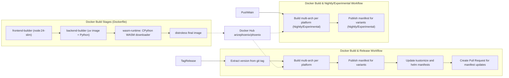

<!-- source: DeepWiki mcp.deepwiki.com · repo Arize-ai/phoenix · page 6.3 CI/CD Pipeline · fetched 2026-10-26 -->

# CI/CD Pipeline

Relevant source files

The following files were used as context for generating this wiki page:

- [.agents/skills/phoenix-docs-gap-audit/SKILL.md](.agents/skills/phoenix-docs-gap-audit/SKILL.md)
- [.eslintignore](.eslintignore)
- [.github/.scripts/collect-customer-issues.js](.github/.scripts/collect-customer-issues.js)
- [.github/actions/approve-automation-pr/action.yml](.github/actions/approve-automation-pr/action.yml)
- [.github/actions/docker-build-image/action.yml](.github/actions/docker-build-image/action.yml)
- [.github/actions/docker-merge-manifest/action.yml](.github/actions/docker-merge-manifest/action.yml)
- [.github/workflows/auto-label-external-issues.yaml](.github/workflows/auto-label-external-issues.yaml)
- [.github/workflows/check-card-links.yml](.github/workflows/check-card-links.yml)
- [.github/workflows/check-dependabot-uv-version.yml](.github/workflows/check-dependabot-uv-version.yml)
- [.github/workflows/claude-code-review.yml](.github/workflows/claude-code-review.yml)
- [.github/workflows/claude-docs-gap-audit.yml](.github/workflows/claude-docs-gap-audit.yml)
- [.github/workflows/claude-implement-issue.yml](.github/workflows/claude-implement-issue.yml)
- [.github/workflows/claude-issue-triage.yml](.github/workflows/claude-issue-triage.yml)
- [.github/workflows/claude-llms-txt.yml](.github/workflows/claude-llms-txt.yml)
- [.github/workflows/claude-readme-translations.yml](.github/workflows/claude-readme-translations.yml)
- [.github/workflows/claude-release-notes.yml](.github/workflows/claude-release-notes.yml)
- [.github/workflows/claude-skills-audit.yml](.github/workflows/claude-skills-audit.yml)
- [.github/workflows/claude-weekly-deps-upgrade.yml](.github/workflows/claude-weekly-deps-upgrade.yml)
- [.github/workflows/claude.yml](.github/workflows/claude.yml)
- [.github/workflows/collect-customer-issues.yaml](.github/workflows/collect-customer-issues.yaml)
- [.github/workflows/cost-sync.yml](.github/workflows/cost-sync.yml)
- [.github/workflows/daily-skills-update.yml](.github/workflows/daily-skills-update.yml)
- [.github/workflows/docker-build-experimental.yml](.github/workflows/docker-build-experimental.yml)
- [.github/workflows/docker-build-nightly.yml](.github/workflows/docker-build-nightly.yml)
- [.github/workflows/docker-build-release.yml](.github/workflows/docker-build-release.yml)
- [.github/workflows/generate-sitemap.yml](.github/workflows/generate-sitemap.yml)
- [.github/workflows/gh_pages.yml](.github/workflows/gh_pages.yml)
- [.github/workflows/helm-ci.yml](.github/workflows/helm-ci.yml)
- [.github/workflows/openapi-schema.yaml](.github/workflows/openapi-schema.yaml)
- [.github/workflows/phoenix-sqlean-upstream.yml](.github/workflows/phoenix-sqlean-upstream.yml)
- [.github/workflows/playwright.yaml](.github/workflows/playwright.yaml)
- [.github/workflows/plugin-evals.yml](.github/workflows/plugin-evals.yml)
- [.github/workflows/publish.yaml](.github/workflows/publish.yaml)
- [.github/workflows/pull-requests.yaml](.github/workflows/pull-requests.yaml)
- [.github/workflows/pypi-smoke-test.yml](.github/workflows/pypi-smoke-test.yml)
- [.github/workflows/python-CI.yml](.github/workflows/python-CI.yml)
- [.github/workflows/python-all-platforms.yml](.github/workflows/python-all-platforms.yml)
- [.github/workflows/storybook-CI.yml](.github/workflows/storybook-CI.yml)
- [.github/workflows/sync-lockfile-release-pr.yml](.github/workflows/sync-lockfile-release-pr.yml)
- [.github/workflows/typescript-CI.yml](.github/workflows/typescript-CI.yml)
- [.github/workflows/typescript-packages-publish-experimental.yml](.github/workflows/typescript-packages-publish-experimental.yml)
- [.github/workflows/typescript-packages-publish.yml](.github/workflows/typescript-packages-publish.yml)
- [.github/workflows/update-phoenix-package-versions.yml](.github/workflows/update-phoenix-package-versions.yml)
- [.nvmrc](.nvmrc)
- [Dockerfile](Dockerfile)
- [packages/phoenix-sqlean/.gitignore](packages/phoenix-sqlean/.gitignore)
- [packages/phoenix-sqlean/MANIFEST.in](packages/phoenix-sqlean/MANIFEST.in)
- [packages/phoenix-sqlean/README.md](packages/phoenix-sqlean/README.md)
- [packages/phoenix-sqlean/scripts/check-upstream.sh](packages/phoenix-sqlean/scripts/check-upstream.sh)
- [scripts/docker/devops/Dockerfile](scripts/docker/devops/Dockerfile)

This page documents Phoenix's continuous integration and continuous deployment infrastructure. It covers GitHub Actions workflows for testing, code generation validation, Docker image builds, TypeScript package publishing, and automated releases. For detailed release versioning and publishing processes, refer to [Release Management](#6.4). For Docker image variants and deployment configuration, refer to [Kubernetes Deployment](#6.5).

---

## Overview

Phoenix uses GitHub Actions as the primary platform to implement CI/CD workflows. Key features include:

- **Change filtering**: selective job execution based on affected file paths to optimize CI resource usage.
- **Matrix testing** across Python versions, platforms, and databases for broad compatibility.
- **Integration of style and static analysis tools**: `mypy`, `pyright`, `ruff`, ESLint, and Prettier.
- **End-to-end tests** with Playwright and sandbox runtime provisioning.
- **Multi-architecture Docker image builds** with deployment manifest updates and PR automation.
- **TypeScript package versioning and publishing** driven by `changesets`.
- **Claude AI agentic workflows** for automated code reviews and issue implementation.
- **Quality gates** to enforce strict passing of tests and checks before merge/deploy.

All workflows use concurrency groups with cancellation of in-progress runs on new pushes, minimizing queue bloat and accelerating feedback `[.github/workflows/python-CI.yml:14-16]()`.

---

## Pipeline Architecture

The overall CI/CD system structure is visualized below, bridging natural language workflow concepts to concrete workflow files and execution commands.

```mermaid
graph TB
    %% Triggers
    subgraph "Triggers"
        PushMain["push: main, version-*"]
        PullRequest["pull_request"]
        TagRelease["push: tags/arize-phoenix-v*"]
        Schedule["schedule: cron"]
        WorkflowDispatch["workflow_dispatch"]
        IssueLabeled["issues: labeled (good-agent-issue)"]
    end
    
    %% GitHub Workflows
    subgraph "GitHub Actions Workflows"
        PythonCI["python-CI.yml"]
        TS_CI["typescript-CI.yml"]
        PlaywrightWF["playwright.yaml"]
        DockerRelease["docker-build-release.yml"]
        DockerNightly["docker-build-nightly.yml"]
        DockerExperimental["docker-build-experimental.yml"]
        ClaudeReview["claude-code-review.yml"]
        ClaudeImplement["claude-implement-issue.yml"]
        PublishPython["publish.yaml"]
        TS_Publish["typescript-packages-publish.yml"]
        TS_PublishExperimental["typescript-packages-publish-experimental.yml"]
        PythonAllPlatforms["python-all-platforms.yml"]
    end
    
    %% Execution Layer
    subgraph "Execution Layer (Tox/UV/PNPM Commands)"
        ToxEnv["tox environments"]
        UVsync["uv sync / uvx commands"]
        PNPMrun["pnpm run commands"]
        PyTest["pytest unit/integration tests"]
        MyPy["mypy --strict type checks"]
        Pyright["pyright TS type checks"]
        PlaywrightTest["playwright end-to-end tests"]
        Lint["ruff / oxlint / ESLint / formatting checks"]
    end

    %% Quality Gates and Build Processes
    subgraph "Quality Gates & Build Processes"
        RunTests["Test Suites Execution"]
        TypeCheck["Static Type Analysis"]
        CodeFormat["Code Formatting & Linting"]
        DockerBuild["Multi-arch Docker Build & Publish"]
        KustomizeHelmUpdate["Update Deployment Manifests"]
        PRCreation["Create PR for version bump"]
        PublishPyPI["Publish Python Packages to PyPI"]
        PublishNPM["Publish TypeScript Packages to NPM"]
    end
    
    %% Links
    PushMain --> PythonCI
    PullRequest --> PythonCI
    PullRequest --> ClaudeReview
    PushMain --> PlaywrightWF
    Schedule --> PlaywrightWF
    TagRelease --> DockerRelease
    WorkflowDispatch --> PublishPython
    PushMain --> TS_CI
    PushMain --> TS_Publish
    PushMain --> DockerNightly
    IssueLabeled --> ClaudeImplement
    WorkflowDispatch --> TS_PublishExperimental
    Schedule --> PythonAllPlatforms
    WorkflowDispatch --> PythonAllPlatforms

    PythonCI --> ToxEnv
    ToxEnv --> PyTest
    ToxEnv --> MyPy
    ToxEnv --> Pyright
    
    TS_CI --> PNPMrun
    PNPMrun --> Lint
    PNPMrun --> Pyright
    
    PlaywrightWF --> UVsync
    PlaywrightWF --> PlaywrightTest
    
    DockerRelease --> DockerBuild
    DockerBuild --> KustomizeHelmUpdate
    KustomizeHelmUpdate --> PRCreation

    DockerNightly --> DockerBuild
    DockerExperimental --> DockerBuild
    
    PublishPython --> PublishPyPI
    TS_Publish --> PublishNPM
    TS_PublishExperimental --> PublishNPM

    PythonAllPlatforms --> RunTests
```

**Sources:**  
`[.github/workflows/python-CI.yml:5-46,105-175]()`  
`[.github/workflows/typescript-CI.yml:5-93]()`  
`[.github/workflows/playwright.yaml:5-138]()`  
`[.github/workflows/docker-build-release.yml:1-137]()`  
`[.github/workflows/docker-build-nightly.yml:1-105]()`  
`[.github/workflows/docker-build-experimental.yml]()`  
`[.github/workflows/claude-code-review.yml:1-69]()`  
`[.github/workflows/claude-implement-issue.yml:1-152]()`  
`[.github/workflows/publish.yaml:1-220]()`  
`[.github/workflows/typescript-packages-publish.yml:1-68]()`  
`[.github/workflows/typescript-packages-publish-experimental.yml]()`  
`[.github/workflows/python-all-platforms.yml:5-171]()`  
`tox.ini:1-165`  

---

## Python CI Pipeline

The `python-CI.yml` workflow is the main Python backend testing pipeline. It runs on `push` events to `main` and `version-*` branches, pull requests, and manual triggers `[.github/workflows/python-CI.yml:5-12]`.

### Change Detection and Conditional Execution

A dedicated `changes` job uses `dorny/paths-filter` to detect modifications in targeted files and directories, enabling selective test execution.

The change filters include keys such as:

| Output Key | Path Globs |
| :--- | :--- |
| `ipynb` | `"**/*.ipynb"` `[.github/workflows/python-CI.yml:54-55]` |
| `prompts` | `prompts/**, scripts/prompts/compile_python_prompts.py` `[.github/workflows/python-CI.yml:56-58]` |
| `phoenix` | `evals/**, src/**, tests/**, tutorials/**, pyproject.toml, tox.ini` `[.github/workflows/python-CI.yml:59-65]` |
| `phoenix_client` | `packages/phoenix-client/**, tox.ini` `[.github/workflows/python-CI.yml:66-68]` |
| `phoenix_evals` | `packages/phoenix-evals/**, tox.ini` `[.github/workflows/python-CI.yml:69-71]` |
| `phoenix_otel` | `packages/phoenix-otel/**, tox.ini` `[.github/workflows/python-CI.yml:72-74]` |
| `migrations` | `src/phoenix/db/migrations/versions/**` `[.github/workflows/python-CI.yml:75-76]` |
| `ddl` | `src/phoenix/db/migrations/**, src/phoenix/db/ddl/*.sql, scripts/ddl/**` `[.github/workflows/python-CI.yml:77-80]` |
| `json_canonicalization_schema` | `src/phoenix/vendor/json_canonicalization_scheme/**/*.py` `[.github/workflows/python-CI.yml:81-82]` |
| `uv_lock` | `"**/pyproject.toml", uv.lock` `[.github/workflows/python-CI.yml:83-85]` |

Downstream jobs only run if their corresponding change flag is `true` `[.github/workflows/python-CI.yml:23-46]`.

**Sources:**
`[.github/workflows/python-CI.yml:5-12]()`
`[.github/workflows/python-CI.yml:14-16]()`
`[.github/workflows/python-CI.yml:23-46]()`
`[.github/workflows/python-all-platforms.yml:5-171]()`

---

## TypeScript CI Pipeline

The `typescript-CI.yml` workflow triggers on pushes and pull requests to main branches, running ESLint, Prettier, `pyright` type checks, code generation validation, and Jest tests `[.github/workflows/typescript-CI.yml:5-93]`.

### Change Detection

This pipeline employs `dorny/paths-filter` to detect changes in TypeScript-related files including `js/**`, `schemas/**`, and configuration files `[.github/workflows/typescript-CI.yml:23-40]`.

### Steps

It installs dependencies via `pnpm`, builds in topological order, verifies zero-drift in OpenAPI code generation via `pnpm run generate:openapi`, schema generative UI codegen, and UI message stream fixtures `[.github/workflows/typescript-CI.yml:61-98]`.

**Sources:**
`[.github/workflows/typescript-CI.yml:5-93]()`
`[.github/workflows/typescript-CI.yml:23-40]()`
`[.github/workflows/typescript-CI.yml:61-98]()`

---

## Playwright End-to-End Testing

Playwright tests run using the `playwright.yaml` workflow triggered on pushes, pull requests, scheduled runs, and manually `[.github/workflows/playwright.yaml:5-16]`.

### Sandbox Runtime Setup

This pipeline sets up runtime dependencies required by Phoenix's sandbox environments:
- **Playwright browsers**: Installed via `pnpm exec playwright install --with-deps` `[.github/workflows/playwright.yaml:153]`.
- **CPython WebAssembly binary & Deno runtime**: Provisioned for containerized sandbox testing.

### Execution

Tests run inside the `./js/app` working directory with Playwright commands using custom runners `[.github/workflows/playwright.yaml:104-122]`. WebKit is conditionally skipped due to caching issues `[.github/workflows/playwright.yaml:115]`.

**Sources:**
`[.github/workflows/playwright.yaml:5-138]()`
`[.github/workflows/playwright.yaml:104-122]()`

---

## Docker Build & Deployment Automation

Phoenix builds and publishes Docker images for deployment using multi-stage Docker builds and corresponding GitHub workflows.

### Multi-Stage Dockerfile

- **Frontend Builder**: Uses `node:24-slim` to execute `pnpm install` and build frontend React bundles under `/phoenix/src/phoenix/server/static` `[Dockerfile:31-47]()`.
- **Backend Builder**: Based on a pinned `uv` image, copies Python source, runs `uv sync` with container and Postgres extras, builds the Python wheel and installs it `[Dockerfile:48-65]()`.
- **WASM Runtime Stage**: Downloads the CPython wasm binary with retries and SHA-256 checksum validation to ensure safe sandbox runtime usage `[Dockerfile:101-117]()`.
- **Final Stage**: Uses a distroless base image, bundles the `.venv` Python environment, built frontend assets, and sandbox runtimes (Deno binary and CPython wasm binary) `[Dockerfile:118-153]()`.

### Docker Build and Publish Workflows

- **Release (`docker-build-release.yml`)**: Triggers on push to tags matching `arize-phoenix-v*`. It extracts the version, then builds images for multiple CPU architectures (`linux/amd64`, `linux/arm64`) and Docker variants (`root`, `nonroot`, `debug`) `[.github/workflows/docker-build-release.yml:5-126]()`.
- **Nightly (`docker-build-nightly.yml`)**: Triggers on pushes to `main` and `version-*` branches.
- **Experimental (`docker-build-experimental.yml`)**: Manually dispatched workflow building experimental variants.

### Deployment Manifest Update

After a release build, Python scripts `scripts/update_kustomize.py` and `scripts/update_helm.py` update Kubernetes and Helm manifests with the new image versions, pushing a pull request automatically via `peter-evans/create-pull-request` `[.github/workflows/docker-build-release.yml:130-170]()`.

**Sources:**
`[Dockerfile:31-47]()`
`[Dockerfile:48-65]()`
`[Dockerfile:101-117]()`
`[Dockerfile:118-153]()`
`[.github/workflows/docker-build-release.yml:5-126]()`
`[.github/workflows/docker-build-release.yml:130-170]()`
`[scripts/update_kustomize.py]()`
`[scripts/update_helm.py]()`

---

## TypeScript Package Publishing

TypeScript packages under the `js/` directory use ChangeSets for versioning and publishing via `.github/workflows/typescript-packages-publish.yml` `[.github/workflows/typescript-packages-publish.yml:1-68]()`.

- Checks out the repository with full history.
- Sets up Node.js and PNPM with caching.
- Runs `changesets/action` to version packages, update changelogs, commit version updates, and publish to npm with provenance enabled `[.github/workflows/typescript-packages-publish.yml:48-65]()`.

**Sources:**
`[.github/workflows/typescript-packages-publish.yml:1-68]()`

---

## Python Package Publishing

The `publish.yaml` workflow is manually dispatched and supports release and preview modes `[.github/workflows/publish.yaml:1-220]()`.

- **Release (default)**: Reads versions from the release-please manifest and builds packages from tagged releases for production PyPI publishing `[.github/workflows/publish.yaml:35-85]()`.
- **Preview**: Builds development pre-releases from the head of a specified branch, using commit SHA stamps (`<version>.dev<int(sha[:7], 16)>`) to uniquely version dev packages `[.github/workflows/publish.yaml:17-21]()`.

**Sources:**
`[.github/workflows/publish.yaml:1-220]()`

---

## Claude AI Agentic Workflows

Phoenix leverages Claude AI for automated code reviews and issue implementation.

### Claude Code Review (`claude-code-review.yml`)

This workflow triggers on pull request events (`opened`, `synchronize`, `ready_for_review`, `reopened`) for same-repo non-draft PRs `[.github/workflows/claude-code-review.yml:4-29]()`. It uses `anthropics/claude-code-action` with subprocess isolation dependencies (`bubblewrap`, `socat`) to execute `/code-review` checks `[.github/workflows/claude-code-review.yml:48-76]()`.

### Claude Implement Issue (`claude-implement-issue.yml`)

This workflow triggers when an issue is labeled with `good-agent-issue` by an authorized user on an allowlist `[.github/workflows/claude-implement-issue.yml:5-27]`. It guards against duplicates, claims the issue, runs Claude Code end-to-end to implement the requested changes, and validates them `[.github/workflows/claude-implement-issue.yml:40-152]()`.

**Sources:**
`[.github/workflows/claude-code-review.yml:4-76]()`
`[.github/workflows/claude-implement-issue.yml:5-152]()`

---

## Quality Gates and Conditional Execution

Phoenix CI enforces strict quality gates across static analysis (`mypy --strict`, `pyright`), linting (`ruff`, ESLint), unit/integration tests (`pytest`), end-to-end suites (Playwright), and container builds. Dedicated required jobs ensure that workflows validate successfully before merge or deployment `[.github/workflows/typescript-CI.yml:103-121]()`.

**Sources:**
`[.github/workflows/python-CI.yml]()`
`[.github/workflows/typescript-CI.yml:103-121]()`
`[.github/workflows/playwright.yaml]()`

---

# References

- `.github/workflows/python-CI.yml`  
- `.github/workflows/typescript-CI.yml`  
- `.github/workflows/playwright.yaml`  
- `.github/workflows/docker-build-release.yml`  
- `.github/workflows/docker-build-nightly.yml`  
- `.github/workflows/docker-build-experimental.yml`  
- `.github/workflows/claude-code-review.yml`  
- `.github/workflows/claude-implement-issue.yml`  
- `.github/workflows/publish.yaml`  
- `.github/workflows/typescript-packages-publish.yml`  
- `.github/workflows/python-all-platforms.yml`  
- `tox.ini`  
- `Dockerfile`
- `scripts/update_kustomize.py`  
- `scripts/update_helm.py`

---

