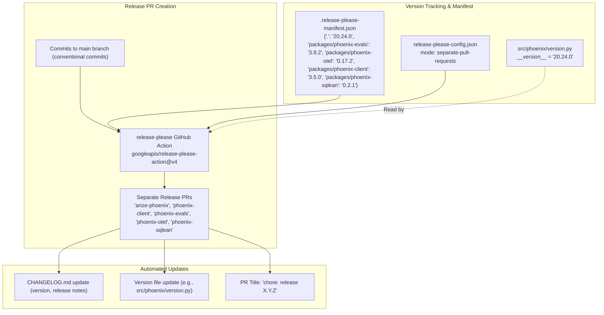
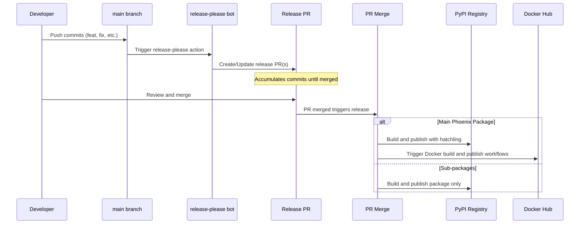
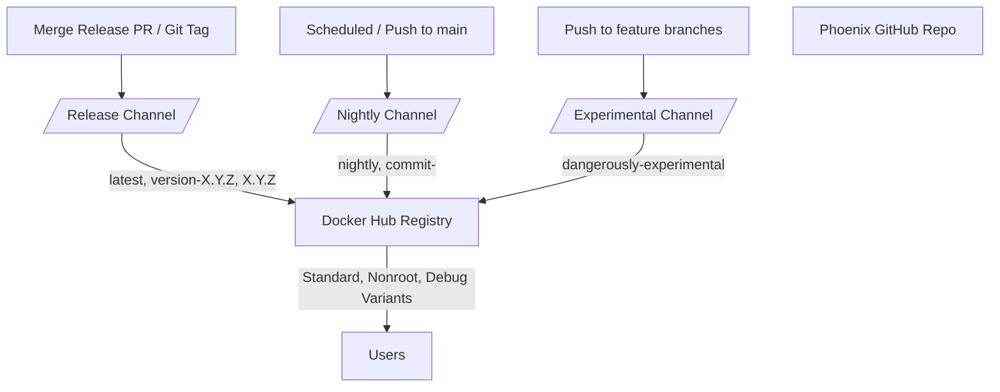

<!-- source: DeepWiki mcp.deepwiki.com · repo Arize-ai/phoenix · page 6.4 Release Management · fetched 2026-10-26 -->

# Release Management

<details>
<summary>Relevant source files</summary>

The following files were used as context for generating this wiki page:

- [.agents/skills/phoenix-release-notes/SKILL.md](.agents/skills/phoenix-release-notes/SKILL.md)
- [.github/workflows/release.yml](.github/workflows/release.yml)
- [.release-please-manifest.json](.release-please-manifest.json)
- [CHANGELOG.md](CHANGELOG.md)
- [docs/phoenix/release-notes.mdx](docs/phoenix/release-notes.mdx)
- [docs/phoenix/release-notes/03-2026/03-11-2026-session-turns-api.mdx](docs/phoenix/release-notes/03-2026/03-11-2026-session-turns-api.mdx)
- [docs/phoenix/release-notes/06-2026/06-16-2026-time-range-metrics-and-sharing.mdx](docs/phoenix/release-notes/06-2026/06-16-2026-time-range-metrics-and-sharing.mdx)
- [docs/phoenix/release-notes/09-2026/09-08-2026-harbor-plugin-for-agent-benchmarks.mdx](docs/phoenix/release-notes/09-2026/09-08-2026-harbor-plugin-for-agent-benchmarks.mdx)
- [docs/phoenix/release-notes/09-2026/09-08-2026-model-providers-trace-filters-and-pxi.mdx](docs/phoenix/release-notes/09-2026/09-08-2026-model-providers-trace-filters-and-pxi.mdx)
- [docs/phoenix/release-notes/09-2026/09-29-2026-editable-dataset-examples-and-trace-metrics.mdx](docs/phoenix/release-notes/09-2026/09-29-2026-editable-dataset-examples-and-trace-metrics.mdx)
- [docs/phoenix/release-notes/10-2026/10-01-2026-trace-tree-evals-and-decision-spans.mdx](docs/phoenix/release-notes/10-2026/10-01-2026-trace-tree-evals-and-decision-spans.mdx)
- [docs/phoenix/release-notes/10-2026/10-13-2026-docker-sandboxes-and-mcp-graphql-tools.mdx](docs/phoenix/release-notes/10-2026/10-13-2026-docker-sandboxes-and-mcp-graphql-tools.mdx)
- [docs/phoenix/release-notes/10-2026/10-16-2026-claude-managed-agents-tracing-and-gemini-4-argon.mdx](docs/phoenix/release-notes/10-2026/10-16-2026-claude-managed-agents-tracing-and-gemini-4-argon.mdx)
- [docs/phoenix/release-notes/2026.mdx](docs/phoenix/release-notes/2026.mdx)
- [docs/phoenix/self-hosting/features/authentication.mdx](docs/phoenix/self-hosting/features/authentication.mdx)
- [docs/product-selector.js](docs/product-selector.js)
- [docs/snippets/ReleaseUpdate.jsx](docs/snippets/ReleaseUpdate.jsx)
- [docs/style.css](docs/style.css)
- [internal_docs/specs/online-evals.md](internal_docs/specs/online-evals.md)
- [internal_docs/specs/playground.md](internal_docs/specs/playground.md)
- [internal_docs/specs/prompts.md](internal_docs/specs/prompts.md)
- [internal_docs/specs/server_evaluators.md](internal_docs/specs/server_evaluators.md)
- [js/.changeset/README.md](js/.changeset/README.md)
- [js/.changeset/config.json](js/.changeset/config.json)
- [js/.npmrc](js/.npmrc)
- [js/examples/notebooks/README.md](js/examples/notebooks/README.md)
- [js/examples/notebooks/deno.json](js/examples/notebooks/deno.json)
- [js/examples/notebooks/langchain/deno.json](js/examples/notebooks/langchain/deno.json)
- [js/examples/notebooks/langchain/package.json](js/examples/notebooks/langchain/package.json)
- [js/examples/notebooks/langchain/tracing_langchain_node_tutorial.ipynb](js/examples/notebooks/langchain/tracing_langchain_node_tutorial.ipynb)
- [js/examples/notebooks/tracing_openai_node_tutorial.ipynb](js/examples/notebooks/tracing_openai_node_tutorial.ipynb)
- [js/examples/notebooks/tracing_openai_sessions_tutorial.ipynb](js/examples/notebooks/tracing_openai_sessions_tutorial.ipynb)
- [kustomize/README.md](kustomize/README.md)
- [packages/phoenix-client/CHANGELOG.md](packages/phoenix-client/CHANGELOG.md)
- [packages/phoenix-client/pyproject.toml](packages/phoenix-client/pyproject.toml)
- [packages/phoenix-client/src/phoenix/client/helpers/spans/__init__.py](packages/phoenix-client/src/phoenix/client/helpers/spans/__init__.py)
- [packages/phoenix-client/src/phoenix/client/helpers/spans/rag.py](packages/phoenix-client/src/phoenix/client/helpers/spans/rag.py)
- [packages/phoenix-evals/CHANGELOG.md](packages/phoenix-evals/CHANGELOG.md)
- [packages/phoenix-evals/pyproject.toml](packages/phoenix-evals/pyproject.toml)
- [pyproject.toml](pyproject.toml)
- [release-please-config.json](release-please-config.json)
- [requirements/ci.txt](requirements/ci.txt)
- [requirements/packages/phoenix-evals.txt](requirements/packages/phoenix-evals.txt)
- [requirements/type-check.txt](requirements/type-check.txt)
- [requirements/unit-tests.txt](requirements/unit-tests.txt)
- [src/phoenix/__init__.py](src/phoenix/__init__.py)
- [src/phoenix/server/api/routers/oauth2.py](src/phoenix/server/api/routers/oauth2.py)
- [src/phoenix/server/jwt_store.py](src/phoenix/server/jwt_store.py)
- [src/phoenix/server/oauth2.py](src/phoenix/server/oauth2.py)
- [src/phoenix/server/types.py](src/phoenix/server/types.py)
- [src/phoenix/version.py](src/phoenix/version.py)
- [tests/integration/auth/conftest.py](tests/integration/auth/conftest.py)
- [tests/integration/auth/test_auth.py](tests/integration/auth/test_auth.py)
- [tests/integration/auth/test_oidc.py](tests/integration/auth/test_oidc.py)
- [tests/integration/client/test_rag_helpers.py](tests/integration/client/test_rag_helpers.py)
- [tests/unit/server/api/routers/test_oauth2.py](tests/unit/server/api/routers/test_oauth2.py)
- [tests/unit/server/test_oauth2.py](tests/unit/server/test_oauth2.py)
- [tests/unit/test_config.py](tests/unit/test_config.py)
- [tox.ini](tox.ini)
- [uv.lock](uv.lock)

</details>


This document describes Phoenix's automated release process, detailing the configuration of `release-please` for version management, the versioning strategy across multiple packages, changelog generation, and the process for publishing Python packages, Docker images, and the dev preview versioning scheme.

It covers:

- Release-please configuration and automation
- Versioning strategy and changelog generation
- Publishing Python packages to PyPI (main and sub-packages)
- Docker image release channels and variants
- Dev preview versioning scheme for pre-release versions
- Migration documentation for breaking changes

For associated CI/CD testing and deployment details, see [CI/CD Pipeline](#6.3) and [Kubernetes Deployment](#6.5).

---

## Overview

Phoenix employs a fully automated release process with independent versioning for each package in this monorepo. Release PRs are created and updated automatically using the [release-please](https://github.com/googleapis/release-please) tool, based on conventional commit messages pushed to the main branch.

Key release outputs include:

- Python packages:
  - **Main package**: `arize-phoenix`
  - **Sub-packages**: `arize-phoenix-client`, `arize-phoenix-evals`, `arize-phoenix-otel`, `arize-phoenix-sqlean`
- Docker images: released across multiple channels (release, nightly, experimental) and variants (standard, nonroot, debug)
- TypeScript packages and Helm charts (published separately; TS not detailed here)

The release process enforces semantic versioning rules and generates changelogs automatically.

Sources: [.release-please-manifest.json:1-1]()

---

## Release-Please Configuration

Phoenix uses `release-please` in **separate-pull-requests mode**, creating independent PRs for version bumps and changelog updates per package.

This setup enables granular versioning, avoiding forced synchronous releases of unrelated packages.



### Package Configuration Map

| Package Path               | PyPI Package Name        | Release Type | Version File Location               |
|---------------------------|--------------------------|--------------|-----------------------------------|
| `.`                       | `arize-phoenix`          | Python       | `src/phoenix/version.py`           |
| `packages/phoenix-client`  | `arize-phoenix-client`   | Python       | `packages/phoenix-client/pyproject.toml` |
| `packages/phoenix-evals`   | `arize-phoenix-evals`    | Python       | `packages/phoenix-evals/pyproject.toml`  |
| `packages/phoenix-otel`    | `arize-phoenix-otel`     | Python       | `packages/phoenix-otel/pyproject.toml`   |
| `packages/phoenix-sqlean`  | `arize-phoenix-sqlean`   | Python       | `packages/phoenix-sqlean/setup.py`       |

This manifest and config coordination ensures each package manages its own version and changelog independently through release-please.

Sources: [.release-please-manifest.json:1-1](), [src/phoenix/version.py:1-1]()

---

## Release Workflow

Release PRs are automatically created by `release-please` triggered by merges to `main` branch containing commits following Conventional Commit format. Each PR updates the corresponding package version, generates changelog entries, and remains open until reviewed and manually merged.

Upon PR merge:

- The change triggers GitHub Actions to build, test, and publish the package.
- The main Phoenix package additionally triggers Docker image builds and deployments.



Sources: [CHANGELOG.md:1-108]()

---

## Versioning Decisions

Semantic versioning is applied based on commit message prefixes:

| Commit Type             | Version Bump       | Examples            |
|------------------------|--------------------|---------------------|
| `feat:`                | Minor (X.Y+1.0)    | 20.23.0 → 20.24.0 |
| `fix:`                 | Patch (X.Y.Z+1)    | 20.21.3 → 20.21.4 |
| `BREAKING CHANGE:` or ⚠ | Major (X+1.0.0)    | 19.0.0 → 20.0.0     |

Changelog sections are generated following these conventions.

Sources: [CHANGELOG.md:1-108]()

---

## Publishing Process

### Python Packages

#### Main Phoenix Package (`arize-phoenix`)

- Version tracked at `src/phoenix/version.py` [src/phoenix/version.py:1-1]().
- Uses [hatchling](https://hatch.pypa.io/latest/) to build wheels and sdist.
- Distributed via PyPI using GitHub Trusted Publishing with OpenID Connect.
- CI validates package contents and metadata using `check-wheel-contents` and `twine check`.

#### Sub-Packages (`arize-phoenix-client`, `arize-phoenix-evals`, `arize-phoenix-otel`, `arize-phoenix-sqlean`)

- Each has independent versioning and `pyproject.toml` metadata (or `setup.py` for `phoenix-sqlean`).
- Published independently to PyPI.
- Built with hatchling.

| Package Path                | Version Source                    |
|----------------------------|---------------------------------|
| `.` (main)                 | `src/phoenix/version.py`          |
| `packages/phoenix-client`  | `packages/phoenix-client/pyproject.toml` |
| `packages/phoenix-evals`   | `packages/phoenix-evals/pyproject.toml`  |
| `packages/phoenix-otel`    | `packages/phoenix-otel/pyproject.toml`   |
| `packages/phoenix-sqlean`  | `packages/phoenix-sqlean/setup.py`       |

Sources: [.release-please-manifest.json:1-1](), [src/phoenix/version.py:1-1](), [packages/phoenix-evals/pyproject.toml:23-23](), [packages/phoenix-client/pyproject.toml:23-23]()

---

### Docker Image Releases

Phoenix publishes Docker images in multiple release channels catering to different deployment needs.

| Release Channel  | Trigger                            | Tagged Versions                             |
|------------------|----------------------------------|--------------------------------------------|
| **Release**      | Merging release PR with Git tag  | `latest`, `version-X.Y.Z`, `X.Y.Z`        |
| **Nightly**      | Scheduled runs or push to `main` | `nightly`, `commit-<sha>`                   |
| **Experimental** | Pushes to feature branches        | `dangerously-experimental`                  |

Docker image variants include:

- **Standard**: Default production image.
- **Nonroot**: Hardened variant running as non-privileged user.
- **Debug**: Includes additional debugging tools and interactive shell.



Sources: [docs/phoenix/release-notes.mdx:1-40]()

---

## Version Manifest and Changelog Linkage

The `.release-please-manifest.json` file centrally tracks the current versions of all packages:

```json
{
  ".": "20.24.0",
  "packages/phoenix-evals": "3.9.2",
  "packages/phoenix-otel": "0.17.2",
  "packages/phoenix-client": "3.5.0",
  "packages/phoenix-sqlean": "0.2.1"
}
```
Sources: [.release-please-manifest.json:1-1]()

The changelogs (`CHANGELOG.md` in the repo root and each package) are auto-generated by release-please:

- They aggregate commit summaries by version.
- Link to GitHub compare views for release details.
- Organized by release date with categorized features and fixes.

This workflow ensures consistency between version numbers, release notes, and published packages.

Sources: [CHANGELOG.md:1-108](), [packages/phoenix-evals/CHANGELOG.md:1-15](), [packages/phoenix-client/CHANGELOG.md:1-15]()

---

## Dev Preview Versioning Scheme

For development or preview releases (pre-release testing), Phoenix follows a structured versioning scheme. An example of version manipulation for testing is seen in the `integration_tests` tox environment, where the `__version__` is programmatically incremented to the next major version to ensure client methods work with future versions [tox.ini:138-138]().

1. The base version number (e.g., `20.24.0`) is augmented with a dev preview suffix.
2. The suffix includes a timestamp or commit SHA to uniquely identify the preview build.
3. These versions are not published as official releases but may be pushed to development environments or Docker preview tags.

Sources: [tox.ini:138-138]()

---

## Migration Documentation

Breaking changes and major increments are documented in release notes and dedicated changelog migration blocks, providing upgrade instructions and compatibility notes.

Sources: [CHANGELOG.md:1-108](), [packages/phoenix-client/CHANGELOG.md:1-30]()

---

# Summary

Phoenix’s release management infrastructure uses:

- **Release-please** with per-package separate PRs and manifests for granular versioning.
- Semantic versioning driven by conventional commits.
- Automated changelog generation linked to version bumps.
- PyPI publishing of the main and sub-packages with detailed CI checks.
- Multi-channel Docker image releases catering to production, nightly, and experimental users.
- A dev preview versioning scheme for pre-release builds.

This system achieves reliable, maintainable, and consistent release processes for a multi-package AI observability platform.

---

Sources:  
[.release-please-manifest.json:1-1](),  
[CHANGELOG.md:1-108](),  
[src/phoenix/version.py:1-1](),  
[tox.ini:138-138](),  
[packages/phoenix-evals/pyproject.toml:23-23](),  
[packages/phoenix-client/pyproject.toml:23-23]()

---

