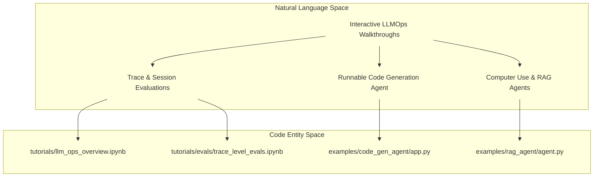
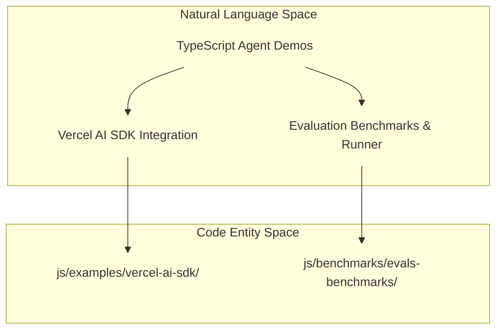

<!-- source: DeepWiki mcp.deepwiki.com · repo Arize-ai/phoenix · page 7 Examples, Tutorials & Benchmarks · fetched 2026-10-26 -->

# Examples, Tutorials & Benchmarks

Relevant source files

The following files were used as context for generating this wiki page:

- [docs/phoenix/cookbook/evaluation/session-level-evaluation.mdx](docs/phoenix/cookbook/evaluation/session-level-evaluation.mdx)
- [examples/code_gen_agent/.gitignore](examples/code_gen_agent/.gitignore)
- [examples/code_gen_agent/.gitkeep](examples/code_gen_agent/.gitkeep)
- [examples/code_gen_agent/README.md](examples/code_gen_agent/README.md)
- [examples/code_gen_agent/agent.py](examples/code_gen_agent/agent.py)
- [examples/code_gen_agent/app.py](examples/code_gen_agent/app.py)
- [examples/code_gen_agent/requirements.txt](examples/code_gen_agent/requirements.txt)
- [examples/code_gen_agent/tools.py](examples/code_gen_agent/tools.py)
- [examples/computer_use_agent/Dockerfile](examples/computer_use_agent/Dockerfile)
- [examples/computer_use_agent/README.md](examples/computer_use_agent/README.md)
- [examples/computer_use_agent/agent.py](examples/computer_use_agent/agent.py)
- [examples/computer_use_agent/app.py](examples/computer_use_agent/app.py)
- [examples/computer_use_agent/image/.config/tint2/applications/firefox-custom.desktop](examples/computer_use_agent/image/.config/tint2/applications/firefox-custom.desktop)
- [examples/computer_use_agent/requirements.txt](examples/computer_use_agent/requirements.txt)
- [examples/computer_use_agent/tools/bash.py](examples/computer_use_agent/tools/bash.py)
- [examples/computer_use_agent/tools/computer.py](examples/computer_use_agent/tools/computer.py)
- [examples/computer_use_agent/tools/edit.py](examples/computer_use_agent/tools/edit.py)
- [examples/rag_agent/agent.py](examples/rag_agent/agent.py)
- [examples/rag_agent/app.py](examples/rag_agent/app.py)
- [examples/rag_agent/requirements.txt](examples/rag_agent/requirements.txt)
- [tutorials/evals/_run_evals_quickstart.py](tutorials/evals/_run_evals_quickstart.py)
- [tutorials/evals/bedrock_tracing_and_evals_tutorial.ipynb](tutorials/evals/bedrock_tracing_and_evals_tutorial.ipynb)
- [tutorials/evals/evaluate_agent.ipynb](tutorials/evals/evaluate_agent.ipynb)
- [tutorials/evals/openai_agents_cookbook.ipynb](tutorials/evals/openai_agents_cookbook.ipynb)
- [tutorials/evals/optimizing_llm_as_a_judge_prompts.ipynb](tutorials/evals/optimizing_llm_as_a_judge_prompts.ipynb)
- [tutorials/evals/session_level_evals.ipynb](tutorials/evals/session_level_evals.ipynb)
- [tutorials/evals/trace_level_evals.ipynb](tutorials/evals/trace_level_evals.ipynb)
- [tutorials/experiments/agents-cookbook.ipynb](tutorials/experiments/agents-cookbook.ipynb)
- [tutorials/experiments/generating_synthetic_datasets.ipynb](tutorials/experiments/generating_synthetic_datasets.ipynb)
- [tutorials/llm_ops_overview.ipynb](tutorials/llm_ops_overview.ipynb)

This page provides an overview of the educational material, interactive walkthroughs, runnable demo applications, and evaluation benchmark suites shipped with the Phoenix repository. These resources are designed to help developers quickly understand how to integrate OpenTelemetry tracing, run LLM-as-a-Judge evaluations, construct multi-turn agent workflows, and execute experiments across both Python and TypeScript ecosystems.

For deep technical details, implementation specifics, and step-by-step guides, refer to the child pages:
- Python notebooks and agent applications: [Python Notebooks & Example Agents](#7.1)
- TypeScript examples and benchmarking tools: [TypeScript Example Apps & Benchmarks](#7.2)
- Documentation architecture and Mintlify site guides: [Documentation Site & Guides](#7.3)

---

## 7.1 Python Notebooks & Example Agents

The Phoenix repository includes an extensive collection of Jupyter notebooks (`tutorials/`) and full-stack runnable agent applications (`examples/`). These materials cover fundamental LLMOps workflows, including automatic OpenTelemetry instrumentation via `phoenix.otel`, trace-level and session-level evaluations using `arize-phoenix-evals`, synthetic dataset generation, and multi-agent orchestration frameworks like LangGraph, Agno, and the OpenAI Agents SDK.

For complete details on configuring notebooks, setting up OpenInference instrumentors, and running reference agent architectures such as `code_gen_agent`, `rag_agent`, and `computer_use_agent`, see [Python Notebooks & Example Agents](#7.1).

Sources:
- `tutorials/llm_ops_overview.ipynb:1-50` [tutorials/llm_ops_overview.ipynb:1-50]()
- `tutorials/evals/trace_level_evals.ipynb:1-45` [tutorials/evals/trace_level_evals.ipynb:1-45]()
- `examples/code_gen_agent/app.py:1-35` [examples/code_gen_agent/app.py:1-35]()
- `examples/code_gen_agent/requirements.txt:1-16` [examples/code_gen_agent/requirements.txt:1-16]()

---

## 7.2 TypeScript Example Apps & Benchmarks

In addition to Python tooling, Phoenix provides TypeScript and JavaScript demonstration applications, client integrations, and evaluation benchmark suites (`js/examples/` and `js/benchmarks/`). These resources demonstrate how to capture traces from Vercel AI SDK and Mastra applications, interact with the Phoenix GraphQL/REST APIs using strongly-typed TypeScript clients, and measure agent performance against standardized evaluation benchmarks.

For comprehensive documentation on TypeScript example apps, Vercel AI SDK converters, experiment runners, and evaluation benchmark suites, see [TypeScript Example Apps & Benchmarks](#7.2).

Sources:
- `js/examples/` (Implicitly referenced via monorepo structure)
- `js/benchmarks/` (Implicitly referenced via monorepo structure)

---

## 7.3 Documentation Site & Guides

The `docs/` directory houses the Mintlify-based documentation site organization, covering getting started guides, integration cookbooks, release notes, self-hosting configurations, and SDK API references. Contributions to documentation are structured around Markdown (`.mdx`) files and configuration mappings in `docs.json`.

For details on site architecture, guide organization, and contribution guidelines, see [Documentation Site & Guides](#7.3).

Sources:
- `docs/phoenix/cookbook/evaluation/session-level-evaluation.mdx` [docs/phoenix/cookbook/evaluation/session-level-evaluation.mdx:1-1]()

---

