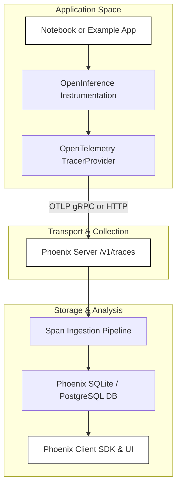
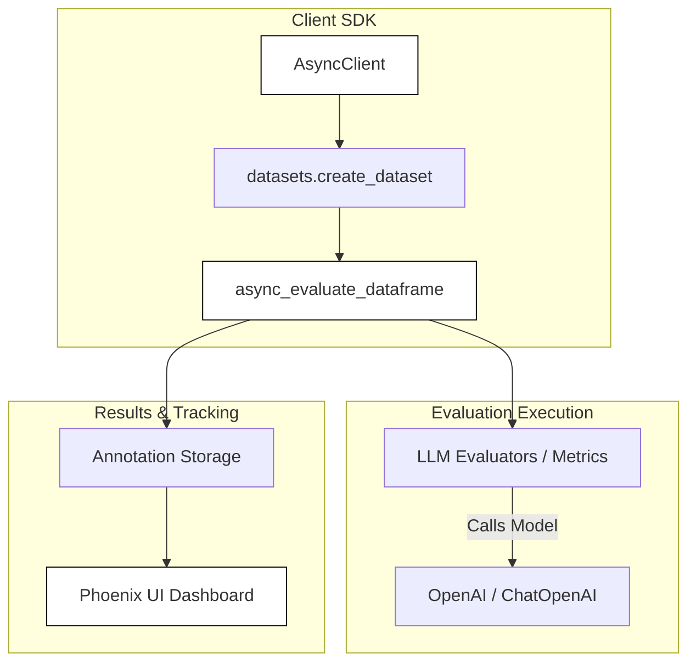

<!-- source: DeepWiki mcp.deepwiki.com · repo Arize-ai/phoenix · page 7.1 Python Notebooks & Example Agents · fetched 2026-10-26 -->

# Python Notebooks & Example Agents

Relevant source files

The following files were used as context for generating this wiki page:

- [docs/phoenix/cookbook/evaluation/session-level-evaluation.mdx](docs/phoenix/cookbook/evaluation/session-level-evaluation.mdx)
- [docs/phoenix/integrations/python/langchain.mdx](docs/phoenix/integrations/python/langchain.mdx)
- [examples/agent_framework_comparison/.gitignore](examples/agent_framework_comparison/.gitignore)
- [examples/agent_framework_comparison/README.md](examples/agent_framework_comparison/README.md)
- [examples/agent_framework_comparison/code_based_agent/main.py](examples/agent_framework_comparison/code_based_agent/main.py)
- [examples/agent_framework_comparison/code_based_agent/router.py](examples/agent_framework_comparison/code_based_agent/router.py)
- [examples/agent_framework_comparison/db/database.py](examples/agent_framework_comparison/db/database.py)
- [examples/agent_framework_comparison/db/download_traces_from_px.py](examples/agent_framework_comparison/db/download_traces_from_px.py)
- [examples/agent_framework_comparison/langgraph/analyze_data.py](examples/agent_framework_comparison/langgraph/analyze_data.py)
- [examples/agent_framework_comparison/langgraph/generate_sql_query.py](examples/agent_framework_comparison/langgraph/generate_sql_query.py)
- [examples/agent_framework_comparison/langgraph/main.py](examples/agent_framework_comparison/langgraph/main.py)
- [examples/agent_framework_comparison/langgraph/router.py](examples/agent_framework_comparison/langgraph/router.py)
- [examples/agent_framework_comparison/li_workflow/main.py](examples/agent_framework_comparison/li_workflow/main.py)
- [examples/agent_framework_comparison/li_workflow/router.py](examples/agent_framework_comparison/li_workflow/router.py)
- [examples/agent_framework_comparison/prompt_templates/router_template.py](examples/agent_framework_comparison/prompt_templates/router_template.py)
- [examples/agent_framework_comparison/requirements.txt](examples/agent_framework_comparison/requirements.txt)
- [examples/agent_framework_comparison/skills/analyze_data.py](examples/agent_framework_comparison/skills/analyze_data.py)
- [examples/agent_framework_comparison/skills/generate_sql_query.py](examples/agent_framework_comparison/skills/generate_sql_query.py)
- [examples/agent_framework_comparison/utils/save_agent_traces.py](examples/agent_framework_comparison/utils/save_agent_traces.py)
- [examples/code_gen_agent/.gitignore](examples/code_gen_agent/.gitignore)
- [examples/code_gen_agent/.gitkeep](examples/code_gen_agent/.gitkeep)
- [examples/code_gen_agent/README.md](examples/code_gen_agent/README.md)
- [examples/code_gen_agent/agent.py](examples/code_gen_agent/agent.py)
- [examples/code_gen_agent/app.py](examples/code_gen_agent/app.py)
- [examples/code_gen_agent/requirements.txt](examples/code_gen_agent/requirements.txt)
- [examples/code_gen_agent/tools.py](examples/code_gen_agent/tools.py)
- [examples/computer_use_agent/Dockerfile](examples/computer_use_agent/Dockerfile)
- [examples/computer_use_agent/README.md](examples/computer_use_agent/README.md)
- [examples/computer_use_agent/agent.py](examples/computer_use_agent/agent.py)
- [examples/computer_use_agent/app.py](examples/computer_use_agent/app.py)
- [examples/computer_use_agent/image/.config/tint2/applications/firefox-custom.desktop](examples/computer_use_agent/image/.config/tint2/applications/firefox-custom.desktop)
- [examples/computer_use_agent/requirements.txt](examples/computer_use_agent/requirements.txt)
- [examples/computer_use_agent/tools/bash.py](examples/computer_use_agent/tools/bash.py)
- [examples/computer_use_agent/tools/computer.py](examples/computer_use_agent/tools/computer.py)
- [examples/computer_use_agent/tools/edit.py](examples/computer_use_agent/tools/edit.py)
- [examples/computer_use_agent/utils.py](examples/computer_use_agent/utils.py)
- [examples/cron-evals/requirements.txt](examples/cron-evals/requirements.txt)
- [examples/rag_agent/agent.py](examples/rag_agent/agent.py)
- [examples/rag_agent/app.py](examples/rag_agent/app.py)
- [examples/rag_agent/requirements.txt](examples/rag_agent/requirements.txt)
- [tutorials/agents/langgraph/langgraph_evaluator.ipynb](tutorials/agents/langgraph/langgraph_evaluator.ipynb)
- [tutorials/agents/langgraph/langgraph_orchestrator.ipynb](tutorials/agents/langgraph/langgraph_orchestrator.ipynb)
- [tutorials/agents/langgraph/langgraph_parallel.ipynb](tutorials/agents/langgraph/langgraph_parallel.ipynb)
- [tutorials/agents/langgraph/langgraph_promptchaining.ipynb](tutorials/agents/langgraph/langgraph_promptchaining.ipynb)
- [tutorials/agents/langgraph/langgraph_router.ipynb](tutorials/agents/langgraph/langgraph_router.ipynb)
- [tutorials/evals/_run_evals_quickstart.py](tutorials/evals/_run_evals_quickstart.py)
- [tutorials/evals/bedrock_tracing_and_evals_tutorial.ipynb](tutorials/evals/bedrock_tracing_and_evals_tutorial.ipynb)
- [tutorials/evals/evals_quickstart.ipynb](tutorials/evals/evals_quickstart.ipynb)
- [tutorials/evals/evaluate_agent.ipynb](tutorials/evals/evaluate_agent.ipynb)
- [tutorials/evals/evaluate_code_readability_classifications.ipynb](tutorials/evals/evaluate_code_readability_classifications.ipynb)
- [tutorials/evals/openai_agents_cookbook.ipynb](tutorials/evals/openai_agents_cookbook.ipynb)
- [tutorials/evals/optimizing_llm_as_a_judge_prompts.ipynb](tutorials/evals/optimizing_llm_as_a_judge_prompts.ipynb)
- [tutorials/evals/session_level_evals.ipynb](tutorials/evals/session_level_evals.ipynb)
- [tutorials/evals/trace_level_evals.ipynb](tutorials/evals/trace_level_evals.ipynb)
- [tutorials/experiments/agents-cookbook.ipynb](tutorials/experiments/agents-cookbook.ipynb)
- [tutorials/experiments/datasets_and_experiments_quickstart.ipynb](tutorials/experiments/datasets_and_experiments_quickstart.ipynb)
- [tutorials/experiments/generating_synthetic_datasets.ipynb](tutorials/experiments/generating_synthetic_datasets.ipynb)
- [tutorials/experiments/run_experiments_with_llama_index.ipynb](tutorials/experiments/run_experiments_with_llama_index.ipynb)
- [tutorials/experiments/summarization.ipynb](tutorials/experiments/summarization.ipynb)
- [tutorials/experiments/txt2sql.ipynb](tutorials/experiments/txt2sql.ipynb)
- [tutorials/llm_ops_overview.ipynb](tutorials/llm_ops_overview.ipynb)
- [tutorials/mcp/tracing_between_mcp_client_and_server/.env.example](tutorials/mcp/tracing_between_mcp_client_and_server/.env.example)
- [tutorials/mcp/tracing_between_mcp_client_and_server/README.md](tutorials/mcp/tracing_between_mcp_client_and_server/README.md)
- [tutorials/mcp/tracing_between_mcp_client_and_server/client.py](tutorials/mcp/tracing_between_mcp_client_and_server/client.py)
- [tutorials/mcp/tracing_between_mcp_client_and_server/requirements.txt](tutorials/mcp/tracing_between_mcp_client_and_server/requirements.txt)
- [tutorials/mcp/tracing_between_mcp_client_and_server/server.py](tutorials/mcp/tracing_between_mcp_client_and_server/server.py)
- [tutorials/tracing/autogen_tutorial.ipynb](tutorials/tracing/autogen_tutorial.ipynb)
- [tutorials/tracing/langchain_agent_tracing_tutorial.ipynb](tutorials/tracing/langchain_agent_tracing_tutorial.ipynb)
- [tutorials/tracing/langchain_tracing_tutorial.ipynb](tutorials/tracing/langchain_tracing_tutorial.ipynb)
- [tutorials/tracing/llama_index_openai_agent_tracing_tutorial.ipynb](tutorials/tracing/llama_index_openai_agent_tracing_tutorial.ipynb)
- [tutorials/tracing/llama_index_tracing_tutorial.ipynb](tutorials/tracing/llama_index_tracing_tutorial.ipynb)
- [tutorials/tracing/openai_tracing_tutorial.ipynb](tutorials/tracing/openai_tracing_tutorial.ipynb)

## Purpose & Scope
This section covers the learning and demonstration materials shipped with the Phoenix repository under the `tutorials/` and `examples/` directories. These runnable resources demonstrate how to integrate Phoenix for OpenTelemetry tracing, perform LLM evaluations, execute structured experiments, build advanced AI agents, and trace Model Context Protocol (MCP) workflows. 

---

## 1. Tutorial Notebooks (`tutorials/`)

The `tutorials/` directory provides interactive Jupyter notebooks demonstrating core Phoenix capabilities across different framework integrations and evaluation paradigms.

### Tracing Tutorials
Tracing tutorials illustrate how to instrument popular LLM orchestration frameworks to emit OpenInference-compliant spans to a local or hosted Phoenix collector.
* **LlamaIndex Tracing**: `tutorials/tracing/llama_index_tracing_tutorial.ipynb` configures `Settings.llm` and `Settings.embed_model` using OpenAI models and hooks into LlamaIndex query engines [tutorials/tracing/llama_index_tracing_tutorial.ipynb:1-172]().
* **LangChain Tracing**: `tutorials/tracing/langchain_tracing_tutorial.ipynb` utilizes `LangChainInstrumentor` from `openinference.instrumentation.langchain` alongside `phoenix.otel.register` to capture LCEL chain runs [tutorials/tracing/langchain_tracing_tutorial.ipynb:1-186]().
* **OpenAI Client Tracing**: `tutorials/tracing/openai_tracing_tutorial.ipynb` demonstrates low-level OpenAI SDK instrumentation via `OpenAIInstrumentor` for structured data extraction tasks [tutorials/tracing/openai_tracing_tutorial.ipynb:1-170]().
* **Agent Tracing**: Notebooks such as `tutorials/tracing/llama_index_openai_agent_tracing_tutorial.ipynb` and `tutorials/tracing/langchain_agent_tracing_tutorial.ipynb` instrument multi-turn agent execution loops and tool calls.

### Evaluation & Experimentation Tutorials
Evaluation and experimentation workflows bridge tracing with data science metrics:
* **Text-to-SQL Experiments**: `tutorials/experiments/txt2sql.ipynb` uses DuckDB, OpenAI, and `phoenix.client.AsyncClient` to perform systematic evaluation-driven development on SQL generation tasks [tutorials/experiments/txt2sql.ipynb:1-194]().
* **LlamaIndex Experiments**: `tutorials/experiments/run_experiments_with_llama_index.ipynb` demonstrates dataset creation, dataset upload via `Client().datasets.create_dataset`, and executing retrieval evaluations [tutorials/experiments/run_experiments_with_llama_index.ipynb:1-207]().
* **Code Readability Evals**: `tutorials/evals/evaluate_code_readability_classifications.ipynb` downloads benchmark datasets and runs binary classification evaluators [tutorials/evals/evaluate_code_readability_classifications.ipynb:1-205]().
* **LLMOps Overview**: `tutorials/llm_ops_overview.ipynb` builds an agent with the Agno framework (`agno`), integrates Tavily search and Open-Meteo weather APIs, and registers OpenTelemetry tracing [tutorials/llm_ops_overview.ipynb:1-201]().

### Model Context Protocol (MCP) Tracing
The MCP tutorial directory (`tutorials/mcp/tracing_between_mcp_client_and_server/`) provides examples for tracing communication between MCP clients and servers using `openinference-instrumentation-mcp` and `strawberry-graphql` [tutorials/mcp/tracing_between_mcp_client_and_server/requirements.txt:1-13]().

Sources:
- `tutorials/tracing/llama_index_tracing_tutorial.ipynb:1-172`
- `tutorials/tracing/langchain_tracing_tutorial.ipynb:1-186`
- `tutorials/experiments/txt2sql.ipynb:1-194`
- `tutorials/llm_ops_overview.ipynb:1-201`
- `tutorials/mcp/tracing_between_mcp_client_and_server/requirements.txt:1-13`

---

## 2. Runnable Example Agent Applications (`examples/`)

The `examples/` directory contains production-style runnable agent applications demonstrating advanced orchestration patterns, graphical user interfaces, and framework comparisons.

### Code Generation Agent (`examples/code_gen_agent`)
The code generation agent combines LangChain, LangGraph, and Gradio to provide an interactive interface for generating and evaluating code.
* Dependencies include `arize-phoenix`, `arize-phoenix-evals`, `langchain`, `langgraph`, and `gradio` [examples/code_gen_agent/requirements.txt:1-16]().
* The application entry point is `examples/code_gen_agent/app.py`, which sets up tracing and mounts the user interface.

### Retrieval-Augmented Generation Agent (`examples/rag_agent`)
The `rag_agent` application implements a RAG workflow with instrumentation for tracking retrieval steps, document reranking, and generation latency.

### Computer Use Agent (`examples/computer_use_agent`)
The `computer_use_agent` provides tool implementations (such as `examples/computer_use_agent/tools/edit.py`) enabling LLMs to interact with file systems and execution environments.

### Agent Framework Comparison (`examples/agent_framework_comparison`)
This directory provides a multi-framework evaluation suite comparing LangChain, LangGraph, LlamaIndex, AutoGen, and CrewAI [examples/agent_framework_comparison/requirements.txt:1-19]().
* It includes shared database schemas (`examples/agent_framework_comparison/db/database.py`), reusable skills (`examples/agent_framework_comparison/skills/`), and trace saving utilities (`examples/agent_framework_comparison/utils/save_agent_traces.py`).

Sources:
- `examples/code_gen_agent/requirements.txt:1-16`
- `examples/agent_framework_comparison/requirements.txt:1-19`

---

## 3. Architecture & Data Flow

The following diagrams illustrate how user interactions in notebooks and example applications flow through instrumentation libraries into the Phoenix backend and client evaluation SDKs.

### Trace Ingestion Data Flow

Sources:
- `tutorials/tracing/langchain_tracing_tutorial.ipynb:80-95`
- `tutorials/experiments/txt2sql.ipynb:80-95`

### Experimentation & Evaluation Pipeline

Sources:
- `tutorials/experiments/run_experiments_with_llama_index.ipynb:45-55`
- `tutorials/tracing/langchain_tracing_tutorial.ipynb:80-92`

---

