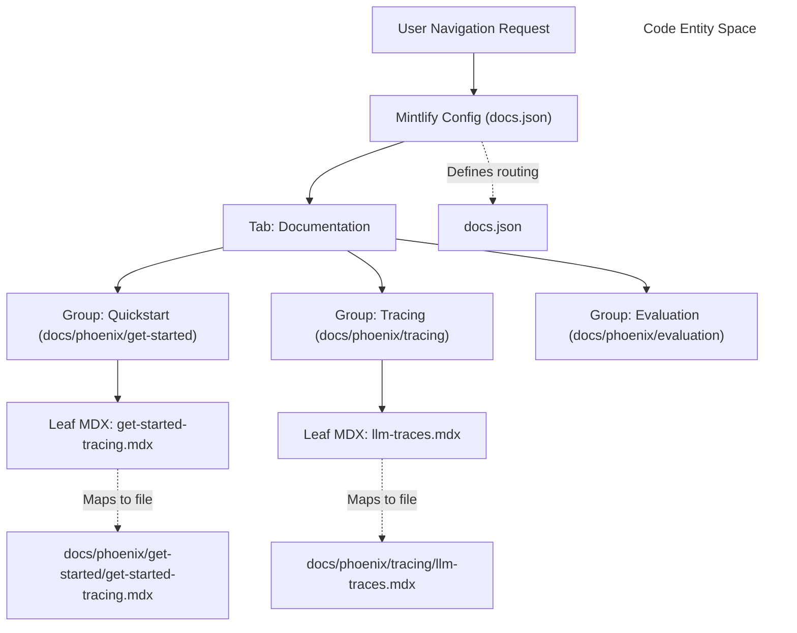
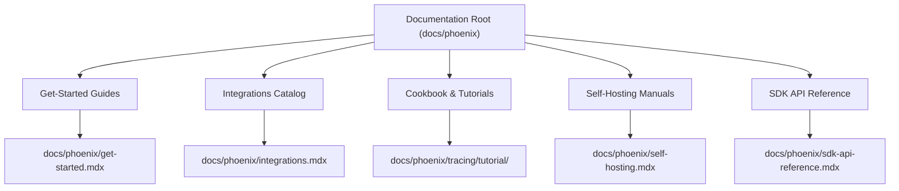
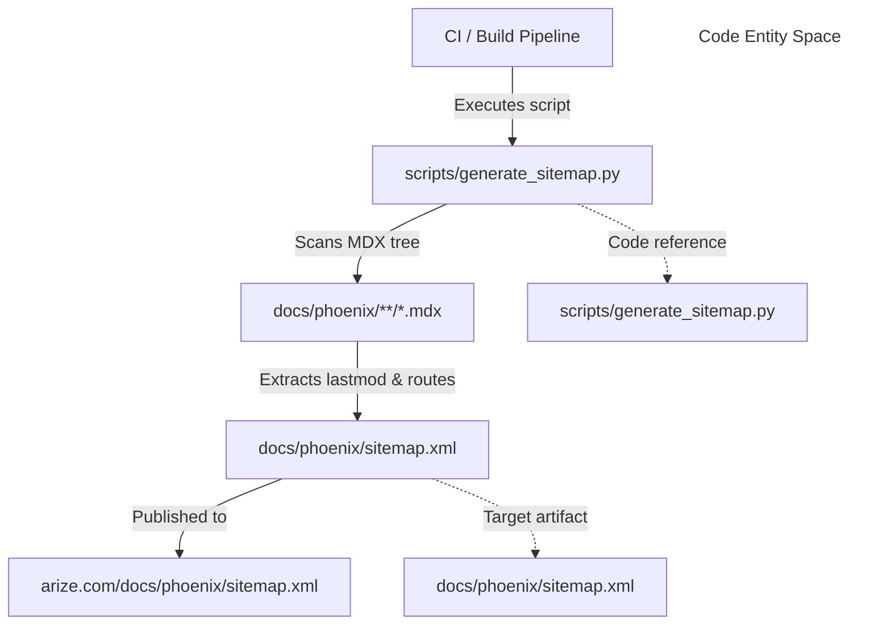

<!-- source: DeepWiki mcp.deepwiki.com · repo Arize-ai/phoenix · page 7.3 Documentation Site & Guides · fetched 2026-10-26 -->

# Documentation Site & Guides

<details>
<summary>Relevant source files</summary>

The following files were used as context for generating this wiki page:

- [docs.json](docs.json)
- [docs/PROMPT.md](docs/PROMPT.md)
- [docs/phoenix.mdx](docs/phoenix.mdx)
- [docs/phoenix/cookbook/tracing/claude-managed-agents-guide.mdx](docs/phoenix/cookbook/tracing/claude-managed-agents-guide.mdx)
- [docs/phoenix/cookbook/tracing/cookbooks.mdx](docs/phoenix/cookbook/tracing/cookbooks.mdx)
- [docs/phoenix/cookbook/tracing/identify-high-signal-traces.mdx](docs/phoenix/cookbook/tracing/identify-high-signal-traces.mdx)
- [docs/phoenix/datasets-and-experiments/how-to-datasets/exporting-datasets.mdx](docs/phoenix/datasets-and-experiments/how-to-datasets/exporting-datasets.mdx)
- [docs/phoenix/datasets-and-experiments/quickstart-datasets.mdx](docs/phoenix/datasets-and-experiments/quickstart-datasets.mdx)
- [docs/phoenix/datasets-and-experiments/tutorial/defining-the-dataset.mdx](docs/phoenix/datasets-and-experiments/tutorial/defining-the-dataset.mdx)
- [docs/phoenix/datasets-and-experiments/tutorial/iteration-workflow-experiments.mdx](docs/phoenix/datasets-and-experiments/tutorial/iteration-workflow-experiments.mdx)
- [docs/phoenix/datasets-and-experiments/tutorial/run-experiments-with-code-evals.mdx](docs/phoenix/datasets-and-experiments/tutorial/run-experiments-with-code-evals.mdx)
- [docs/phoenix/datasets-and-experiments/tutorial/run-experiments-with-llm-judge.mdx](docs/phoenix/datasets-and-experiments/tutorial/run-experiments-with-llm-judge.mdx)
- [docs/phoenix/evaluation/concepts-evals/evaluating-multi-agent-systems.mdx](docs/phoenix/evaluation/concepts-evals/evaluating-multi-agent-systems.mdx)
- [docs/phoenix/evaluation/llm-evals.mdx](docs/phoenix/evaluation/llm-evals.mdx)
- [docs/phoenix/evaluation/python-quickstart.mdx](docs/phoenix/evaluation/python-quickstart.mdx)
- [docs/phoenix/evaluation/typescript-quickstart.mdx](docs/phoenix/evaluation/typescript-quickstart.mdx)
- [docs/phoenix/get-started.mdx](docs/phoenix/get-started.mdx)
- [docs/phoenix/get-started/get-started-evaluations.mdx](docs/phoenix/get-started/get-started-evaluations.mdx)
- [docs/phoenix/get-started/get-started-tracing.mdx](docs/phoenix/get-started/get-started-tracing.mdx)
- [docs/phoenix/integrations.mdx](docs/phoenix/integrations.mdx)
- [docs/phoenix/integrations/developer-tools/coding-agents.mdx](docs/phoenix/integrations/developer-tools/coding-agents.mdx)
- [docs/phoenix/integrations/llm-providers/anthropic.mdx](docs/phoenix/integrations/llm-providers/anthropic.mdx)
- [docs/phoenix/integrations/llm-providers/cohere.mdx](docs/phoenix/integrations/llm-providers/cohere.mdx)
- [docs/phoenix/integrations/llm-providers/cohere/cohere-tracing.mdx](docs/phoenix/integrations/llm-providers/cohere/cohere-tracing.mdx)
- [docs/phoenix/integrations/platforms/claude-managed-agents.mdx](docs/phoenix/integrations/platforms/claude-managed-agents.mdx)
- [docs/phoenix/integrations/platforms/claude-managed-agents/claude-managed-agents-tracing.mdx](docs/phoenix/integrations/platforms/claude-managed-agents/claude-managed-agents-tracing.mdx)
- [docs/phoenix/integrations/platforms/scalekit.mdx](docs/phoenix/integrations/platforms/scalekit.mdx)
- [docs/phoenix/integrations/platforms/scalekit/scalekit-tracing.mdx](docs/phoenix/integrations/platforms/scalekit/scalekit-tracing.mdx)
- [docs/phoenix/integrations/python/google-adk/google-adk-tracing.mdx](docs/phoenix/integrations/python/google-adk/google-adk-tracing.mdx)
- [docs/phoenix/integrations/python/graphite/graphite-integration-guide.mdx](docs/phoenix/integrations/python/graphite/graphite-integration-guide.mdx)
- [docs/phoenix/integrations/python/pydantic/pydantic-evals.mdx](docs/phoenix/integrations/python/pydantic/pydantic-evals.mdx)
- [docs/phoenix/llms.txt](docs/phoenix/llms.txt)
- [docs/phoenix/production-guide.mdx](docs/phoenix/production-guide.mdx)
- [docs/phoenix/release-notes/01-2025/01-18-2025-automatic-and-manual-span-tracing.mdx](docs/phoenix/release-notes/01-2025/01-18-2025-automatic-and-manual-span-tracing.mdx)
- [docs/phoenix/release-notes/07-2025/07-07-2025-databse-disk-usage-monitor.mdx](docs/phoenix/release-notes/07-2025/07-07-2025-databse-disk-usage-monitor.mdx)
- [docs/phoenix/release-notes/10-2025/10-10-2025-viewer-role.mdx](docs/phoenix/release-notes/10-2025/10-10-2025-viewer-role.mdx)
- [docs/phoenix/release-notes/10-2025/10-20-2025-splits.mdx](docs/phoenix/release-notes/10-2025/10-20-2025-splits.mdx)
- [docs/phoenix/resources/frequently-asked-questions.mdx](docs/phoenix/resources/frequently-asked-questions.mdx)
- [docs/phoenix/resources/frequently-asked-questions/what-is-my-phoenix-endpoint.mdx](docs/phoenix/resources/frequently-asked-questions/what-is-my-phoenix-endpoint.mdx)
- [docs/phoenix/resources/frequently-asked-questions/what-is-the-difference-between-phoenix-and-arize.mdx](docs/phoenix/resources/frequently-asked-questions/what-is-the-difference-between-phoenix-and-arize.mdx)
- [docs/phoenix/resources/phoenix-to-arize-ax-migration.mdx](docs/phoenix/resources/phoenix-to-arize-ax-migration.mdx)
- [docs/phoenix/resources/python-api.mdx](docs/phoenix/resources/python-api.mdx)
- [docs/phoenix/resources/typescript-api.mdx](docs/phoenix/resources/typescript-api.mdx)
- [docs/phoenix/sdk-api-reference.mdx](docs/phoenix/sdk-api-reference.mdx)
- [docs/phoenix/sdk-api-reference/python/arize-phoenix-otel.mdx](docs/phoenix/sdk-api-reference/python/arize-phoenix-otel.mdx)
- [docs/phoenix/sdk-api-reference/rest-api/overview.mdx](docs/phoenix/sdk-api-reference/rest-api/overview.mdx)
- [docs/phoenix/sdk-api-reference/typescript/overview.mdx](docs/phoenix/sdk-api-reference/typescript/overview.mdx)
- [docs/phoenix/sdk-api-reference/typescript/packages/phoenix-client/datasets.mdx](docs/phoenix/sdk-api-reference/typescript/packages/phoenix-client/datasets.mdx)
- [docs/phoenix/sdk-api-reference/typescript/packages/phoenix-evals/phoenix-integration.mdx](docs/phoenix/sdk-api-reference/typescript/packages/phoenix-evals/phoenix-integration.mdx)
- [docs/phoenix/sdk-api-reference/typescript/packages/phoenix-otel/overview.mdx](docs/phoenix/sdk-api-reference/typescript/packages/phoenix-otel/overview.mdx)
- [docs/phoenix/self-hosting.mdx](docs/phoenix/self-hosting.mdx)
- [docs/phoenix/self-hosting/architecture.mdx](docs/phoenix/self-hosting/architecture.mdx)
- [docs/phoenix/self-hosting/features/management.mdx](docs/phoenix/self-hosting/features/management.mdx)
- [docs/phoenix/self-hosting/security/privacy.mdx](docs/phoenix/self-hosting/security/privacy.mdx)
- [docs/phoenix/settings/access-control-rbac.mdx](docs/phoenix/settings/access-control-rbac.mdx)
- [docs/phoenix/settings/data-retention.mdx](docs/phoenix/settings/data-retention.mdx)
- [docs/phoenix/sitemap.xml](docs/phoenix/sitemap.xml)
- [docs/phoenix/tracing/concepts-tracing/faqs-tracing.mdx](docs/phoenix/tracing/concepts-tracing/faqs-tracing.mdx)
- [docs/phoenix/tracing/concepts-tracing/otel-openinference/phoenix-otel-helpers.mdx](docs/phoenix/tracing/concepts-tracing/otel-openinference/phoenix-otel-helpers.mdx)
- [docs/phoenix/tracing/how-to-tracing/importing-and-exporting-traces/importing-existing-traces.mdx](docs/phoenix/tracing/how-to-tracing/importing-and-exporting-traces/importing-existing-traces.mdx)
- [docs/phoenix/tracing/how-to-tracing/importing-and-exporting-traces/retrieve-traces-via-cli.mdx](docs/phoenix/tracing/how-to-tracing/importing-and-exporting-traces/retrieve-traces-via-cli.mdx)
- [docs/phoenix/tracing/how-to-tracing/setup-tracing.mdx](docs/phoenix/tracing/how-to-tracing/setup-tracing.mdx)
- [docs/phoenix/tracing/how-to-tracing/setup-tracing/setup-using-phoenix-otel.mdx](docs/phoenix/tracing/how-to-tracing/setup-tracing/setup-using-phoenix-otel.mdx)
- [docs/phoenix/tracing/llm-traces.mdx](docs/phoenix/tracing/llm-traces.mdx)
- [docs/phoenix/tracing/llm-traces/metrics.mdx](docs/phoenix/tracing/llm-traces/metrics.mdx)
- [docs/phoenix/tracing/llm-traces/projects.mdx](docs/phoenix/tracing/llm-traces/projects.mdx)
- [docs/phoenix/user-guide.mdx](docs/phoenix/user-guide.mdx)
- [docs/sitemap.xml](docs/sitemap.xml)
- [docs/snippets/agent-assisted-onboarding-prereq.mdx](docs/snippets/agent-assisted-onboarding-prereq.mdx)
- [docs/snippets/agent-assisted-onboarding.mdx](docs/snippets/agent-assisted-onboarding.mdx)
- [docs/snippets/connect-to-phoenix-env.mdx](docs/snippets/connect-to-phoenix-env.mdx)
- [js/.gitignore](js/.gitignore)
- [js/packages/phoenix-client/src/datasets/createDatasetSplit.ts](js/packages/phoenix-client/src/datasets/createDatasetSplit.ts)
- [js/packages/phoenix-client/src/datasets/deleteDatasetSplit.ts](js/packages/phoenix-client/src/datasets/deleteDatasetSplit.ts)
- [js/packages/phoenix-client/src/datasets/index.ts](js/packages/phoenix-client/src/datasets/index.ts)
- [js/packages/phoenix-client/src/datasets/resolveDatasetIdentifier.ts](js/packages/phoenix-client/src/datasets/resolveDatasetIdentifier.ts)
- [js/packages/phoenix-client/src/datasets/updateDatasetSplit.ts](js/packages/phoenix-client/src/datasets/updateDatasetSplit.ts)
- [packages/phoenix-client/src/phoenix/client/constants/__init__.py](packages/phoenix-client/src/phoenix/client/constants/__init__.py)
- [scripts/generate_sitemap.py](scripts/generate_sitemap.py)
- [sitemap.xml](sitemap.xml)
- [tutorials/experiments/python_experiments_quickstart.ipynb](tutorials/experiments/python_experiments_quickstart.ipynb)
- [tutorials/quickstarts/python_quickstart.ipynb](tutorials/quickstarts/python_quickstart.ipynb)

</details>


## Purpose and Scope

This page documents the organization, generation pipeline, and contribution workflows for the Arize Phoenix documentation site. Powered by **Mintlify**, the documentation infrastructure bridges conceptual user guides, integration catalogs, cookbook tutorials, self-hosting manuals, and auto-generated SDK API references. 

---

## 1. Mintlify Configuration & Site Architecture

The Phoenix documentation is declared and structured via the top-level configuration manifest [docs.json](). This file defines the global theme, color schemes (`#00769E` primary, `#39C7FF` light, `#009DD2` dark), typography (`Geist`), contextual AI assist options (`copy`, `view`, `chatgpt`, `claude`, `perplexity`), and the multi-level navigation tree [docs.json:1-174]().

The site content consists of Markdown (`.md`) and MDX (`.mdx`) files located in the `docs/phoenix/` directory. The navigation object in [docs.json]() organizes pages into structured tabs, groups, and sub-groups (such as *Quickstart*, *Coding Agents*, *Tracing*, *Evaluation*, and *API Reference*).


*Diagram 1: Mintlify Navigation & File Mapping Structure*

Sources: [docs.json:1-174](), [docs/phoenix.mdx:1-103]()

---

## 2. Content Sections & Organization

The documentation site is divided into distinct functional verticals:

1. **Get-Started Guides**: Rapid onboarding tutorials (`docs/phoenix/get-started`) demonstrating local server startup [docs/phoenix/get-started.mdx](), OpenTelemetry instrumentation [docs/phoenix/get-started/get-started-tracing.mdx](), and experiment evaluation workflows [docs/phoenix/get-started/get-started-evaluations.mdx]().
2. **Integrations Catalog**: Comprehensive guides for AI frameworks, LLM providers, and coding agents [docs/phoenix/integrations.mdx]() detailing native auto-instrumentation packages [docs/phoenix/integrations/developer-tools/coding-agents.mdx]().
3. **Cookbook & Tutorials**: End-to-end recipes showing advanced patterns like custom evaluators, multi-turn session tracking, and production metric monitoring [docs/phoenix/llms.txt:24-30]().
4. **Self-Hosting & Production Guides**: Operational documentation covering Docker deployment, Kubernetes Helm charts, environment variable tuning, security, and privacy compliance [docs/phoenix/self-hosting.mdx]().
5. **SDK API Reference**: Programmatic reference documentation covering Python clients, `@arizeai/phoenix-otel`, REST API endpoints, and GraphQL schemas [docs/phoenix/sdk-api-reference.mdx]().


*Diagram 2: Content Hierarchy Layout*

Sources: [docs/phoenix/integrations.mdx:1-41](), [docs/phoenix/get-started/get-started-tracing.mdx:1-103]()

---

## 3. Sitemap Generation & Search Indexing

To ensure search engine discoverability and accurate indexing by LLM scraping tools, Phoenix maintains an XML sitemap at [docs/phoenix/sitemap.xml]() and the index file [docs/phoenix/llms.txt]().

The sitemap lists all canonical URLs for documentation pages along with their modification timestamps [docs/phoenix/sitemap.xml:1-172](). Sitemap synchronization is automated via Python scripts in the repository:


*Diagram 3: Documentation Sitemap Generation Pipeline*

Sources: [docs/phoenix/sitemap.xml:1-172](), [scripts/generate_sitemap.py]()

---

## 4. Contributing Documentation

Contributors looking to add or modify documentation must adhere to the following workflow:

1. **File Placement**: Create or edit `.mdx` files within the appropriate subdirectory under `docs/phoenix/`.
2. **Navigation Updates**: Register new pages in [docs.json]() under the corresponding navigation group to ensure they appear in the Mintlify sidebar.
3. **Frontmatter Standards**: Include valid Mintlify frontmatter at the top of every MDX file, specifying `title` and `description`:
   ```yaml
   ---
   title: "Page Title"
   description: "Concise summary of the guide or reference."
   ---
   ```
4. **Link Integrity & Snippets**: Use relative pathing for internal Markdown links. When referencing repository code snippets, utilize the comment-tag snippet inclusion syntax [docs/phoenix/get-started/get-started-tracing.mdx:20]() rather than hardcoding code blocks.
5. **Verification**: Run local validation and preview builds via Mintlify CLI before submitting pull requests.

Sources: [docs.json:51-174](), [docs/phoenix/get-started/get-started-tracing.mdx:16-29]()

---

