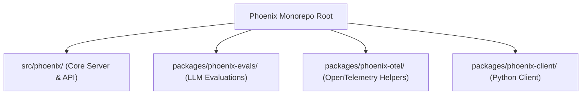
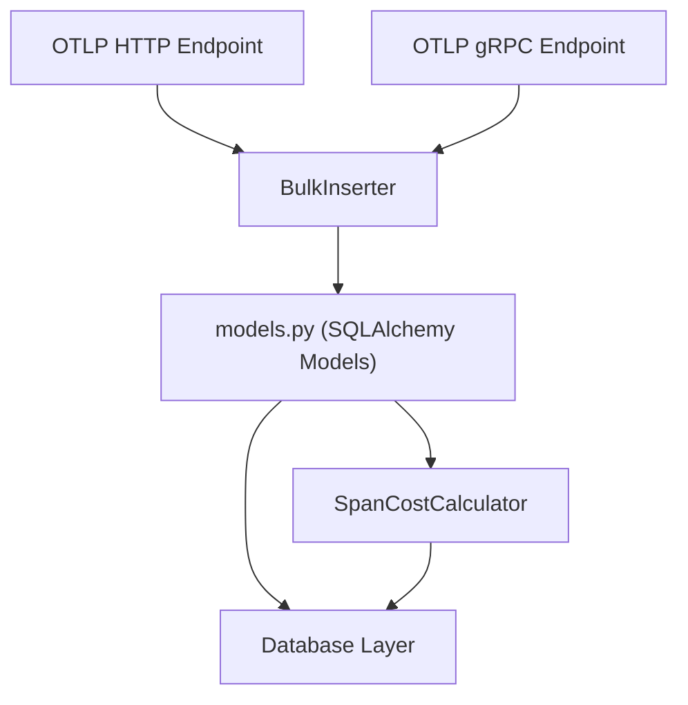
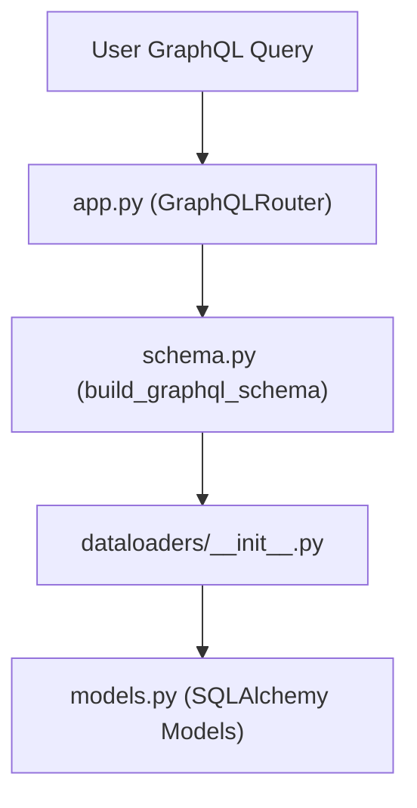
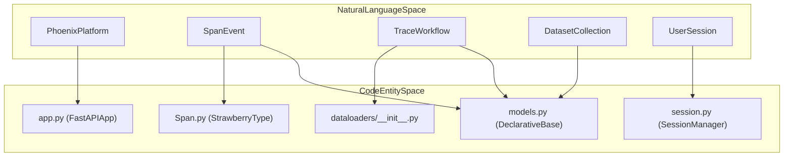

<!-- source: DeepWiki mcp.deepwiki.com · repo Arize-ai/phoenix · page 8 Glossary · fetched 2026-10-26 -->

# Glossary

Relevant source files

The following files were used as context for generating this wiki page:

- [.release-please-manifest.json](.release-please-manifest.json)
- [CHANGELOG.md](CHANGELOG.md)
- [cspell.json](cspell.json)
- [internal_docs/specs/online-evals.md](internal_docs/specs/online-evals.md)
- [internal_docs/specs/playground.md](internal_docs/specs/playground.md)
- [internal_docs/specs/prompts.md](internal_docs/specs/prompts.md)
- [internal_docs/specs/server_evaluators.md](internal_docs/specs/server_evaluators.md)
- [kustomize/README.md](kustomize/README.md)
- [packages/phoenix-client/CHANGELOG.md](packages/phoenix-client/CHANGELOG.md)
- [packages/phoenix-client/pyproject.toml](packages/phoenix-client/pyproject.toml)
- [packages/phoenix-evals/CHANGELOG.md](packages/phoenix-evals/CHANGELOG.md)
- [packages/phoenix-evals/pyproject.toml](packages/phoenix-evals/pyproject.toml)
- [pyproject.toml](pyproject.toml)
- [requirements/ci.txt](requirements/ci.txt)
- [requirements/packages/phoenix-evals.txt](requirements/packages/phoenix-evals.txt)
- [requirements/type-check.txt](requirements/type-check.txt)
- [requirements/unit-tests.txt](requirements/unit-tests.txt)
- [scripts/data/generate_traces.py](scripts/data/generate_traces.py)
- [src/phoenix/__init__.py](src/phoenix/__init__.py)
- [src/phoenix/config.py](src/phoenix/config.py)
- [src/phoenix/db/alembic.ini](src/phoenix/db/alembic.ini)
- [src/phoenix/db/engines.py](src/phoenix/db/engines.py)
- [src/phoenix/db/migrate.py](src/phoenix/db/migrate.py)
- [src/phoenix/db/migrations/__init__.py](src/phoenix/db/migrations/__init__.py)
- [src/phoenix/db/migrations/env.py](src/phoenix/db/migrations/env.py)
- [src/phoenix/db/migrations/versions/10460e46d750_datasets.py](src/phoenix/db/migrations/versions/10460e46d750_datasets.py)
- [src/phoenix/db/migrations/versions/3be8647b87d8_add_token_columns_to_spans_table.py](src/phoenix/db/migrations/versions/3be8647b87d8_add_token_columns_to_spans_table.py)
- [src/phoenix/db/migrations/versions/cf03bd6bae1d_init.py](src/phoenix/db/migrations/versions/cf03bd6bae1d_init.py)
- [src/phoenix/db/models.py](src/phoenix/db/models.py)
- [src/phoenix/server/api/context.py](src/phoenix/server/api/context.py)
- [src/phoenix/server/api/dataloaders/__init__.py](src/phoenix/server/api/dataloaders/__init__.py)
- [src/phoenix/server/api/dataloaders/trace_root_spans.py](src/phoenix/server/api/dataloaders/trace_root_spans.py)
- [src/phoenix/server/api/queries.py](src/phoenix/server/api/queries.py)
- [src/phoenix/server/api/routers/v1/experiment_evaluations.py](src/phoenix/server/api/routers/v1/experiment_evaluations.py)
- [src/phoenix/server/api/routers/v1/experiment_runs.py](src/phoenix/server/api/routers/v1/experiment_runs.py)
- [src/phoenix/server/api/routers/v1/experiments.py](src/phoenix/server/api/routers/v1/experiments.py)
- [src/phoenix/server/api/types/Experiment.py](src/phoenix/server/api/types/Experiment.py)
- [src/phoenix/server/api/types/MimeType.py](src/phoenix/server/api/types/MimeType.py)
- [src/phoenix/server/api/types/Project.py](src/phoenix/server/api/types/Project.py)
- [src/phoenix/server/api/types/ProjectSession.py](src/phoenix/server/api/types/ProjectSession.py)
- [src/phoenix/server/api/types/Span.py](src/phoenix/server/api/types/Span.py)
- [src/phoenix/server/api/types/Trace.py](src/phoenix/server/api/types/Trace.py)
- [src/phoenix/server/app.py](src/phoenix/server/app.py)
- [src/phoenix/server/main.py](src/phoenix/server/main.py)
- [src/phoenix/server/templates/index.html](src/phoenix/server/templates/index.html)
- [src/phoenix/server/thread_server.py](src/phoenix/server/thread_server.py)
- [src/phoenix/services.py](src/phoenix/services.py)
- [src/phoenix/session/session.py](src/phoenix/session/session.py)
- [src/phoenix/settings.py](src/phoenix/settings.py)
- [src/phoenix/trace/fixtures.py](src/phoenix/trace/fixtures.py)
- [src/phoenix/trace/schemas.py](src/phoenix/trace/schemas.py)
- [src/phoenix/trace/span_json_decoder.py](src/phoenix/trace/span_json_decoder.py)
- [src/phoenix/trace/span_json_encoder.py](src/phoenix/trace/span_json_encoder.py)
- [src/phoenix/trace/utils.py](src/phoenix/trace/utils.py)
- [src/phoenix/version.py](src/phoenix/version.py)
- [tests/unit/_helpers.py](tests/unit/_helpers.py)
- [tests/unit/db/test_engines.py](tests/unit/db/test_engines.py)
- [tests/unit/server/api/routers/v1/test_experiments.py](tests/unit/server/api/routers/v1/test_experiments.py)
- [tests/unit/server/api/test_queries.py](tests/unit/server/api/test_queries.py)
- [tests/unit/server/api/types/test_Experiment.py](tests/unit/server/api/types/test_Experiment.py)
- [tests/unit/server/api/types/test_Project.py](tests/unit/server/api/types/test_Project.py)
- [tests/unit/server/api/types/test_ProjectSession.py](tests/unit/server/api/types/test_ProjectSession.py)
- [tests/unit/server/api/types/test_Span.py](tests/unit/server/api/types/test_Span.py)
- [tests/unit/server/api/types/test_Trace.py](tests/unit/server/api/types/test_Trace.py)
- [tox.ini](tox.ini)
- [uv.lock](uv.lock)

## Purpose and Scope

This page provides definitions for codebase-specific terms, jargon, abbreviations, and domain concepts used within the Phoenix project. It clarifies terminology for onboarding engineers and links directly to relevant modules, classes, and functions for deeper technical investigation.

---

## Phoenix Core Concepts

### Phoenix
Phoenix is an open-source AI observability platform designed for experimentation, evaluation, and troubleshooting of large language model (LLM) applications. It provides trace collection via OpenTelemetry, dataset versioning, evaluation frameworks, prompt management, and a vendor-agnostic playground interface supporting multiple LLM providers.

- Core Python package: `arize-phoenix`
- Main server entrypoint module: `phoenix.server.main`
- Implements features: tracing, evaluation, datasets, experiments, prompts, authentication, cost tracking
- Version tracked in: `src/phoenix/version.py`

**Key Code:**  
- Main server entrypoint: [src/phoenix/server/main.py:1-29]()  
- Version string: [src/phoenix/version.py:1-1]()  
- Package metadata: [.release-please-manifest.json:1]()

Sources:  
- [src/phoenix/server/main.py:1-29]()  
- [src/phoenix/version.py:1-1]()  
- [.release-please-manifest.json:1]()

---

### Span  
A *Span* represents a discrete operation or event within a trace, usually recording an interaction with an LLM or a related tool (e.g., tool invocation, retrieval, reranker).

- Built on OpenTelemetry spans enhanced with AI-specific semantic conventions (e.g., language model details, input/output payloads)
- Contains fields like timestamps, span kind (LLM, TOOL, CHAIN, RETRIEVER, etc.), input and output content, model metadata, and annotations
- Span kinds include `LLM`, `CHAIN`, `TOOL`, `RETRIEVER`, `EMBEDDING`, `RERANKER`, and `AGENT`

**Key Code:**  
- SQLAlchemy Span ORM model: [src/phoenix/db/models.py:440-540]()  
- GraphQL Span type schema: [src/phoenix/server/api/types/Span.py:57-232]()  

Sources:  
- [src/phoenix/db/models.py:440-540]()  
- [src/phoenix/server/api/types/Span.py:57-232]()  

---

### Trace  
A *Trace* is a collection of related spans that represent an entire workflow, request, or session lifecycle within an LLM application, enabling end-to-end analysis and debugging.

- Traces provide visibility into the whole request including nested tool, chain, and LLM calls
- Incoming trace data is ingested over OTLP (OpenTelemetry Protocol) via gRPC and HTTP, decoded, validated, and stored in the database

**Key Code:**  
- Trace GraphQL type: [src/phoenix/server/api/types/Trace.py:30-95]()  
- Trace DataLoader usage: [src/phoenix/server/api/dataloaders/__init__.py:1-50]()  

Sources:  
- [src/phoenix/server/api/types/Trace.py:30-95]()  
- [src/phoenix/server/api/dataloaders/__init__.py:1-50]()  

---

### Project  
A *Project* is a top-level namespace in Phoenix grouping related traces, datasets, experiments, annotations, and sessions. It serves organizational and access control boundaries.

- Holds configuration such as trace retention policies
- Supports multi-user collaboration with role-based access control

**Key Code:**  
- Default project constant `DEFAULT_PROJECT_NAME`: [src/phoenix/config.py:60-60]()  
- Project GraphQL type and definitions: [src/phoenix/server/api/types/Project.py:61-195]()  

Sources:  
- [src/phoenix/config.py:60-60]()  
- [src/phoenix/server/api/types/Project.py:61-195]()  

---

### Dataset  
A *Dataset* is a versioned collection of example inputs and expected outputs used for evaluation, experimentation, and fine-tuning.

- Supports example revisions, splitting, and metadata
- Links between spans and dataset examples enable annotation and metric reporting

**Key Code:**  
- Dataset SQLAlchemy models `Dataset`, `DatasetExample`: [src/phoenix/db/models.py:1020-1100]()  
- Dataset GraphQL types: [src/phoenix/server/api/types/Dataset.py:15-80]()  

Sources:  
- [src/phoenix/db/models.py:1020-1100]()  
- [src/phoenix/server/api/types/Dataset.py:15-80]()  

---

### Experiment  
An *Experiment* encapsulates evaluation runs comparing models, prompts, or data splits.

- Aggregates metrics time series, latency, error rates
- Tracks statuses such as `RUNNING`, `COMPLETED`, `STOPPED`, `ERROR`

**Key Code:**  
- Experiment GraphQL type: [src/phoenix/server/api/types/Experiment.py:20-70]()  
- Experiment status enum values: [src/phoenix/db/models.py:179-195]()  

Sources:  
- [src/phoenix/server/api/types/Experiment.py:20-70]()  
- [src/phoenix/db/models.py:179-195]()  

---

### Evaluator  
*Evaluators* define automated or manual benchmarking of model outputs using dataset examples.

- Include LLM evaluators, code evaluators, and built-in classification evaluators
- Support input mapping to align dataset schema to model inputs

**Key Code:**  
- Evaluator ORM definitions: [src/phoenix/db/models.py:178-180]()  
- Python evaluation framework package: [packages/phoenix-evals/pyproject.toml:1-40]()  

Sources:  
- [src/phoenix/db/models.py:178-180]()  
- [packages/phoenix-evals/pyproject.toml:1-40]()  

---

### Annotation  
*Annotations* are labels, scores, or qualitative feedback provided on spans, traces, or dataset examples to enrich analysis.

- Support annotator kinds: `LLM`, `HUMAN`, `CODE`
- Annotation types: `CATEGORICAL`, `CONTINUOUS`, and `FREEFORM`
- Metadata includes explanation text, source identifiers, timestamps, and user info

**Key Code:**  
- Annotation configuration types: [src/phoenix/db/types/annotation_configs.py:1-70]()  

Sources:  
- [src/phoenix/db/types/annotation_configs.py:1-70]()  

---

### Session  
A *Session* groups related interactions, particularly multi-turn conversations or AI assistant dialogs.

- Captures conversational context with linked traces and turns
- PxI (Phoenix Intelligence) agent interactions are session-bound for behavioral continuity

**Key Code:**  
- Session class management: [src/phoenix/session/session.py:7-143]()  

Sources:  
- [src/phoenix/session/session.py:7-143]()  

---

## Monorepo Structure  

Phoenix is developed as a monorepo combining Python and TypeScript packages for integrated development and releases.

### Python Packages

| Package Name          | Description                              | Location                  |
|-----------------------|------------------------------------------|---------------------------|
| `arize-phoenix`       | Core server, API, models, ingestion       | `src/phoenix/`            |
| `arize-phoenix-evals` | LLM evaluation framework                   | `packages/phoenix-evals/` |
| `arize-phoenix-otel`  | OpenTelemetry integration helpers          | `packages/phoenix-otel/`  |
| `arize-phoenix-client`| REST/GraphQL client library                  | `packages/phoenix-client/`|

### TypeScript Packages

| Package Name           | Description                            | Location                     |
|------------------------|--------------------------------------|------------------------------|
| `@arizeai/phoenix-client`| Frontend client API typings & hooks   | `js/packages/phoenix-client/`|
| `@arizeai/phoenix-mcp`   | Model Context Protocol server and client | `js/packages/phoenix-mcp/`  |
| `@arizeai/phoenix-cli`   | CLI tools for managing project entities | `js/packages/phoenix-cli/`  |

Versioning is centrally managed with `.release-please-manifest.json` tracking package version numbers.

Title: "Phoenix Monorepo Package Dependencies"

Sources:  
- [packages/phoenix-client/pyproject.toml:1-33]()  
- [.release-please-manifest.json:1]()  
- [src/phoenix/version.py:1-1]()  
- [src/phoenix/server/main.py:1-29]()  

---

## Server Architecture Highlights

### FastAPI Application  
Phoenix server is a FastAPI ASGI app providing REST, GraphQL, and WebSocket endpoints.

- Uses middleware for CORS, authentication (bearer token, OAuth2), CSRF, gzip compression, and tracing
- Startup lifecycle supports asynchronous daemons, task sweeps, and database session pools
- API routers organized by version and authentication domain

**Key Code:**  
- FastAPI app setup: [src/phoenix/server/app.py:33-60]()  
- Authentication backend: `BearerTokenAuthBackend` [src/phoenix/server/app.py:122-122]()  

Sources:  
- [src/phoenix/server/app.py:33-122]()  

---

### GraphQL API  
Phoenix provides a comprehensive GraphQL API using Strawberry GraphQL.

- Uses DataLoader batching pattern for efficient DB access
- Builds types including Project, Dataset, Experiment, Span, Annotation, Agent
- Supports queries, mutations, subscriptions

**Key Code:**  
- Schema builder function: [src/phoenix/server/api/schema.py:1-100]()  
- GraphQLRouter instance: [src/phoenix/server/app.py:55-56]()  

Sources:  
- [src/phoenix/server/api/schema.py:1-100]()  
- [src/phoenix/server/app.py:55-56]()  

---

### OTLP Ingestion  
Phoenix ingests OpenTelemetry Protocol (OTLP) formatted trace spans over HTTP and gRPC.

- OTLP requests decoded and validated, spans inserted in batches via `BulkInserter`
- `SpanCostCalculator` daemon computes cost estimates for spans based on token usage and model pricing
- Supports synchronous and streaming ingestion paths

**Key Code:**  
- BulkInserter implementation: [src/phoenix/db/bulk_inserter.py:1-100]()  
- SpanCostCalculator daemon: [src/phoenix/server/cost_tracking/span_cost_calculator.py:1-42]()  

Sources:  
- [src/phoenix/db/bulk_inserter.py:1-100]()  
- [src/phoenix/server/cost_tracking/span_cost_calculator.py:1-42]()  

---

### Database Layer  
Phoenix uses SQLAlchemy async ORM supporting PostgreSQL and SQLite backend.

- Models defined with declarative base in `src/phoenix/db/models.py`
- Migrations managed with Alembic
- Allows efficient queries with complex filters, joins, and batch inserts

**Key Code:**  
- SQLAlchemy declarative base and models: [src/phoenix/db/models.py:40-53]()  
- Async Engine configuration: [src/phoenix/db/engines.py:1-50]()  

Sources:  
- [src/phoenix/db/models.py:40-53]()  
- [src/phoenix/db/engines.py:1-50]()  

---

## Important Data Flows and Relationships

Title: "OTLP Ingestion and Cost Tracking Pipeline"

Sources:  
- [src/phoenix/server/app.py:81-90]()  
- [src/phoenix/db/bulk_inserter.py:1-100]()  
- [src/phoenix/server/cost_tracking/span_cost_calculator.py:1-42]()  
- [src/phoenix/db/models.py:40-53]()  

---

Title: "GraphQL Query Execution Flow"

Sources:  
- [src/phoenix/server/app.py:55-60]()  
- [src/phoenix/server/api/schema.py:1-100]()  
- [src/phoenix/server/api/dataloaders/__init__.py:1-50]()  
- [src/phoenix/db/models.py:40-53]()  

---

## Bridging Natural Language Terms to Core Code Entities

Title: "Mapping System Concepts to Code Entities"

Sources:  
- [src/phoenix/server/app.py:33-60]()  
- [src/phoenix/db/models.py:40-53]()  
- [src/phoenix/server/api/types/Span.py:57-232]()  
- [src/phoenix/server/api/dataloaders/__init__.py:1-50]()  
- [src/phoenix/session/session.py:7-143]()