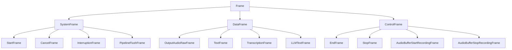
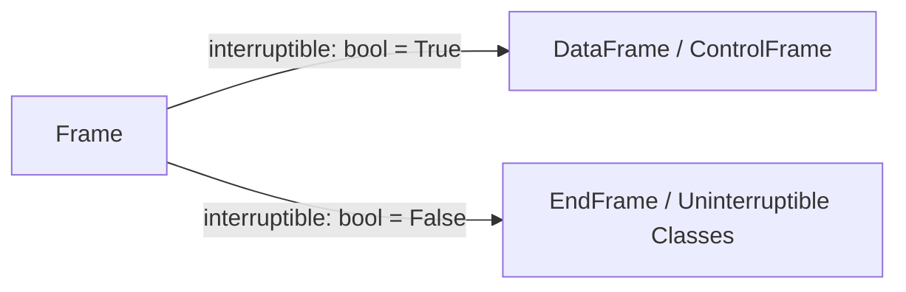
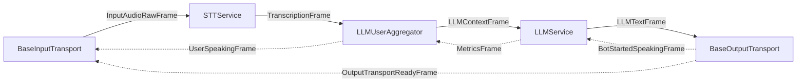
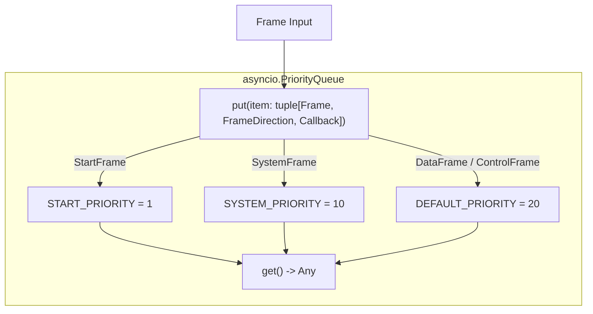
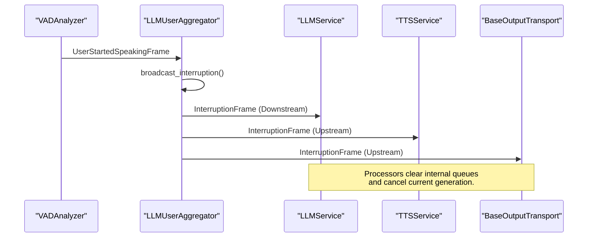

<!-- source: DeepWiki mcp.deepwiki.com · repo pipecat-ai/pipecat · page 3.1 Frame System and Processing · fetched 2026-10-26 -->

# Frame System and Processing

Relevant source files

The following files were used as context for generating this wiki page:

- [CHANGELOG.md](CHANGELOG.md)
- [changelog/6081.fixed.md](changelog/6081.fixed.md)
- [src/pipecat/audio/filters/__init__.py](src/pipecat/audio/filters/__init__.py)
- [src/pipecat/audio/filters/base_audio_filter.py](src/pipecat/audio/filters/base_audio_filter.py)
- [src/pipecat/frames/frames.py](src/pipecat/frames/frames.py)
- [src/pipecat/pipeline/task.py](src/pipecat/pipeline/task.py)
- [src/pipecat/processors/aggregators/dtmf_aggregator.py](src/pipecat/processors/aggregators/dtmf_aggregator.py)
- [src/pipecat/processors/aggregators/llm_response.py](src/pipecat/processors/aggregators/llm_response.py)
- [src/pipecat/processors/frame_processor.py](src/pipecat/processors/frame_processor.py)
- [src/pipecat/transports/base_input.py](src/pipecat/transports/base_input.py)
- [src/pipecat/transports/base_output.py](src/pipecat/transports/base_output.py)
- [src/pipecat/transports/base_transport.py](src/pipecat/transports/base_transport.py)
- [src/pipecat/utils/frame_queue.py](src/pipecat/utils/frame_queue.py)
- [tests/test_base_output_transport.py](tests/test_base_output_transport.py)
- [tests/test_dtmf_aggregator.py](tests/test_dtmf_aggregator.py)
- [tests/test_frame_processor.py](tests/test_frame_processor.py)
- [tests/test_frame_queue.py](tests/test_frame_queue.py)

This document describes the frame-based data model and processing architecture that powers Pipecat's real-time pipeline system. It covers the frame type hierarchy, frame metadata, directional flow, and the priority queue mechanism that enables ordered processing, pipeline draining, and interruption handling.

---

## Purpose and Scope

Frames are the fundamental unit of data flow in Pipecat. Every piece of information—audio samples, video frames, text tokens, system commands, control signals—flows through the pipeline as a frame object. This document explains:

- The frame class hierarchy and type system (`SystemFrame`, `DataFrame`, `ControlFrame`) defined in `src/pipecat/frames/frames.py`.
- Built-in frame metadata and tracking capabilities (`id`, `name`, `pts`, `metadata`, `interruptible`).
- How frames flow in upstream and downstream directions via `FrameDirection` (`src/pipecat/processors/frame_processor.py`).
- The priority queue system (`FrameProcessorQueue`) that separates system frames from data frames.
- Frame processing lifecycle and event handling.
- Interruption handling mechanics and interruptible flags.

Sources: [src/pipecat/frames/frames.py:7-20](), [src/pipecat/processors/frame_processor.py:7-12]()

---

## Frame Type Hierarchy

Pipecat defines a class hierarchy that categorizes frames by processing priority and semantics. All frames inherit from the base `Frame` class [src/pipecat/frames/frames.py:74-120]().

### Hierarchy Diagram

**Diagram: Pipecat Frame Class Hierarchy (Code Entity Space)**

Sources: [src/pipecat/frames/frames.py:74-156](), [src/pipecat/processors/frame_processor.py:30-42]()

### Frame Category Semantics

| Category | Priority | Queueing Behavior | Use Case | Default Interruptible |
|----------|----------|-------------------|----------|----------------------|
| `SystemFrame` | High | Processed immediately, bypasses data queue | Lifecycle, speech boundaries, interruptions, flushes [src/pipecat/frames/frames.py:122-130]() | Varies (often `False` for critical control/end) |
| `DataFrame` | Normal | Queued and processed in order | Audio, video, text, transcriptions [src/pipecat/frames/frames.py:132-141]() | `True` |
| `ControlFrame` | Normal | Queued and processed in order | Settings, tool configuration, termination, buffer control [src/pipecat/frames/frames.py:144-156]() | `True` |

Sources: [src/pipecat/frames/frames.py:122-156](), [src/pipecat/processors/frame_processor.py:131-184]()

### Interruptible Field and Deprecated Mixin

The `UninterruptibleFrame` mixin is deprecated since 1.11.0 in favor of the `interruptible` field defined directly on the base `Frame` class [src/pipecat/frames/frames.py:163-181](). 

**Diagram: Interruptible Frame Configuration**

Frames with `interruptible: bool = field(default=False, init=False)` (such as `EndFrame`) remain in internal queues during interruptions and are never cancelled. This ensures critical frames are always delivered to completion [src/pipecat/frames/frames.py:97-105](), [src/pipecat/processors/frame_processor.py:30-42](), [CHANGELOG.md:67-73](). The `interruptible` field can also be set on an individual frame instance before pushing it to override the default behavior for that specific frame [CHANGELOG.md:67-73]().

Sources: [src/pipecat/frames/frames.py:97-181](), [src/pipecat/processors/frame_processor.py:30-42](), [CHANGELOG.md:67-73]()

---

## Frame Base Properties

Every frame instance automatically receives metadata fields that enable tracking, correlation, and debugging across the pipeline [src/pipecat/frames/frames.py:74-120]().

| Property | Type | Description |
|----------|------|-------------|
| `id` | `int` | Unique identifier for the frame instance [src/pipecat/frames/frames.py:97]() |
| `name` | `str` | Human-readable name combining class name and instance count [src/pipecat/frames/frames.py:98]() |
| `pts` | `Optional[int]` | Presentation timestamp in nanoseconds [src/pipecat/frames/frames.py:99]() |
| `metadata` | `Dict[str, Any]` | Dictionary for arbitrary frame metadata [src/pipecat/frames/frames.py:101]() |
| `transport_source` | `Optional[str]` | Name of the transport source that created this frame [src/pipecat/frames/frames.py:102]() |
| `transport_destination` | `Optional[str]` | Target destination for this frame [src/pipecat/frames/frames.py:103]() |
| `interruptible` | `bool` | Whether an interruption may drop this frame from a processor's queue or cancel its processing. Defaults to `True` unless overridden [src/pipecat/frames/frames.py:104]() |

Sources: [src/pipecat/frames/frames.py:74-120](), [src/pipecat/transports/base_output.py:27-53]()

---

## Frame Direction and Flow

Frames flow through the pipeline in two directions: **downstream** (input → output) and **upstream** (output → input). This bidirectional flow enables feedback, state coordination, and metrics reporting.

### FrameDirection Enum

Frame direction is represented by the `FrameDirection` enum [src/pipecat/processors/frame_processor.py:58-68]():
- `DOWNSTREAM`: Frames flowing from input to output [src/pipecat/processors/frame_processor.py:66]()
- `UPSTREAM`: Frames flowing back from output to input [src/pipecat/processors/frame_processor.py:67]()

### Directional Flow Diagram

**Diagram: Bidirectional Frame Flow in Pipeline (Code Entity Space)**

Sources: [src/pipecat/processors/frame_processor.py:58-68](), [src/pipecat/transports/base_input.py:38-44](), [src/pipecat/transports/base_output.py:66-72]()

---

## Frame Processing Architecture

Each `FrameProcessor` maintains an internal priority queue system that separates high-priority system frames from standard data/control frames [src/pipecat/processors/frame_processor.py:131-184]().

### Priority Queue Implementation

The `FrameProcessorQueue` extends `asyncio.PriorityQueue` to implement a multi-tier priority system [src/pipecat/processors/frame_processor.py:131-184]():
1. **START_PRIORITY (1)**: Reserved for `StartFrame` [src/pipecat/processors/frame_processor.py:140]()
2. **SYSTEM_PRIORITY (10)**: Reserved for `SystemFrame` instances [src/pipecat/processors/frame_processor.py:141]()
3. **DEFAULT_PRIORITY (20)**: Used for `DataFrame` and `ControlFrame` instances [src/pipecat/processors/frame_processor.py:142]()

**Diagram: FrameProcessorQueue Priority Mechanics (Code Entity Space)**

Sources: [src/pipecat/processors/frame_processor.py:131-184]()

---

## Frame Processing Lifecycle and Events

Frames pass through a structured lifecycle within each processor, with hooks for observation and error handling [src/pipecat/processors/frame_processor.py:1-188]().

### Event Handlers
`FrameProcessor` supports registering event handlers for granular monitoring:
- `on_before_process_frame`: Triggered before a frame is processed.
- `on_after_process_frame`: Triggered after a frame is processed.
- `on_before_push_frame`: Triggered before a frame is pushed downstream or upstream.
- `on_after_push_frame`: Triggered after a frame is pushed.
- `on_error`: Triggered when an exception occurs during execution.

Sources: [src/pipecat/processors/frame_processor.py:1-50]()

---

## Common Frame Types

### Media and Audio Frames
| Frame Type | Category | Purpose |
|------------|----------|---------|
| `InputAudioRawFrame` | Data | Raw audio input from transport [src/pipecat/transports/base_input.py:22]() |
| `OutputAudioRawFrame` | Data | Raw audio output to transport [src/pipecat/transports/base_output.py:38]() |
| `TTSAudioRawFrame` | Data | Audio generated by TTS services [src/pipecat/transports/base_output.py:49]() |
| `InputImageRawFrame` | Data | Raw video/image input [src/pipecat/transports/base_input.py:23]() |

Sources: [src/pipecat/transports/base_input.py:17-29](), [src/pipecat/transports/base_output.py:27-53]()

### LLM and Control Frames
| Frame Type | Category | Purpose |
|------------|----------|---------|
| `LLMTextFrame` | Data | Text token generated by LLM [src/pipecat/processors/aggregators/llm_response.py:14]() |
| `TextFrame` | Data | General purpose text container [src/pipecat/processors/aggregators/llm_response.py:15]() |
| `LLMFullResponseStartFrame` | System | Marks start of LLM response stream [src/pipecat/processors/aggregators/llm_response.py:13]() |
| `LLMFullResponseEndFrame` | System | Marks end of LLM response stream [src/pipecat/processors/aggregators/llm_response.py:12]() |

Sources: [src/pipecat/processors/aggregators/llm_response.py:9-16]()

---

## Interruption and Flow Control

Interruptions are handled via `Interruption` and `InterruptionFrame` signals [src/pipecat/processors/frame_processor.py:38](). When a user starts speaking, an interruption is broadcast through the pipeline, causing processors to clear interruptible queued items while preserving frames with `interruptible=False` [src/pipecat/transports/base_output.py:36]().

**Diagram: Interruption Handling Sequence**

Sources: [src/pipecat/processors/aggregators/llm_response.py:62-65](), [src/pipecat/transports/base_output.py:36](), [src/pipecat/processors/frame_processor.py:38]()

---

