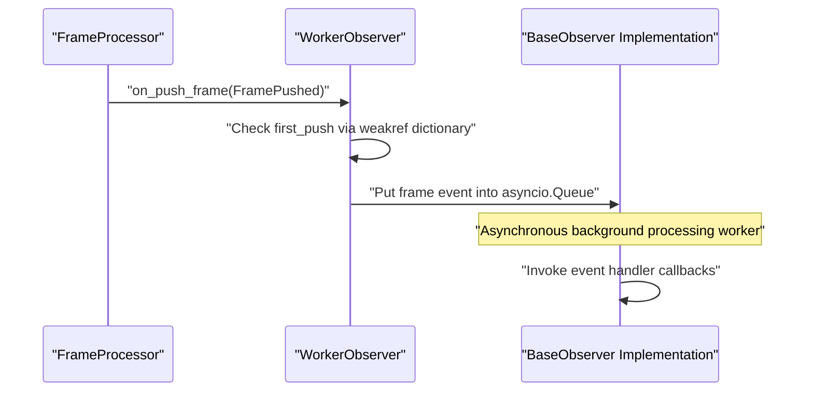

<!-- source: DeepWiki mcp.deepwiki.com · repo pipecat-ai/pipecat · page 3.10 Observer System and Monitoring · fetched 2026-10-26 -->

# Observer System and Monitoring

<details>
<summary>Relevant source files</summary>

The following files were used as context for generating this wiki page:

- [changelog/6086.fixed.4.md](changelog/6086.fixed.4.md)
- [src/pipecat/metrics/metrics.py](src/pipecat/metrics/metrics.py)
- [src/pipecat/observers/__init__.py](src/pipecat/observers/__init__.py)
- [src/pipecat/observers/base_observer.py](src/pipecat/observers/base_observer.py)
- [src/pipecat/observers/loggers/debug_log_observer.py](src/pipecat/observers/loggers/debug_log_observer.py)
- [src/pipecat/observers/loggers/metrics_log_observer.py](src/pipecat/observers/loggers/metrics_log_observer.py)
- [src/pipecat/observers/startup_timing_observer.py](src/pipecat/observers/startup_timing_observer.py)
- [src/pipecat/observers/turn_tracking_observer.py](src/pipecat/observers/turn_tracking_observer.py)
- [src/pipecat/observers/user_bot_latency_observer.py](src/pipecat/observers/user_bot_latency_observer.py)
- [src/pipecat/pipeline/base_pipeline.py](src/pipecat/pipeline/base_pipeline.py)
- [src/pipecat/pipeline/parallel_pipeline.py](src/pipecat/pipeline/parallel_pipeline.py)
- [src/pipecat/pipeline/pipeline.py](src/pipecat/pipeline/pipeline.py)
- [src/pipecat/pipeline/sync_parallel_pipeline.py](src/pipecat/pipeline/sync_parallel_pipeline.py)
- [src/pipecat/pipeline/worker_observer.py](src/pipecat/pipeline/worker_observer.py)
- [src/pipecat/processors/metrics/frame_processor_metrics.py](src/pipecat/processors/metrics/frame_processor_metrics.py)
- [src/pipecat/processors/metrics/sentry.py](src/pipecat/processors/metrics/sentry.py)
- [src/pipecat/utils/tracing/service_attributes.py](src/pipecat/utils/tracing/service_attributes.py)
- [src/pipecat/utils/tracing/service_decorators.py](src/pipecat/utils/tracing/service_decorators.py)
- [src/pipecat/utils/tracing/tracing_context.py](src/pipecat/utils/tracing/tracing_context.py)
- [src/pipecat/utils/tracing/turn_trace_observer.py](src/pipecat/utils/tracing/turn_trace_observer.py)
- [tests/test_llm_token_usage_totals.py](tests/test_llm_token_usage_totals.py)
- [tests/test_rtvi_observer_metrics.py](tests/test_rtvi_observer_metrics.py)
- [tests/test_startup_timing_observer.py](tests/test_startup_timing_observer.py)
- [tests/test_ttfa_metrics.py](tests/test_ttfa_metrics.py)
- [tests/test_turn_tracking_observer.py](tests/test_turn_tracking_observer.py)
- [tests/test_user_bot_latency_observer.py](tests/test_user_bot_latency_observer.py)
- [tests/test_worker_observer.py](tests/test_worker_observer.py)

</details>


## Purpose and Scope

The observer system in Pipecat provides a non-intrusive monitoring architecture designed to track frame flow, collect operational and performance metrics, measure latencies, and trace pipeline execution. Observers view frames and lifecycle events as they move through processors without requiring modifications to core processor logic [src/pipecat/observers/base_observer.py:70-127]().

This page covers:
- The base observer pattern and non-blocking asynchronous dispatch via `WorkerObserver` [src/pipecat/observers/base_observer.py:114-172](), [src/pipecat/pipeline/worker_observer.py:56-71]().
- Lifecycle observers such as `StartupTimingObserver` [src/pipecat/observers/startup_timing_observer.py:170-185]() and `WorkerObserver` [src/pipecat/pipeline/worker_observer.py:56-71]().
- Conversation and performance tracking via `TurnTrackingObserver` [src/pipecat/observers/turn_tracking_observer.py:30-50]() and `UserBotLatencyObserver` [src/pipecat/observers/user_bot_latency_observer.py:7-14]().
- Metrics collection and formatting using log observers and performance integrations like `SentryMetrics` [src/pipecat/observers/base_observer.py:7-12](), [src/pipecat/processors/metrics/sentry.py:25-31]().

Sources: [src/pipecat/observers/base_observer.py:7-12](), [src/pipecat/observers/base_observer.py:70-172](), [src/pipecat/observers/startup_timing_observer.py:170-185](), [src/pipecat/observers/turn_tracking_observer.py:30-50](), [src/pipecat/observers/user_bot_latency_observer.py:7-14](), [src/pipecat/processors/metrics/sentry.py:25-31](), [src/pipecat/pipeline/worker_observer.py:56-71]()

## Observer Pattern Architecture

Pipecat implements an observer pattern where concrete observers inherit from `BaseObserver` [src/pipecat/observers/base_observer.py:114-127]() and register for pipeline hooks. To prevent observer execution overhead from blocking real-time audio and video frame routing, `WorkerObserver` acts as a proxy [src/pipecat/pipeline/worker_observer.py:56-71](). It receives frame events and distributes them to managed user observers using isolated asynchronous queues and task workers [src/pipecat/pipeline/worker_observer.py:56-71]().

### Natural Language to Code Entity Mapping: Monitoring Infrastructure

The following diagram maps high-level monitoring concepts to the specific classes and data structures implemented across the Pipecat codebase.

Title: Monitoring Infrastructure Mapping
```mermaid
graph TB
    subgraph "Natural-Language-Space"
        Direction["Frame Direction"]
        Metric["Performance Metric"]
        Event["Pipeline Event"]
        Startup["Startup Timing"]
        Tracing["Distributed Tracing"]
        RTVI["RTVI Monitoring"]
    end

    subgraph "Code-Entity-Space"
        direction_code["FrameDirection"]
        metric_code["MetricsFrame"]
        ttfb_code["TTFBMetricsData"]
        ttfa_code["TTFAMetricsData"]
        event_code["FramePushed"]
        processed_code["FrameProcessed"]
        startup_code["StartupTimingObserver"]
        timing_code["ProcessorStartupTiming"]
        trace_code["TurnTraceObserver"]
        rtvi_obs["GoogleRTVIObserver"]
    end

    Direction --- direction_code
    Metric --- metric_code
    Metric --- ttfb_code
    Metric --- ttfa_code
    Event --- event_code
    Event --- processed_code
    Startup --- startup_code
    Startup --- timing_code
    Tracing --- trace_code
    RTVI --- rtvi_obs

    direction_code -.-> [src/pipecat/processors/frame_processor.py:36-36]()
    metric_code -.-> [src/pipecat/frames/frames.py:9-9]()
    ttfb_code -.-> [src/pipecat/metrics/metrics.py:16-16]()
    event_code -.-> [src/pipecat/observers/base_observer.py:47-47]()
    processed_code -.-> [src/pipecat/observers/base_observer.py:25-25]()
    startup_code -.-> [src/pipecat/observers/startup_timing_observer.py:170-185]()
    timing_code -.-> [src/pipecat/observers/startup_timing_observer.py:78-100]()
    trace_code -.-> [src/pipecat/utils/tracing/turn_trace_observer.py:36-36]()
    rtvi_obs -.-> [src/pipecat/services/google/rtvi.py:51-56]()
```
Sources: [src/pipecat/observers/base_observer.py:25-47](), [src/pipecat/observers/startup_timing_observer.py:78-185](), [src/pipecat/utils/tracing/turn_trace_observer.py:36-36](), [src/pipecat/services/google/rtvi.py:51-56]()

### Data Flow: Frame Event to Observers

Title: Observer Event Flow

Sources: [src/pipecat/observers/base_observer.py:79-109](), [src/pipecat/pipeline/worker_observer.py:93-187]()

Sources: [src/pipecat/observers/base_observer.py:79-185](), [src/pipecat/pipeline/worker_observer.py:56-187]()

## Core Observer Classes

### BaseObserver
`BaseObserver` is the abstract foundation class for all pipeline frame observers [src/pipecat/observers/base_observer.py:114-127](). It exposes key asynchronous hook methods:
- `on_push_frame(data: FramePushed)`: Called when a frame is transferred between processors [src/pipecat/observers/base_observer.py:157-172]().
- `on_process_frame(data: FrameProcessed)`: Called when a frame enters a processor's execution block [src/pipecat/observers/base_observer.py:145-155]().
- `on_processor_setup(data: ProcessorSetUp)`: Called when a processor completes its initialization [src/pipecat/observers/base_observer.py:174-185]().

Sources: [src/pipecat/observers/base_observer.py:114-185]()

### TaskObserver and WorkerObserver
`WorkerObserver` acts as a multi-observer proxy manager [src/pipecat/pipeline/worker_observer.py:56-71](). It maintains a weak reference dictionary of frames in flight (`_frames_pushed`) to distinguish between initial frame creation (`first_push = True`) and downstream hops [src/pipecat/pipeline/worker_observer.py:93-94](), [src/pipecat/pipeline/worker_observer.py:178-182](). It instantiates dedicated `asyncio.Queue` buffers and background tasks for each registered user observer to ensure pipelined frame processing remains non-blocking [src/pipecat/pipeline/worker_observer.py:33-48](), [src/pipecat/pipeline/worker_observer.py:64-67]().

Sources: [src/pipecat/pipeline/worker_observer.py:33-71](), [src/pipecat/pipeline/worker_observer.py:93-187]()

### TurnTrackingObserver
`TurnTrackingObserver` tracks conversation flow state by analyzing user and bot speech frames [src/pipecat/observers/turn_tracking_observer.py:30-50]().
- Initiates turn counting upon receiving `StartFrame` [src/pipecat/observers/turn_tracking_observer.py:90-93]().
- Triggers turn start on `UserStartedSpeakingFrame` [src/pipecat/observers/turn_tracking_observer.py:94-95]() and manages timeouts via `turn_end_timeout_secs` after `BotStoppedSpeakingFrame` [src/pipecat/observers/turn_tracking_observer.py:61-62](), [src/pipecat/observers/turn_tracking_observer.py:157-163]().
- Detects interruptions when a user starts speaking while the bot is active, setting the `was_interrupted` flag on `on_turn_ended` [src/pipecat/observers/turn_tracking_observer.py:130-137]().

Sources: [src/pipecat/observers/turn_tracking_observer.py:30-63](), [src/pipecat/observers/turn_tracking_observer.py:90-163]()

### UserBotLatencyObserver
`UserBotLatencyObserver` calculates response latency spanning from `VADUserStoppedSpeakingFrame` to `BotStartedSpeakingFrame` [src/pipecat/observers/user_bot_latency_observer.py:7-14](). When enabled via metrics configurations, it aggregates a comprehensive breakdown containing TTFB measurements across STT, LLM, and TTS processors, text aggregation durations, and function call execution latencies [src/pipecat/observers/user_bot_latency_observer.py:48-91](). It explicitly resets metric accumulators upon encountering an `InterruptionFrame` to prevent stale metrics from leaking across turns [src/pipecat/observers/user_bot_latency_observer.py:28-38]().

| Metric Class | Purpose |
| :--- | :--- |
| `TTFBBreakdownMetrics` | TTFB measurement with timestamp for timeline placement [src/pipecat/observers/user_bot_latency_observer.py:48-61](). |
| `TextAggregationBreakdownMetrics` | Text aggregation duration for sentence-based synthesis [src/pipecat/observers/user_bot_latency_observer.py:64-75](). |
| `FunctionCallMetrics` | Latency for a single function call execution [src/pipecat/observers/user_bot_latency_observer.py:78-89](). |

Sources: [src/pipecat/observers/user_bot_latency_observer.py:7-91]()

### StartupTimingObserver
`StartupTimingObserver` monitors processor initialization efficiency [src/pipecat/observers/startup_timing_observer.py:170-185](). It records concurrent setup durations (`setup()`) via `ProcessorSetUp` events [src/pipecat/observers/base_observer.py:75-92](), [src/pipecat/pipeline/base_pipeline.py:26-61]() and sequential start latencies by tracking `StartFrame` processing traversal times [src/pipecat/observers/startup_timing_observer.py:9-13](). It compiles this data into a `StartupTimingReport` alongside transport connection milestones (`BotConnectedFrame` and `ClientConnectedFrame`) through `TransportTimingReport` [src/pipecat/observers/startup_timing_observer.py:124-168]().

Sources: [src/pipecat/observers/base_observer.py:75-92](), [src/pipecat/observers/startup_timing_observer.py:7-18](), [src/pipecat/observers/startup_timing_observer.py:124-185](), [src/pipecat/pipeline/base_pipeline.py:26-61]()

### TurnTraceObserver and Sentry Integration
- `TurnTraceObserver`: Coordinates with `TurnTrackingObserver` and `UserBotLatencyObserver` to emit OpenTelemetry spans for conversational turns [src/pipecat/utils/tracing/turn_trace_observer.py:36-44](). It structures tracing spans hierarchically, attaching latency breakdowns as telemetry attributes for analysis in APM platforms [src/pipecat/utils/tracing/turn_trace_observer.py:92-106]().
- `SentryMetrics`: Extends `FrameProcessorMetrics` to package TTFB and processing latency measurements directly into Sentry transactions for performance monitoring [src/pipecat/processors/metrics/sentry.py:25-31]().

Sources: [src/pipecat/processors/metrics/sentry.py:25-57](), [src/pipecat/utils/tracing/turn_trace_observer.py:36-44](), [src/pipecat/utils/tracing/turn_trace_observer.py:92-106]()

## Metrics Collection via Log Observers

Pipecat provides pre-built log observers that format and route pipeline frames directly to logging frameworks:
- **LLMLogObserver**: Logs LLM generation events, tool calls, and text outputs.
- **TranscriptionLogObserver**: Captures and logs real-time interim and final transcription frames.
- **MetricsLogObserver**: Unpacks `MetricsFrame` objects to log performance metrics including TTFB, TTFA, and token usage.
- **DebugLogObserver**: Provides generalized frame interception with filtering rules for debugging specific service channels.

Sources: [src/pipecat/observers/base_observer.py:7-12]()

### Natural Language to Code Entity Mapping: Tracing Context

Title: Tracing Context and Data Flow
```mermaid
graph LR
    subgraph "Tracing-Concepts"
        Context["Tracing Context"]
        TurnSpan["Turn Span"]
        LatencyAttr["Latency Attribute"]
    end

    subgraph "Code-Entities"
        ctx_class["TracingContext"]
        trace_obs["TurnTraceObserver"]
        latency_handler["_handle_latency_measured"]
        start_conv["start_conversation_tracing"]
    end

    Context --- ctx_class
    TurnSpan --- trace_obs
    LatencyAttr --- latency_handler
    Context --- start_conv

    ctx_class -.-> [src/pipecat/utils/tracing/tracing_context.py:18-18]()
    trace_obs -.-> [src/pipecat/utils/tracing/turn_trace_observer.py:36-36]()
    latency_handler -.-> [src/pipecat/utils/tracing/turn_trace_observer.py:92-92]()
    start_conv -.-> [src/pipecat/utils/tracing/turn_trace_observer.py:120-120]()
```
Sources: [src/pipecat/utils/tracing/turn_trace_observer.py:36-44](), [src/pipecat/utils/tracing/turn_trace_observer.py:92-106](), [src/pipecat/utils/tracing/turn_trace_observer.py:120-152]()

---

