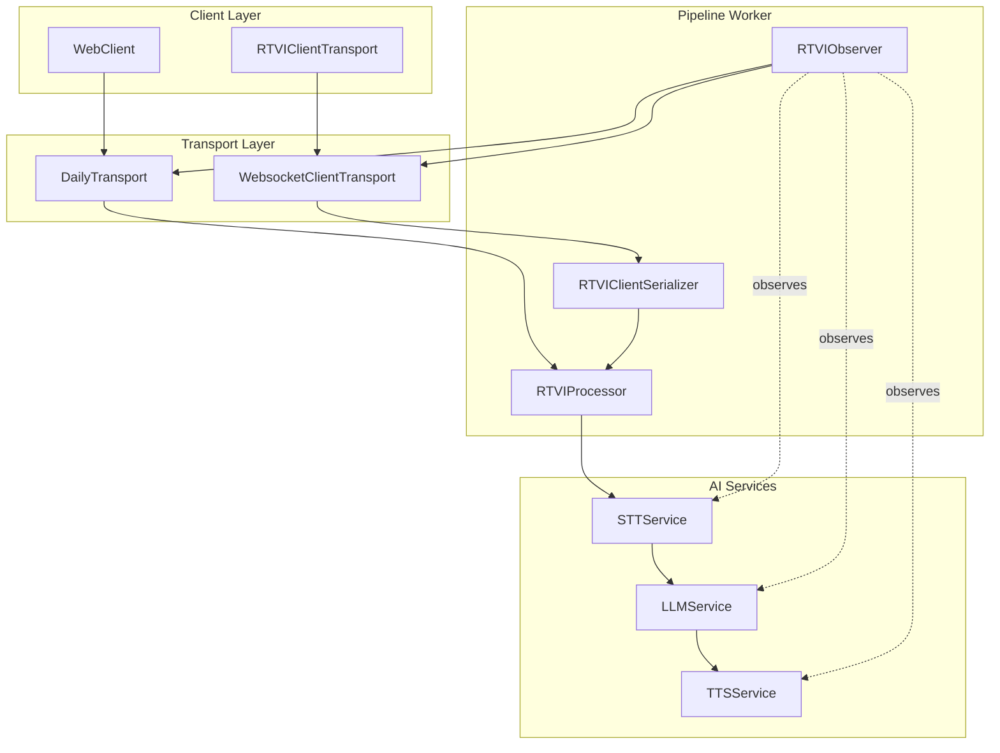
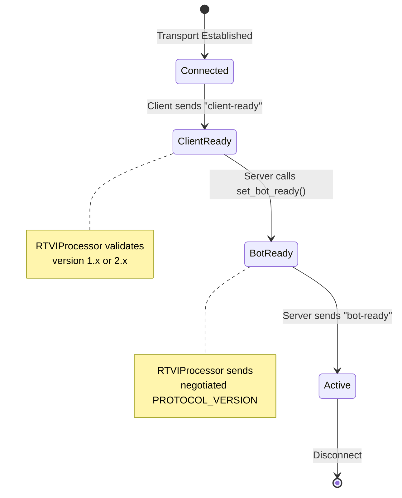
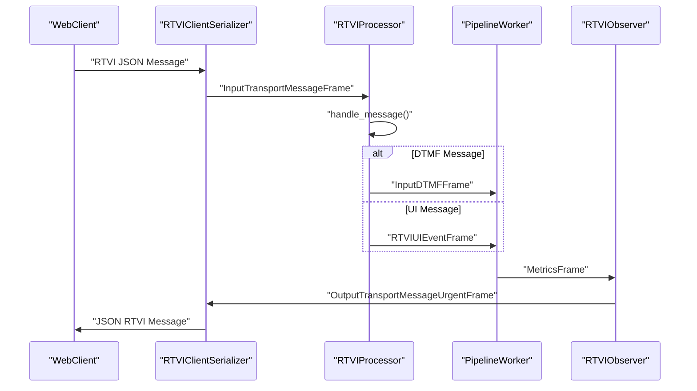

<!-- source: DeepWiki mcp.deepwiki.com · repo pipecat-ai/pipecat · page 3.11 RTVI Protocol · fetched 2026-10-26 -->

# RTVI Protocol

Relevant source files

The following files were used as context for generating this wiki page:

- [changelog/3415.changed.md](changelog/3415.changed.md)
- [changelog/6072.fixed.2.md](changelog/6072.fixed.2.md)
- [changelog/6093.added.2.md](changelog/6093.added.2.md)
- [changelog/6093.added.3.md](changelog/6093.added.3.md)
- [changelog/6093.added.5.md](changelog/6093.added.5.md)
- [changelog/6093.added.md](changelog/6093.added.md)
- [src/pipecat/processors/frameworks/rtvi/__init__.py](src/pipecat/processors/frameworks/rtvi/__init__.py)
- [src/pipecat/processors/frameworks/rtvi/frames.py](src/pipecat/processors/frameworks/rtvi/frames.py)
- [src/pipecat/processors/frameworks/rtvi/models.py](src/pipecat/processors/frameworks/rtvi/models.py)
- [src/pipecat/processors/frameworks/rtvi/observer.py](src/pipecat/processors/frameworks/rtvi/observer.py)
- [src/pipecat/processors/frameworks/rtvi/processor.py](src/pipecat/processors/frameworks/rtvi/processor.py)
- [src/pipecat/utils/security/ssrf.py](src/pipecat/utils/security/ssrf.py)
- [tests/test_rtvi_observer_pushes.py](tests/test_rtvi_observer_pushes.py)
- [tests/test_rtvi_observer_raw_text.py](tests/test_rtvi_observer_raw_text.py)
- [tests/test_rtvi_processor.py](tests/test_rtvi_processor.py)
- [tests/test_rtvi_ui.py](tests/test_rtvi_ui.py)
- [tests/test_ssrf.py](tests/test_ssrf.py)

## Purpose and Scope

The RTVI (Real-Time Voice Interface) Protocol is a standardized messaging protocol for bidirectional communication between clients and AI voice agents. It defines message formats, event types, and lifecycle management for real-time voice interactions. This page covers the protocol structure, message types, event system, and integration with Pipecat pipelines via `RTVIProcessor` [src/pipecat/processors/frameworks/rtvi/processor.py:53-59](), `RTVIObserver` [src/pipecat/processors/frameworks/rtvi/observer.py:7-11](), and client-side serializers and transports.

RTVI 2.0.0 introduced state synchronization, detailed bot-output progress tracking, raw VAD event exposure, and frame-based audio streaming. In subsequent releases, the protocol was bumped to **2.2.0**, introducing breaking changes in 2.1.0 (such as updating the `dtmf` client message to use a `buttons` list) and adding support for the `send-file` client message (`UserFileRawFrame`), raw text streams (`stt-raw-text`, `llm-raw-text`, `tts-raw-text`), the `user-input` message type, and bot backchannel reporting [src/pipecat/processors/frameworks/rtvi/models.py:32-47](), [changelog/6093.added.3.md:1](), [changelog/6093.added.5.md:1]().

For information about pipeline architecture and frame processing, see [Core Architecture](). For transport-level communication details, see [Transport Layer]().

Sources: [src/pipecat/processors/frameworks/rtvi/processor.py:53-59](), [src/pipecat/processors/frameworks/rtvi/observer.py:7-11](), [src/pipecat/processors/frameworks/rtvi/models.py:32-47](), [changelog/6093.added.3.md:1](), [changelog/6093.added.5.md:1]()

## Protocol Overview

RTVI Protocol provides a structured communication layer between voice AI applications and their clients. All RTVI messages use the label `"rtvi-ai"` for identification and include message types, IDs, and optional data payloads [src/pipecat/processors/frameworks/rtvi/models.py:40-64](). The protocol supports features like client-server handshaking, configuration management, action execution, and real-time event routing.

### RTVI in the Pipeline Architecture

The RTVI system sits between the transport layer and the core processing logic, acting as a bidirectional bridge for control and observation, linking transport classes like `DailyTransport` and client transports with `RTVIProcessor` and `RTVIObserver`.

Title: "RTVI Pipeline Integration Architecture"

Sources: [src/pipecat/processors/frameworks/rtvi/processor.py:53-82](), [src/pipecat/processors/frameworks/rtvi/observer.py:7-11]()

## Core Components

### RTVIProcessor

`RTVIProcessor` is a `FrameProcessor` that handles incoming RTVI messages from clients and processes them within the pipeline [src/pipecat/processors/frameworks/rtvi/processor.py:53-59](). It manages client-server handshaking, configuration management, action execution, and message routing.

**Key Responsibilities:**
- **Handshake & Versioning**: Validates client version and echoes compatibility responses [src/pipecat/processors/frameworks/rtvi/processor.py:109-114](), [tests/test_rtvi_processor.py:34-85]().
- **UI Agent Protocol**: Handles inbound `ui-event`, `ui-snapshot`, and `ui-cancel-job-group` messages [src/pipecat/processors/frameworks/rtvi/processor.py:103-106](), [src/pipecat/processors/frameworks/rtvi/frames.py:133-186]().
- **Frame-Based Audio**: Pushes `InputAudioRawFrame` and `InputTransportStartAudioStreamingFrame` downstream based on client readiness [src/pipecat/processors/frameworks/rtvi/processor.py:61-82]().
- **File Ingestion**: Processes incoming `send-file` messages into `UserFileRawFrame` instances [src/pipecat/processors/frameworks/rtvi/models.py:32-38](), [src/pipecat/processors/frameworks/rtvi/processor.py:35-36]().

Sources: [src/pipecat/processors/frameworks/rtvi/processor.py:53-184](), [src/pipecat/processors/frameworks/rtvi/models.py:32-47](), [src/pipecat/processors/frameworks/rtvi/frames.py:133-186](), [tests/test_rtvi_processor.py:34-85]()

### RTVIObserver and RTVIObserverParams

`RTVIObserver` translates internal Pipecat frames into standardized RTVI event messages [src/pipecat/processors/frameworks/rtvi/observer.py:7-11]().

**Observed Frame Types and Mappings:**
- `TranscriptionFrame` / `InterimTranscriptionFrame` → `user-input` (`input_type: "transcription"`) and `user-transcription` [src/pipecat/processors/frameworks/rtvi/observer.py:27-63](), [tests/test_rtvi_observer_pushes.py:115-148]()
- `UserBackchannelFrame` → `user-input` (`input_type: "backchannel"`) [src/pipecat/processors/frameworks/rtvi/observer.py:57-57](), [tests/test_rtvi_observer_pushes.py:103-114]()
- `RTVISendTextFrame` → `user-input` (`input_type: "chat"`) [src/pipecat/processors/frameworks/rtvi/observer.py:78-78](), [tests/test_rtvi_observer_pushes.py:155-164]()
- `LLMFullResponseStartFrame` / `LLMFullResponseEndFrame` → `bot-llm-started/stopped` [src/pipecat/processors/frameworks/rtvi/observer.py:46-47]()
- `TTSStartedFrame` / `TTSStoppedFrame` → `bot-tts-started/stopped` [src/pipecat/processors/frameworks/rtvi/observer.py:54-55]()
- `InterruptionFrame` → `bot-interrupted` [src/pipecat/processors/frameworks/rtvi/observer.py:44-44]()
- `LLMMarkerResponseFrame` → `bot-llm-marker` (if `bot_llm_marker_enabled` is `True`) [src/pipecat/processors/frameworks/rtvi/observer.py:48-48]()
- `FunctionCallsStartedFrame`, `FunctionCallInProgressFrame`, `FunctionCallResultFrame`, `FunctionCallCancelFrame` → `llm-function-call-started`, `llm-function-call-in-progress`, `llm-function-call-stopped` (with configurable `function_call_report_level`) [src/pipecat/processors/frameworks/rtvi/observer.py:33-41]()
- `VADUserStartedSpeakingFrame`, `VADUserStoppedSpeakingFrame` → `vad-user-started-speaking`, `vad-user-stopped-speaking` (if `vad_user_speaking_enabled` is `True`) [src/pipecat/processors/frameworks/rtvi/observer.py:62-63]()

`RTVIObserverParams` [src/pipecat/processors/frameworks/rtvi/observer.py:115-164]() allows for fine-grained control over which RTVI messages are emitted.

| Parameter | Type | Default | Description |
|-----------|------|---------|-------------|
| `bot_output_enabled` | `bool` | `True` | Indicates if bot output messages should be sent [src/pipecat/processors/frameworks/rtvi/observer.py:119-119]() |
| `bot_llm_enabled` | `bool` | `True` | Indicates if the bot's LLM messages should be sent [src/pipecat/processors/frameworks/rtvi/observer.py:120-123]() |
| `bot_llm_marker_enabled` | `bool` | `False` | Indicates if the bot's LLM marker reports should be sent [src/pipecat/processors/frameworks/rtvi/observer.py:124-128]() |
| `bot_tts_enabled` | `bool` | `True` | Indicates if the bot's TTS messages should be sent [src/pipecat/processors/frameworks/rtvi/observer.py:129-132]() |
| `bot_speaking_enabled` | `bool` | `True` | Indicates if the bot's started/stopped speaking messages should be sent [src/pipecat/processors/frameworks/rtvi/observer.py:133-133]() |
| `bot_audio_level_enabled` | `bool` | `True` | Indicates if bot's audio level messages should be sent [src/pipecat/processors/frameworks/rtvi/observer.py:134-134]() |
| `user_llm_enabled` | `bool` | `True` | Indicates if the user's LLM input messages should be sent [src/pipecat/processors/frameworks/rtvi/observer.py:135-135]() |
| `user_speaking_enabled` | `bool` | `True` | Indicates if the user's started/stopped speaking messages should be sent [src/pipecat/processors/frameworks/rtvi/observer.py:136-136]() |
| `vad_user_speaking_enabled` | `bool` | `False` | Indicates if raw VAD user started/stopped speaking messages should be sent [src/pipecat/processors/frameworks/rtvi/observer.py:137-140]() |
| `user_transcription_enabled` | `bool` | `True` | Indicates if user's transcription messages should be sent [src/pipecat/processors/frameworks/rtvi/observer.py:141-146]() |
| `user_input_enabled` | `bool` | `True` | Indicates if the user's input messages should be sent [src/pipecat/processors/frameworks/rtvi/observer.py:148-150]() |
| `user_audio_level_enabled` | `bool` | `True` | Indicates if user's audio level messages should be sent [src/pipecat/processors/frameworks/rtvi/observer.py:151-151]() |
| `metrics_enabled` | `bool` | `True` | Indicates if metrics messages should be sent [src/pipecat/processors/frameworks/rtvi/observer.py:152-152]() |
| `system_logs_enabled` | `bool` | `True` | Indicates if system logs should be sent [src/pipecat/processors/frameworks/rtvi/observer.py:153-153]() |
| `stt_raw_text_enabled` | `bool` | `False` | Indicates if STT raw text messages should be sent (protocol 2.2.0+) [src/pipecat/processors/frameworks/rtvi/observer.py:154-156]() |
| `llm_raw_text_enabled` | `bool` | `False` | Indicates if LLM raw text messages should be sent (protocol 2.2.0+) [src/pipecat/processors/frameworks/rtvi/observer.py:157-159]() |
| `tts_raw_text_enabled` | `bool` | `False` | Indicates if TTS raw text messages should be sent (protocol 2.2.0+) [src/pipecat/processors/frameworks/rtvi/observer.py:160-163]() |
| `ignored_sources` | `list[FrameProcessor]` | `[]` | List of frame processors whose frames should be silently ignored [src/pipecat/processors/frameworks/rtvi/observer.py:164-165]() |
| `function_call_report_level` | `dict[str, RTVIFunctionCallReportLevel]` | `{"*": RTVIFunctionCallReportLevel.NONE}` | Controls what information is exposed in function call events [src/pipecat/processors/frameworks/rtvi/observer.py:94-111]() |

The `RTVIObserver` can be dynamically reconfigured at runtime by pushing an `RTVIConfigureObserverFrame` [src/pipecat/processors/frameworks/rtvi/frames.py:70-96]().

Sources: [src/pipecat/processors/frameworks/rtvi/observer.py:7-164](), [src/pipecat/processors/frameworks/rtvi/frames.py:70-96](), [tests/test_rtvi_observer_pushes.py:103-164]()

### Serializers and Client Transports

Pipecat provides client-side support for RTVI through serialization classes.

- **RTVIClientSerializer**: Implements `FrameSerializer` to deserialize incoming RTVI server messages into pipeline frames (e.g., `LLMTextFrame`, `TranscriptionFrame`) and serialize outgoing client frames (`OutputAudioRawFrame`, custom transport messages).
- **Client Transports**: Transports such as WebSocket or WebRTC connectors automatically perform the `client-ready` and `bot-ready` handshake sequence upon connection.

Sources: [src/pipecat/processors/frameworks/rtvi/processor.py:53-143]()

## Protocol Versioning and Upgrades

### Protocol Version 2.2.0 Features
- **File Ingestion (`send-file`)**: Protocol version `2.2.0` introduces the `send-file` client message, allowing clients to transmit inline base64 bytes or URLs which are mapped directly to `UserFileRawFrame` instances within the pipeline [src/pipecat/processors/frameworks/rtvi/models.py:32-47](), [changelog/3415.changed.md:1]().
- **Raw Text Streams**: Supports sending `stt-raw-text`, `llm-raw-text`, and `tts-raw-text` messages for real-time transcription and streaming inspection when enabled in `RTVIObserverParams` [tests/test_rtvi_observer_raw_text.py:29-40]().
- **User Input & Bot Backchannels**: Introduces `user-input` messages (`transcription`, `chat`, `backchannel`) and reports bot backchannels as `bot-output` and `bot-tts-text` [changelog/6093.added.3.md:1](), [changelog/6093.added.5.md:1]().

Sources: [src/pipecat/processors/frameworks/rtvi/models.py:32-47](), [tests/test_rtvi_observer_raw_text.py:29-40](), [changelog/6093.added.3.md:1](), [changelog/6093.added.5.md:1]()

## UI Agent Protocol

The UI Agent Protocol provides standardized frames for client-side UI interaction.

| Frame Type | Direction | Purpose |
|------------|-----------|---------|
| `RTVIUICommandFrame` | Outbound | Sends UI commands via `UICommandMessage` [src/pipecat/processors/frameworks/rtvi/frames.py:130-154]() |
| `RTVIUIJobGroupFrame` | Outbound | Sends job-group lifecycle updates via `UIJobGroupMessage` [src/pipecat/processors/frameworks/rtvi/frames.py:156-179]() |
| `RTVIUIEventFrame` | Inbound | Represents a UI event from the client via `UIEventMessage` [src/pipecat/processors/frameworks/rtvi/frames.py:182-187]() |
| `RTVIUISnapshotFrame` | Inbound | Carries serialized accessibility trees via `UISnapshotMessage` [src/pipecat/processors/frameworks/rtvi/frames.py:186-186]() |
| `RTVIUICancelJobGroupFrame` | Inbound | Request to cancel a job group [src/pipecat/processors/frameworks/rtvi/frames.py:41-41]() |

Sources: [src/pipecat/processors/frameworks/rtvi/frames.py:41-187](), [tests/test_rtvi_ui.py:50-195]()

## Lifecycle Management

### Client Ready Flow

Title: "RTVI Client Ready State Machine"

Sources: [src/pipecat/processors/frameworks/rtvi/processor.py:128-143](), [tests/test_rtvi_processor.py:34-85]()

### Bot Interruption

`RTVIProcessor.interrupt_bot()` broadcasts an interruption frame upstream [src/pipecat/processors/frameworks/rtvi/processor.py:144-147](). This triggers a `bot-interrupted` RTVI message via `RTVIObserver` [src/pipecat/processors/frameworks/rtvi/observer.py:7-11]().

Sources: [src/pipecat/processors/frameworks/rtvi/processor.py:144-147](), [src/pipecat/processors/frameworks/rtvi/observer.py:7-11]()

## Message Structure and Code-Entity Data Flow

RTVI messages include a `label` (`"rtvi-ai"`), a `type`, and optional `id` and `data` fields [src/pipecat/processors/frameworks/rtvi/models.py:53-64]().

Title: "RTVI Message Data Flow and Processing Sequence"

Sources: [src/pipecat/processors/frameworks/rtvi/processor.py:172-184](), [src/pipecat/processors/frameworks/rtvi/observer.py:7-11](), [src/pipecat/processors/frameworks/rtvi/models.py:53-64]()

---

