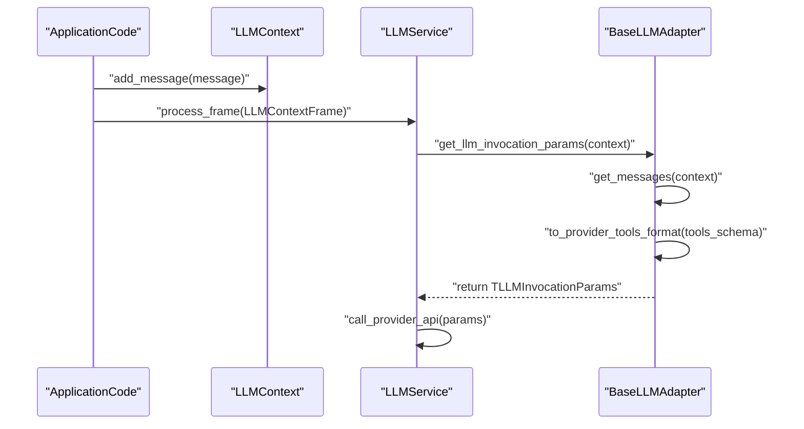

<!-- source: DeepWiki mcp.deepwiki.com · repo pipecat-ai/pipecat · page 3.6 Context System · fetched 2026-10-26 -->

# Context System

Relevant source files

The following files were used as context for generating this wiki page:

- [src/pipecat/adapters/base_llm_adapter.py](src/pipecat/adapters/base_llm_adapter.py)
- [src/pipecat/adapters/services/anthropic_adapter.py](src/pipecat/adapters/services/anthropic_adapter.py)
- [src/pipecat/adapters/services/aws_nova_sonic_adapter.py](src/pipecat/adapters/services/aws_nova_sonic_adapter.py)
- [src/pipecat/adapters/services/bedrock_adapter.py](src/pipecat/adapters/services/bedrock_adapter.py)
- [src/pipecat/adapters/services/gemini_adapter.py](src/pipecat/adapters/services/gemini_adapter.py)
- [src/pipecat/adapters/services/grok_realtime_adapter.py](src/pipecat/adapters/services/grok_realtime_adapter.py)
- [src/pipecat/adapters/services/inworld_realtime_adapter.py](src/pipecat/adapters/services/inworld_realtime_adapter.py)
- [src/pipecat/adapters/services/open_ai_adapter.py](src/pipecat/adapters/services/open_ai_adapter.py)
- [src/pipecat/adapters/services/open_ai_realtime_adapter.py](src/pipecat/adapters/services/open_ai_realtime_adapter.py)
- [src/pipecat/adapters/services/open_ai_responses_adapter.py](src/pipecat/adapters/services/open_ai_responses_adapter.py)
- [src/pipecat/adapters/services/perplexity_adapter.py](src/pipecat/adapters/services/perplexity_adapter.py)
- [src/pipecat/processors/aggregators/llm_context.py](src/pipecat/processors/aggregators/llm_context.py)
- [tests/test_get_llm_invocation_params.py](tests/test_get_llm_invocation_params.py)

The purpose of this document is to define the universal `LLMContext` system in Pipecat, document the `BaseLLMAdapter` pattern for provider translation, detail the migration from legacy provider-specific contexts, and explain how custom tools and schema preservation are handled across disparate LLM backends.

Sources: [src/pipecat/processors/aggregators/llm_context.py:7-15]()

---

## Overview

`LLMContext` is the central data structure for managing conversational state across Pipecat pipelines [src/pipecat/processors/aggregators/llm_context.py:114-121](). It maintains:

- **Messages**: Conversation history as a list of `LLMContextMessage` objects, supporting both universal standard messages and provider-specific overrides [src/pipecat/processors/aggregators/llm_context.py:75-88]().
- **Tools**: Available function and tool definitions stored as a `ToolsSchema` or normalized lists of `FunctionSchema` and `DirectFunction` objects [src/pipecat/processors/aggregators/llm_context.py:122-144]().
- **Tool Choice**: Strategy for tool selection (`auto`, `none`, `required`, or explicit selection) [src/pipecat/processors/aggregators/llm_context.py:122-144]().

**Key Design Principle**: Whenever an LLM service needs to access context, it performs a just-in-time translation from this universal format into whatever provider-specific invocation payload is required, using a service-specific subclass of `BaseLLMAdapter` [src/pipecat/processors/aggregators/llm_context.py:7-15](), [src/pipecat/adapters/base_llm_adapter.py:60-76]().

Sources: [src/pipecat/processors/aggregators/llm_context.py:7-15](), [src/pipecat/processors/aggregators/llm_context.py:114-144](), [src/pipecat/adapters/base_llm_adapter.py:60-76]()

---

## LLMContext Architecture

The following diagram illustrates the relationship between universal context entities in code and the provider adapters, bridging conceptual entities with concrete Python class names in the codebase.

Title: "LLMContext and BaseLLMAdapter Translation Flow"

```mermaid
graph TB
    subgraph "Natural_Language_Space_Universal_Context"
        LLMContext["LLMContext"]
        LLMStandardMessage["LLMStandardMessage"]
        LLMSpecificMessage["LLMSpecificMessage"]
        ToolsSchema["ToolsSchema"]
        
        LLMContext --> LLMStandardMessage
        LLMContext --> LLMSpecificMessage
        LLMContext --> ToolsSchema
    end
    
    subgraph "Code_Entity_Space_Provider_Adapters"
        BaseLLMAdapter["BaseLLMAdapter"]
        OpenAILLMAdapter["OpenAILLMAdapter"]
        AnthropicLLMAdapter["AnthropicLLMAdapter"]
        GeminiLLMAdapter["GeminiLLMAdapter"]
        AWSBedrockLLMAdapter["AWSBedrockLLMAdapter"]
        OpenAIResponsesLLMAdapter["OpenAIResponsesLLMAdapter"]
        OpenAIRealtimeLLMAdapter["OpenAIRealtimeLLMAdapter"]
        GrokRealtimeLLMAdapter["GrokRealtimeLLMAdapter"]
        AWSNovaSonicLLMAdapter["AWSNovaSonicLLMAdapter"]
        
        BaseLLMAdapter --- OpenAILLMAdapter
        BaseLLMAdapter --- AnthropicLLMAdapter
        BaseLLMAdapter --- GeminiLLMAdapter
        BaseLLMAdapter --- AWSBedrockLLMAdapter
        BaseLLMAdapter --- OpenAIResponsesLLMAdapter
        BaseLLMAdapter --- OpenAIRealtimeLLMAdapter
        BaseLLMAdapter --- GrokRealtimeLLMAdapter
        BaseLLMAdapter --- AWSNovaSonicLLMAdapter
    end
    
    subgraph "Code_Entity_Space_Invocation_Parameters"
        OAI_Params["OpenAILLMInvocationParams"]
        Ant_Params["AnthropicLLMInvocationParams"]
        Gem_Params["GeminiLLMInvocationParams"]
        Bed_Params["AWSBedrockLLMInvocationParams"]
        Resp_Params["OpenAIResponsesLLMInvocationParams"]
        RT_Params["OpenAIRealtimeLLMInvocationParams"]
        Grok_Params["GrokRealtimeLLMInvocationParams"]
        Nova_Params["AWSNovaSonicLLMInvocationParams"]
    end
    
    LLMContext --> BaseLLMAdapter
    OpenAILLMAdapter --> OAI_Params
    AnthropicLLMAdapter --> Ant_Params
    GeminiLLMAdapter --> Gem_Params
    AWSBedrockLLMAdapter --> Bed_Params
    OpenAIResponsesLLMAdapter --> Resp_Params
    OpenAIRealtimeLLMAdapter --> RT_Params
    GrokRealtimeLLMAdapter --> Grok_Params
    AWSNovaSonicLLMAdapter --> Nova_Params
```

Sources: [src/pipecat/processors/aggregators/llm_context.py:62-72](), [src/pipecat/adapters/base_llm_adapter.py:37-60](), [src/pipecat/adapters/services/open_ai_adapter.py:121-127](), [src/pipecat/adapters/services/anthropic_adapter.py:59-65](), [src/pipecat/adapters/services/gemini_adapter.py:35-41](), [src/pipecat/adapters/services/bedrock_adapter.py:96-103](), [src/pipecat/adapters/services/open_ai_responses_adapter.py:25-33](), [src/pipecat/adapters/services/aws_nova_sonic_adapter.py:52-61](), [src/pipecat/adapters/services/open_ai_realtime_adapter.py:23-32](), [src/pipecat/adapters/services/grok_realtime_adapter.py:27-39]()

---

## Message Management

### Message Types
The context supports two types of messages within its internal message collection:
1. **`LLMStandardMessage`**: A message parameter type conforming to the OpenAI ChatCompletion standard [src/pipecat/processors/aggregators/llm_context.py:62-72]().
2. **`LLMSpecificMessage`**: A container dataclass (`LLMSpecificMessage`) holding provider-specific message objects, keyed by string identifiers such as `"openai"`, `"google"`, `"anthropic"`, or `"gemini-live"` [src/pipecat/processors/aggregators/llm_context.py:75-87](), [src/pipecat/adapters/services/gemini_adapter.py:59-62]() (for Gemini), [src/pipecat/adapters/services/anthropic_adapter.py:74-77]() (for Anthropic), [src/pipecat/adapters/services/open_ai_adapter.py:140-143]() (for OpenAI), [src/pipecat/adapters/services/bedrock_adapter.py:112-115]() (for AWS Bedrock), [src/pipecat/adapters/services/open_ai_responses_adapter.py:45-48]() (for OpenAI Responses), [src/pipecat/adapters/services/open_ai_realtime_adapter.py:41-44]() (for OpenAI Realtime), [src/pipecat/adapters/services/grok_realtime_adapter.py:48-51]() (for Grok Realtime), and [src/pipecat/adapters/services/aws_nova_sonic_adapter.py:70-73]() (for AWS Nova Sonic).

### Core Operations
| Method | Description | Source |
|--------|-------------|--------|
| `add_message(message)` | Appends a message to the internal history list. | [src/pipecat/processors/aggregators/llm_context.py:114-144]() |
| `get_messages(llm_id)` | Returns messages, filtering out `LLMSpecificMessage` instances that do not match the target `llm_id`. | [src/pipecat/processors/aggregators/llm_context.py:114-144]() |
| `create_image_message()` | Utility method to generate a message containing an image. | [src/pipecat/processors/aggregators/llm_context.py:171-183]() |

Sources: [src/pipecat/processors/aggregators/llm_context.py:75-87](), [src/pipecat/processors/aggregators/llm_context.py:171-183](), [src/pipecat/adapters/services/gemini_adapter.py:59-62](), [src/pipecat/adapters/services/anthropic_adapter.py:74-77](), [src/pipecat/adapters/services/open_ai_adapter.py:140-143](), [src/pipecat/adapters/services/bedrock_adapter.py:112-115](), [src/pipecat/adapters/services/open_ai_responses_adapter.py:45-48](), [src/pipecat/adapters/services/open_ai_realtime_adapter.py:41-44](), [src/pipecat/adapters/services/grok_realtime_adapter.py:48-51](), [src/pipecat/adapters/services/aws_nova_sonic_adapter.py:70-73]()

---

## The Adapter Pattern (`BaseLLMAdapter`) and `LLMContextConversionError`

The `BaseLLMAdapter` class acts as the abstract bridge between the universal `LLMContext` and target provider APIs [src/pipecat/adapters/base_llm_adapter.py:60-76](). Subclasses can also enforce stricter backend constraints, such as `PerplexityLLMAdapter` which extends `OpenAILLMAdapter` to handle strict role-alternation and message formatting rules [src/pipecat/adapters/services/perplexity_adapter.py:39-50](). Furthermore, `BaseLLMAdapter` validates asynchronous definitions for `get_llm_invocation_params` through `__init_subclass__` [src/pipecat/adapters/base_llm_adapter.py:85-96]().

### Key Adapter Methods
- `get_llm_invocation_params(context, **kwargs)`: Extracts provider-specific parameter dictionaries (messages, tools, instructions) from the context [src/pipecat/adapters/base_llm_adapter.py:122-139]().
- `to_provider_tools_format(tools_schema)`: Transforms a `ToolsSchema` into the target provider's tool syntax [src/pipecat/adapters/base_llm_adapter.py:141-151]().
- `builtin_tools`: Mutable dictionary mapping tool names to `FunctionSchema` instances injected transparently on inference requests [src/pipecat/adapters/base_llm_adapter.py:98-110]().

### Error Handling via `LLMContextConversionError`
When mapping context messages fails (for example, due to malformed structures or unsupported content types), adapters raise `LLMContextConversionError`, which wraps the underlying exception as `__cause__` [src/pipecat/adapters/base_llm_adapter.py:40-58](). The corresponding LLM service catches this exception and propagates an `ErrorFrame` upstream [src/pipecat/adapters/base_llm_adapter.py:40-58]().

| Provider | Adapter Class | Conversion Error Behavior |
|----------|---------------|---------------------------|
| **Anthropic** | `AnthropicLLMAdapter` | Raises `LLMContextConversionError` on mapping failures [src/pipecat/adapters/base_llm_adapter.py:40-58]() |
| **Gemini** | `GeminiLLMAdapter` | Raises `LLMContextConversionError` on mapping failures [src/pipecat/adapters/base_llm_adapter.py:40-58]() |
| **AWS Bedrock** | `AWSBedrockLLMAdapter` | Raises `LLMContextConversionError` on mapping failures [src/pipecat/adapters/services/bedrock_adapter.py:18-20]() |

Sources: [src/pipecat/adapters/base_llm_adapter.py:40-76](), [src/pipecat/adapters/base_llm_adapter.py:85-96](), [src/pipecat/adapters/services/bedrock_adapter.py:18-20](), [src/pipecat/adapters/services/perplexity_adapter.py:39-50]()

---

## Safe Context Editing and Data Flow

Coordination between services and the context system relies on standard frames and explicit invocation parameter generation.

Title: "Context Resolution Sequence"

Sources: [src/pipecat/adapters/base_llm_adapter.py:122-139](), [src/pipecat/adapters/base_llm_adapter.py:141-151]()

---

## Tool Integration and Serialization (`custom_tools` Preservation)

Tools are defined via `ToolsSchema` and managed within the context system. Provider adapters implement specific conversions for standard tools while preserving provider-specific custom tools (such as Gemini's schema subsets or OpenAI custom function bindings) [src/pipecat/adapters/services/gemini_adapter.py:102-111](), [src/pipecat/adapters/services/open_ai_responses_adapter.py:119-144](). This ensures specialized provider extensions remain intact during serialization across network boundaries and multi-worker topologies.

Sources: [src/pipecat/adapters/services/gemini_adapter.py:102-111](), [src/pipecat/adapters/services/open_ai_responses_adapter.py:119-144]()

---

## Migration from Provider-Specific Contexts

Pipecat has fully transitioned from legacy provider-specific context classes to the universal `LLMContext`.

### Migration Mapping
| Deprecated Class | Universal Replacement |
|------------------|-----------------------|
| `OpenAILLMContext` | `LLMContext` |
| `GoogleLLMContext` | `LLMContext` |
| `AnthropicLLMContext` | `LLMContext` |
| `AWSBedrockLLMContext` | `LLMContext` |

**Legacy Support**: `LLMContext` supports embedded `LLMSpecificMessage` objects to accommodate custom payloads when direct provider interoperability is required [src/pipecat/processors/aggregators/llm_context.py:75-87](), [src/pipecat/adapters/base_llm_adapter.py:60-76]().

Sources: [src/pipecat/processors/aggregators/llm_context.py:7-15](), [src/pipecat/processors/aggregators/llm_context.py:75-87](), [src/pipecat/adapters/base_llm_adapter.py:60-76]()

---

