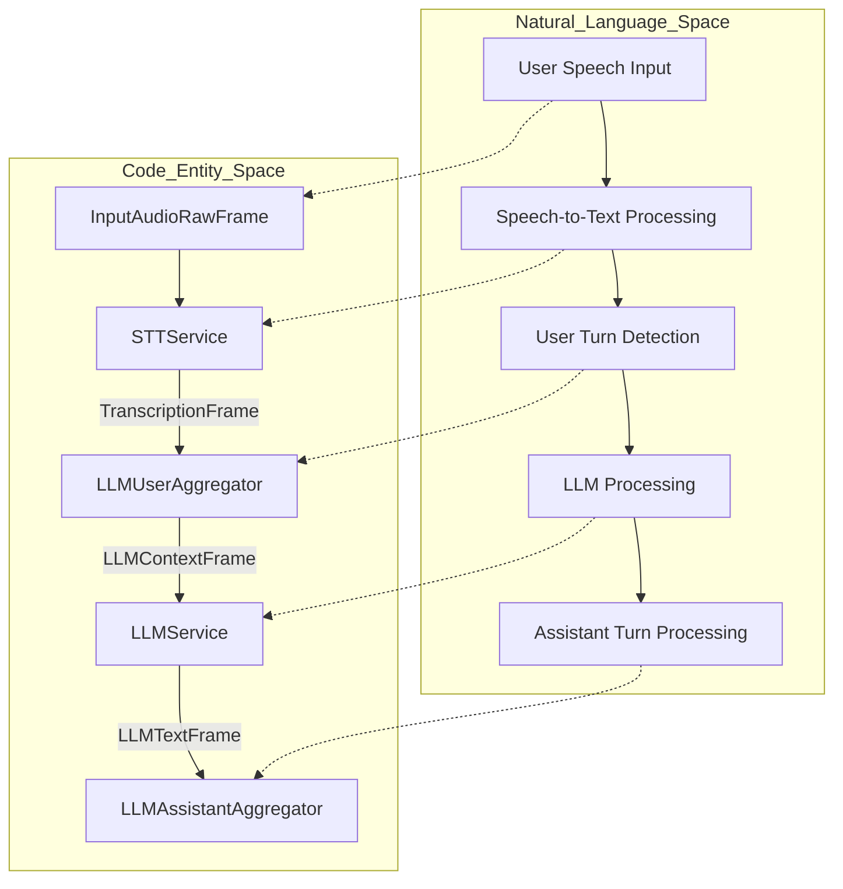
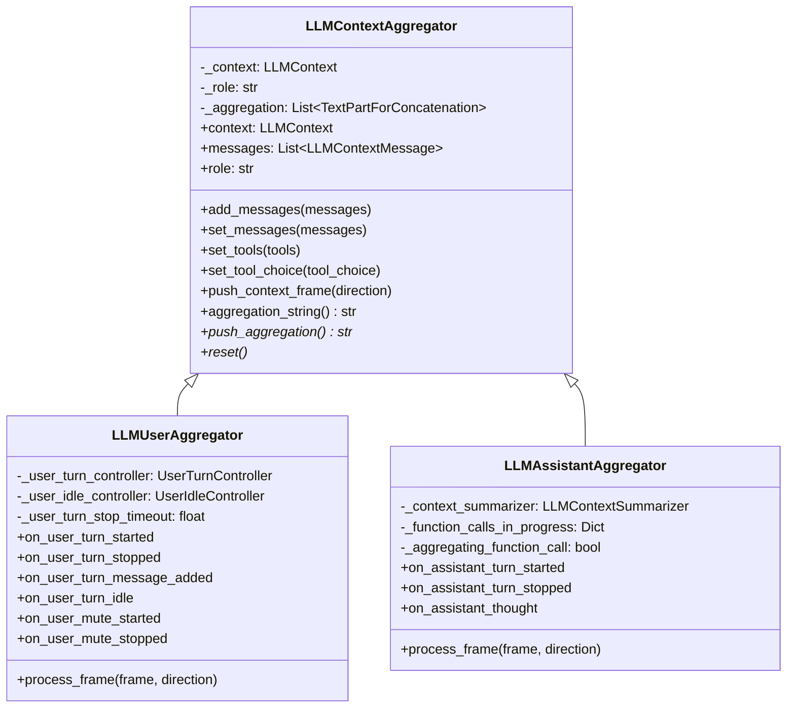
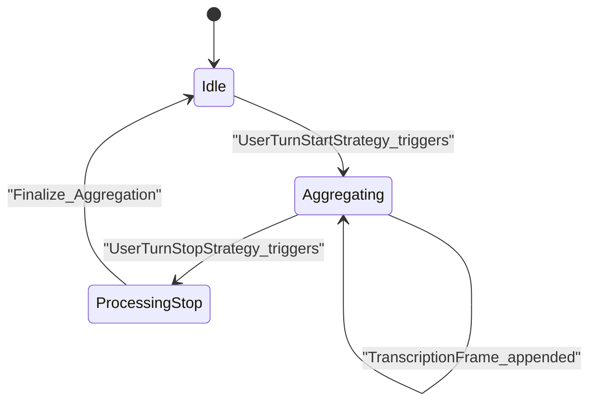
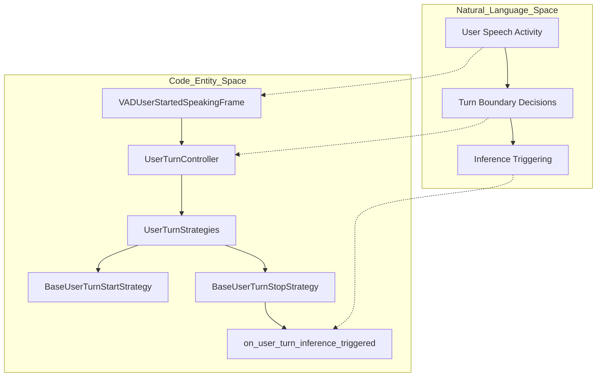
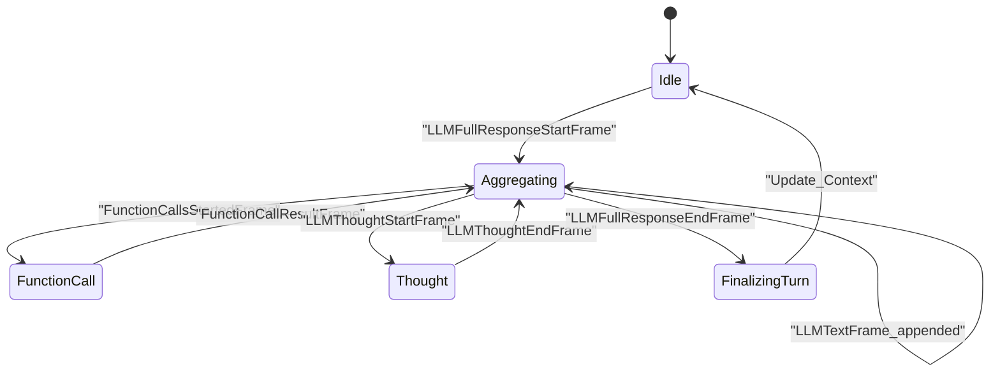

<!-- source: DeepWiki mcp.deepwiki.com · repo pipecat-ai/pipecat · page 3.7 Context Aggregators · fetched 2026-10-26 -->

# Context Aggregators

Relevant source files

The following files were used as context for generating this wiki page:

- [src/pipecat/processors/aggregators/llm_response_universal.py](src/pipecat/processors/aggregators/llm_response_universal.py)
- [src/pipecat/turns/user_stop/__init__.py](src/pipecat/turns/user_stop/__init__.py)
- [src/pipecat/turns/user_stop/external_user_turn_completion_stop_strategy.py](src/pipecat/turns/user_stop/external_user_turn_completion_stop_strategy.py)
- [src/pipecat/turns/user_stop/llm_turn_completion_user_turn_stop_strategy.py](src/pipecat/turns/user_stop/llm_turn_completion_user_turn_stop_strategy.py)
- [src/pipecat/turns/user_turn_completion_mixin.py](src/pipecat/turns/user_turn_completion_mixin.py)
- [tests/test_context_aggregators_universal.py](tests/test_context_aggregators_universal.py)
- [tests/test_langchain.py](tests/test_langchain.py)
- [tests/test_rtvi_observer_config.py](tests/test_rtvi_observer_config.py)
- [tests/test_user_turn_completion_mixin.py](tests/test_user_turn_completion_mixin.py)

Context aggregators manage user and assistant turns in conversational AI pipelines by collecting and aggregating frames during each turn and maintaining conversation state in an `LLMContext` [src/pipecat/processors/aggregators/llm_response_universal.py:7-12](). They bridge speech-to-text services, LLM processing, and text-to-speech components by coordinating the flow of conversation data between these components.

For information about underlying context storage, see [Context System](3.6). For turn detection and user idle handling, see [Turn Detection and User Idle](3.8).

Sources: [src/pipecat/processors/aggregators/llm_response_universal.py:7-12]()

## Architecture Overview

Context aggregators sit at critical junctions in the processing pipeline, intercepting and accumulating frames flowing between different service types. The `LLMUserAggregator` processes user input from STT services, while the `LLMAssistantAggregator` processes assistant output from LLM services [src/pipecat/processors/aggregators/llm_response_universal.py:9-12]().

### Natural Language to Code Entity Mapping: Turn Management

### Pipeline Flow Diagram

```mermaid
graph TB
    subgraph "PipelineFlow"
        Input["BaseInputTransport"]
        VAD["VADController"]
        STTSvc["STTService"]
        UserAggr["LLMUserAggregator"]
        LLMSvc["LLMService"]
        AssistAggr["LLMAssistantAggregator"]
        TTSSvc["TTSService"]
        Output["BaseOutputTransport"]
    end
    
    Input -->|"InputAudioRawFrame"| VAD
    VAD -->|"VADUserStartedSpeakingFrame"| STTSvc
    STTSvc -->|"TranscriptionFrame"| UserAggr
    UserAggr -->|"LLMContextFrame"| LLMSvc
    LLMSvc -->|"LLMTextFrame"| AssistAggr
    AssistAggr -->|"TextFrame"| TTSSvc
    TTSSvc -->|"TTSAudioRawFrame"| Output
```

Sources: [src/pipecat/processors/aggregators/llm_response_universal.py:7-12](), [src/pipecat/processors/aggregators/llm_response_universal.py:117-164]()

## LLMContextAggregator Base Class

`LLMContextAggregator` is the abstract base class for both user and assistant aggregators. It provides common functionality for interacting with an `LLMContext` and managing text aggregation buffers [src/pipecat/processors/aggregators/llm_response_universal.py:240-252]().

**Key Responsibilities:**
- Maintains a reference to a shared `LLMContext` [src/pipecat/processors/aggregators/llm_response_universal.py:250-252]().
- Provides context frame creation via `_get_context_frame()` [src/pipecat/processors/aggregators/llm_response_universal.py:330-334]().
- Manages an aggregation buffer for text parts using `TextPartForConcatenation` [src/pipecat/processors/aggregators/llm_response_universal.py:256-258]().
- Provides message manipulation methods like `add_messages()` and `set_messages()` [src/pipecat/processors/aggregators/llm_response_universal.py:288-301]().
- Defines the abstract `push_aggregation()` method implemented by subclasses [src/pipecat/processors/aggregators/llm_response_universal.py:354-355]().

Sources: [src/pipecat/processors/aggregators/llm_response_universal.py:240-358]()

## LLMUserAggregator

`LLMUserAggregator` collects user transcriptions during active user turns, managing the boundary between when a user starts and stops speaking [src/pipecat/processors/aggregators/llm_response_universal.py:360-400](). It uses turn strategies to determine turn boundaries and supports various user interaction patterns.

### Core Functionality and Turn Flow

The user aggregator operates within turn boundaries governed by `UserTurnController`:
1. **Turn Start Detection**: User turn start strategies (e.g., `VADUserTurnStartStrategy`, `TranscriptionUserTurnStartStrategy`) or proposed turn frames signal when aggregation begins [src/pipecat/turns/user_start/base_user_turn_start_strategy.py:39-51]().
2. **Transcription Aggregation**: Collects `TranscriptionFrame` objects during the active turn [src/pipecat/processors/aggregators/llm_response_universal.py:844-847]().
3. **Turn Stop Detection**: User turn stop strategies (e.g., `SpeechTimeoutUserTurnStopStrategy`) signal when aggregation completes [src/pipecat/turns/user_stop/base_user_turn_stop_strategy.py:43-66]().
4. **Context Update**: Adds the aggregated user message to `LLMContext` and pushes an `LLMContextFrame` downstream [src/pipecat/processors/aggregators/llm_response_universal.py:647-654]().
5. **Event Emission**: Emits the `on_user_turn_message_added` event when a complete user message is added to the context [src/pipecat/processors/aggregators/llm_response_universal.py:656-662]().

### Turn Controller Integration (Mapping Natural Language to Code)

Sources: [src/pipecat/processors/aggregators/llm_response_universal.py:360-664](), [src/pipecat/turns/user_turn_strategies.py:55-79](), [src/pipecat/turns/user_turn_controller.py:36-84]()

### Frame Processing Table

| Frame Type | Purpose | Processing Action |
|------------|---------|-------------------|
| `TranscriptionFrame` | User speech text | Aggregated during active turn [src/pipecat/processors/aggregators/llm_response_universal.py:844-847](). |
| `InterimTranscriptionFrame` | Partial transcription | Consumed, not aggregated [src/pipecat/processors/aggregators/llm_response_universal.py:849-851](). |
| `TranslationFrame` | Translated speech | Consumed, not aggregated [src/pipecat/processors/aggregators/llm_response_universal.py:853-855](). |
| `VADUserStartedSpeakingFrame` | VAD start signal | Forwarded to turn controller [src/pipecat/processors/aggregators/llm_response_universal.py:783-785](). |
| `VADUserStoppedSpeakingFrame` | VAD stop signal | Forwarded to turn controller [src/pipecat/processors/aggregators/llm_response_universal.py:787-789](). |
| `ProposedUserStartedSpeakingFrame` | Service turn start proposal | Resolved via `ExternalUserTurnStrategies` [src/pipecat/turns/user_turn_strategies.py:106-111](). |
| `ProposedUserStoppedSpeakingFrame` | Service turn stop proposal | Resolved via `ExternalUserTurnStrategies` [src/pipecat/turns/user_turn_strategies.py:106-111](). |
| `LLMMessagesAppendFrame` | Add messages | Updates context, optionally triggers LLM run [src/pipecat/processors/aggregators/llm_response_universal.py:760-765](). |
| `LLMMessagesTransformFrame` | Transform context | Facilitates programmatic editing of context [src/pipecat/processors/aggregators/llm_response_universal.py:772-776](). |
| `LLMRunFrame` | Trigger LLM | Pushes `LLMContextFrame` downstream [src/pipecat/processors/aggregators/llm_response_universal.py:778-781](). |
| `LLMSetToolsFrame` | Update tools | Updates context tools; if `add_tool_change_messages` is True, appends a developer message describing changes [src/pipecat/processors/aggregators/llm_response_universal.py:791-795](). |
| `ServiceMetadataFrame` | Service configuration | Configures `realtime_service_mode` [src/pipecat/processors/aggregators/llm_response_universal.py:833-835](). |
| `STTMetadataFrame` | STT Latency | Updates TTFS P99 for turn detection strategies [src/pipecat/processors/aggregators/llm_response_universal.py:837-839](). |

Sources: [src/pipecat/processors/aggregators/llm_response_universal.py:760-855]()

## Gated Context Patterns and Turn Completion

When `FilterIncompleteUserTurnStrategies` is active, the aggregator gates user turn finalization on the LLM's turn completion marker (COMPLETE `●`, INCOMPLETE SHORT `◐`, INCOMPLETE LONG `○`) [src/pipecat/turns/user_turn_strategies.py:115-166](), suppressing incomplete responses and triggering timeouts for re-prompting via `LLMTurnCompletionUserTurnStopStrategy` [src/pipecat/turns/user_stop/llm_turn_completion_user_turn_stop_strategy.py:18-46](). The `LLMTurnCompletionUserTurnStopStrategy` configures the LLM to enable `filter_incomplete_user_turns` and seeds the `UserTurnCompletionConfig` on `StartFrame` [src/pipecat/turns/user_stop/llm_turn_completion_user_turn_stop_strategy.py:73-85](). This ensures that all LLMs, even those behind an `LLMSwitcher`, are configured for the marker-based completion protocol [src/pipecat/turns/user_stop/llm_turn_completion_user_turn_stop_strategy.py:30-36]().

The `EagerUserTurnStopStrategy` [src/pipecat/turns/user_stop/eager_user_turn_stop_strategy.py:23-51]() allows the system to speculatively generate a response based on an `EagerTranscriptionFrame` [src/pipecat/turns/user_stop/eager_user_turn_stop_strategy.py:96-97](). If the committed transcription matches the eager one according to an `EagerMatchPolicy`, the speculative response is kept [src/pipecat/turns/user_stop/eager_user_turn_stop_strategy.py:120-129](). Otherwise, an `EagerEndOfTurnCancelFrame` is emitted, and a new inference is triggered [src/pipecat/turns/user_stop/eager_user_turn_stop_strategy.py:136-141]().

Sources: [src/pipecat/turns/user_turn_strategies.py:115-166](), [src/pipecat/turns/user_stop/llm_turn_completion_user_turn_stop_strategy.py:18-46](), [src/pipecat/turns/user_stop/llm_turn_completion_user_turn_stop_strategy.py:73-85](), [src/pipecat/turns/user_stop/llm_turn_completion_user_turn_stop_strategy.py:30-36](), [src/pipecat/turns/user_stop/eager_user_turn_stop_strategy.py:23-141]()

## LLMAssistantAggregator

`LLMAssistantAggregator` collects assistant responses from LLM services, managing function calls, model thoughts, and text output. It updates the `LLMContext` with assistant messages and manages context summarization [src/pipecat/processors/aggregators/llm_response_universal.py:898-950]().

### Core Functionality

1. **Turn Start**: `LLMFullResponseStartFrame` signals that assistant aggregation has begun [src/pipecat/processors/aggregators/llm_response_universal.py:1005-1008]().
2. **Content Collection**: Accumulates incoming `LLMTextFrame` tokens [src/pipecat/processors/aggregators/llm_response_universal.py:1026-1029]().
3. **Turn End**: `LLMFullResponseEndFrame` finalizes aggregation [src/pipecat/processors/aggregators/llm_response_universal.py:1010-1013]().
4. **Context Update**: Adds the completed assistant message to `LLMContext` [src/pipecat/processors/aggregators/llm_response_universal.py:1215-1225]().

### Function Calls and Thoughts
- **Function Calls**: Tracked via `FunctionCallsStartedFrame`, `FunctionCallInProgressFrame`, and `FunctionCallResultFrame` using `tool_call_id` in `_function_calls_in_progress` [src/pipecat/processors/aggregators/llm_response_universal.py:1091-1158]().
- **Thoughts**: Internal reasoning tokens are captured via `LLMThoughtStartFrame`, `LLMThoughtTextFrame`, and `LLMThoughtEndFrame`, triggering the `on_assistant_thought` event [src/pipecat/processors/aggregators/llm_response_universal.py:1160-1198]().

Sources: [src/pipecat/processors/aggregators/llm_response_universal.py:898-1236]()

## Universal Aggregator Pair and Realtime Service Mode

`LLMContextAggregatorPair` is a convenience class that instantiates and links an `LLMUserAggregator` and an `LLMAssistantAggregator` sharing the same `LLMContext` [src/pipecat/processors/aggregators/llm_response_universal.py:1238-1245]().

### Realtime Service Mode
Setting `realtime_service_mode=True` configures the aggregator pair for speech-to-speech services (e.g., OpenAI Realtime, Gemini Live):
1. **Decoupled Context Writes**: Assistant response start triggers user message context writes [src/pipecat/processors/aggregators/llm_response_universal.py:1005-1008]().
2. **Strategy Swapping**: Automatically replaces default turn strategies with `ExternalUserTurnStartStrategy` and `ExternalUserTurnStopStrategy` if the service emits its own turn frames [src/pipecat/processors/aggregators/llm_response_universal.py:1268-1275]().
3. **on_user_turn_message_added Event**: Serves as the canonical event to subscribe to finalized user text, as raw content fields may be handled differently in realtime streams [src/pipecat/processors/aggregators/llm_response_universal.py:62-63]().

### Tool Change Messages
When `add_tool_change_messages=True`, the aggregator computes the difference between advertised tools on each `LLMSetToolsFrame` and appends a `developer` role message to the context describing additions and removals [src/pipecat/processors/aggregators/llm_response_universal.py:121-132]().

Sources: [src/pipecat/processors/aggregators/llm_response_universal.py:121-132](), [src/pipecat/processors/aggregators/llm_response_universal.py:1238-1275]()

## Configuration Parameters

### LLMUserAggregatorParams

| Parameter | Type | Default | Description |
|-----------|------|---------|-------------|
| `add_tool_change_messages` | `bool` | `False` | When True, on each `LLMSetToolsFrame` the aggregator computes the diff against the currently advertised tools and appends a developer-role message to the context describing additions/removals. Helps the LLM stay coherent across mid-conversation tool changes. [src/pipecat/processors/aggregators/llm_response_universal.py:128-139]() |
| `audio_idle_timeout` | `float` | `1.0` | Timeout in seconds to force speech stop when no audio frames are received while in SPEAKING state (e.g. user mutes mic mid-speech). Set to 0 to disable. [src/pipecat/processors/aggregators/llm_response_universal.py:140-142]() |
| `user_turn_strategies` | `UserTurnStrategies` | `None` | User turn start and stop strategies. [src/pipecat/processors/aggregators/llm_response_universal.py:143]() |
| `user_mute_strategies` | `List[BaseUserMuteStrategy]` | `[]` | List of user mute strategies. [src/pipecat/processors/aggregators/llm_response_universal.py:144]() |
| `user_turn_stop_timeout` | `float` | `5.0` | Time in seconds to wait before considering the user's turn finished. [src/pipecat/processors/aggregators/llm_response_universal.py:145-146]() |
| `user_idle_timeout` | `float` | `0` | Timeout in seconds for detecting user idle state. The aggregator will emit an `on_user_turn_idle` event when the user has been idle (not speaking) for this duration. Set to 0 to disable idle detection. [src/pipecat/processors/aggregators/llm_response_universal.py:147-150]() |
| `vad_analyzer` | `VADAnalyzer` | `None` | Voice Activity Detection analyzer instance. [src/pipecat/processors/aggregators/llm_response_universal.py:151]() |
| `empty_user_turn` | `EmptyUserTurnConfig` | `None` | How to respond to a user turn that ends with no transcript. [src/pipecat/processors/aggregators/llm_response_universal.py:153-156]() |
| `filter_incomplete_user_turns` | `bool` | `False` | **Deprecated.** When enabled, the LLM outputs a turn-completion marker at the start of each response. Use `user_turn_strategies=FilterIncompleteUserTurnStrategies()` instead. Will be removed in 2.0.0. [src/pipecat/processors/aggregators/llm_response_universal.py:157-164]() |
| `user_turn_completion_config` | `UserTurnCompletionConfig` | `None` | Configuration for turn completion behavior including custom instructions, timeouts, and prompts. Only used when `filter_incomplete_user_turns` is True (deprecated path). [src/pipecat/processors/aggregators/llm_response_universal.py:165-171]() |

### LLMAssistantAggregatorParams

| Parameter | Type | Default | Description |
|-----------|------|---------|-------------|
| `enable_auto_context_summarization` | `bool` | `False` | Enable automatic context summarization. [src/pipecat/processors/aggregators/llm_response_universal.py:203]() |
| `auto_context_summarization_config` | `LLMAutoContextSummarizationConfig` | `None` | Summarization configuration. [src/pipecat/processors/aggregators/llm_response_universal.py:204]() |

Sources: [src/pipecat/processors/aggregators/llm_response_universal.py:123-204]()

---

