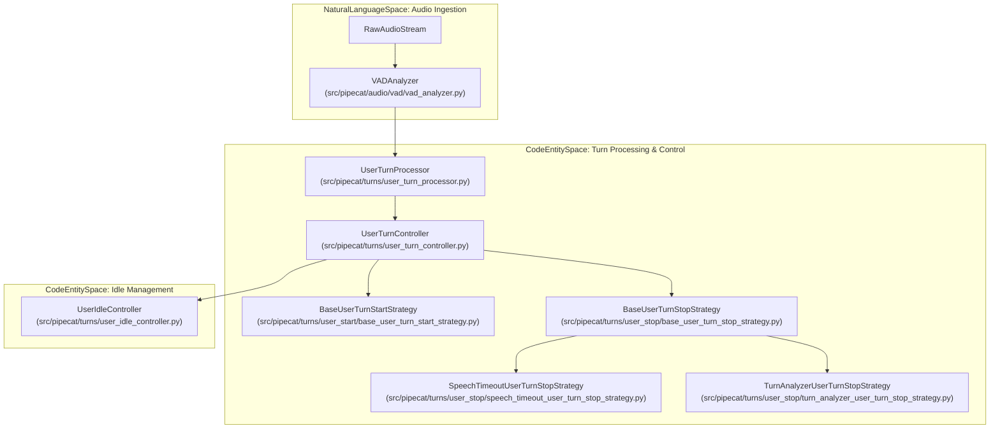
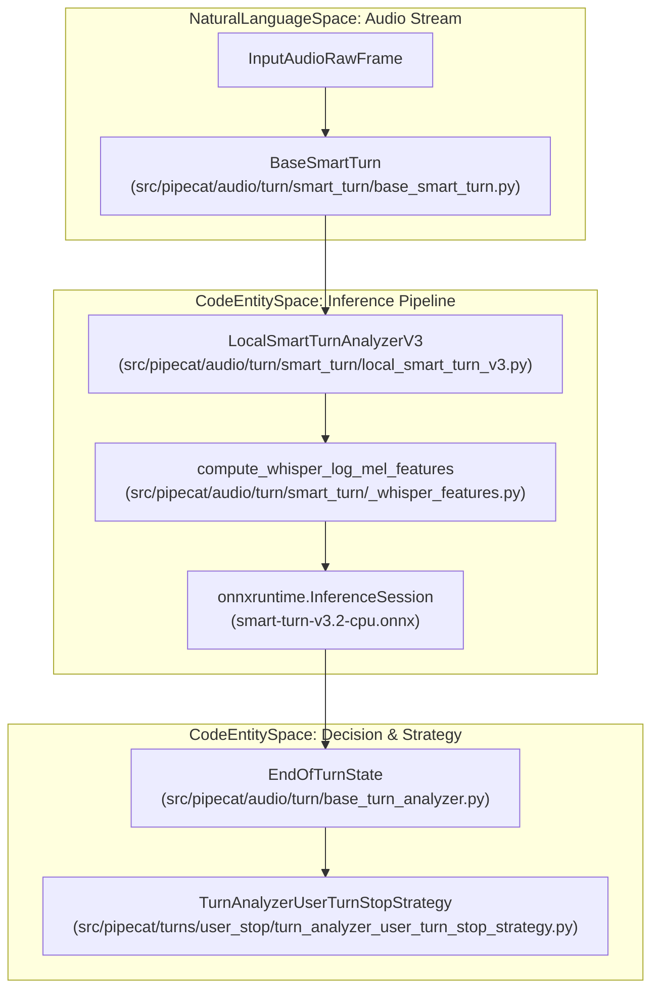

<!-- source: DeepWiki mcp.deepwiki.com · repo pipecat-ai/pipecat · page 3.8 Turn Detection and User Idle · fetched 2026-10-26 -->

# Turn Detection and User Idle

Relevant source files

The following files were used as context for generating this wiki page:

- [evals/release/scenarios/scripted/filter_incomplete_turns.yaml](evals/release/scenarios/scripted/filter_incomplete_turns.yaml)
- [examples/features/features-voicemail-detection.py](examples/features/features-voicemail-detection.py)
- [examples/turn-management/turn-management-custom-external-turn-strategy.py](examples/turn-management/turn-management-custom-external-turn-strategy.py)
- [examples/turn-management/turn-management-detect-user-idle.py](examples/turn-management/turn-management-detect-user-idle.py)
- [examples/turn-management/turn-management-filter-incomplete-turns-function-calling.py](examples/turn-management/turn-management-filter-incomplete-turns-function-calling.py)
- [examples/turn-management/turn-management-filter-incomplete-turns-user-idle.py](examples/turn-management/turn-management-filter-incomplete-turns-user-idle.py)
- [examples/turn-management/turn-management-filter-incomplete-turns.py](examples/turn-management/turn-management-filter-incomplete-turns.py)
- [examples/turn-management/turn-management-interruption-config.py](examples/turn-management/turn-management-interruption-config.py)
- [examples/turn-management/turn-management-smart-turn-local-coreml.py](examples/turn-management/turn-management-smart-turn-local-coreml.py)
- [examples/turn-management/turn-management-smart-turn-local.py](examples/turn-management/turn-management-smart-turn-local.py)
- [examples/turn-management/turn-management-turn-tracking-observer.py](examples/turn-management/turn-management-turn-tracking-observer.py)
- [examples/turn-management/turn-management-user-assistant-turns.py](examples/turn-management/turn-management-user-assistant-turns.py)
- [examples/turn-management/turn-management-user-mute-strategy.py](examples/turn-management/turn-management-user-mute-strategy.py)
- [src/pipecat/audio/filters/koala_filter.py](src/pipecat/audio/filters/koala_filter.py)
- [src/pipecat/audio/turn/base_turn_analyzer.py](src/pipecat/audio/turn/base_turn_analyzer.py)
- [src/pipecat/audio/turn/smart_turn/__init__.py](src/pipecat/audio/turn/smart_turn/__init__.py)
- [src/pipecat/audio/turn/smart_turn/base_smart_turn.py](src/pipecat/audio/turn/smart_turn/base_smart_turn.py)
- [src/pipecat/audio/turn/smart_turn/http_smart_turn.py](src/pipecat/audio/turn/smart_turn/http_smart_turn.py)
- [src/pipecat/audio/turn/smart_turn/local_coreml_smart_turn.py](src/pipecat/audio/turn/smart_turn/local_coreml_smart_turn.py)
- [src/pipecat/audio/turn/smart_turn/local_smart_turn_v2.py](src/pipecat/audio/turn/smart_turn/local_smart_turn_v2.py)
- [src/pipecat/audio/vad/vad_analyzer.py](src/pipecat/audio/vad/vad_analyzer.py)
- [src/pipecat/audio/volume.py](src/pipecat/audio/volume.py)
- [src/pipecat/turns/user_idle_controller.py](src/pipecat/turns/user_idle_controller.py)
- [src/pipecat/turns/user_start/base_user_turn_start_strategy.py](src/pipecat/turns/user_start/base_user_turn_start_strategy.py)
- [src/pipecat/turns/user_start/external_user_turn_start_strategy.py](src/pipecat/turns/user_start/external_user_turn_start_strategy.py)
- [src/pipecat/turns/user_start/min_words_user_turn_start_strategy.py](src/pipecat/turns/user_start/min_words_user_turn_start_strategy.py)
- [src/pipecat/turns/user_start/wake_phrase_user_turn_start_strategy.py](src/pipecat/turns/user_start/wake_phrase_user_turn_start_strategy.py)
- [src/pipecat/turns/user_stop/base_user_turn_stop_strategy.py](src/pipecat/turns/user_stop/base_user_turn_stop_strategy.py)
- [src/pipecat/turns/user_stop/deferred_user_turn_stop_strategy.py](src/pipecat/turns/user_stop/deferred_user_turn_stop_strategy.py)
- [src/pipecat/turns/user_stop/external_user_turn_stop_strategy.py](src/pipecat/turns/user_stop/external_user_turn_stop_strategy.py)
- [src/pipecat/turns/user_stop/speech_timeout_user_turn_stop_strategy.py](src/pipecat/turns/user_stop/speech_timeout_user_turn_stop_strategy.py)
- [src/pipecat/turns/user_stop/turn_analyzer_user_turn_stop_strategy.py](src/pipecat/turns/user_stop/turn_analyzer_user_turn_stop_strategy.py)
- [src/pipecat/turns/user_turn_controller.py](src/pipecat/turns/user_turn_controller.py)
- [src/pipecat/turns/user_turn_processor.py](src/pipecat/turns/user_turn_processor.py)
- [src/pipecat/turns/user_turn_strategies.py](src/pipecat/turns/user_turn_strategies.py)
- [tests/test_audio_volume.py](tests/test_audio_volume.py)
- [tests/test_empty_user_turn.py](tests/test_empty_user_turn.py)
- [tests/test_turn_start_vad_state.py](tests/test_turn_start_vad_state.py)
- [tests/test_user_idle_controller.py](tests/test_user_idle_controller.py)
- [tests/test_user_turn_controller.py](tests/test_user_turn_controller.py)
- [tests/test_user_turn_start_strategy.py](tests/test_user_turn_start_strategy.py)
- [tests/test_user_turn_stop_strategy.py](tests/test_user_turn_stop_strategy.py)

This page details the turn detection and user idle systems in Pipecat (`src/pipecat/turns/` and `src/pipecat/audio/turn/`), which manage when a user's speaking turn begins and ends, handle voice activity detection, implement muting strategies during bot responses, and detect user inactivity.

**Scope**: This page focuses on the mechanisms for detecting user speech boundaries and idle states. For related subsystems, see:
- How turns are processed into LLM context: [Context Aggregators](3.7)
- How user speech interrupts bot output: [Interruption Handling](3.9)
- The underlying VAD analyzers (Silero, AIC, etc.): [Voice Activity Detection](6.1)

---

## Turn Detection Architecture

The turn detection system operates through a hierarchy of components that transform raw audio signals into semantic user turn events. The architecture separates concerns into distinct layers: VAD analysis, turn start/stop strategy execution, idle tracking, and pipeline event routing via `UserTurnProcessor` and `UserTurnController`.

Title: "Turn_Detection_Code_Architecture"

Sources: [src/pipecat/turns/user_turn_controller.py:36-113](), [src/pipecat/turns/user_idle_controller.py:26-53](), [src/pipecat/turns/user_turn_processor.py:35-110](), [src/pipecat/audio/vad/vad_analyzer.py:63-140]()

---

## Voice Activity Detection (VAD) and Turn Start Strategies

The `VADAnalyzer` abstract base class [src/pipecat/audio/vad/vad_analyzer.py:63-140]() defines the interface for voice activity detection. It produces state transitions (`QUIET`, `STARTING`, `SPEAKING`, `STOPPING`) that are converted into frames by the VAD controller [src/pipecat/audio/vad/vad_analyzer.py:31-45]().

Turn start strategies determine when a user's speaking turn officially begins:
- `VADUserTurnStartStrategy`: Triggers immediately on `VADUserStartedSpeakingFrame`.
- `MinWordsUserTurnStartStrategy`: Triggers only after a minimum number of words are transcribed [src/pipecat/turns/user_start/min_words_user_turn_start_strategy.py:1-39]().
- `TranscriptionUserTurnStartStrategy`: Triggers on the first `TranscriptionFrame`.
- `ExternalUserTurnStartStrategy`: Used when an external service manages turn boundaries via `UserStartedSpeakingFrame` [src/pipecat/turns/user_start/external_user_turn_start_strategy.py:1-40]().
- `WakePhraseUserTurnStartStrategy`: Triggers when a specific wake phrase is detected [src/pipecat/turns/user_start/wake_phrase_user_turn_start_strategy.py:1-39]().

Sources: [src/pipecat/audio/vad/vad_analyzer.py:31-140](), [src/pipecat/turns/user_start/external_user_turn_start_strategy.py:1-40](), [src/pipecat/turns/user_start/min_words_user_turn_start_strategy.py:1-39](), [src/pipecat/turns/user_start/wake_phrase_user_turn_start_strategy.py:1-39]()

---

## Turn Stop Strategies and Lifecycle

Turn stop strategies decide when the user has finished speaking. Pipecat distinguishes between triggering inference and finalizing a turn. Many strategies support the `wait_for_transcript` keyword argument to decouple local detection from STT arrival [src/pipecat/turns/user_stop/speech_timeout_user_turn_stop_strategy.py:50-73]().

**Lifecycle Callbacks**: Strategies implement `handle_user_turn_started()` and `handle_user_turn_stopped()` lifecycle callbacks [src/pipecat/turns/user_stop/turn_analyzer_user_turn_stop_strategy.py:100-116](). These allow strategies to precisely clear per-turn bookkeeping while preserving live physical state (such as VAD status) across turn boundaries.

| Strategy Class | Description |
| :--- | :--- |
| `SpeechTimeoutUserTurnStopStrategy` | Uses dual timers: a policy floor (`user_speech_timeout`) and a safety net (`stt_timeout`). Short-circuited by `TranscriptionFrame.finalized=True` [src/pipecat/turns/user_stop/speech_timeout_user_turn_stop_strategy.py:27-48](). |
| `TurnAnalyzerUserTurnStopStrategy` | Uses ML models (e.g., `LocalSmartTurnAnalyzerV3`) to predict turn completion [src/pipecat/turns/user_stop/turn_analyzer_user_turn_stop_strategy.py:34-48](). `handle_user_turn_stopped` clears buffered speech to prevent phantom turns from stale silence timers [src/pipecat/turns/user_stop/turn_analyzer_user_turn_stop_strategy.py:104-116](). |
| `ExternalUserTurnStopStrategy` | End-of-turn counterpart to external start strategies, handling `ProposedUserStoppedSpeakingFrame` [src/pipecat/turns/user_stop/external_user_turn_stop_strategy.py:27-51](). |
| `ExternalUserTurnCompletionStopStrategy` | A specialized external stop strategy that listens for `UserTurnInferenceCompletedFrame` [tests/test_user_turn_controller.py:63-65](). Used when an LLM explicitly signals turn completion. |
| `DeferredUserTurnStopStrategy` | Defers the decision to another strategy for complex conditional logic [src/pipecat/turns/user_stop/deferred_user_turn_stop_strategy.py:1-39](). |

Sources: [src/pipecat/turns/user_stop/speech_timeout_user_turn_stop_strategy.py:27-48](), [src/pipecat/turns/user_stop/turn_analyzer_user_turn_stop_strategy.py:34-116](), [src/pipecat/turns/user_stop/external_user_turn_stop_strategy.py:27-51](), [tests/test_user_turn_controller.py:63-65](), [src/pipecat/turns/user_stop/deferred_user_turn_stop_strategy.py:1-39]()

---

## Smart Turn Analyzers

Smart turn analyzers use machine learning models to determine if a user is finished speaking, moving beyond simple silence detection.

Title: "Smart_Turn_Code_Flow"

The `LocalSmartTurnAnalyzerV3` implementation uses an ONNX model for local end-of-turn detection. It resamples audio to 16 kHz, truncates or pads it to 8 seconds, and computes Whisper-style log-mel features before running inference with `onnxruntime` [src/pipecat/audio/turn/smart_turn/local_smart_turn_v3.py:1-170](). Audio logging can be enabled via environment configuration, writing WAV files to the designated logging directory [src/pipecat/audio/turn/smart_turn/local_smart_turn_v3.py:47](), [src/pipecat/audio/turn/smart_turn/local_smart_turn_v3.py:97-98]().

Sources: [src/pipecat/audio/turn/smart_turn/base_smart_turn.py:52-168](), [src/pipecat/audio/turn/smart_turn/local_smart_turn_v3.py:28-170](), [src/pipecat/turns/user_stop/turn_analyzer_user_turn_stop_strategy.py:34-48]()

---

## User Idle Detection

The `UserIdleController` (`src/pipecat/turns/user_idle_controller.py`) monitors user activity. If the user hasn't spoken for the `user_idle_timeout` duration after `BotStoppedSpeakingFrame`, it emits an `on_user_turn_idle` event [src/pipecat/turns/user_idle_controller.py:26-53]().

- **Suppression**: The timer is suppressed while a user turn is in progress to avoid false triggers during interruptions [src/pipecat/turns/user_idle_controller.py:35-37]().
- **Dynamic Updates**: A `UserIdleTimeoutUpdateFrame` applies immediately, restarting running timers or arming them dynamically [src/pipecat/turns/user_idle_controller.py:39-41]().

Sources: [src/pipecat/turns/user_idle_controller.py:26-53]()

---

## User Mute Strategies

Mute strategies suppress user input during specific pipeline states, such as when the bot is delivering a critical first response or executing a tool:
- `AlwaysUserMuteStrategy`
- `FirstSpeechUserMuteStrategy`
- `FunctionCallUserMuteStrategy`
- `MuteUntilFirstBotCompleteUserMuteStrategy`

Sources: [src/pipecat/turns/user_mute/base_user_mute_strategy.py:1-40]()

---

