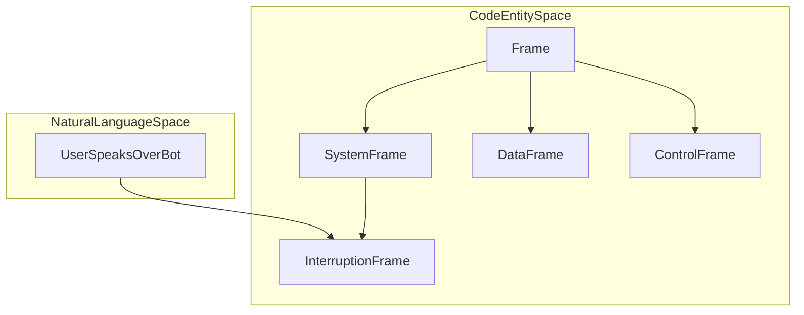
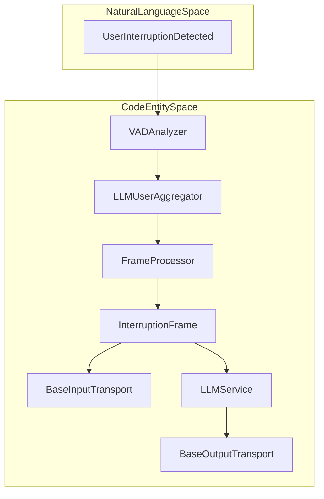

<!-- source: DeepWiki mcp.deepwiki.com · repo pipecat-ai/pipecat · page 3.9 Interruption Handling · fetched 2026-10-26 -->

# Interruption Handling

Relevant source files

The following files were used as context for generating this wiki page:

- [CHANGELOG.md](CHANGELOG.md)
- [changelog/5534.added.md](changelog/5534.added.md)
- [changelog/5534.fixed.md](changelog/5534.fixed.md)
- [src/pipecat/frames/frames.py](src/pipecat/frames/frames.py)
- [src/pipecat/pipeline/task.py](src/pipecat/pipeline/task.py)
- [src/pipecat/processors/aggregators/llm_response.py](src/pipecat/processors/aggregators/llm_response.py)
- [src/pipecat/processors/frame_processor.py](src/pipecat/processors/frame_processor.py)
- [src/pipecat/services/deepgram/flux/tts.py](src/pipecat/services/deepgram/flux/tts.py)
- [src/pipecat/transports/base_input.py](src/pipecat/transports/base_input.py)
- [src/pipecat/transports/base_output.py](src/pipecat/transports/base_output.py)
- [src/pipecat/transports/base_transport.py](src/pipecat/transports/base_transport.py)
- [tests/test_deepgram_flux_sagemaker_tts.py](tests/test_deepgram_flux_sagemaker_tts.py)
- [tests/test_deepgram_flux_tts.py](tests/test_deepgram_flux_tts.py)
- [tests/test_fish_tts.py](tests/test_fish_tts.py)
- [tests/test_tts_interruptible_service.py](tests/test_tts_interruptible_service.py)
- [tests/test_tts_zero_audio_contexts.py](tests/test_tts_zero_audio_contexts.py)

## Purpose and Scope

This document specifies how the Pipecat framework handles conversational interruptions—specifically when user input (such as speech detected by Voice Activity Detection) must cancel ongoing bot output, text generation, or media rendering. Pipecat implements a robust architecture utilizing `InterruptionFrame` broadcasting, queue prioritization via `FrameProcessorQueue`, configurable frame protection (`interruptible` field), and specialized handling across transport layers, aggregators, and AI services.

Sources: [src/pipecat/frames/frames.py:73-116](), [src/pipecat/processors/frame_processor.py:131-183]()

---

## Core Interruption Concepts

### InterruptionFrame and Frame Categorization

Interruption handling relies on the core frame type hierarchy defined in `pipecat.frames.frames`. 

- **`Frame`**: Base class containing the `interruptible` attribute (`bool`), which determines whether an interruption drops the frame or cancels its processing [src/pipecat/frames/frames.py:73-116]().
- **`SystemFrame`**: High-priority frames such as `InterruptionFrame` that bypass normal data flow and are processed immediately by frame processors [src/pipecat/frames/frames.py:122-129]().
- **`DataFrame` & `ControlFrame`**: Standard data and control structures that are subject to cancellation during an active interruption [src/pipecat/frames/frames.py:133-155]().

Title: Interruption Concept Architecture Mapping

Sources: [src/pipecat/frames/frames.py:73-155]()

### The `interruptible` Field and `UninterruptibleFrame` Deprecation

Every `Frame` instance initializes `interruptible = True` by default [src/pipecat/frames/frames.py:104-104](). 
- Developers can explicitly set `interruptible = False` on a specific frame instance before pushing it to protect it from being dropped or cancelled during an interruption [CHANGELOG.md:67-74]().
- The legacy `UninterruptibleFrame` mixin is deprecated as of version 1.11.0 in favor of setting `interruptible: bool = field(default=False, init=False)` directly on frame subclasses, and will be removed in version 2.0.0 [src/pipecat/frames/frames.py:163-181](), [CHANGELOG.md:67-74]().

Sources: [src/pipecat/frames/frames.py:104-181](), [CHANGELOG.md:67-74]()

### Frame Priority System

When frames arrive at a processor, `FrameProcessorQueue` sorts them into priority tiers to ensure control and system signals bypass regular payloads [src/pipecat/processors/frame_processor.py:131-172]().

| Frame Type | Priority Constant | Value | Description |
|------------|-------------------|-------|-------------|
| `StartFrame` | `START_PRIORITY` | `1` | Outranks all other frames [src/pipecat/processors/frame_processor.py:140-163]() |
| `SystemFrame` (`InterruptionFrame`) | `SYSTEM_PRIORITY` | `10` | Outranks data and control frames, processed immediately [src/pipecat/processors/frame_processor.py:141-165]() |
| `DataFrame` / `ControlFrame` | `DEFAULT_PRIORITY` | `20` | Standard flow frames [src/pipecat/processors/frame_processor.py:142-168]() |

Sources: [src/pipecat/processors/frame_processor.py:131-172]()

---

## Interruption Propagation and Broadcasting

When an interruption condition is met (e.g., `VADAnalyzer` detects user speech), an `InterruptionFrame` is broadcast bidirectionally across the pipeline graph to notify input transports, LLM services, and output transports.

Title: Interruption Broadcasting Data Flow

Sources: [src/pipecat/processors/frame_processor.py:38-42](), [src/pipecat/processors/aggregators/llm_response.py:62-65]()

---

## Frame Processing and Queue Behavior

Upon receiving an `InterruptionFrame`, a `FrameProcessor` executes interruption logic:
1. **Task Cancellation**: Any ongoing processing task tied to cancellable frames is terminated.
2. **Queue Draining**: Internal queues drop items where `interruptible=True`, while preserving frames marked `interruptible=False` [src/pipecat/frames/frames.py:104-116]().
3. **State Reset**: Processors reset internal state flags to prepare for the user's new conversational turn [src/pipecat/processors/aggregators/llm_response.py:62-65]().

Sources: [src/pipecat/processors/frame_processor.py:131-183](), [src/pipecat/processors/aggregators/llm_response.py:62-65]()

---

## Service-Specific Interruption Handling

### LLM and Aggregators
- **`LLMFullResponseAggregator`**: Intercepts `InterruptionFrame`, invokes its completion event handler with `completed=False`, resets its `_aggregation` string, and clears its `_started` flag [src/pipecat/processors/aggregators/llm_response.py:62-65]().

Sources: [src/pipecat/processors/aggregators/llm_response.py:20-86]()

### TTS Services and Transports (`BaseOutputTransport`)
- **`BaseOutputTransport`**: Manages output rendering through `MediaSender` instances [src/pipecat/transports/base_output.py:92-97](). When interrupted, it clears active audio buffers and halts active transmission tasks via `cancel()` [src/pipecat/transports/base_output.py:183-191]().
- **`InterruptibleTTSService`**: Tracks speaking states via `_bot_speaking` and `_tts_started` flags to determine whether websocket connections should be reset or reconnected upon interruption [tests/test_tts_interruptible_service.py:7-27]().

Sources: [src/pipecat/transports/base_output.py:92-191](), [tests/test_tts_interruptible_service.py:7-27]()

### STT Services (`BaseInputTransport`)
- **`BaseInputTransport`**: Handles incoming audio streams, tracks `_user_speaking` state, and propagates control signals when user actions override bot output [src/pipecat/transports/base_input.py:38-79]().

Sources: [src/pipecat/transports/base_input.py:38-79]()

---

## Related Frame Types

| Frame Class | Category | Role in Interruption |
|-------------|----------|----------------------|
| `InterruptionFrame` | `System` | Triggers framework-wide cancellation and buffer flushing [src/pipecat/frames/frames.py:38-42]() |
| `CancelFrame` | `System` | Forces immediate task termination, bypassing normal ordering [src/pipecat/frames/frames.py:31-31]() |
| `EndFrame` | `Control` | Gracefully shuts down the pipeline after flushing queued frames [src/pipecat/transports/base_output.py:33-33]() |

Sources: [src/pipecat/frames/frames.py:31-42](), [src/pipecat/transports/base_output.py:33-33]()

---

