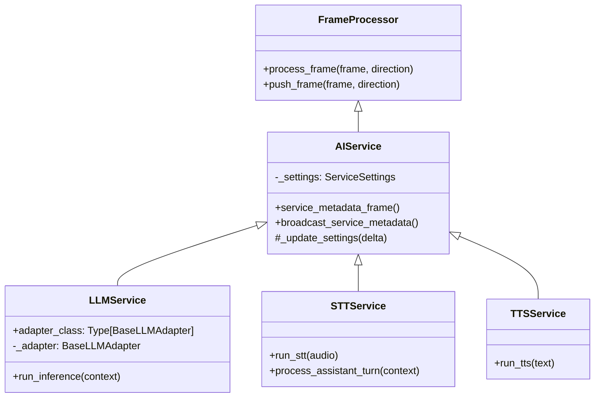
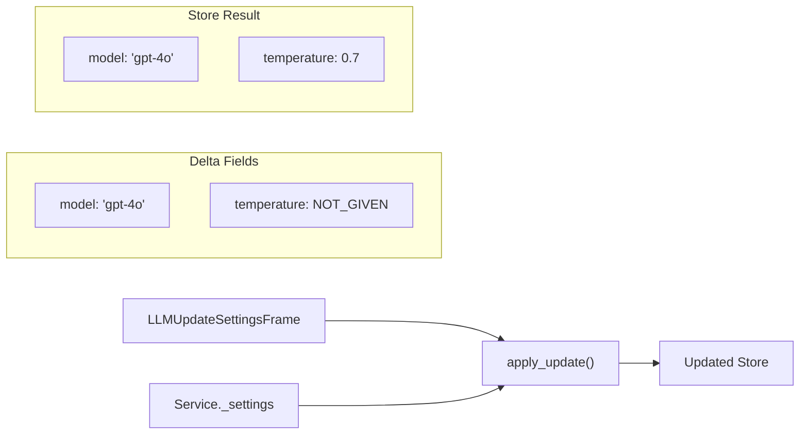
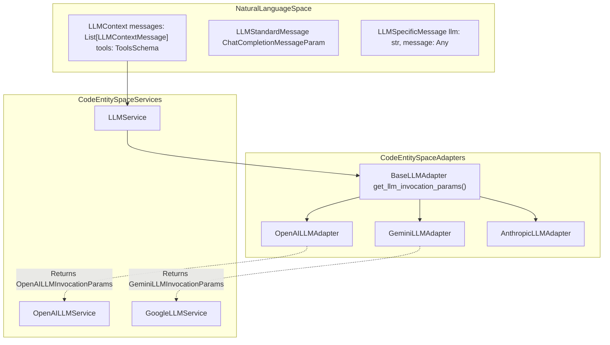
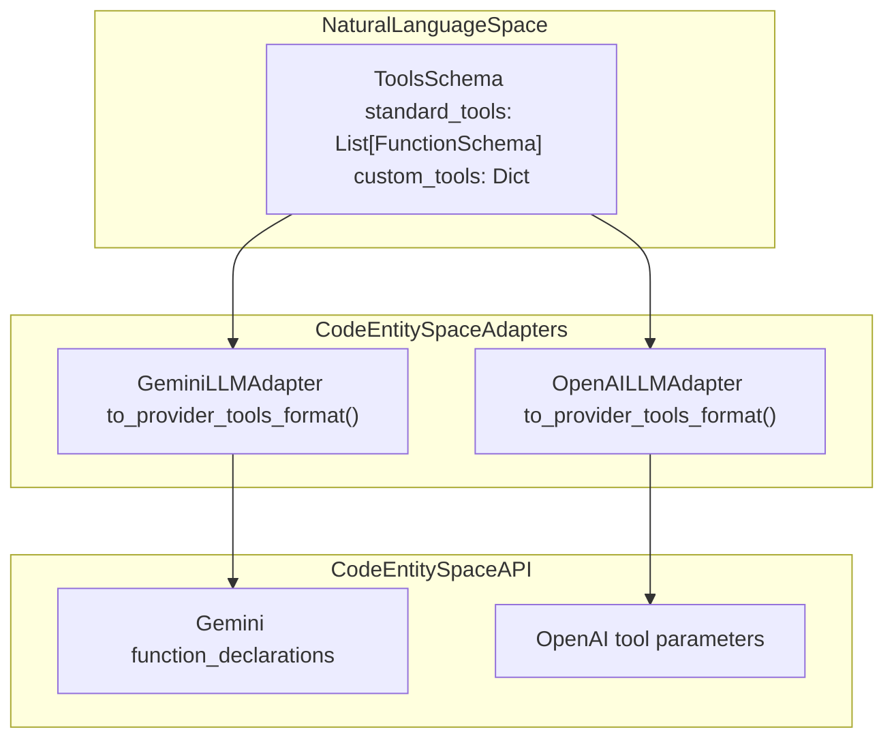

<!-- source: DeepWiki mcp.deepwiki.com · repo pipecat-ai/pipecat · page 4.1 Service Architecture and Adapters · fetched 2026-10-26 -->

# Service Architecture and Adapters

Relevant source files

The following files were used as context for generating this wiki page:

- [AGENTS.md](AGENTS.md)
- [CONTRIBUTING.md](CONTRIBUTING.md)
- [changelog/6101.fixed.md](changelog/6101.fixed.md)
- [src/pipecat/adapters/base_llm_adapter.py](src/pipecat/adapters/base_llm_adapter.py)
- [src/pipecat/adapters/services/anthropic_adapter.py](src/pipecat/adapters/services/anthropic_adapter.py)
- [src/pipecat/adapters/services/aws_nova_sonic_adapter.py](src/pipecat/adapters/services/aws_nova_sonic_adapter.py)
- [src/pipecat/adapters/services/bedrock_adapter.py](src/pipecat/adapters/services/bedrock_adapter.py)
- [src/pipecat/adapters/services/gemini_adapter.py](src/pipecat/adapters/services/gemini_adapter.py)
- [src/pipecat/adapters/services/grok_realtime_adapter.py](src/pipecat/adapters/services/grok_realtime_adapter.py)
- [src/pipecat/adapters/services/inworld_realtime_adapter.py](src/pipecat/adapters/services/inworld_realtime_adapter.py)
- [src/pipecat/adapters/services/open_ai_adapter.py](src/pipecat/adapters/services/open_ai_adapter.py)
- [src/pipecat/adapters/services/open_ai_realtime_adapter.py](src/pipecat/adapters/services/open_ai_realtime_adapter.py)
- [src/pipecat/adapters/services/open_ai_responses_adapter.py](src/pipecat/adapters/services/open_ai_responses_adapter.py)
- [src/pipecat/adapters/services/perplexity_adapter.py](src/pipecat/adapters/services/perplexity_adapter.py)
- [src/pipecat/classifiers/base_classifier.py](src/pipecat/classifiers/base_classifier.py)
- [src/pipecat/classifiers/jev/classifier.py](src/pipecat/classifiers/jev/classifier.py)
- [src/pipecat/classifiers/jev/client.py](src/pipecat/classifiers/jev/client.py)
- [src/pipecat/classifiers/llm/classifier.py](src/pipecat/classifiers/llm/classifier.py)
- [src/pipecat/classifiers/typesafe/jev/classifier.py](src/pipecat/classifiers/typesafe/jev/classifier.py)
- [src/pipecat/classifiers/typesafe/jev/client.py](src/pipecat/classifiers/typesafe/jev/client.py)
- [src/pipecat/evals/conversation.py](src/pipecat/evals/conversation.py)
- [src/pipecat/evals/conversation_observer.py](src/pipecat/evals/conversation_observer.py)
- [src/pipecat/extensions/voicemail/voicemail_detector.py](src/pipecat/extensions/voicemail/voicemail_detector.py)
- [src/pipecat/processors/aggregators/llm_context.py](src/pipecat/processors/aggregators/llm_context.py)
- [src/pipecat/services/ai_service.py](src/pipecat/services/ai_service.py)
- [src/pipecat/services/grok/realtime/events.py](src/pipecat/services/grok/realtime/events.py)
- [src/pipecat/services/grok/realtime/llm.py](src/pipecat/services/grok/realtime/llm.py)
- [src/pipecat/services/openai/realtime/events.py](src/pipecat/services/openai/realtime/events.py)
- [src/pipecat/services/settings.py](src/pipecat/services/settings.py)
- [src/pipecat/services/websocket_service.py](src/pipecat/services/websocket_service.py)
- [src/pipecat/transports/daily/utils.py](src/pipecat/transports/daily/utils.py)
- [src/pipecat/utils/image.py](src/pipecat/utils/image.py)
- [tests/test_anthropic_thinking_defaults.py](tests/test_anthropic_thinking_defaults.py)
- [tests/test_base_classifier.py](tests/test_base_classifier.py)
- [tests/test_classifiers_jev.py](tests/test_classifiers_jev.py)
- [tests/test_evals_conversation.py](tests/test_evals_conversation.py)
- [tests/test_evals_conversation_observer.py](tests/test_evals_conversation_observer.py)
- [tests/test_get_llm_invocation_params.py](tests/test_get_llm_invocation_params.py)
- [tests/test_llm_classifier.py](tests/test_llm_classifier.py)
- [tests/test_llm_context.py](tests/test_llm_context.py)
- [tests/test_settings.py](tests/test_settings.py)
- [tests/test_voicemail_detector.py](tests/test_voicemail_detector.py)
- [tests/test_websocket_service.py](tests/test_websocket_service.py)

## Purpose and Scope

This document explains the adapter pattern, settings system, update frames, and base service architecture that enable Pipecat to support over 60 AI service providers through a unified interface. The architecture consists of a multi-layer design:
1. **Universal Context Layer**: A provider-agnostic representation of conversations (`LLMContext`).
2. **Adapter Layer**: Provider-specific translators (`BaseLLMAdapter`) that convert universal context into native API formats.
3. **Settings Layer**: A sparse delta system (`ServiceSettings`) for runtime configuration updates via update frames.
4. **WebSocket Infrastructure**: Resilient connection management via `WebsocketService`, `QuickFailureTracker`, and `_BoundedCloseConnection`.

Sources: [src/pipecat/processors/aggregators/llm_context.py:7-15](), [src/pipecat/adapters/base_llm_adapter.py:60-76](), [src/pipecat/services/settings.py:7-35](), [src/pipecat/services/websocket_service.py:84-138]()

---

## Base Service Architecture

All AI services in Pipecat inherit from `AIService`, which extends `FrameProcessor`.

Title: Service Class Hierarchy

Sources: [src/pipecat/services/ai_service.py:1-50](), [src/pipecat/services/settings.py:141-168]()

The `AIService` base class provides model name management, metrics support, and the foundation for the settings system. AI services can override `service_metadata_frame()` to broadcast a `ServiceMetadataFrame` at start, enabling auto-configuration of downstream processors like turn strategies. `STTService` includes the `process_assistant_turn()` hook to allow providers to carry over context between turns for improved accuracy.

Sources: [src/pipecat/services/ai_service.py:1-50](), [src/pipecat/services/settings.py:141-168]()

---

## Settings System and Deltas

Pipecat uses a settings infrastructure to manage service configurations that can change while a pipeline is running (e.g., changing a model, voice, or language).

### Store vs. Delta Modes
The `ServiceSettings` class (and its subclasses like `LLMSettings`, `TTSSettings`, `STTSettings`) operates in two distinct modes:

1. **Store mode** (`self._settings`): Holds the full current state. Every field must have a real value; the `NOT_GIVEN` sentinel is never valid here [src/pipecat/services/settings.py:11-17](). `validate_complete()` is called in `AIService.start()` to enforce this.
2. **Delta mode**: A sparse update object carried by an `*UpdateSettingsFrame`. Only the fields the caller wants to change are set; all others remain `NOT_GIVEN`. `apply_update()` merges a delta into a store, skipping any `NOT_GIVEN` fields [src/pipecat/services/settings.py:19-22]().

### The NOT_GIVEN Sentinel
To distinguish between a field set to `None` and a field that was simply omitted from an update, Pipecat uses a `NOT_GIVEN` singleton [src/pipecat/services/settings.py:53-58]().

Title: Settings Delta Application

Sources: [src/pipecat/services/settings.py:7-35]()

**Key Helpers:**
* `is_given(value)`: Returns `True` if a value is anything other than `NOT_GIVEN` [src/pipecat/utils/types.py:45-45]().
* `apply_update(delta)`: Merges a delta into a store and returns a dictionary of changed fields [src/pipecat/services/settings.py:141-168]().

Sources: [src/pipecat/services/settings.py:7-172](), [src/pipecat/utils/types.py:45-45]()

---

## Universal LLM Context and Adapters (Bridge: Natural Language Space to Code Entity Space)

The service integration layer uses just-in-time translation. Conversations are stored in a universal format and converted to provider-specific formats only when an API call is made [src/pipecat/processors/aggregators/llm_context.py:7-15]().

Title: ContextToProviderTranslationFlow

Sources: [src/pipecat/processors/aggregators/llm_context.py:7-15](), [src/pipecat/adapters/base_llm_adapter.py:60-76]()

### LLMContext
The `LLMContext` class manages message history, tool definitions, and multimedia content [src/pipecat/processors/aggregators/llm_context.py:113-119](). It supports `LLMStandardMessage` (OpenAI-compatible) and `LLMSpecificMessage` (containers for provider-specific extensions) [src/pipecat/processors/aggregators/llm_context.py:74-86]().

Sources: [src/pipecat/processors/aggregators/llm_context.py:7-119]()

---

## BaseLLMAdapter Pattern and Provider Translation

Adapters isolate the differences between provider APIs. Each LLM service class defines an `adapter_class` that it uses to prepare API calls.

### BaseLLMAdapter Interface
All adapters must implement:
* `get_llm_invocation_params()`: Converts `LLMContext` to the provider's specific `TypedDict` of parameters [src/pipecat/adapters/base_llm_adapter.py:123-139]().
* `to_provider_tools_format()`: Translates the universal `ToolsSchema` to the provider's function-calling syntax [src/pipecat/adapters/base_llm_adapter.py:141-151]().
* `get_messages_for_logging()`: Sanitizes messages (e.g., truncating image data or thought signatures) for safe debug output [src/pipecat/adapters/base_llm_adapter.py:153-164]().

Adapters also handle `builtin_tools`, which are automatically merged into every inference request [src/pipecat/adapters/base_llm_adapter.py:99-110]().

**Context Conversion Safety**: `AnthropicLLMAdapter`, `AWSBedrockLLMAdapter`, and `GeminiLLMAdapter` use `LLMContextConversionError` to wrap failures during message conversion, ensuring the underlying cause is preserved and surfaced [src/pipecat/adapters/base_llm_adapter.py:40-49](), [src/pipecat/adapters/services/anthropic_adapter.py:22-30](), [src/pipecat/adapters/services/gemini_adapter.py:17-25]().

Sources: [src/pipecat/adapters/base_llm_adapter.py:40-184](), [src/pipecat/adapters/services/anthropic_adapter.py:22-30](), [src/pipecat/adapters/services/gemini_adapter.py:17-25]()

### Comparison of Adapter Transformations

| Provider | System Message Handling | Role Mapping | Special Logic |
| :--- | :--- | :--- | :--- |
| **OpenAI** | Inline as `role: "system"` | Pass-through | `convert_developer_to_user` option [src/pipecat/adapters/services/open_ai_adapter.py:158-161](). |
| **Gemini** | `system_instruction` param | `system` -> `user` | Strips `additionalProperties` from JSON schemas [src/pipecat/adapters/services/gemini_adapter.py:113-163](). |
| **Anthropic** | `system` parameter | `system`/`developer` -> `user` | Merges consecutive messages with same role [src/pipecat/adapters/services/anthropic_adapter.py:106-132](). |
| **OpenAI Responses** | Developer role / instructions | `system` -> `developer` | Flattened tool schemas and reasoning support [src/pipecat/adapters/services/open_ai_responses_adapter.py:50-117](). |
| **AWS Bedrock** | `system` parameter (list of dicts) | `system`/`developer` -> `user` | Merges consecutive messages with same role [src/pipecat/adapters/services/bedrock_adapter.py:117-161](). |

Sources: [src/pipecat/adapters/services/open_ai_adapter.py:145-186](), [src/pipecat/adapters/services/gemini_adapter.py:64-100](), [src/pipecat/adapters/services/anthropic_adapter.py:79-132](), [src/pipecat/adapters/services/open_ai_responses_adapter.py:50-117](), [src/pipecat/adapters/services/bedrock_adapter.py:117-161]()

---

## Tools Schema and Custom Tools (Bridge: Natural Language Space to Code Entity Space)

Pipecat uses `ToolsSchema` to manage both standardized function calling and provider-specific custom tools.

Title: ToolsSchemaMapping

Sources: [src/pipecat/adapters/services/gemini_adapter.py:102-163](), [src/pipecat/adapters/services/open_ai_responses_adapter.py:119-144]()

The `ToolsSchema` preserves `custom_tools` across serialization boundaries. Specific adapters like `GeminiLLMAdapter` recursively sanitize schemas to match provider constraints (such as removing `additionalProperties` or union types) [src/pipecat/adapters/services/gemini_adapter.py:113-163]().

Sources: [src/pipecat/adapters/services/gemini_adapter.py:113-163]()

---

## Runtime Configuration via Update Frames

Services accept runtime configuration modifications via update frames (e.g., `LLMUpdateSettingsFragment`, `TTSUpdateSettingsFrame`, `STTUpdateSettingsFrame`). When an update frame flows downstream into an `AIService`, the service intercepts it and invokes its internal update handler.

1. **Frame Flow**: The control frame traverses the pipeline until it reaches the target `AIService`.
2. **Delta Parsing**: The service extracts the sparse delta settings payload.
3. **Store Application**: `ServiceSettings.apply_update()` merges the delta into the active store and returns changed fields.
4. **Adapter/Service Update**: The service reconfigures its underlying client parameters (such as switching models or voices) dynamically without restarting the pipeline worker.

Sources: [src/pipecat/services/settings.py:19-22](), [src/pipecat/services/ai_service.py:1-50]()

---

## WebsocketService and Reconnection

Services that communicate over WebSockets inherit from `WebsocketService` for robust connection management [src/pipecat/services/websocket_service.py:84-98]().

### Reconnection Behavior
The `WebsocketService` implements automatic reconnection with exponential backoff and rapid failure detection via `QuickFailureTracker`, tracking connection lifespans to identify authentication or policy rejections immediately [src/pipecat/services/websocket_service.py:100-138](). The `_BoundedCloseConnection` subclass times out closing handshakes to avoid stalling pipeline tear-down [src/pipecat/services/websocket_service.py:53-83]().

Sources: [src/pipecat/services/websocket_service.py:53-138]()

---

