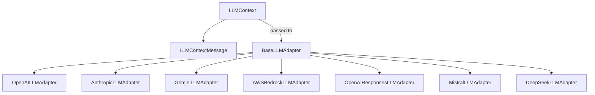
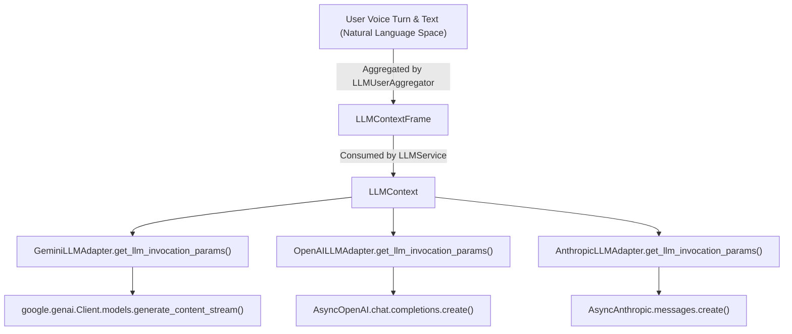
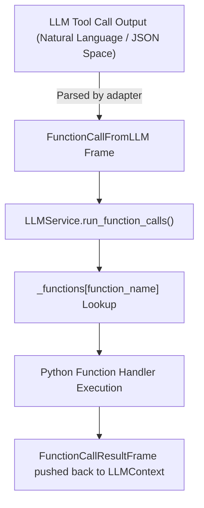

<!-- source: DeepWiki mcp.deepwiki.com · repo pipecat-ai/pipecat · page 4.2 Large Language Models · fetched 2026-10-26 -->

# Large Language Models

Relevant source files

The following files were used as context for generating this wiki page:

- [changelog/5939.fixed.2.md](changelog/5939.fixed.2.md)
- [changelog/5939.fixed.md](changelog/5939.fixed.md)
- [examples/function-calling/function-calling-google-vertex.py](examples/function-calling/function-calling-google-vertex.py)
- [examples/function-calling/function-calling-inception.py](examples/function-calling/function-calling-inception.py)
- [examples/thinking/thinking-anthropic.py](examples/thinking/thinking-anthropic.py)
- [examples/thinking/thinking-functions-anthropic.py](examples/thinking/thinking-functions-anthropic.py)
- [examples/thinking/thinking-functions-google-vertex.py](examples/thinking/thinking-functions-google-vertex.py)
- [examples/thinking/thinking-functions-google.py](examples/thinking/thinking-functions-google.py)
- [examples/thinking/thinking-functions-openai-responses.py](examples/thinking/thinking-functions-openai-responses.py)
- [examples/thinking/thinking-google-vertex.py](examples/thinking/thinking-google-vertex.py)
- [examples/thinking/thinking-google.py](examples/thinking/thinking-google.py)
- [examples/thinking/thinking-openai-responses-http.py](examples/thinking/thinking-openai-responses-http.py)
- [examples/thinking/thinking-openai-responses.py](examples/thinking/thinking-openai-responses.py)
- [examples/update-settings/llm/llm-google-vertex.py](examples/update-settings/llm/llm-google-vertex.py)
- [examples/voice/voice-openai-http.py](examples/voice/voice-openai-http.py)
- [src/pipecat/services/anthropic/llm.py](src/pipecat/services/anthropic/llm.py)
- [src/pipecat/services/aws/llm.py](src/pipecat/services/aws/llm.py)
- [src/pipecat/services/azure/llm.py](src/pipecat/services/azure/llm.py)
- [src/pipecat/services/baseten/llm.py](src/pipecat/services/baseten/llm.py)
- [src/pipecat/services/cerebras/llm.py](src/pipecat/services/cerebras/llm.py)
- [src/pipecat/services/deepseek/llm.py](src/pipecat/services/deepseek/llm.py)
- [src/pipecat/services/fireworks/llm.py](src/pipecat/services/fireworks/llm.py)
- [src/pipecat/services/google/llm.py](src/pipecat/services/google/llm.py)
- [src/pipecat/services/google/vertex/__init__.py](src/pipecat/services/google/vertex/__init__.py)
- [src/pipecat/services/google/vertex/llm.py](src/pipecat/services/google/vertex/llm.py)
- [src/pipecat/services/grok/llm.py](src/pipecat/services/grok/llm.py)
- [src/pipecat/services/groq/llm.py](src/pipecat/services/groq/llm.py)
- [src/pipecat/services/groq/stt.py](src/pipecat/services/groq/stt.py)
- [src/pipecat/services/inception/__init__.py](src/pipecat/services/inception/__init__.py)
- [src/pipecat/services/inception/llm.py](src/pipecat/services/inception/llm.py)
- [src/pipecat/services/llm_service.py](src/pipecat/services/llm_service.py)
- [src/pipecat/services/mistral/llm.py](src/pipecat/services/mistral/llm.py)
- [src/pipecat/services/novita/__init__.py](src/pipecat/services/novita/__init__.py)
- [src/pipecat/services/novita/llm.py](src/pipecat/services/novita/llm.py)
- [src/pipecat/services/nvidia/llm.py](src/pipecat/services/nvidia/llm.py)
- [src/pipecat/services/ollama/llm.py](src/pipecat/services/ollama/llm.py)
- [src/pipecat/services/openai/base_llm.py](src/pipecat/services/openai/base_llm.py)
- [src/pipecat/services/openai/llm.py](src/pipecat/services/openai/llm.py)
- [src/pipecat/services/openai/responses/llm.py](src/pipecat/services/openai/responses/llm.py)
- [src/pipecat/services/openrouter/llm.py](src/pipecat/services/openrouter/llm.py)
- [src/pipecat/services/perplexity/llm.py](src/pipecat/services/perplexity/llm.py)
- [src/pipecat/services/qwen/llm.py](src/pipecat/services/qwen/llm.py)
- [src/pipecat/services/sambanova/llm.py](src/pipecat/services/sambanova/llm.py)
- [src/pipecat/services/sarvam/__init__.py](src/pipecat/services/sarvam/__init__.py)
- [src/pipecat/services/sarvam/llm.py](src/pipecat/services/sarvam/llm.py)
- [src/pipecat/services/together/llm.py](src/pipecat/services/together/llm.py)
- [src/pipecat/services/whisper/utils.py](src/pipecat/services/whisper/utils.py)
- [src/pipecat/services/xai/llm.py](src/pipecat/services/xai/llm.py)
- [tests/test_google_safety_settings.py](tests/test_google_safety_settings.py)
- [tests/test_google_thinking_defaults.py](tests/test_google_thinking_defaults.py)
- [tests/test_google_token_usage.py](tests/test_google_token_usage.py)
- [tests/test_llm_reasoning_token_usage.py](tests/test_llm_reasoning_token_usage.py)
- [tests/test_llm_ttfb_normalization.py](tests/test_llm_ttfb_normalization.py)
- [tests/test_novita_llm.py](tests/test_novita_llm.py)
- [tests/test_openai_compatible_api_key.py](tests/test_openai_compatible_api_key.py)
- [tests/test_openai_compatible_extra_body.py](tests/test_openai_compatible_extra_body.py)
- [tests/test_openai_compatible_token_usage.py](tests/test_openai_compatible_token_usage.py)
- [tests/test_openai_llm_timeout.py](tests/test_openai_llm_timeout.py)
- [tests/test_openai_responses_http.py](tests/test_openai_responses_http.py)
- [tests/test_openai_responses_websocket.py](tests/test_openai_responses_websocket.py)
- [tests/test_run_inference.py](tests/test_run_inference.py)
- [tests/test_sambanova_llm.py](tests/test_sambanova_llm.py)
- [tests/test_sarvam_llm.py](tests/test_sarvam_llm.py)
- [tests/test_ttfat_metrics.py](tests/test_ttfat_metrics.py)

This document covers the LLM service architecture in Pipecat, including the base `LLMService` class, provider integrations, configuration patterns, context management, function calling, the adapter system, and the OpenAI Responses API with reasoning support.

For speech-to-speech services that combine STT, LLM, and TTS in a single service, see [Speech-to-Speech Services](#4.5). For context aggregation patterns and message management, see [Context Aggregators](#3.7).

Sources: [src/pipecat/services/llm_service.py:1-185](), [src/pipecat/adapters/base_llm_adapter.py:1-123]()

## LLMService Architecture

The `LLMService` base class provides a unified interface for all LLM providers in Pipecat. It handles function calling registration and execution, context processing, response streaming, and out-of-band inference with support for both parallel and sequential function execution modes.

### Class Hierarchy

Title: "LLM Service Class Hierarchy"

```mermaid
graph TB
    AIService["AIService"]
    LLMService["LLMService"]
    WebsocketService["WebsocketService"]
    BaseOpenAILLMService["BaseOpenAILLMService"]
    OpenAILLMService["OpenAILLMService"]
    AnthropicLLMService["AnthropicLLMService"]
    GoogleLLMService["GoogleLLMService"]
    AWSBedrockLLMService["AWSBedrockLLMService"]
    OpenAIResponsesLLMService["OpenAIResponsesLLMService"]
    OpenAIResponsesHttpLLMService["OpenAIResponsesHttpLLMService"]
    CerebrasLLMService["CerebrasLLMService"]
    BasetenLLMService["BasetenLLMService"]
    SambaNovaLLMService["SambaNovaLLMService"]
    DeepSeekLLMService["DeepSeekLLMService"]
    FireworksLLMService["FireworksLLMService"]
    GroqLLMService["GroqLLMService"]
    MistralLLMService["MistralLLMService"]
    NvidiaLLMService["NvidiaLLMService"]
    OllamaLLMService["OllamaLLMService"]
    OpenRouterLLMService["OpenRouterLLMService"]
    PerplexityLLMService["PerplexityLLMService"]
    QwenLLMService["QwenLLMService"]
    SarvamLLMService["SarvamLLMService"]
    TogetherLLMService["TogetherLLMService"]
    XaiLLMService["XaiLLMService"]
    NovitaLLMService["NovitaLLMService"]
    GoogleVertexLLMService["GoogleVertexLLMService"]
    GrokLLMService["GrokLLMService"]
    InceptionLLMService["InceptionLLMService"]
    
    AIService --> LLMService
    LLMService --> BaseOpenAILLMService
    LLMService --> AnthropicLLMService
    LLMService --> GoogleLLMService
    LLMService --> AWSBedrockLLMService
    
    WebsocketService --> OpenAIResponsesLLMService
    LLMService --> OpenAIResponsesHttpLLMService
    
    BaseOpenAILLMService --> OpenAILLMService
    OpenAILLMService --> CerebrasLLMService
    OpenAILLMService --> BasetenLLMService
    OpenAILLMService --> SambaNovaLLMService
    OpenAILLMService --> DeepSeekLLMService
    OpenAILLMService --> FireworksLLMService
    OpenAILLMService --> GroqLLMService
    OpenAILLMService --> MistralLLMService
    OpenAILLMService --> NvidiaLLMService
    OpenAILLMService --> OllamaLLMService
    OpenAILLMService --> OpenRouterLLMService
    OpenAILLMService --> PerplexityLLMService
    OpenAILLMService --> QwenLLMService
    OpenAILLMService --> SarvamLLMService
    OpenAILLMService --> TogetherLLMService
    OpenAILLMService --> XaiLLMService
    OpenAILLMService --> NovitaLLMService
    OpenAILLMService --> InceptionLLMService
    GoogleLLMService --> GoogleVertexLLMService
    XaiLLMService --> GrokLLMService
```

Sources: [src/pipecat/services/llm_service.py:65-80](), [src/pipecat/services/openai/base_llm.py:83-84](), [src/pipecat/services/anthropic/llm.py:41-43](), [src/pipecat/services/google/llm.py:161-166](), [src/pipecat/services/aws/llm.py:87-93](), [src/pipecat/services/openai/responses/llm.py:59-64](), [src/pipecat/services/sambanova/llm.py:31-36](), [src/pipecat/services/deepseek/llm.py:55-60](), [src/pipecat/services/mistral/llm.py:28-33](), [src/pipecat/services/cerebras/llm.py:24-29](), [src/pipecat/services/baseten/llm.py:24-29](), [src/pipecat/services/fireworks/llm.py:24-29](), [src/pipecat/services/groq/llm.py:24-29](), [src/pipecat/services/nvidia/llm.py:24-29](), [src/pipecat/services/ollama/llm.py:24-29](), [src/pipecat/services/openrouter/llm.py:105-117](), [src/pipecat/services/perplexity/llm.py:24-29](), [src/pipecat/services/qwen/llm.py:24-29](), [src/pipecat/services/sarvam/llm.py:39-44](), [src/pipecat/services/together/llm.py:24-29](), [src/pipecat/services/xai/llm.py:24-29](), [src/pipecat/services/novita/llm.py:24-29](), [src/pipecat/services/google/vertex/llm.py:24-29](), [src/pipecat/services/grok/llm.py:21](), [src/pipecat/services/inception/llm.py:24-29]()

**LLMService Core Responsibilities**

The `LLMService` class provides:

- **Function Registry**: Stores function handlers in `_functions` mapping function names to `FunctionCallRegistryItem` objects [src/pipecat/services/llm_service.py:174-185]().
- **Execution Modes**: Supports parallel or sequential function execution parameters via `FunctionCallParams` [src/pipecat/services/llm_service.py:125-166]().
- **Turn Completion**: Mixin support for filtering incomplete user turns via `UserTurnCompletionLLMServiceMixin` [src/pipecat/services/llm_service.py:69-69]().
- **Adapter Pattern**: Each service references an `adapter_class` for payload and message translation [src/pipecat/services/llm_service.py:30-31]().
- **Context Summarization**: Automatic context compression when token limits are reached using `LLMContextSummarizationUtil` [src/pipecat/utils/context/llm_context_summarization.py:76-79]().

Sources: [src/pipecat/services/llm_service.py:30-185](), [src/pipecat/utils/context/llm_context_summarization.py:76-79]()

---

### Adapter System

The adapter pattern enables universal `LLMContext` structures to work across different LLM providers by translating standard message formats into provider-specific schemas.

Title: "LLM Adapter System Architecture"

Sources: [src/pipecat/adapters/base_llm_adapter.py:1-123](), [src/pipecat/adapters/services/gemini_adapter.py:27-28](), [src/pipecat/adapters/services/anthropic_adapter.py:23-26](), [src/pipecat/adapters/services/bedrock_adapter.py:24-27](), [src/pipecat/adapters/services/open_ai_responses_adapter.py:42-45]()

**Adapter Methods**

Adapters implement methods to bridge formats:
- `get_llm_invocation_params()`: Converts `LLMContext` to provider-specific parameters.
- `to_provider_tools_format()`: Converts tool schemas to provider-specific formats.
- `LLMContextConversionError`: Raised when message transformation fails, preventing silent failures [src/pipecat/adapters/base_llm_adapter.py:26-27]().

Sources: [src/pipecat/adapters/base_llm_adapter.py:1-123](), [src/pipecat/adapters/services/gemini_adapter.py:27-28]()

---

### Bridging Natural Language Space to Code Entity Space: Context Processing Flow

Title: "Natural Language Space to Code Entity Space - LLM Inference"

Sources: [src/pipecat/services/google/llm.py:161-166](), [src/pipecat/services/openai/base_llm.py:89-96](), [src/pipecat/adapters/base_llm_adapter.py:1-123]()

---

## Standard LLM Integrations

Pipecat provides built-in integrations for over 60 AI providers.

### OpenAI and Compatible Services

`BaseOpenAILLMService` provides the foundation for OpenAI-compatible services [src/pipecat/services/openai/base_llm.py:89-96]().

- **Developer Role**: Supports the "developer" role natively, but can convert to "user" for compatible providers (e.g., Cerebras, SambaNova, DeepSeek, OpenRouter, Sarvam) via `supports_developer_role = False` [src/pipecat/services/openai/base_llm.py:101-108](), [src/pipecat/services/sambanova/llm.py:38-40](), [src/pipecat/services/openrouter/llm.py:112-114](), [src/pipecat/services/sarvam/llm.py:46-49]().
- **Settings**: Supports `max_completion_tokens`, `temperature`, `top_p`, etc., using OpenAI's `NOT_GIVEN` sentinels [src/pipecat/services/openai/base_llm.py:56-80]().
- **Compatible Providers**:
  - `SambaNovaLLMService`: OpenAI-compatible integration for SambaNova AI [src/pipecat/services/sambanova/llm.py:31-36]().
  - `DeepSeekLLMService`: OpenAI-compatible integration for DeepSeek API, with specific `thinking` configuration [src/pipecat/services/deepseek/llm.py:55-60]().
  - `MistralLLMService`: Mistral integration with message-based function call filtering [src/pipecat/services/mistral/llm.py:28-33]().
  - `CerebrasLLMService`: High-throughput integration via Cerebras API [src/pipecat/services/cerebras/llm.py:24-29]().
  - `OpenRouterLLMService`: Integrates with OpenRouter, supporting provider preferences and routing [src/pipecat/services/openrouter/llm.py:105-117]().
  - `SarvamLLMService`: Integrates with Sarvam, supporting wiki grounding and reasoning effort [src/pipecat/services/sarvam/llm.py:39-44]().
  - `GroqLLMService`: Integrates with Groq, optimized for fast inference [src/pipecat/services/groq/llm.py:24-29]().
  - `PerplexityLLMService`: Integrates with Perplexity, supporting specific models and settings [src/pipecat/services/perplexity/llm.py:24-29]().
  - `TogetherLLMService`: Integrates with Together.ai, supporting various models [src/pipecat/services/together/llm.py:24-29]().
  - `FireworksLLMService`: Integrates with Fireworks.ai [src/pipecat/services/fireworks/llm.py:24-29]().
  - `NvidiaLLMService`: Integrates with NVIDIA AI Foundation Models [src/pipecat/services/nvidia/llm.py:24-29]().
  - `OllamaLLMService`: Integrates with Ollama for local models [src/pipecat/services/ollama/llm.py:24-29]().
  - `QwenLLMService`: Integrates with Qwen models [src/pipecat/services/qwen/llm.py:24-29]().
  - `XaiLLMService`: Integrates with xAI models, including `GrokLLMService` [src/pipecat/services/xai/llm.py:24-29](), [src/pipecat/services/grok/llm.py:21]().
  - `NovitaLLMService`: Integrates with Novita.ai [src/pipecat/services/novita/llm.py:24-29]().
  - `InceptionLLMService`: Integrates with Inception models [src/pipecat/services/inception/llm.py:24-29]().

Sources: [src/pipecat/services/openai/base_llm.py:56-108](), [src/pipecat/services/sambanova/llm.py:31-53](), [src/pipecat/services/mistral/llm.py:28-52](), [src/pipecat/services/cerebras/llm.py:24-42](), [src/pipecat/services/openrouter/llm.py:105-117](), [src/pipecat/services/sarvam/llm.py:39-44](), [src/pipecat/services/groq/llm.py:24-29](), [src/pipecat/services/perplexity/llm.py:24-29](), [src/pipecat/services/together/llm.py:24-29](), [src/pipecat/services/fireworks/llm.py:24-29](), [src/pipecat/services/nvidia/llm.py:24-29](), [src/pipecat/services/ollama/llm.py:24-29](), [src/pipecat/services/qwen/llm.py:24-29](), [src/pipecat/services/xai/llm.py:24-29](), [src/pipecat/services/grok/llm.py:21](), [src/pipecat/services/novita/llm.py:24-29](), [src/pipecat/services/inception/llm.py:24-29]()

---

### Anthropic Claude

`AnthropicLLMService` supports Claude models [src/pipecat/services/anthropic/llm.py:41-43]().

- **Extended Thinking**: Configurable via `AnthropicThinkingConfig`. Emits `LLMThought*` frames during generation [src/pipecat/services/anthropic/llm.py:132-162]().
- **Prompt Caching**: Enabled with `enable_prompt_caching` in settings [src/pipecat/services/anthropic/llm.py:142-167]().

Sources: [src/pipecat/services/anthropic/llm.py:132-167](), [src/pipecat/adapters/services/anthropic_adapter.py:23-26]()

---

### Google Gemini

`GoogleLLMService` supports Gemini models [src/pipecat/services/google/llm.py:161-166]().

- **Thinking Config**: Supports `thinking_budget` (Gemini 2.5) and `thinking_level` (Gemini 3) via `GoogleThinkingConfig` [src/pipecat/services/google/llm.py:128-160]().
- **Safety Settings**: Configurable safety thresholds via `GoogleLLMSettings` [src/pipecat/services/google/llm.py:123-140]().
- **Vertex AI**: `GoogleVertexLLMService` extends `GoogleLLMService` for Google Cloud Vertex AI integration [src/pipecat/services/google/vertex/llm.py:24-29]().

Sources: [src/pipecat/services/google/llm.py:123-166](), [src/pipecat/adapters/services/gemini_adapter.py:27-28](), [src/pipecat/services/google/vertex/llm.py:24-29]()

---

### AWS Bedrock

`AWSBedrockLLMService` provides access to Bedrock models [src/pipecat/services/aws/llm.py:87-93]().

- **aiobotocore**: Uses `aiobotocore` for async operations [src/pipecat/services/aws/llm.py:48-50]().
- **Nova Support**: Supports Amazon Nova and Anthropic Claude models with vision and function calling [src/pipecat/services/aws/llm.py:87-93]().
- **Prompt Caching**: Supports `enable_prompt_caching` to reduce TTFT [src/pipecat/services/aws/llm.py:60-85]().

Sources: [src/pipecat/services/aws/llm.py:48-93](), [src/pipecat/adapters/services/bedrock_adapter.py:24-27]()

---

## OpenAI Responses API with Reasoning Support

Pipecat supports the OpenAI Responses API via `OpenAIResponsesLLMService` (WebSocket) and `OpenAIResponsesHttpLLMService` (HTTP) [src/pipecat/services/openai/responses/llm.py:7-7]().

### Reasoning Configuration

- **Config**: Configurable via `settings.reasoning = OpenAIResponsesReasoningConfig(effort=..., summary=...)` [src/pipecat/services/openai/responses/llm.py:106-144]().
- **Models**: Supported by reasoning-capable models such as the `gpt-5.x` and `o-series` [src/pipecat/services/openai/responses/llm.py:106-114]().
- **Persistence**: Encrypted reasoning is automatically captured and returned on subsequent turns.

Sources: [src/pipecat/services/openai/responses/llm.py:106-168](), [src/pipecat/adapters/services/open_ai_responses_adapter.py:42-45]()

---

## Function Calling and Tool Use

### Function Registration & Execution Flow

Tools are defined via schema adapters and executed through `LLMService.run_function_calls()` [src/pipecat/services/llm_service.py:125-166]().

Title: "Natural Language Space to Code Entity Space - Tool Execution"

Sources: [src/pipecat/services/llm_service.py:125-185]()

---

