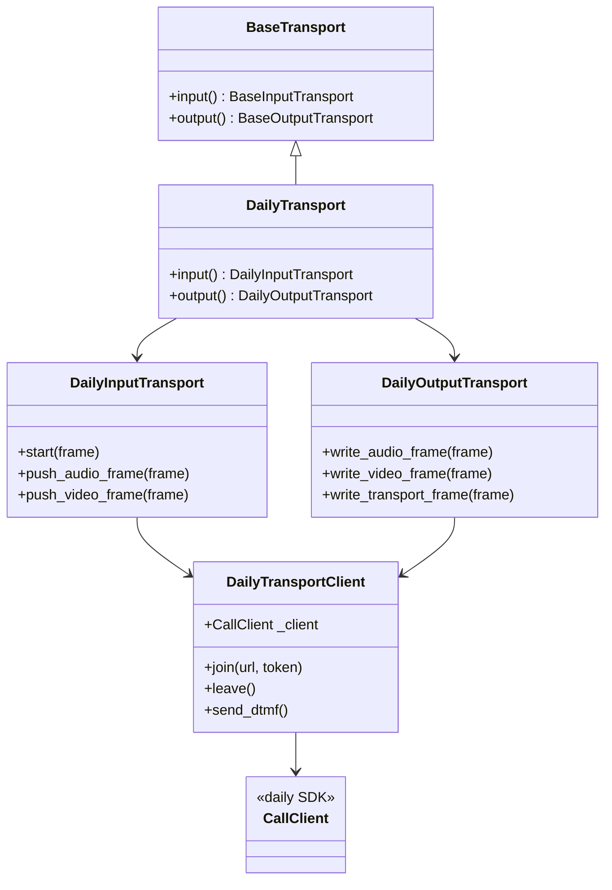
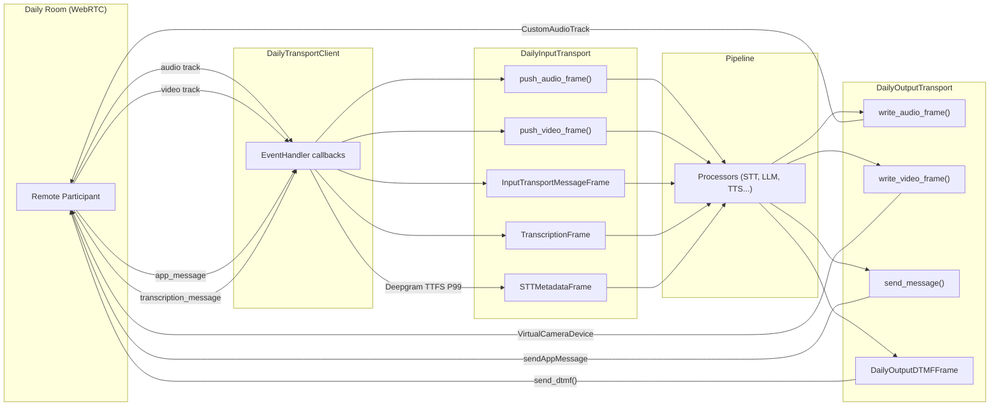
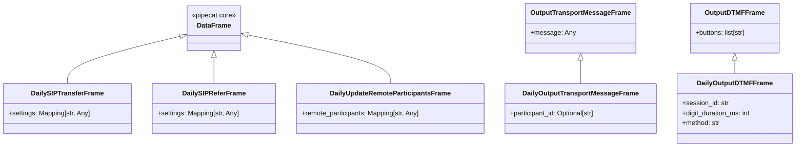
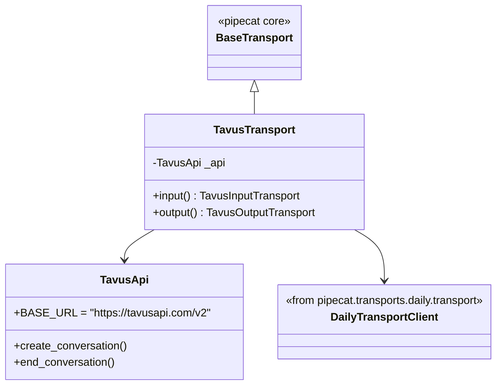

<!-- source: DeepWiki mcp.deepwiki.com · repo pipecat-ai/pipecat · page 5.1 Daily Transport · fetched 2026-10-26 -->

# Daily Transport

<details>
<summary>Relevant source files</summary>

The following files were used as context for generating this wiki page:

- [changelog/5571.fixed.md](changelog/5571.fixed.md)
- [changelog/6027.fixed.5.md](changelog/6027.fixed.5.md)
- [changelog/6055.fixed.4.md](changelog/6055.fixed.4.md)
- [changelog/6056.deprecated.4.md](changelog/6056.deprecated.4.md)
- [src/pipecat/runner/daily.py](src/pipecat/runner/daily.py)
- [src/pipecat/services/google/gemini_live/file_api.py](src/pipecat/services/google/gemini_live/file_api.py)
- [src/pipecat/transports/daily/transport.py](src/pipecat/transports/daily/transport.py)
- [src/pipecat/transports/livekit/transport.py](src/pipecat/transports/livekit/transport.py)
- [src/pipecat/transports/smallwebrtc/connection.py](src/pipecat/transports/smallwebrtc/connection.py)
- [src/pipecat/transports/smallwebrtc/request_handler.py](src/pipecat/transports/smallwebrtc/request_handler.py)
- [src/pipecat/transports/smallwebrtc/transport.py](src/pipecat/transports/smallwebrtc/transport.py)
- [src/pipecat/transports/video_in_sampler.py](src/pipecat/transports/video_in_sampler.py)
- [src/pipecat/transports/whatsapp/__init__.py](src/pipecat/transports/whatsapp/__init__.py)
- [src/pipecat/transports/whatsapp/api.py](src/pipecat/transports/whatsapp/api.py)
- [src/pipecat/transports/whatsapp/client.py](src/pipecat/transports/whatsapp/client.py)
- [tests/test_daily_transport.py](tests/test_daily_transport.py)
- [tests/test_livekit_transport.py](tests/test_livekit_transport.py)
- [tests/test_smallwebrtc_transport.py](tests/test_smallwebrtc_transport.py)
- [tests/test_video_in_sources.py](tests/test_video_in_sources.py)

</details>


## Purpose and Scope

This page documents `DailyTransport`, Pipecat's official integration for Daily.co WebRTC infrastructure. It covers audio/video streaming, call recording, transcription, dial-in and dial-out telephony, DTMF signaling, SIP call control (`DailySIPTransferFrame`, `DailySIPReferFrame`), `DailyRESTHelper`, `WebRTCVADAnalyzer`, `STTMetadataFrame` broadcasting, and the companion `TavusTransport` avatar integration.

For abstract transport base classes, see [Core Architecture: Transport I/O Architecture](3.5)(). For other transport protocols, see [Transport Layer](5)().

Sources: [src/pipecat/transports/daily/transport.py:7-12](), [src/pipecat/runner/daily.py:7-12]()

---

## Installation

The Daily transport requires the `daily` extras package for Python:

```bash
pip install pipecat-ai[daily]
```

The underlying module implementation is located at `src/pipecat/transports/daily/transport.py`.

Sources: [src/pipecat/transports/daily/transport.py:61-79]()

---

## Architecture

The Daily transport implements the split input/output transport model, bridging Pipecat's frame pipeline with Daily's underlying WebRTC SDK (`daily-python`).

### Diagram: Daily Transport Code Architecture and Class Hierarchy

Sources: [src/pipecat/transports/daily/transport.py:55-58](), [src/pipecat/transports/daily/transport.py:62-74]()

### Diagram: Daily Transport Frame Flow and Event Mapping

Sources: [src/pipecat/transports/daily/transport.py:47-51](), [src/pipecat/transports/daily/transport.py:62-74]()

---

## DailyTransport

`DailyTransport` serves as the top-level container initialized with a room URL, meeting token, bot identifier, and `DailyParams`.

Internally, it coordinates a shared `DailyTransportClient` instance across separate input and output transport handlers.

### STT Latency Metadata
When `transcription_enabled=True` and using Deepgram services, the transport automatically broadcasts an `STTMetadataFrame` containing `DEEPGRAM_TTFS_P99` latency metrics upon successful transcription initialization.

Sources: [src/pipecat/transports/daily/transport.py:53-55]()

---

## DailyParams

`DailyParams` extends `TransportParams` with configuration options specific to Daily.co rooms.

| Parameter Category | Key Options |
|---|---|
| Audio Input | `audio_in_enabled`, `audio_in_sample_rate`, `audio_in_filter` |
| Audio Output | `audio_out_enabled`, `audio_out_sample_rate`, `audio_out_destinations` (includes `"screenAudio"`) |
| Video Input | `video_in_enabled` |
| Video Output | `video_out_enabled`, `video_out_width`, `video_out_height`, `video_out_destinations`, `camera_out_send_settings` |
| Daily Infrastructure | `transcription`, `recording`, `dialin_settings`, `dialout_settings` |

Sources: [src/pipecat/transports/daily/transport.py:269-400]()

---

## DailyCallbacks

`DailyCallbacks` is a Pydantic `BaseModel` that defines async event handlers for Daily call lifecycle events.

| Callback Field | Trigger Condition |
|---|---|
| `on_joined` | Bot successfully connects to the Daily room |
| `on_left` | Bot disconnects from the room |
| `on_participant_joined` | A remote participant joins the session |
| `on_participant_left` | A remote participant departs |
| `on_app_message` | Data channel message received |
| `on_transcription_message` | Server-side transcription result arrived |
| `on_dialin_ready` | SIP dial-in call established |
| `on_dialout_answered` | Outbound SIP call answered |

Sources: [src/pipecat/transports/daily/transport.py:402-480]()

---

## DailyTransportClient

`DailyTransportClient` encapsulates the `daily.CallClient` SDK:
- Manages virtual speaker (`VirtualSpeakerDevice`) and camera (`VirtualCameraDevice`) instances.
- Manages custom audio and video sources (`CustomAudioSource`, `CustomVideoSource`).
- Implements `EventHandler` to marshal Daily SDK callbacks onto the asyncio event loop using `asyncio.run_coroutine_threadsafe`.
- Exposes `send_dtmf()` for telephony and IVR interactions.

Sources: [src/pipecat/transports/daily/transport.py:62-74]()

---

## WebRTCVADAnalyzer

`WebRTCVADAnalyzer` wraps Daily's native WebRTC Voice Activity Detection engine.

```python
from pipecat.transports.daily.transport import WebRTCVADAnalyzer
from pipecat.audio.vad.vad_analyzer import VADParams

analyzer = WebRTCVADAnalyzer(
    sample_rate=16000,
    params=VADParams(stop_secs=0.2)
)
```

It enforces strict 10 ms audio chunk requirements (`num_frames_required()`) and returns confidence scores (`0.0` to `1.0`) via native analysis calls with a 2-second reset period (`VAD_RESET_PERIOD_MS`).

Sources: [src/pipecat/transports/daily/transport.py:80-81](), [src/pipecat/transports/daily/transport.py:203-225]()

---

## Daily-Specific Frame Types

### Diagram: Daily Frame Type Hierarchy

Sources: [src/pipecat/transports/daily/transport.py:31-51](), [src/pipecat/transports/daily/transport.py:84-160]()

### DTMF Frames
- `DailyOutputDTMFFrame`: Downstream frame queued after current audio playback finishes. Forwards `session_id`, `digit_duration_ms`, and `method` to Daily's `send_dtmf`.
- `DailyOutputDTMFUrgentFrame`: Downstream frame sent immediately, bypassing the audio queue.

### Message Frames
- `DailyOutputTransportMessageFrame`: Sends data channel messages; `participant_id=None` broadcasts to all peers.
- `DailyOutputTransportMessageUrgentFrame`: Sends data messages immediately without queueing.
- `DailyInputTransportMessageFrame`: Upstream frame carrying incoming app messages and sender `participant_id`.

Sources: [src/pipecat/transports/daily/transport.py:31-116](), [src/pipecat/transports/daily/transport.py:163-200]()

---

## SIP Call Control

- `DailySIPTransferFrame` & `DailySIPReferFrame`: Queued through the output transport's audio queue, ensuring that transfer/refer operations execute only after the bot finishes its active audio utterance.
- `DailyUpdateRemoteParticipantsFrame`: Dynamically updates remote participant permissions or metadata during a call.

Sources: [src/pipecat/transports/daily/transport.py:117-160]()

---

## Daily REST Utilities

The `pipecat.runner.daily` module and `DailyRESTHelper` provide high-level abstractions for room creation, meeting token generation, and SIP configuration.

| Helper Class | Purpose |
|---|---|
| `DailyRESTHelper` | Low-level HTTP client for Daily REST API endpoints |
| `DailyRoomParams` / `DailyRoomProperties` | Room creation configuration and capability flags |
| `DailyMeetingTokenProperties` | Token generation parameters (owner flags, expiration) |

Sources: [src/pipecat/runner/daily.py:7-12](), [src/pipecat/runner/daily.py:45-52](), [src/pipecat/runner/daily.py:77-146]()

---

## TavusTransport Integration

`TavusTransport` integrates Pipecat bots with conversational avatar platforms using Tavus APIs (`TavusApi`) combined with `DailyTransportClient` for WebRTC transport.

### Diagram: Tavus Transport Code Mapping

Sources: [src/pipecat/transports/daily/transport.py:62-74]()

- `create_conversation()` initializes avatar sessions.
- `TavusParams` supports `audio_out_faster_than_realtime` to optimize avatar rendering buffers by pushing TTS audio app messages faster than real-time playback.

Sources: [src/pipecat/runner/daily.py:7-12]()

---

## Module Reference

| Symbol | Module Path |
|---|---|
| `DailyTransport` | `pipecat.transports.daily.transport` |
| `DailyTransportClient` | `pipecat.transports.daily.transport` |
| `DailyParams` | `pipecat.transports.daily.transport` |
| `WebRTCVADAnalyzer` | `pipecat.transports.daily.transport` |
| `DailyRESTHelper` | `pipecat.transports.daily.utils` |

Sources: [src/pipecat/transports/daily/transport.py:7-12](), [src/pipecat/runner/daily.py:7-12]()

---

