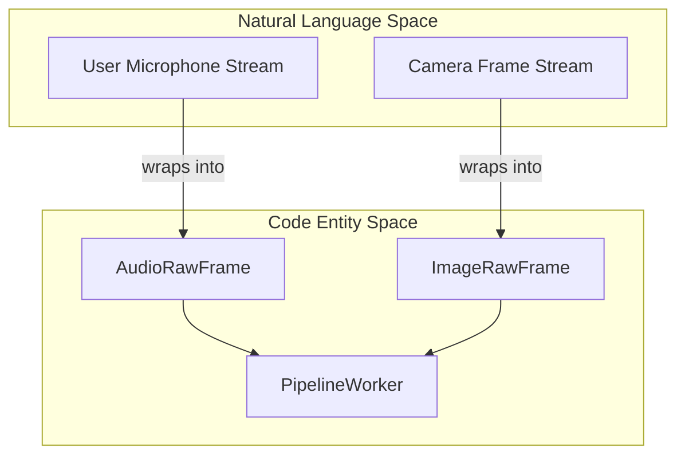
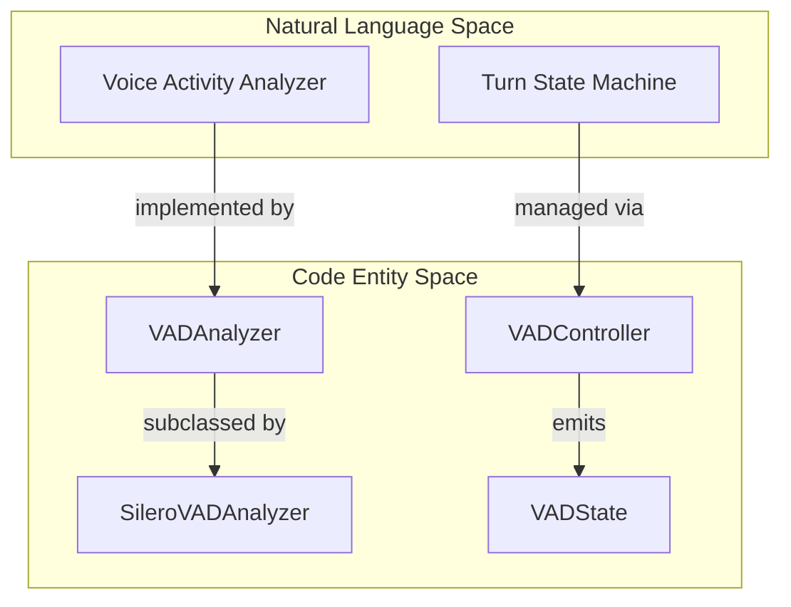

<!-- source: DeepWiki mcp.deepwiki.com · repo pipecat-ai/pipecat · page 6 Audio and Video Processing · fetched 2026-10-26 -->

# Audio and Video Processing

Relevant source files

The following files were used as context for generating this wiki page:

- [src/pipecat/audio/filters/koala_filter.py](src/pipecat/audio/filters/koala_filter.py)
- [src/pipecat/audio/turn/base_turn_analyzer.py](src/pipecat/audio/turn/base_turn_analyzer.py)
- [src/pipecat/audio/turn/smart_turn/__init__.py](src/pipecat/audio/turn/smart_turn/__init__.py)
- [src/pipecat/audio/turn/smart_turn/base_smart_turn.py](src/pipecat/audio/turn/smart_turn/base_smart_turn.py)
- [src/pipecat/audio/turn/smart_turn/http_smart_turn.py](src/pipecat/audio/turn/smart_turn/http_smart_turn.py)
- [src/pipecat/audio/turn/smart_turn/local_coreml_smart_turn.py](src/pipecat/audio/turn/smart_turn/local_coreml_smart_turn.py)
- [src/pipecat/audio/turn/smart_turn/local_smart_turn_v2.py](src/pipecat/audio/turn/smart_turn/local_smart_turn_v2.py)
- [src/pipecat/audio/vad/vad_analyzer.py](src/pipecat/audio/vad/vad_analyzer.py)
- [src/pipecat/audio/volume.py](src/pipecat/audio/volume.py)
- [tests/test_audio_volume.py](tests/test_audio_volume.py)

This page provides an overview of Pipecat's audio and video processing infrastructure, covering frame type abstractions, Voice Activity Detection (VAD), audio filtering, video handling, and supporting media utilities. This subsystem sits between transport implementations [see Transport Layer (#5)] and higher-level AI service processors [see AI Service Integrations (#4)].

Sources: [src/pipecat/frames/frames.py:157-190](), [src/pipecat/audio/vad/vad_analyzer.py:9-12]()

---

## Overview

Pipecat processes audio and video data through a frame-based pipeline architecture. Media flows across components as typed data frames, allowing modules to transform, analyze, or route streams efficiently. The pipeline supports bidirectional audio streaming, real-time video processing, noise suppression, sample rate conversion via SOXR, and trailing audio flushing in output transports to prevent end-of-turn clipping.

Title: "Media Stream Routing"

Sources: [src/pipecat/frames/frames.py:157-190](), [src/pipecat/audio/utils.py:7-12]()

---

## Audio and Video Frame Types

Raw media streams are encapsulated into structured frame mixins that propagate through the pipeline. The `AudioRawFrame` mixin [src/pipecat/frames/frames.py:157-174]() carries raw PCM audio bytes, sample rates, and channel counts. The `ImageRawFrame` mixin [src/pipecat/frames/frames.py:177-190]() handles raw image buffers, sizes, and color formats.

Sources: [src/pipecat/frames/frames.py:157-190]()

---

## Voice Activity Detection (6.1)

Voice Activity Detection (VAD) identifies user speech activity to manage conversational turns. Pipecat uses `VADAnalyzer` implementations alongside a `VADController` to manage transitions across `VADState` values (`QUIET`, `STARTING`, `SPEAKING`, `STOPPING`) [src/pipecat/audio/vad/vad_analyzer.py:31-45](). Analyzers process incoming raw audio chunks asynchronously to generate confidence scores.

For detailed documentation on VAD implementations (Silero, AIC, Krisp VIVA VAD), state machines, and parameter configurations, see [Voice Activity Detection](#6.1).

Title: "VAD Processing Architecture"

Sources: [src/pipecat/audio/vad/vad_analyzer.py:31-192]()

---

## Audio Filters and Enhancement (6.2)

Audio filters process input streams to eliminate noise, echo, and artifacts before feeding them to speech-to-text engines. Pipecat supports multiple filter SDKs including RNNoise, Noisereduce, Koala [src/pipecat/audio/filters/koala_filter.py:29-110](), Krisp, and AI-Coustics filters.

For detailed coverage of `BaseAudioFilter`, filter implementations, mixers, resamplers, and audio recording buffers (`AudioBufferProcessor`), see [Audio Filters and Enhancement](#6.2).

Sources: [src/pipecat/audio/filters/koala_filter.py:29-110]()

---

## Video Processing (6.3)

Video processing manages visual frames for multimodal LLMs, avatar rendering, and video streaming. Pipecat integrates with services like Tavus, HeyGen, and Simli to synchronize synthetic face streams with generated speech output.

For detailed documentation on video frame processing, service integrations, and GStreamer file sources, see [Video Processing](#6.3).

Sources: [src/pipecat/frames/frames.py:177-190]()

---

## Audio Utilities

Pipecat provides auxiliary functions and classes for signal manipulation, resampling, mixing, and volume tracking [src/pipecat/audio/utils.py:7-12]().

| Function / Class | Description |
|------------------|-------------|
| `create_file_resampler` | Creates a `SOXRAudioResampler` for batch audio file processing [src/pipecat/audio/utils.py:30-39]() |
| `create_stream_resampler` | Creates a `SOXRStreamAudioResampler` for real-time sample rate conversion [src/pipecat/audio/utils.py:41-51]() |
| `mix_audio` | Mixes two 16-bit PCM audio streams [src/pipecat/audio/utils.py:54-83]() |
| `interleave_stereo_audio` | Combines two mono channels into a stereo stream [src/pipecat/audio/utils.py:85-108]() |
| `pcm_to_wav` | Wraps raw PCM audio in a WAV container [src/pipecat/audio/utils.py:111-145]() |
| `AudioVolumeTracker` | Tracks audio loudness over a rolling window using ITU-R BS.1770 [src/pipecat/audio/volume.py:19-79]() |

Sources: [src/pipecat/audio/utils.py:7-194](), [src/pipecat/audio/volume.py:19-79]()

---

