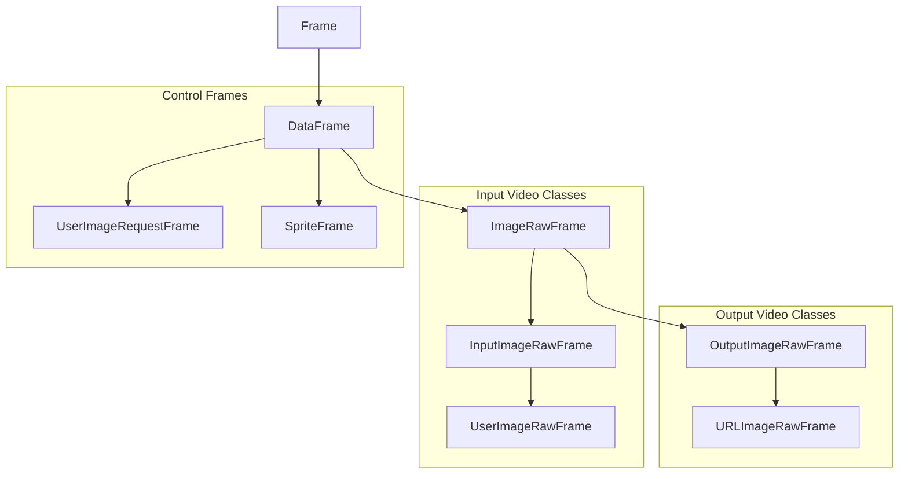
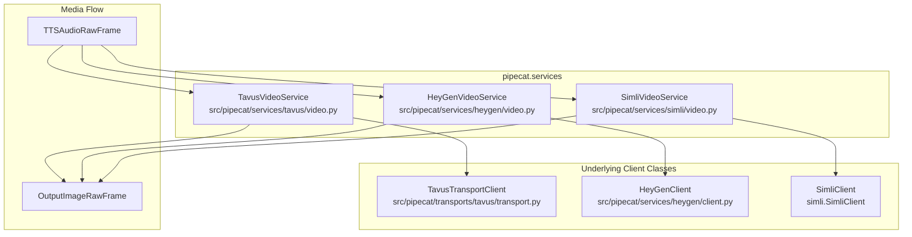

<!-- source: DeepWiki mcp.deepwiki.com · repo pipecat-ai/pipecat · page 6.3 Video Processing · fetched 2026-10-26 -->

# Video Processing

Relevant source files

The following files were used as context for generating this wiki page:

- [examples/video-avatar/video-avatar-heygen-transport.py](examples/video-avatar/video-avatar-heygen-transport.py)
- [examples/video-avatar/video-avatar-heygen-video-service.py](examples/video-avatar/video-avatar-heygen-video-service.py)
- [examples/video-avatar/video-avatar-lemonslice-transport.py](examples/video-avatar/video-avatar-lemonslice-transport.py)
- [examples/video-avatar/video-avatar-simli-video-service.py](examples/video-avatar/video-avatar-simli-video-service.py)
- [examples/video-avatar/video-avatar-tavus-transport.py](examples/video-avatar/video-avatar-tavus-transport.py)
- [examples/video-avatar/video-avatar-tavus-video-service.py](examples/video-avatar/video-avatar-tavus-video-service.py)
- [pyrightconfig.json](pyrightconfig.json)
- [src/pipecat/services/heygen/client.py](src/pipecat/services/heygen/client.py)
- [src/pipecat/services/heygen/video.py](src/pipecat/services/heygen/video.py)
- [src/pipecat/services/simli/video.py](src/pipecat/services/simli/video.py)
- [src/pipecat/services/tavus/video.py](src/pipecat/services/tavus/video.py)
- [src/pipecat/services/xai/realtime/events.py](src/pipecat/services/xai/realtime/events.py)
- [src/pipecat/transports/heygen/transport.py](src/pipecat/transports/heygen/transport.py)
- [src/pipecat/transports/lemonslice/api.py](src/pipecat/transports/lemonslice/api.py)
- [src/pipecat/transports/lemonslice/transport.py](src/pipecat/transports/lemonslice/transport.py)
- [tests/test_xai_realtime_voices.py](tests/test_xai_realtime_voices.py)

## Purpose and Scope

This document describes Pipecat's video processing subsystem, covering video frame structures, transport integration, format conversions, real-time avatar generation services (**Tavus**, **HeyGen**, and **Simli**), multimodal video ingestion (such as camera and screen share streams), and GStreamer pipeline integration for file-based media sources. Video processing enables both user video ingestion and multimodal/avatar output generation within Pipecat pipelines.

Sources:
- [src/pipecat/services/tavus/video.py:7-11]()
- [src/pipecat/services/heygen/video.py:7-12]()
- [src/pipecat/services/simli/video.py:7-7]()

---

## Video Frame Hierarchy

Pipecat uses a structured hierarchy of frame classes to represent visual data flowing through the pipeline. All video frames extend from `ImageRawFrame` [src/pipecat/frames/frames.py:28-29](), which is a subtype of `DataFrame`.

Title: "Video Frame Type Hierarchy to Code Entities"

Sources:
- [src/pipecat/frames/frames.py:17-36]()

**Key Frame Types and Classes:**

| Frame Class | Purpose | Key Attributes |
|-------------|---------|----------------|
| `UserImageRawFrame` | User video feed ingestion | `user_id`, `transport_source` |
| `OutputImageRawFrame` | Rendered video output frames | `image`, `size`, `format`, `transport_destination` |
| `URLImageRawFrame` | References a remote image via URL | `url` |
| `UserImageRequestFrame` | Requests video capture triggering | `user_id`, `framerate`, `video_source` |
| `SpriteFrame` | Animated multi-image sequence | List of images with timing metadata |

Sources:
- [src/pipecat/frames/frames.py:17-36]()

---

## Avatar Video Services

Pipecat integrates with real-time conversational avatar services that consume audio frames and emit synchronized video and audio streams. These services act as specialized `AIService` implementations [src/pipecat/services/tavus/video.py:50-50](), [src/pipecat/services/heygen/video.py:62-62](), [src/pipecat/services/simli/video.py:49-55]().

Title: "Avatar Service Code Bridge Architecture"

Sources:
- [src/pipecat/services/tavus/video.py:50-191]()
- [src/pipecat/services/heygen/video.py:62-184]()
- [src/pipecat/services/simli/video.py:33-170]()
- [src/pipecat/services/heygen/client.py:54-175]()

### Tavus Integration

`TavusVideoService` [src/pipecat/services/tavus/video.py:50-64]() manages avatar video generation by acting as a sink transport proxy:
* **Dual Room Topology**: Facilitates a bridge between a "Tavus room" (containing the Tavus Avatar and the bot) and a "User room" (containing the bot and the human user) [src/pipecat/services/tavus/video.py:57-61]().
* **Persona Configuration**: The `persona_id` parameter defaults to `"pipecat0"`, which instructs Tavus to use the Pipecat bot's native TTS voice and expect audio payloads over the `conversation.echo` app message API [src/pipecat/services/tavus/video.py:71-84]().
* **Video Capture**: Incoming participant video frames from `TavusTransportClient` are wrapped into `OutputImageRawFrame` and pushed into the pipeline [src/pipecat/services/tavus/video.py:166-178]().

Sources:
- [src/pipecat/services/tavus/video.py:50-191]()

### HeyGen Integration

`HeyGenVideoService` [src/pipecat/services/heygen/video.py:62-82]() integrates HeyGen's interactive avatar platform supporting both `INTERACTIVE_AVATAR` and `LIVE_AVATAR` service types [src/pipecat/services/heygen/client.py:54-59]().
* **Client Synchronization**: `HeyGenClient` coordinates a dual-connection architecture consisting of a WebSocket for avatar control/audio streaming and a LiveKit room for receiving avatar video and audio [src/pipecat/services/heygen/client.py:82-88]().
* **Audio Throttling**: Employs chunk-based pacing (e.g., 400ms first chunk size, 1000ms subsequent chunks) to emulate standard audio hardware packet timing [src/pipecat/services/heygen/video.py:137-141]().

Sources:
- [src/pipecat/services/heygen/video.py:62-184]()
- [src/pipecat/services/heygen/client.py:54-175]()

### Simli Integration

`SimliVideoService` [src/pipecat/services/simli/video.py:49-55]() provides real-time lip-sync video generation using `SimliClient` [src/pipecat/services/simli/video.py:156-161]().
* **Audio Resampling**: Configures an internal `AudioResampler` (`_simli_resampler`) from the `av` library to transform incoming audio into mono 16kHz PCM streams [src/pipecat/services/simli/video.py:33-34,165]().
* **Trinity Mode**: Supports low-latency Trinity avatars via the `is_trinity_avatar` initialization flag [src/pipecat/services/simli/video.py:169-170]().

Sources:
- [src/pipecat/services/simli/video.py:33-170]()

---

## Multimodal Capabilities and Video Ingestion

Pipecat supports multimodal interactions where video feeds (such as user camera inputs or screen shares) can be dynamically requested and fed into LLM contexts.

* **On-Request Video Capture**: Transports can be configured with `VideoInSourceParams(on_request_only=True)` so that video frames are not continuously streamed unless explicitly requested [src/pipecat/transports/base_transport.py:27-38]().
* **Triggering Requests**: Function tools or event handlers can push a `UserImageRequestFrame` upstream to the transport, specifying the `user_id` and video source properties [src/pipecat/frames/frames.py:50-50]().
* **Context Integration**: The transport responds with a `UserImageRawFrame` (`UserImageRawFrame`), which is handled by context aggregators and appended to the universal LLM context for vision-enabled models [src/pipecat/frames/frames.py:49-49]().

Sources:
- [src/pipecat/transports/base_transport.py:27-54]()
- [src/pipecat/frames/frames.py:49-51]()

---

## GStreamer Integration for File-Based Media

The GStreamer integration in Pipecat uses pipelines as custom media sources to feed video and audio into Pipecat pipelines.

* **Lifecycle Management**: Initializes a `Gst.Pipeline` parser on `StartFrame`, setting pipeline state to `PLAYING`. Teardown and cancellation transition the pipeline to `NULL`.
* **Pad Decoding**: Connects a `decodebin` element with a `pad-added` callback to dynamically route audio and video pads to format filters and appsinks.
* **Output Configuration**: Controlled via transport and source parameter objects defining resolution, sample rate, channels, and clock synchronization.

Sources:
- [pyrightconfig.json:1-11]()

---

## Frame Distribution and Idle Monitoring Patterns

Complex video and multimodal pipelines frequently rely on utility processors to duplicate, filter, or monitor stream activity.

* **Producer Processors**: Filter input frames based on asynchronous conditions and fan them out to multiple consumer queues.
* **Consumer Processors**: Subscribe to producers, consume queued frames, optionally transform them via asynchronous transformers, and inject them into pipeline streams.
* **Task Management**: Automatically initialize background consumer task handlers upon receiving `StartFrame` and clean them up on `EndFrame` or `CancelFrame`.

Sources:
- [pyrightconfig.json:1-11]()

---

