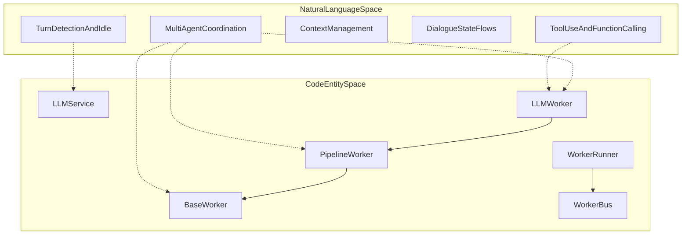
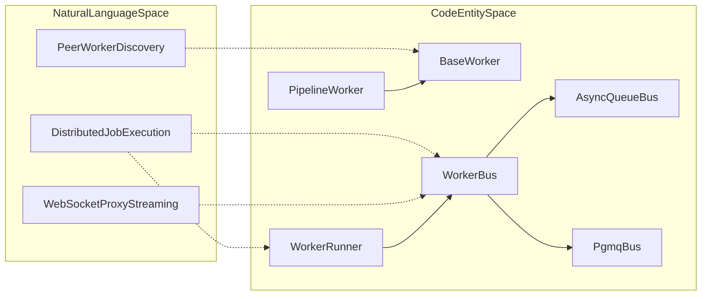

<!-- source: DeepWiki mcp.deepwiki.com · repo pipecat-ai/pipecat · page 8 Advanced Topics · fetched 2026-10-26 -->

# Advanced Topics

Relevant source files

The following files were used as context for generating this wiki page:

- [src/pipecat/bus/bridge_processor.py](src/pipecat/bus/bridge_processor.py)
- [src/pipecat/bus/bus.py](src/pipecat/bus/bus.py)
- [src/pipecat/bus/queue.py](src/pipecat/bus/queue.py)
- [src/pipecat/bus/subscriber.py](src/pipecat/bus/subscriber.py)
- [src/pipecat/pipeline/worker.py](src/pipecat/pipeline/worker.py)
- [src/pipecat/utils/startup.py](src/pipecat/utils/startup.py)
- [src/pipecat/workers/base_worker.py](src/pipecat/workers/base_worker.py)
- [src/pipecat/workers/runner.py](src/pipecat/workers/runner.py)
- [tests/test_base_worker.py](tests/test_base_worker.py)
- [tests/test_bus.py](tests/test_bus.py)
- [tests/test_job_group.py](tests/test_job_group.py)
- [tests/test_messages.py](tests/test_messages.py)
- [tests/test_pgmq_backends.py](tests/test_pgmq_backends.py)
- [tests/test_pgmq_bus.py](tests/test_pgmq_bus.py)
- [tests/test_redis_bus.py](tests/test_redis_bus.py)
- [tests/test_runner.py](tests/test_runner.py)
- [tests/test_serializers.py](tests/test_serializers.py)
- [tests/test_utils_startup.py](tests/test_utils_startup.py)
- [tests/test_websocket_proxy.py](tests/test_websocket_proxy.py)

This section covers advanced patterns, optimizations, and specialized features for building production-grade conversational AI applications with Pipecat [src/pipecat/pipeline/worker.py:7-12](). These topics build upon the core architecture and basic service integrations [src/pipecat/processors/frame_processor.py:7-12]().

**Prerequisites:** Understanding of Core Architecture, AI Service Integrations, and Transport Layer is recommended before exploring these advanced topics [src/pipecat/processors/frame_processor.py:7-12]().

Sources: [src/pipecat/pipeline/worker.py:7-12](), [src/pipecat/processors/frame_processor.py:7-12]()

---

## What Makes These Topics "Advanced"

Advanced features in Pipecat enable sophisticated behaviors beyond basic LLM chat, such as precise queue control, typed evaluation via classifiers [src/pipecat/frames/frames.py:42-46](), and distributed multi-worker agent topologies managed by `WorkerRunner` and `WorkerBus` [src/pipecat/workers/base_worker.py:7-12](), [src/pipecat/workers/runner.py:7-13]().

| Capability | Purpose | Complexity | Subsection |
|------------|---------|------------|------------|
| **Function Calling** | Enable LLM to invoke Python functions with structured arguments | Moderate | [Function Calling and Tool Use](#8.1) |
| **Natural Conversations** | Handle interruptions, turn-taking, and turn-completion detection | High | [Building Natural Conversations](#8.2) |
| **Multi-Worker Framework** | Orchestrate multiple agents and UI workers over a shared bus | High | [Multi-Worker Framework](#8.3) |
| **Conversation Flows** | Define state-machine based dialogue structures with `FlowManager` | Moderate | [Conversation Flows](#8.7) |
| **Custom Processors** | Extend the framework with custom frame processing logic and classifiers | High | [Custom Processors and Extensions](#8.4) |
| **Performance Optimization** | Reduce latency, track metrics (TTFA/TTFB), and optimize resource usage | Moderate | [Observability, Metrics, and Tracing](#8.5) |
| **Persistent Memory** | Maintain conversation state across sessions with services like Mem0 | Moderate | [Memory and Persistent Context](#8.6) |
| **API Migration** | Upgrade from deprecated APIs to current patterns | Low | [Migration Guides and Deprecated APIs](#8.8) |

Sources: [src/pipecat/workers/base_worker.py:7-12](), [src/pipecat/workers/runner.py:7-13]()

---

## Advanced Systems Integration with Code Entities

The following diagram bridges the gap between high-level advanced concepts and the specific code entities that implement them, focusing on the multi-agent framework, universal aggregation, and conversation flow systems.

**Advanced Systems to Code Entity Mapping**

Sources: [src/pipecat/pipeline/worker.py:7-12](), [src/pipecat/workers/base_worker.py:119-126]()

---

## Multi-Worker Communication Architecture

The multi-worker framework coordinates agents and runners over a shared bus infrastructure [src/pipecat/pipeline/worker.py:7-12](), [src/pipecat/bus/bus.py:7-11](). The following diagram illustrates how classes map between execution abstractions and message buses.

**Worker Architecture to Code Entities**

Sources: [src/pipecat/workers/runner.py:7-13](), [src/pipecat/bus/bus.py:7-11](), [src/pipecat/bus/bridge_processor.py:7-17]()

---

## Overview of Subsections

### 8.1 Function Calling and Tool Use
Deep dive into LLM function calling including auto-registration of direct functions and schema-based tools. This involves direct function wrappers for automatic schema generation from Python functions, function schemas for explicit tool definitions, and tool schemas for managing collections of tools via `ToolsSchema` and `LLMWorker` components. It covers parameter handling, parallel/sequential execution, async function calls, streaming intermediate results, and tool integration across workers. For details, see [Function Calling and Tool Use](#8.1).

Sources: [src/pipecat/pipeline/worker.py:7-12]()

### 8.2 Building Natural Conversations
Techniques for fluid interactions: turn completion detection and user turn mixing using specialized service mixins. This includes strategies for filtering incomplete turns, managing conversational flow patterns, and configuring turn strategies via `UserTurnStrategies`. For details, see [Building Natural Conversations](#8.2).

Sources: [src/pipecat/pipeline/worker.py:7-12]()

### 8.3 Multi-Worker Framework
Enables multi-agent coordination where workers operate as peers managed by a runner over a shared bus [src/pipecat/workers/base_worker.py:7-12](), [src/pipecat/bus/bus.py:7-11](). This framework supports `PipelineWorker`, `WorkerBus`, `WorkerRunner`, and `BaseWorker` subclasses for distributed topologies, job group fan-out, and WebSocket proxies [src/pipecat/pipeline/worker.py:7-12](), [src/pipecat/workers/runner.py:7-13](). For details, see [Multi-Worker Framework](#8.3).

Sources: [src/pipecat/workers/base_worker.py:7-12](), [src/pipecat/workers/runner.py:7-13](), [src/pipecat/bus/bus.py:7-11]()

### 8.4 Custom Processors and Extensions
Guide for creating custom `FrameProcessor` subclasses and pipeline extensions utilizing application resources and pipeline setup configs [src/pipecat/processors/frame_processor.py:38-42](). This includes specialized processors like classifiers, IVR navigators, voicemail detection, and text aggregators. For details, see [Custom Processors and Extensions](#8.4).

Sources: [src/pipecat/processors/frame_processor.py:38-42]()

### 8.5 Observability, Metrics, and Tracing
Monitoring pipeline health using OpenTelemetry tracing, turn tracking observers, and OpenTelemetry GenAI semantic conventions. This section covers metrics collection, trace observers, and latency tracking. For details, see [Observability, Metrics, and Tracing](#8.5).

Sources: [src/pipecat/pipeline/worker.py:68-71]()

### 8.6 Memory and Persistent Context
Long-term state management using context structures and automatic context summarization via summarizer components. This also covers persistent storage patterns and multi-turn history management. For details, see [Memory and Persistent Context](#8.6).

Sources: [src/pipecat/pipeline/worker.py:7-12]()

### 8.7 Conversation Flows
The Pipecat Flows framework for robust state-machine based dialogue structures (`FlowManager`). This enables defining complex conversational logic, state transitions, actions, and YAML flow configurations across different providers. For details, see [Conversation Flows](#8.7).

Sources: [src/pipecat/pipeline/worker.py:7-12]()

### 8.8 Migration Guides and Deprecated APIs
Upgrade paths for evolving APIs, including namespace migrations and transition paths from older task structures (`PipelineTask`) to the current worker framework (`PipelineWorker`, `WorkerRunner`) [src/pipecat/pipeline/worker.py:7-12](), [src/pipecat/workers/runner.py:7-13](). This section also covers deprecation scanning tooling and legacy setup hooks (`setup_pipeline_task`) [src/pipecat/utils/startup.py:7-18](). For details, see [Migration Guides and Deprecated APIs](#8.8).

Sources: [src/pipecat/pipeline/worker.py:7-12](), [src/pipecat/workers/runner.py:7-13](), [src/pipecat/utils/startup.py:7-18]()

---

