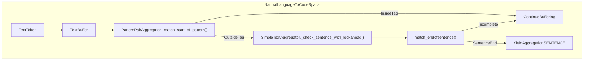
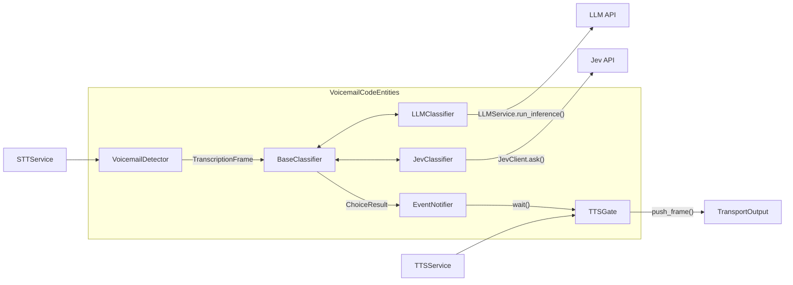
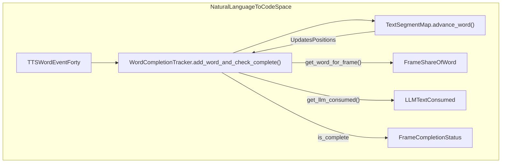

<!-- source: DeepWiki mcp.deepwiki.com · repo pipecat-ai/pipecat · page 8.4 Custom Processors and Extensions · fetched 2026-10-26 -->

# Custom Processors and Extensions

<details>
<summary>Relevant source files</summary>

The following files were used as context for generating this wiki page:

- [changelog/6081.fixed.md](changelog/6081.fixed.md)
- [changelog/6101.fixed.md](changelog/6101.fixed.md)
- [examples/assets/pronunciations.json](examples/assets/pronunciations.json)
- [examples/features/features-pronunciation-dictionary.py](examples/features/features-pronunciation-dictionary.py)
- [examples/features/features-text-transforms.py](examples/features/features-text-transforms.py)
- [examples/features/features-voice-formatter.py](examples/features/features-voice-formatter.py)
- [src/pipecat/audio/filters/__init__.py](src/pipecat/audio/filters/__init__.py)
- [src/pipecat/audio/filters/base_audio_filter.py](src/pipecat/audio/filters/base_audio_filter.py)
- [src/pipecat/classifiers/base_classifier.py](src/pipecat/classifiers/base_classifier.py)
- [src/pipecat/classifiers/jev/classifier.py](src/pipecat/classifiers/jev/classifier.py)
- [src/pipecat/classifiers/jev/client.py](src/pipecat/classifiers/jev/client.py)
- [src/pipecat/classifiers/llm/classifier.py](src/pipecat/classifiers/llm/classifier.py)
- [src/pipecat/classifiers/typesafe/jev/classifier.py](src/pipecat/classifiers/typesafe/jev/classifier.py)
- [src/pipecat/classifiers/typesafe/jev/client.py](src/pipecat/classifiers/typesafe/jev/client.py)
- [src/pipecat/extensions/voicemail/voicemail_detector.py](src/pipecat/extensions/voicemail/voicemail_detector.py)
- [src/pipecat/processors/aggregators/dtmf_aggregator.py](src/pipecat/processors/aggregators/dtmf_aggregator.py)
- [src/pipecat/services/ai_service.py](src/pipecat/services/ai_service.py)
- [src/pipecat/transcriptions/language.py](src/pipecat/transcriptions/language.py)
- [src/pipecat/utils/frame_queue.py](src/pipecat/utils/frame_queue.py)
- [src/pipecat/utils/image.py](src/pipecat/utils/image.py)
- [src/pipecat/utils/string.py](src/pipecat/utils/string.py)
- [src/pipecat/utils/text/__init__.py](src/pipecat/utils/text/__init__.py)
- [src/pipecat/utils/text/base_text_aggregator.py](src/pipecat/utils/text/base_text_aggregator.py)
- [src/pipecat/utils/text/base_text_filter.py](src/pipecat/utils/text/base_text_filter.py)
- [src/pipecat/utils/text/markdown_text_filter.py](src/pipecat/utils/text/markdown_text_filter.py)
- [src/pipecat/utils/text/pattern_pair_aggregator.py](src/pipecat/utils/text/pattern_pair_aggregator.py)
- [src/pipecat/utils/text/simple_text_aggregator.py](src/pipecat/utils/text/simple_text_aggregator.py)
- [src/pipecat/utils/text/skip_tags_aggregator.py](src/pipecat/utils/text/skip_tags_aggregator.py)
- [src/pipecat/utils/text/transforms/acronyms.py](src/pipecat/utils/text/transforms/acronyms.py)
- [src/pipecat/utils/text/transforms/currency.py](src/pipecat/utils/text/transforms/currency.py)
- [src/pipecat/utils/text/transforms/dates.py](src/pipecat/utils/text/transforms/dates.py)
- [src/pipecat/utils/text/transforms/email.py](src/pipecat/utils/text/transforms/email.py)
- [src/pipecat/utils/text/transforms/numbers.py](src/pipecat/utils/text/transforms/numbers.py)
- [src/pipecat/utils/text/transforms/percentages.py](src/pipecat/utils/text/transforms/percentages.py)
- [src/pipecat/utils/text/transforms/phone.py](src/pipecat/utils/text/transforms/phone.py)
- [src/pipecat/utils/text/transforms/replacements.py](src/pipecat/utils/text/transforms/replacements.py)
- [src/pipecat/utils/text/transforms/strip_markdown.py](src/pipecat/utils/text/transforms/strip_markdown.py)
- [src/pipecat/utils/text/transforms/voice_formatter.py](src/pipecat/utils/text/transforms/voice_formatter.py)
- [tests/test_aws_stt_language.py](tests/test_aws_stt_language.py)
- [tests/test_base_classifier.py](tests/test_base_classifier.py)
- [tests/test_base_output_transport.py](tests/test_base_output_transport.py)
- [tests/test_classifiers_jev.py](tests/test_classifiers_jev.py)
- [tests/test_dtmf_aggregator.py](tests/test_dtmf_aggregator.py)
- [tests/test_english_sentence_aggregation.py](tests/test_english_sentence_aggregation.py)
- [tests/test_frame_processor.py](tests/test_frame_processor.py)
- [tests/test_frame_queue.py](tests/test_frame_queue.py)
- [tests/test_llm_classifier.py](tests/test_llm_classifier.py)
- [tests/test_llm_context.py](tests/test_llm_context.py)
- [tests/test_markdown_text_filter.py](tests/test_markdown_text_filter.py)
- [tests/test_pattern_pair_aggregator.py](tests/test_pattern_pair_aggregator.py)
- [tests/test_sentencex_tokenizer.py](tests/test_sentencex_tokenizer.py)
- [tests/test_service_language.py](tests/test_service_language.py)
- [tests/test_simple_text_aggregator.py](tests/test_simple_text_aggregator.py)
- [tests/test_skip_tags_aggregator.py](tests/test_skip_tags_aggregator.py)
- [tests/test_utils_string.py](tests/test_utils_string.py)
- [tests/test_voicemail_detector.py](tests/test_voicemail_detector.py)

</details>


This page provides a technical guide for creating custom `FrameProcessor` subclasses, text filters, classifiers, and specialized extensions like voicemail detection, DTMF aggregation, and IVR navigation. It details the implementation of frame flow control, pattern matching, classification backends, and state management within the Pipecat pipeline.

## Custom Frame Processors

All processing components in Pipecat inherit from `FrameProcessor` [src/pipecat/processors/frame_processor.py:44-51](). Custom processors allow for specialized data manipulation, filtering, and protocol handling.

### Implementation Patterns

A custom processor typically overrides `process_frame` to intercept and modify the frame stream. It must call `await super().process_frame(frame, direction)` to maintain internal state and then use `push_frame` to forward the data [src/pipecat/processors/frame_processor.py:91-134]().

```python
from pipecat.processors.frame_processor import FrameProcessor, FrameDirection
from pipecat.frames.frames import Frame, TextFrame

class MyCustomProcessor(FrameProcessor):
    async def process_frame(self, frame: Frame, direction: FrameDirection):
        # Mandatory: update internal state and handle system frames
        await super().process_frame(frame, direction)
        
        if isinstance(frame, TextFrame):
            # Transformation logic
            frame.text = frame.text.upper()
            
        # Forward the frame to the next processor in the pipeline
        await self.push_frame(frame, direction)
```

Sources: [src/pipecat/processors/frame_processor.py:44-134]()

### Event Handlers and Interruption

Processors can register event handlers for lifecycle events such as `on_before_process_frame` or `on_after_push_frame` [tests/test_frame_processor.py:55-72](). They also provide high-level methods for managing flow:
*   `broadcast_interruption()`: Pushes an `InterruptionFrame` in both directions to stop current processing [src/pipecat/processors/frame_processor.py:766-785]().
*   `broadcast_frame()`: Creates and pushes a new frame instance both upstream and downstream [src/pipecat/processors/frame_processor.py:787-806]().

Sources: [src/pipecat/processors/frame_processor.py:766-806](), [tests/test_frame_processor.py:55-123]()

---

## Text Aggregation and Filtering

Text aggregators and filters are used to buffer and clean streaming text from LLMs before it reaches TTS services or other downstream consumers.

### LLM Text Processor
The `LLMTextProcessor` acts as a bridge, converting `LLMTextFrame` objects into `AggregatedTextFrame` objects using a configured `BaseTextAggregator` [src/pipecat/processors/aggregators/llm_text_processor.py:30-40](). By default, it uses a `SimpleTextAggregator` to aggregate by sentence [src/pipecat/processors/aggregators/llm_text_processor.py:51-51]().

Sources: [src/pipecat/processors/aggregators/llm_text_processor.py:30-74]()

### Simple and Pattern Aggregators

The `SimpleTextAggregator` uses `sentencex` and punctuation rules to detect sentence boundaries [src/pipecat/utils/text/simple_text_aggregator.py:20-26](). It implements a lookahead mechanism to disambiguate punctuation [src/pipecat/utils/text/simple_text_aggregator.py:78-114](). It utilizes `match_endofsentence` which handles various scripts including Latin, CJK, and Indic [src/pipecat/utils/string.py:143-180]().

The `PatternPairAggregator` identifies content between delimiters and can perform actions like `REMOVE`, `KEEP`, or `AGGREGATE` [src/pipecat/utils/text/pattern_pair_aggregator.py:40-44]().

*   **REMOVE**: The text along with its delimiters will be removed from the streaming text. Sentence aggregation will continue on as if this text did not exist [src/pipecat/utils/text/pattern_pair_aggregator.py:40-40]().
*   **KEEP**: The delimiters will be removed, but the content between them will be kept. Sentence aggregation will continue on with the internal text included [src/pipecat/utils/text/pattern_pair_aggregator.py:41-41]().
*   **AGGREGATE**: The delimiters will be removed and the content between will be treated as a separate aggregation. Any text before the start of the pattern will be returned early, whether or not a complete sentence was found. Then the pattern will be returned. Then the aggregation will continue on sentence matching after the closing delimiter is found. The content between the delimiters is not aggregated by sentence. It is aggregated as one single block of text [src/pipecat/utils/text/pattern_pair_aggregator.py:42-44]().

Title: "Aggregation Logic Flow"

Sources: [src/pipecat/utils/text/simple_text_aggregator.py:20-159](), [src/pipecat/utils/text/pattern_pair_aggregator.py:75-162](), [src/pipecat/utils/string.py:143-180]()

### Markdown Text Filter

The `MarkdownTextFilter` converts Markdown to plain text while preserving structure [src/pipecat/utils/text/markdown_text_filter.py:23-30](). It handles second-level markdown headers (`## Header`) and ensures they are normalized even when preceded by blank lines [src/pipecat/utils/text/markdown_text_filter.py:80-96]().

| Parameter | Purpose |
| :--- | :--- |
| `enable_text_filter` | Whether to apply filtering. Defaults to True [src/pipecat/utils/text/markdown_text_filter.py:42](). |
| `filter_code` | Whether to remove code blocks from the text. Defaults to False [src/pipecat/utils/text/markdown_text_filter.py:43](). |
| `filter_tables` | Whether to remove table content from the text. Defaults to False [src/pipecat/utils/text/markdown_text_filter.py:44](). |
| `filter_repeated_sequences` | Whether to remove repeated sequences from the text. Defaults to True [src/pipecat/utils/text/markdown_text_filter.py:45](). |

Sources: [src/pipecat/utils/text/markdown_text_filter.py:23-162](), [src/pipecat/utils/text/markdown_text_filter.py:42-45]()

### Text Transforms

Pipecat provides built-in text transforms in `pipecat.utils.text.transforms` applied before TTS synthesis to ensure special text (currency, phone numbers, dates, acronyms) is spoken naturally.

Individual transforms are async callables with the signature `async def transform(text: str, aggregation_type: str) -> str` [examples/features/features-text-transforms.py:13-14](). The `aggregation_type` string controls which frames the transform applies to, with `"*"` meaning all frames [examples/features/features-text-transforms.py:17-18]().

The `VoiceFormatter` bundles these transforms, applying them in a recommended order [examples/features/features-voice-formatter.py:88-91]().

Available transforms include:
*   `strip_markdown`: Removes Markdown formatting [src/pipecat/utils/text/transforms/strip_markdown.py]()
*   `normalize_acronyms`: Expands acronyms [src/pipecat/utils/text/transforms/acronyms.py]()
*   `email_to_speech`: Converts email addresses to spoken form [src/pipecat/utils/text/transforms/email.py]()
*   `expand_currency`: Expands currency amounts [src/pipecat/utils/text/transforms/currency.py]()
*   `expand_percentages`: Expands percentages [src/pipecat/utils/text/transforms/percentages.py]()
*   `expand_phone_numbers`: Expands phone numbers [src/pipecat/utils/text/transforms/phone.py]()
*   `normalize_dates`: Normalizes dates [src/pipecat/utils/text/transforms/dates.py]()
*   `expand_units`: Expands units [src/pipecat/utils/text/transforms/units.py]()
*   `expand_numbers`: Expands numbers [src/pipecat/utils/text/transforms/numbers.py]()
*   `replace_text`: Custom regex-based text substitutions [src/pipecat/utils/text/transforms/replacements.py]()

Title: "Text Transform Flow"

```mermaid
graph TD
    subgraph "NaturalLanguageToCodeSpace"
        LLM_Output["LLMTextFrameRawText"] --> Transform_Chain["TTSServiceTextTransforms"]
        Transform_Chain -- "strip_markdown" --> Strip_MD["StripMarkdown"]
        Strip_MD -- "normalize_acronyms" --> Normalize_Acronyms["NormalizeAcronyms"]
        Normalize_Acronyms -- "email_to_speech" --> Email_To_Speech["EmailToSpeech"]
        Email_To_Speech -- "expand_currency" --> Expand_Currency["ExpandCurrency"]
        Expand_Currency -- "expand_percentages" --> Expand_Percentages["ExpandPercentages"]
        Expand_Percentages -- "replace_text" --> Custom_Replacements["CustomReplacements"]
        Custom_Replacements --> TTS_Input["TextForTTSSynthesis"]
    end
```

Sources: [examples/features/features-text-transforms.py:13-18](), [examples/features/features-text-transforms.py:124-131](), [examples/features/features-voice-formatter.py:88-91](), [src/pipecat/utils/text/transforms/acronyms.py](), [src/pipecat/utils/text/transforms/currency.py](), [src/pipecat/utils/text/transforms/dates.py](), [src/pipecat/utils/text/transforms/email.py](), [src/pipecat/utils/text/transforms/numbers.py](), [src/pipecat/utils/text/transforms/percentages.py](), [src/pipecat/utils/text/transforms/phone.py](), [src/pipecat/utils/text/transforms/replacements.py](), [src/pipecat/utils/text/transforms/strip_markdown.py](), [src/pipecat/utils/text/transforms/units.py](), [src/pipecat/utils/text/transforms/voice_formatter.py]()

---

## Voicemail Detection and Classifiers

The `VoicemailDetector` classifies calls as live conversations or voicemail systems [src/pipecat/extensions/voicemail/voicemail_detector.py:7-16](). It relies on classifiers inheriting from `BaseClassifier` [src/pipecat/classifiers/base_classifier.py:40-43](), such as `JevClassifier` [src/pipecat/classifiers/typesafe/jev/classifier.py:21]() or `LLMClassifier` [src/pipecat/classifiers/llm/classifier.py:29]().

### Classification and Gating Architecture

1.  **Classifier**: Evaluates transcription states and returns structured results (`ChoiceResult`) [src/pipecat/classifiers/base_classifier.py:155-167]().
    *   `BaseClassifier` defines the interface including `YesNoQuestion`, `ChoiceQuestion`, and `ScoreQuestion` [src/pipecat/classifiers/base_classifier.py:44-87]().
    *   `LLMClassifier` uses an `LLMService` to answer questions by rendering state into a prompt and parsing JSON replies [src/pipecat/classifiers/llm/classifier.py:108-139]().
    *   `JevClassifier` integrates with TypeSafe's Jev classification model via `JevClient` [src/pipecat/classifiers/typesafe/jev/classifier.py:21]().
2.  **TTSGate**: Holds back TTS output frames until a decision (`conversation` vs `voicemail`) is reached [src/pipecat/extensions/voicemail/voicemail_detector.py:80-87](). Buffers `TTSStartedFrame`, `TTSStoppedFrame`, `TTSTextFrame`, and `TTSAudioRawFrame` [src/pipecat/extensions/voicemail/voicemail_detector.py:135-137]() and releases or discards them based on the verdict [src/pipecat/extensions/voicemail/voicemail_detector.py:142-153]().

Title: "Voicemail System Architecture"

Sources: [src/pipecat/extensions/voicemail/voicemail_detector.py:80-153](), [src/pipecat/classifiers/base_classifier.py:40-167](), [src/pipecat/classifiers/typesafe/jev/classifier.py:21](), [src/pipecat/classifiers/typesafe/jev/client.py:21](), [src/pipecat/classifiers/llm/classifier.py:29-139](), [tests/test_voicemail_detector.py:40-71]()

---

## DTMF Aggregator

The `DTMFAggregator` converts raw `InputDTMFFrame` keypad entries into `TranscriptionFrame` objects [src/pipecat/processors/aggregators/dtmf_aggregator.py:29-40]().

*   **Aggregation**: Accumulates digits until a `termination_digit` (default `#`) is received or an idle `timeout` occurs [src/pipecat/processors/aggregators/dtmf_aggregator.py:109-114]().
*   **Interruption**: Broadcasts an `InterruptionFrame` on the first digit [src/pipecat/processors/aggregators/dtmf_aggregator.py:105-106]().
*   **Formatting**: Prepends a configurable prefix (default `DTMF: `) [src/pipecat/processors/aggregators/dtmf_aggregator.py:142-147]().

Sources: [src/pipecat/processors/aggregators/dtmf_aggregator.py:29-65](), [src/pipecat/processors/aggregators/dtmf_aggregator.py:136-150](), [tests/test_dtmf_aggregator.py:21-51]()

---

## IVR Navigator

The `IVRProcessor` facilitates navigating Interactive Voice Response systems by managing state transitions and digit entry [src/pipecat/extensions/ivr/ivr_navigator.py:56-68](). It uses a `PatternPairAggregator` to detect XML-tagged commands like `<dtmf>1</dtmf>` or `<ivr>completed</ivr>` in LLM output [src/pipecat/extensions/ivr/ivr_navigator.py:120-132]().

Sources: [src/pipecat/extensions/ivr/ivr_navigator.py:43-100]()

---

## Managed Tasks and Idle Processing

### Managed Tasks
Custom processors should use `self.create_task()` for background operations, ensuring automatic cleanup during `cleanup()` [src/pipecat/processors/frame_processor.py:473-485]().

| Function | Purpose |
| :--- | :--- |
| `self.create_task(coro)` | Registers an async task for lifecycle management [src/pipecat/processors/frame_processor.py:473](). |
| `self.cancel_task(task)` | Safely cancels and awaits a managed task [src/pipecat/processors/frame_processor.py:497](). |
| `self.push_error(msg)` | Broadcasts an `ErrorFrame` and logs the exception [src/pipecat/processors/frame_processor.py:830](). |

Sources: [src/pipecat/processors/frame_processor.py:473-518](), [src/pipecat/processors/frame_processor.py:830-844]()

### Idle Frame Processor
The `IdleFrameProcessor` monitors frame activity and triggers an async callback if no frames are received within a defined timeout [src/pipecat/processors/idle_frame_processor.py:16-31]().

Sources: [src/pipecat/processors/idle_frame_processor.py:16-47]()

---

## GStreamer Pipeline Source

The `GStreamerPipelineSource` allows using GStreamer strings as media sources in a pipeline [src/pipecat/processors/gstreamer/pipeline_source.py:39-45](). It handles pipeline lifecycles and converts media buffers into Pipecat frames.

*   **Audio**: Decodes and resamples audio to `OutputAudioRawFrame` [src/pipecat/processors/gstreamer/pipeline_source.py:158-188]().
*   **Video**: Decodes and scales video to `OutputImageRawFrame` [src/pipecat/processors/gstreamer/pipeline_source.py:190-218]().

Sources: [src/pipecat/processors/gstreamer/pipeline_source.py:39-63](), [src/pipecat/processors/gstreamer/pipeline_source.py:158-218]()

---

## Word Completion and Timestamps

The `WordCompletionTracker` compares normalized alphanumeric character counts between original LLM text and spoken word timestamps [src/pipecat/utils/context/word_completion_tracker.py:15-37](). It uses `TextSegmentMap` to manage positions across transformed segments [src/pipecat/utils/context/text_segment_map.py:53-77]().

Title: "Word Completion Tracking"

Sources: [src/pipecat/utils/context/word_completion_tracker.py:15-69](), [src/pipecat/utils/context/text_segment_map.py:53-77](), [src/pipecat/utils/text/word_timestamp_utils.py:12-53]()

---

