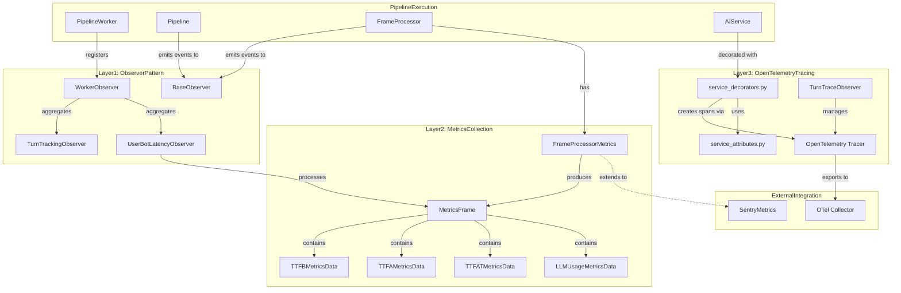
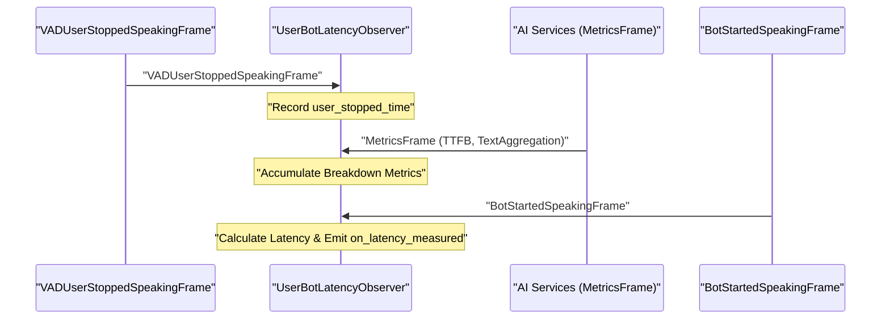
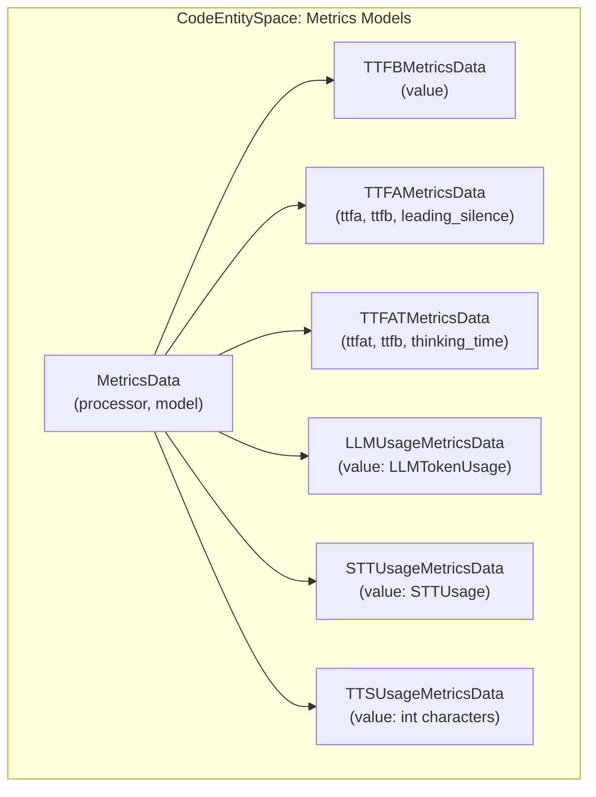
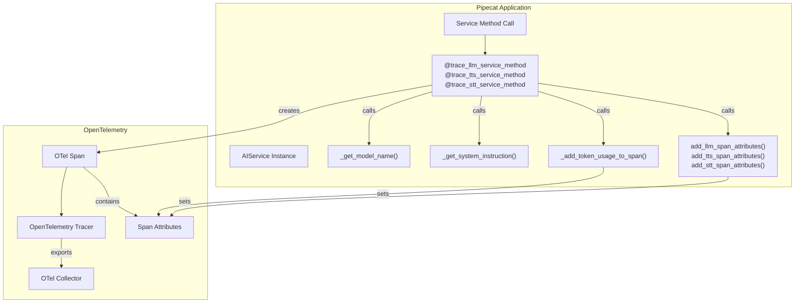

<!-- source: DeepWiki mcp.deepwiki.com · repo pipecat-ai/pipecat · page 8.5 Observability, Metrics, and Tracing · fetched 2026-10-26 -->

# Observability, Metrics, and Tracing

Relevant source files

The following files were used as context for generating this wiki page:

- [changelog/6047.added.md](changelog/6047.added.md)
- [changelog/6047.changed.md](changelog/6047.changed.md)
- [changelog/6047.performance.md](changelog/6047.performance.md)
- [src/pipecat/metrics/metrics.py](src/pipecat/metrics/metrics.py)
- [src/pipecat/observers/loggers/debug_log_observer.py](src/pipecat/observers/loggers/debug_log_observer.py)
- [src/pipecat/observers/loggers/metrics_log_observer.py](src/pipecat/observers/loggers/metrics_log_observer.py)
- [src/pipecat/observers/turn_tracking_observer.py](src/pipecat/observers/turn_tracking_observer.py)
- [src/pipecat/observers/user_bot_latency_observer.py](src/pipecat/observers/user_bot_latency_observer.py)
- [src/pipecat/processors/metrics/frame_processor_metrics.py](src/pipecat/processors/metrics/frame_processor_metrics.py)
- [src/pipecat/processors/metrics/sentry.py](src/pipecat/processors/metrics/sentry.py)
- [src/pipecat/utils/log_config.py](src/pipecat/utils/log_config.py)
- [src/pipecat/utils/tracing/service_attributes.py](src/pipecat/utils/tracing/service_attributes.py)
- [src/pipecat/utils/tracing/service_decorators.py](src/pipecat/utils/tracing/service_decorators.py)
- [src/pipecat/utils/tracing/tracing_context.py](src/pipecat/utils/tracing/tracing_context.py)
- [src/pipecat/utils/tracing/turn_trace_observer.py](src/pipecat/utils/tracing/turn_trace_observer.py)
- [tests/test_llm_context_logging.py](tests/test_llm_context_logging.py)
- [tests/test_llm_token_usage_totals.py](tests/test_llm_token_usage_totals.py)
- [tests/test_log_config.py](tests/test_log_config.py)
- [tests/test_rtvi_observer_metrics.py](tests/test_rtvi_observer_metrics.py)
- [tests/test_ttfa_metrics.py](tests/test_ttfa_metrics.py)
- [tests/test_turn_tracking_observer.py](tests/test_turn_tracking_observer.py)
- [tests/test_user_bot_latency_observer.py](tests/test_user_bot_latency_observer.py)

## Purpose and Scope

This document provides a deep dive into Pipecat's observability system, covering metrics collection, OpenTelemetry (OTel) tracing, service-specific decorators, turn and latency observers, Sentry integration, Time-To-First-Audio (TTFA) and Time-To-First-Answer-Token (TTFAT) metrics, and logging configuration. The observability framework is designed to give developers granular visibility into pipeline execution, latency breakdown, token usage, and distributed tracing across real-time voice and conversational AI agents.

Sources: `[src/pipecat/observers/base_observer.py:25-77]()`, `[src/pipecat/processors/metrics/frame_processor_metrics.py:31-66]()`, `[src/pipecat/utils/tracing/service_decorators.py:7-12]()`

---

## System Architecture

Pipecat's observability architecture integrates three orthogonal subsystems:
1. **Observers (`BaseObserver`)**: Event-driven hooks that inspect frame flow and compute high-level aggregate metrics such as user-to-bot latency and conversation turn boundaries.
2. **Metrics Collection (`FrameProcessorMetrics`)**: In-pipeline tracking of timing metrics (TTFB, TTFA, TTFAT), execution durations, and token usage via `MetricsFrame` propagation `[src/pipecat/processors/metrics/frame_processor_metrics.py:31-66]()`.
3. **OpenTelemetry Tracing (`service_decorators.py`)**: Distributed context propagation and span creation adhering to OpenTelemetry GenAI semantic conventions `[src/pipecat/utils/tracing/service_decorators.py:7-12]()`.

### Diagram: Observability Architecture

Sources: `[src/pipecat/observers/base_observer.py:25-77]()`, `[src/pipecat/processors/metrics/frame_processor_metrics.py:31-66]()`, `[src/pipecat/utils/tracing/service_decorators.py:7-12]()`, `[src/pipecat/utils/tracing/turn_trace_observer.py:36-74]()`

---

## Observer Pattern and Built-in Observers

Observers hook into frame push events via `BaseObserver.on_push_frame()` without modifying pipeline data flow. 

### TurnTrackingObserver

`TurnTrackingObserver` monitors conversation turns by listening to pipeline and frame events `[src/pipecat/observers/turn_tracking_observer.py:29-50]`.
* **Turn Initialization**: The first turn starts immediately upon `StartFrame` `[src/pipecat/observers/turn_tracking_observer.py:89-92]`.
* **User Speech**: Subsequent turns start when `UserStartedSpeakingFrame` or speech onset occurs `[src/pipecat/observers/turn_tracking_observer.py:93-94]`.
* **Turn Termination**: A turn ends when the bot stops speaking and either a timeout (`turn_end_timeout_secs`) elapses or the user starts speaking again `[src/pipecat/observers/turn_tracking_observer.py:95-103, 114-151]()`.

### UserBotLatencyObserver

`UserBotLatencyObserver` calculates the total user-to-bot response latency between `VADUserStoppedSpeakingFrame` and `BotStartedSpeakingFrame` `[src/pipecat/observers/user_bot_latency_observer.py:7-14, tests/test_user_bot_latency_observer.py:58-96]()`. 
When `enable_metrics=True` is configured, it aggregates intermediate service metrics (`TTFBMetricsData`, `TextAggregationMetricsData`) and constructs detailed timing breakdowns (endpointing wait, transcription, LLM inference, text aggregation, and TTS synthesis) `[src/pipecat/observers/user_bot_latency_observer.py:13-14, 180-270]()`.

### Diagram: Latency Breakdown Flow

Sources: `[src/pipecat/observers/turn_tracking_observer.py:29-167]()`, `[src/pipecat/observers/user_bot_latency_observer.py:7-212]()`, `[tests/test_user_bot_latency_observer.py:58-189]()`

---

## Metrics Collection, TTFA, TTFAT, and Token Usage

`FrameProcessorMetrics` manages quantitative performance data `[src/pipecat/processors/metrics/frame_processor_metrics.py:31-66]()` emitted downstream inside `MetricsFrame` objects.

### Key Metric Types

1. **TTFB (Time To First Byte)**: Measured from request initiation (`start_ttfb_metrics()`) to the first generated output (`stop_ttfb_metrics()`) `[src/pipecat/processors/metrics/frame_processor_metrics.py:107-178]()`.
2. **TTFA (Time To First Audio)**: Extends TTFB by measuring the interval until the first audible audio sample, capturing leading silence padding (`leading_silence`) `[src/pipecat/metrics/metrics.py:41-62, src/pipecat/processors/metrics/frame_processor_metrics.py:58-62]()`.
3. **TTFAT (Time To First Answer Token)**: Measures time from LLM request to the first answer token (excluding model reasoning or thinking time) `[src/pipecat/metrics/metrics.py:64-97]()`. Reported by text-generating LLM services.
4. **LLM Token Usage**: `LLMTokenUsage` captures `prompt_tokens`, `completion_tokens`, `total_tokens`, cache read/creation tokens, and `reasoning_tokens` `[src/pipecat/metrics/metrics.py:109-151]()`. Services differ in whether their input count is reported net or gross of prompt caches (e.g., Anthropic/Bedrock report net, OpenAI-compatible services report gross). Reasoning tokens are included within `completion_tokens` and also exposed separately `[src/pipecat/metrics/metrics.py:194-196]()`.

### Diagram: Metrics Class Hierarchy

Sources: `[src/pipecat/metrics/metrics.py:19-177]`, `[src/pipecat/processors/metrics/frame_processor_metrics.py:31-66]()`

---

## Logging Configuration and LLM Context Control

Pipecat uses `loguru` for structured logging `[src/pipecat/utils/log_config.py]()`. The environment variable `PIPECAT_LOG_LLM_CONTEXT` governs how much of the conversation context LLM services include in their `DEBUG` logs `[changelog/6047.added.md:1-5, tests/test_llm_context_logging.py:1-45]()`:
* `full` (default): Logs every message in the LLM context on each inference `[changelog/6047.added.md:1]`.
* `off`: Omits the message payload from LLM generation and conversation setup logs, preventing log flooding in long conversational sessions `[changelog/6047.added.md:1, tests/test_llm_context_logging.py:61-70]`.
* Invalid values raise `InvalidEnvVarValueError` upon LLM service construction `[tests/test_llm_context_logging.py:41-45]()`.

Sources: `[src/pipecat/utils/log_config.py]`, `[tests/test_llm_context_logging.py:1-102]`, `[changelog/6047.added.md:1-5]`

---

## OpenTelemetry Tracing and Service Decorators

Pipecat provides service-specific decorators (`service_decorators.py`) that automatically wrap AI service calls in OpenTelemetry spans `[src/pipecat/utils/tracing/service_decorators.py:7-12]()`.

### Semantic Conventions

Attributes adhere to OpenTelemetry GenAI semantic conventions via `service_attributes.py` `[src/pipecat/utils/tracing/service_attributes.py:7-12]()`:
* `AWSBedrockLLMService` maps to provider name `aws.bedrock` `[src/pipecat/utils/tracing/service_attributes.py:45]()`.
* `AzureLLMService` maps to provider name `azure.ai.openai` `[src/pipecat/utils/tracing/service_attributes.py:47]()`.
* `GoogleLLMService` maps to `gcp.gemini` `[src/pipecat/utils/tracing/service_attributes.py:49]()`.
* `GoogleVertexLLMService` maps to `gcp.vertex_ai` `[src/pipecat/utils/tracing/service_attributes.py:50]()`.
* `GrokLLMService` maps to `x_ai` `[src/pipecat/utils/tracing/service_attributes.py:52]()`.
* `MistralLLMService` maps to `mistral_ai` `[src/pipecat/utils/tracing/service_attributes.py:53]()`.
* Reasoning token counts are exported under `gen_ai.usage.reasoning.output_tokens` `[src/pipecat/utils/tracing/service_decorators.py:192-195]()`.

### Diagram: OpenTelemetry Tracing Flow

Sources: `[src/pipecat/utils/tracing/service_decorators.py:7-196]`, `[src/pipecat/utils/tracing/service_attributes.py:28-184]()`

---

## TurnTraceObserver and Tracing Context

`TurnTraceObserver` connects `TurnTrackingObserver` and `UserBotLatencyObserver` with OpenTelemetry tracing `[src/pipecat/utils/tracing/turn_trace_observer.py:36-74]()`. It manages a top-level conversation span and child spans for individual conversation turns, ensuring all STT, LLM, and TTS service spans nest correctly beneath the active conversation turn `[src/pipecat/utils/tracing/turn_trace_observer.py:36-45, 120-152]()`.

Sources: `[src/pipecat/utils/tracing/turn_trace_observer.py:36-167]()`

---

## Sentry Integration

`SentryMetrics` extends `FrameProcessorMetrics` to record performance monitoring transactions in Sentry `[src/pipecat/processors/metrics/sentry.py:25-31]()`.
* **Transactions**: Automatically initiates Sentry transactions (`sentry_sdk.start_transaction`) for `ttfb` and `processing` metrics operations `[src/pipecat/processors/metrics/sentry.py:85-88, 121-124]()`.
* **Async Queueing**: Offloads transaction finalization (`tx.finish`) to a background worker task using an `asyncio.Queue` via `_sentry_task_handler()` to avoid blocking the asyncio event loop during real-time streaming `[src/pipecat/processors/metrics/sentry.py:54-56, 148-156]()`.

Sources: `[src/pipecat/processors/metrics/sentry.py:25-156]()`

---

