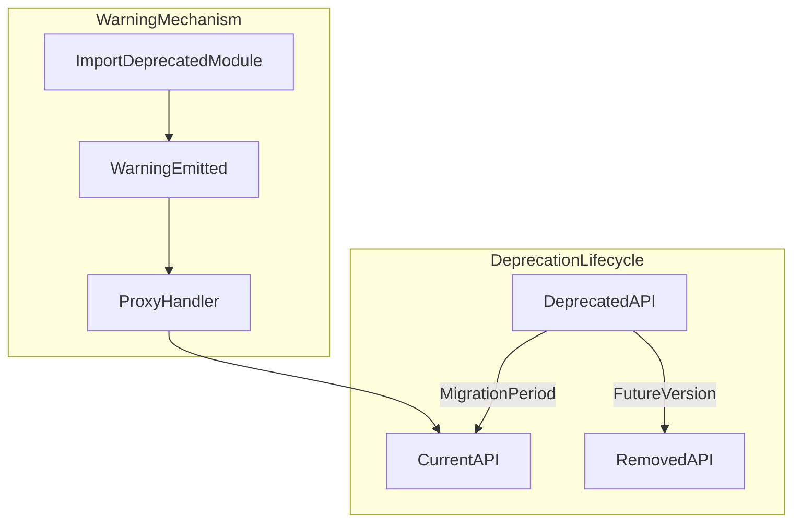
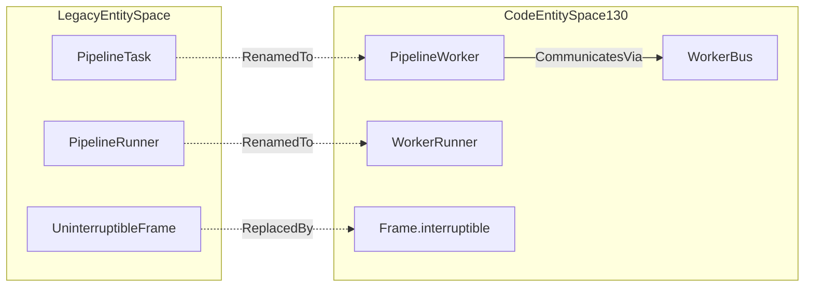
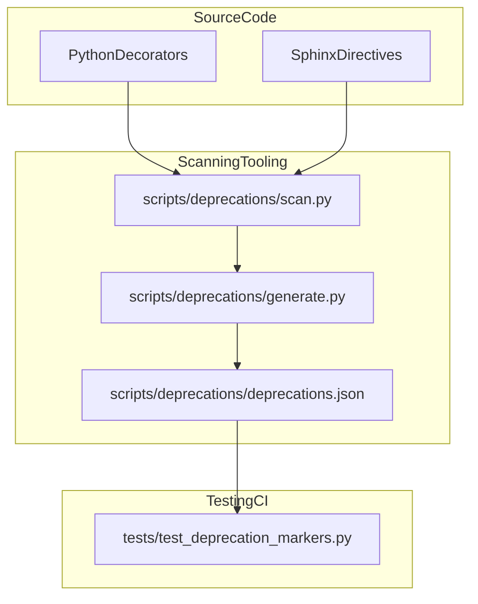
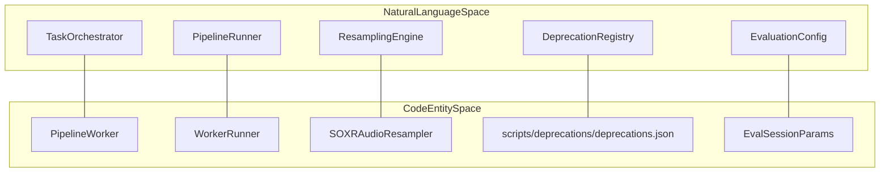

<!-- source: DeepWiki mcp.deepwiki.com · repo pipecat-ai/pipecat · page 8.8 Migration Guides and Deprecated APIs · fetched 2026-10-26 -->

# Migration Guides and Deprecated APIs

<details>
<summary>Relevant source files</summary>

The following files were used as context for generating this wiki page:

- [.github/workflows/generate-changelog.yml](.github/workflows/generate-changelog.yml)
- [CHANGELOG.md](CHANGELOG.md)
- [scripts/deprecations/deprecations.json](scripts/deprecations/deprecations.json)
- [scripts/deprecations/generate_removals.py](scripts/deprecations/generate_removals.py)
- [scripts/deprecations/removals.json](scripts/deprecations/removals.json)
- [scripts/deprecations/scan.py](scripts/deprecations/scan.py)
- [src/pipecat/evals/_session_subprocess.py](src/pipecat/evals/_session_subprocess.py)
- [src/pipecat/evals/script_session.py](src/pipecat/evals/script_session.py)
- [src/pipecat/evals/session.py](src/pipecat/evals/session.py)
- [src/pipecat/evals/simulation_session.py](src/pipecat/evals/simulation_session.py)
- [src/pipecat/frames/frames.py](src/pipecat/frames/frames.py)
- [src/pipecat/pipeline/task.py](src/pipecat/pipeline/task.py)
- [src/pipecat/processors/aggregators/llm_response.py](src/pipecat/processors/aggregators/llm_response.py)
- [src/pipecat/processors/frame_processor.py](src/pipecat/processors/frame_processor.py)
- [src/pipecat/transports/base_input.py](src/pipecat/transports/base_input.py)
- [src/pipecat/transports/base_output.py](src/pipecat/transports/base_output.py)
- [src/pipecat/transports/base_transport.py](src/pipecat/transports/base_transport.py)
- [src/pipecat/utils/deprecation.py](src/pipecat/utils/deprecation.py)
- [tests/test_deprecation_markers.py](tests/test_deprecation_markers.py)
- [tests/test_text_type_deprecations.py](tests/test_text_type_deprecations.py)

</details>


This document outlines the deprecation roadmap, upgrade pathways, and backward-compatibility layers within the Pipecat AI framework. As Pipecat matures toward stable 2.0 architectures, certain legacy APIs, naming conventions, and structural patterns are superseded by flexible, provider-agnostic, multi-worker implementations [src/pipecat/processors/frame_processor.py:90-128](), [src/pipecat/pipeline/task.py:7-29]().

## Overview of Deprecation Strategy

Pipecat manages API lifecycles using Python's standard `warnings` module to emit `DeprecationWarning` messages [src/pipecat/processors/frame_processor.py:120-127](). Deprecated modules, classes, and parameter accessors use proxy objects or wrapper functions to preserve backward compatibility while logging upgrade paths [src/pipecat/processors/frame_processor.py:116-128](), [src/pipecat/pipeline/task.py:7-29]() (via `pipecat.pipeline.task` module which re-exports `PipelineWorker`).

Every deprecation in Pipecat follows a canonical template enforced by `tests/test_deprecation_markers.py` and parsed by `src/pipecat/utils/deprecation.py`:

```
`Subject` is deprecated since X.Y.Z and will be removed in A.B.C. Use `Replacement` instead.
```

Title: Deprecation and Proxy Flow


Sources: [src/pipecat/processors/frame_processor.py:116-128](), [src/pipecat/pipeline/task.py:7-29](), [src/pipecat/utils/deprecation.py:9-64](), [tests/test_deprecation_markers.py:7-50]()

## Major Migration: Multi-Worker Framework (1.3.0)

Version 1.3.0 introduced the multi-agent framework (`pipecat.workers`), renaming core orchestration primitives to better match distributed and multi-agent roles [src/pipecat/pipeline/task.py:7-29]().

### PipelineTask → PipelineWorker
The `PipelineTask` class is deprecated in favor of `PipelineWorker` [src/pipecat/pipeline/task.py:7-29](). While `PipelineTask` remains as a deprecated alias, new code should use `PipelineWorker`. Every `PipelineWorker` operates as a node on a shared `WorkerBus` capable of passing typed messages [src/pipecat/pipeline/task.py:7-29]().

### PipelineRunner → WorkerRunner
The `PipelineRunner` class is deprecated in favor of `WorkerRunner` [src/pipecat/pipeline/runner.py:23-37](). The runner manages diverse worker types (such as `LLMWorker` and `UIWorker`) rather than solely linear execution pipelines.
*   **Deprecated Pattern:** `WorkerRunner.run(worker=my_worker)`
*   **Modern Pattern:** `WorkerRunner.add_workers([my_worker])` followed by `WorkerRunner.run()`.

### UninterruptibleFrame Mixin → interruptible Field
The `UninterruptibleFrame` mixin class is deprecated in favor of explicit configuration on the base `Frame` class [src/pipecat/frames/frames.py:163-172]().
*   **Deprecated Pattern:** `class CustomFrame(DataFrame, UninterruptibleFrame): pass`
*   **Modern Pattern:** Setting `interruptible: bool = field(default=False, init=False)` directly inside custom frame definitions [src/pipecat/frames/frames.py:163-172]().

Title: Multi-Worker Migration Mapping


Sources: [src/pipecat/pipeline/task.py:7-29](), [src/pipecat/pipeline/runner.py:23-37](), [src/pipecat/frames/frames.py:163-172]()

## Module Path and Namespace Migrations

Several sub-packages and utilities have been reorganized for cleaner namespacing and provider independence.

| Deprecated Namespace / Symbol | Current Namespace / Symbol | Reason |
|-------------------------------|----------------------------|--------|
| `pipecat.pipeline.task` | `pipecat.pipeline.worker` | Renamed task to worker semantics [src/pipecat/pipeline/task.py:7-29]() |
| `pipecat.pipeline.runner.PipelineRunner` | `pipecat.workers.runner.WorkerRunner` | Runner handles multiple worker topologies [src/pipecat/pipeline/runner.py:23-37]() |
| `pipecat.evals.harness` | `pipecat.evals.session` / `script_session` | Module split and refactored |
| `EvalResult` | `EvalScriptResult` | Renamed for clarity |
| `EvalTurnProgress` | `EvalScriptTurnProgress` | Renamed for clarity |
| `EvalTurnResult` | `EvalScriptTurnResult` | Renamed for clarity |
| `load_scenario_file` | `EvalScenarioFile.load` | Converted to class method |
| `pipecat-ai-flows` (standalone) | `pipecat.flows` | Merged into core `pipecat-ai` package |

Sources: [src/pipecat/pipeline/task.py:7-29](), [src/pipecat/pipeline/runner.py:23-37]()

## Resource Management: tool_resources to app_resources

**Deprecated in 1.2.0:** `tool_resources`
**Replacement:** `app_resources`

The framework renamed `tool_resources` to `app_resources` across processor setup structures to denote that application-scoped resources (database pools, client sessions, shared cache handles) are available to tool handlers, workers, and custom processors alike [src/pipecat/processors/frame_processor.py:90-128]().

*   **PipelineWorker Initialization:** Pass resources via `PipelineWorker(..., app_resources=...)`.
*   **FrameProcessors:** Read from `setup.pipeline_worker.app_resources` during `setup()`. Accessing `setup.tool_resources` triggers a `DeprecationWarning` [src/pipecat/processors/frame_processor.py:116-128]().

Sources: [src/pipecat/processors/frame_processor.py:90-128]()

## Service, Transport, and Memory Updates

### VAD and Resampling Parameter Updates
*   **Resamplers:** `ResampyResampler` is deprecated in favor of `SOXRAudioResampler`, `create_file_resampler()`, or `create_stream_resampler()`.
*   **AIC VAD Parameters:** `AICQuailVADAnalyzer.minimum_speech_duration`, `AICQuailVADAnalyzer.sensitivity`, and `AICQuailVADAnalyzer.speech_hold_duration` are deprecated and ignored. Use `VADParams` (`start_secs`, `stop_secs`, `confidence`) instead.
*   **Mem0 Memory Service API Version:** `Mem0MemoryService.InputParams.api_version` is deprecated since 1.4.0 with no replacement, as Mem0 2.0.0 removed the parameter.

### Transports and Output Parameters
*   **Transport Bitrate:** `video_out_bitrate` in `TransportParams` is deprecated [src/pipecat/transports/base_output.py:99-105](). Use provider-specific settings (e.g., `DailyParams.camera_out_send_settings`).
*   **Input Streaming Control:** Direct calls to `BaseInputTransport.start_audio_in_streaming()` are deprecated [src/pipecat/transports/base_input.py:95-99](). Push an `InputTransportStartAudioStreamingFrame` downstream instead [src/pipecat/transports/base_input.py:95-99]().

Sources: [src/pipecat/transports/base_output.py:99-105](), [src/pipecat/transports/base_input.py:95-99]()

## Flows and Evaluation System Deprecations

### Flows Framework Migration Path
*   **FlowManager Task Parameter:** `FlowManager(task=...)` is deprecated since 1.5.0; use `FlowManager(worker=...)` instead.
*   **FlowResult TypedDict:** `FlowResult` is deprecated since 1.5.0 with no replacement; define custom `TypedDict` or return any JSON-serializable value.
*   **Legacy Action Handlers:** `LegacyActionHandler` (receiving only `action: dict`) is deprecated since 1.5.0 in favor of `FlowActionHandler` (`(action, flow_manager)`).
*   **Context Strategies:** `ContextStrategy.RESET_WITH_SUMMARY` and its `summary_prompt` parameter are deprecated since 1.5.0 in favor of pushing `LLMSummarizeContextFrame`.
*   **Node Role Messages:** `role_messages` (list-of-dicts) is deprecated since 1.5.0; use `role_message` (str) instead.

### Evaluation System Knobs
*   **EvalJudge Transcript Argument:** `EvalJudge.evaluate_run.transcript` is deprecated. Populate judge conversations explicitly using `.add_user_message()`, `.add_assistant_message()`, and `.add_tool_call()`.
*   **EvalJudge Service Parameter:** `EvalJudge.service` is deprecated. Use `LLMClassifier` as the `classifier` parameter, passing the service as the `explainer` for reasons.
*   **EvalSession Knobs:** Passing direct keyword arguments like `connect_timeout_s`, `default_timeout_ms`, or `record_path` directly to `EvalSession.from_scenario()` is deprecated. Pass an explicit `EvalSessionParams` data class instance [src/pipecat/evals/session.py:67-127]().

Sources: [src/pipecat/evals/session.py:67-127]()

## Deprecation Scanning Tooling

Pipecat uses automated validation under `scripts/deprecations/` to parse `.. deprecated::` Sphinx directives and `@deprecated` decorators from the source tree, guided by parser modules like `scripts/deprecations/scan.py` and unit tests in `tests/test_deprecation_markers.py` [tests/test_deprecation_markers.py:7-50](). The generator compiles these findings into `scripts/deprecations/deprecations.json`, which CI workflows validate against pending release removals (`scripts/deprecations/removals.json`) [-.github/workflows/generate-changelog.yml:135-138]().

Title: Deprecation Scanning Data Flow


Sources: [tests/test_deprecation_markers.py:7-50]()

## Migration Checklist

| Feature Area | Legacy Pattern | Modern Pattern |
|--------------|----------------|----------------|
| **Task Orchestration** | `PipelineTask` [src/pipecat/pipeline/task.py:7-29]() | `PipelineWorker` [src/pipecat/pipeline/task.py:7-29]() |
| **Runner Execution** | `PipelineRunner` [src/pipecat/pipeline/runner.py:23-37]() | `WorkerRunner` [src/pipecat/pipeline/runner.py:23-37]() |
| **Shared Resources** | `setup.tool_resources` [src/pipecat/processors/frame_processor.py:90-128]() | `setup.pipeline_worker.app_resources` [src/pipecat/processors/frame_processor.py:90-128]() |
| **Resampler** | `ResampyResampler` | `SOXRAudioResampler` |
| **VAD Analyzer Parameters** | `minimum_speech_duration` | `VADParams` |
| **Input Streaming** | `start_audio_in_streaming()` [src/pipecat/transports/base_input.py:95-99]() | `InputTransportStartAudioStreamingFrame` [src/pipecat/transports/base_input.py:95-99]() |
| **Frame Interruptibility** | `UninterruptibleFrame` mixin [src/pipecat/frames/frames.py:163-172]() | `interruptible: bool = field(default=False, init=False)` [src/pipecat/frames/frames.py:163-172]() |
| **Eval Session Options** | Direct keyword arguments | `EvalSessionParams` [src/pipecat/evals/session.py:67-127]() |
| **Eval Judge Service** | `EvalJudge.service` | `EvalJudge.classifier` (using `LLMClassifier`) |
| **Flows Manager Task** | `FlowManager(task=...)` | `FlowManager(worker=...)` |

Title: Code Entity Mapping for Migration


Sources: [src/pipecat/pipeline/task.py:7-29](), [src/pipecat/processors/frame_processor.py:90-128](), [src/pipecat/transports/base_input.py:95-99](), [src/pipecat/frames/frames.py:163-172](), [src/pipecat/evals/session.py:67-127]()

---

