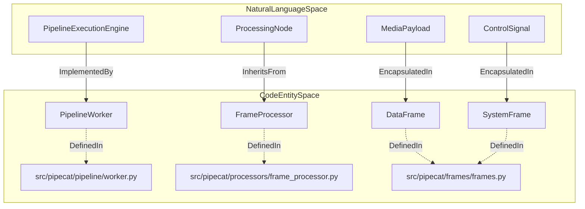
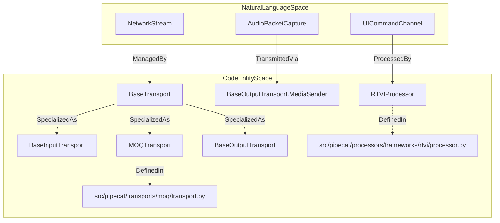

<!-- source: DeepWiki mcp.deepwiki.com · repo pipecat-ai/pipecat · page 9 Glossary · fetched 2026-10-26 -->

# Glossary

Relevant source files

The following files were used as context for generating this wiki page:

- [CHANGELOG.md](CHANGELOG.md)
- [changelog/6118.fixed.6.md](changelog/6118.fixed.6.md)
- [docs/architecture/word-tracking-deck.html](docs/architecture/word-tracking-deck.html)
- [docs/architecture/word-trecking/README.md](docs/architecture/word-trecking/README.md)
- [docs/architecture/word-trecking/aggregated-frame-sequencer.md](docs/architecture/word-trecking/aggregated-frame-sequencer.md)
- [docs/architecture/word-trecking/improvements.md](docs/architecture/word-trecking/improvements.md)
- [docs/architecture/word-trecking/rtvi-integration.md](docs/architecture/word-trecking/rtvi-integration.md)
- [docs/architecture/word-trecking/text-segment-map.md](docs/architecture/word-trecking/text-segment-map.md)
- [docs/architecture/word-trecking/word-completion-tracker.md](docs/architecture/word-trecking/word-completion-tracker.md)
- [src/pipecat/bus/bridge_processor.py](src/pipecat/bus/bridge_processor.py)
- [src/pipecat/bus/bus.py](src/pipecat/bus/bus.py)
- [src/pipecat/bus/queue.py](src/pipecat/bus/queue.py)
- [src/pipecat/bus/subscriber.py](src/pipecat/bus/subscriber.py)
- [src/pipecat/frames/frames.py](src/pipecat/frames/frames.py)
- [src/pipecat/pipeline/task.py](src/pipecat/pipeline/task.py)
- [src/pipecat/pipeline/worker.py](src/pipecat/pipeline/worker.py)
- [src/pipecat/processors/aggregators/llm_response.py](src/pipecat/processors/aggregators/llm_response.py)
- [src/pipecat/processors/aggregators/llm_text_processor.py](src/pipecat/processors/aggregators/llm_text_processor.py)
- [src/pipecat/processors/frame_processor.py](src/pipecat/processors/frame_processor.py)
- [src/pipecat/services/tts_service.py](src/pipecat/services/tts_service.py)
- [src/pipecat/transports/base_input.py](src/pipecat/transports/base_input.py)
- [src/pipecat/transports/base_output.py](src/pipecat/transports/base_output.py)
- [src/pipecat/transports/base_transport.py](src/pipecat/transports/base_transport.py)
- [src/pipecat/utils/context/aggregated_frame_sequencer.py](src/pipecat/utils/context/aggregated_frame_sequencer.py)
- [src/pipecat/utils/context/audio_context_manager.py](src/pipecat/utils/context/audio_context_manager.py)
- [src/pipecat/utils/context/word_timestamp_tracker.py](src/pipecat/utils/context/word_timestamp_tracker.py)
- [src/pipecat/utils/startup.py](src/pipecat/utils/startup.py)
- [src/pipecat/workers/base_worker.py](src/pipecat/workers/base_worker.py)
- [src/pipecat/workers/runner.py](src/pipecat/workers/runner.py)
- [tests/test_aggregated_frame_sequencer.py](tests/test_aggregated_frame_sequencer.py)
- [tests/test_audio_context_manager.py](tests/test_audio_context_manager.py)
- [tests/test_base_worker.py](tests/test_base_worker.py)
- [tests/test_bus.py](tests/test_bus.py)
- [tests/test_job_group.py](tests/test_job_group.py)
- [tests/test_messages.py](tests/test_messages.py)
- [tests/test_pgmq_backends.py](tests/test_pgmq_backends.py)
- [tests/test_pgmq_bus.py](tests/test_pgmq_bus.py)
- [tests/test_redis_bus.py](tests/test_redis_bus.py)
- [tests/test_runner.py](tests/test_runner.py)
- [tests/test_sentence_tokenizer_language.py](tests/test_sentence_tokenizer_language.py)
- [tests/test_serializers.py](tests/test_serializers.py)
- [tests/test_tts_frame_ordering.py](tests/test_tts_frame_ordering.py)
- [tests/test_utils_startup.py](tests/test_utils_startup.py)
- [tests/test_websocket_proxy.py](tests/test_websocket_proxy.py)
- [tests/test_word_timestamp_tracker.py](tests/test_word_timestamp_tracker.py)

This glossary provides definitions for codebase-specific terms, jargon, abbreviations, and domain concepts used within the Pipecat framework. It is designed to help onboarding engineers navigate architectural patterns, frame types, multi-worker frameworks, service patterns, evaluation mechanisms, and audio/VAD terminology.

---

## 1. Core Pipeline and Frame Concepts

### Frame
The fundamental unit of data in Pipecat. All information—including audio, text, images, control signals, and system instructions—is encapsulated in a `Frame` object and passed through the pipeline [src/pipecat/frames/frames.py:73-95](). Every frame features a unique identifier (`id`), human-readable name (`name`), presentation timestamp (`pts`), metadata dictionary (`metadata`), and an `interruptible` boolean flag (defaulting to `True`) that determines whether user interruptions can drop or cancel the frame [src/pipecat/frames/frames.py:97-116]().

*   **SystemFrame**: High-priority frames designed for immediate signaling. They bypass standard queues to ensure rapid delivery (e.g., `CancelFrame`, `InterruptionFrame`) [src/pipecat/frames/frames.py:122-129]().
*   **DataFrame**: Frames containing media or conversation content (e.g., `OutputAudioRawFrame`, `TextFrame`). They are processed in order and can be cancelled or dropped by user interruptions [src/pipecat/frames/frames.py:133-141]().
*   **ControlFrame**: Frames for pipeline orchestration that must be processed in-band with data but are not direct media payloads (e.g., `EndFrame`, `UpdateSettingsFrame`) [src/pipecat/frames/frames.py:145-155]().
*   **interruptible**: A field on `Frame` determining whether an interruption may discard it from a processor queue or cancel its processing [src/pipecat/frames/frames.py:90-95](). Subclasses like `EndFrame` set `interruptible: bool = field(default=False, init=False)` [src/pipecat/frames/frames.py:90-95]().

Sources: [src/pipecat/frames/frames.py:73-155]()

### FrameProcessor
The base class for every processing node in a Pipecat pipeline. Processors receive frames via `process_frame()` and pass them to downstream or upstream components using `push_frame()` [src/pipecat/processors/frame_processor.py:60-116](). They utilize `FrameProcessorQueue` for priority-tiered frame management (`StartFrame` outranks `SystemFrame`, which outranks default data/control frames) [src/pipecat/processors/frame_processor.py:131-184]().

Sources: [src/pipecat/processors/frame_processor.py:60-184]()

### PipelineWorker
Formerly known as `PipelineTask` [src/pipecat/pipeline/task.py:7-29](). The execution engine that orchestrates pipeline execution, frame routing, lifecycle management, heartbeats, idle detection, and observer notification [src/pipecat/pipeline/worker.py:7-12]().

Sources: [src/pipecat/pipeline/task.py:7-29](), [src/pipecat/pipeline/worker.py:7-12]()

Pipeline Execution Mapping

Sources: [src/pipecat/pipeline/task.py:7-29](), [src/pipecat/processors/frame_processor.py:60-116](), [src/pipecat/frames/frames.py:73-141]()

---

## 2. Multi-Worker Framework (`pipecat.workers`)

### WorkerBus & Subclasses
The pub/sub messaging backbone enabling communication between multiple distributed agents and worker peers in the Pipecat multi-worker framework [src/pipecat/pipeline/worker.py:24-31](). 
*   `AsyncQueueBus`: A local, in-memory queue-based bus implementation.
*   `RedisBus`: A distributed message bus backed by Redis.
*   `PgmqBus`: A PostgreSQL Message Queue (PGMQ)-backed distributed bus.

### BaseWorker & LLMWorker
`BaseWorker` provides the foundation for connecting to an underlying event bus and managing worker lifecycle activation [src/pipecat/workers/base_worker.py](). Specialized workers include `PipelineWorker`, `LLMWorker`, `LLMContextWorker`, and `UIWorker` [src/pipecat/pipeline/worker.py:7-12]().

Sources: [src/pipecat/pipeline/worker.py:24-31](), [src/pipecat/workers/base_worker.py]()

---

## 3. Audio, Transport, and AI Service Terminology

### Input and Output Transports
*   **BaseInputTransport**: Handles audio and video input capture, Voice Activity Detection (VAD) triggering, turn analysis, and user interaction forwarding [src/pipecat/transports/base_input.py:38-44]().
*   **BaseOutputTransport**: Handles audio and video rendering, frame buffering, resampling, mixing via `BaseAudioMixer`, and media streaming via `MediaSender` instances [src/pipecat/transports/base_output.py:66-97]().

Sources: [src/pipecat/transports/base_input.py:38-44](), [src/pipecat/transports/base_output.py:66-97]()

### TextAggregationMode
An enumeration controlling how incoming text is aggregated before Text-to-Speech (TTS) synthesis [src/pipecat/services/tts_service.py:72-87]().
*   `SENTENCE`: Buffers incoming tokens until natural sentence boundaries are encountered, producing more natural prosody at the cost of additional latency [src/pipecat/services/tts_service.py:76-77]().
*   `TOKEN`: Streams text tokens directly to TTS as they arrive, minimizing latency at the potential expense of prosody [src/pipecat/services/tts_service.py:78-79]().

Sources: [src/pipecat/services/tts_service.py:72-87]()

### FunctionCallParams
A dataclass encapsulating all parameters required for executing a tool or function call from an LLM service, including `function_name`, `tool_call_id`, `arguments`, references to the `LLMService`, `PipelineWorker`, `LLMContext`, `result_callback`, and application resources [src/pipecat/services/llm_service.py:143-158]().

Sources: [src/pipecat/services/llm_service.py:143-158]()

### STT Latency Metrics
*   **TTFB (Time To First Byte)**: For STT services, measures the duration from when user speech stops to when the initial partial or final transcript arrives [src/pipecat/services/stt_service.py:115-119]().
*   **TTFS (Time To Final Speech)**: P99 latency metric from speech offset to final transcription text, often broadcast via `STTMetadataFrame` [src/pipecat/services/stt_service.py:120-124]().

Sources: [src/pipecat/services/stt_service.py:115-124]()

Transport Architecture Mapping

Sources: [src/pipecat/transports/base_output.py:66-97](), [src/pipecat/transports/base_transport.py:1-25]()

---

## 4. Evaluation and Classifier Terms

### EvalRunner & EvalSession
The components responsible for orchestrating automated test suites and executing conversational simulation sessions against agent pipelines within the Pipecat evaluation framework.

### JudgeVerdict & EvalJudge
The evaluation structures returned by test judges. `JudgeVerdict` includes a `confidence` score (ranging from 0 to 1) indicating how certain the judge is of its assessment [CHANGELOG.md:75-77]().

### JevClassifier & LLMClassifier
Classification engines used to extract structured answers (such as `YesNoQuestion`, `ChoiceQuestion`, or `ScoreQuestion`) from conversational text states [CHANGELOG.md:116-128](). `JevClassifier` leverages TypeSafe's Jev model for rapid classification, while `LLMClassifier` utilizes standard Pipecat LLM services supporting `run_inference()` [CHANGELOG.md:92-128]().

Sources: [CHANGELOG.md:75-131]()