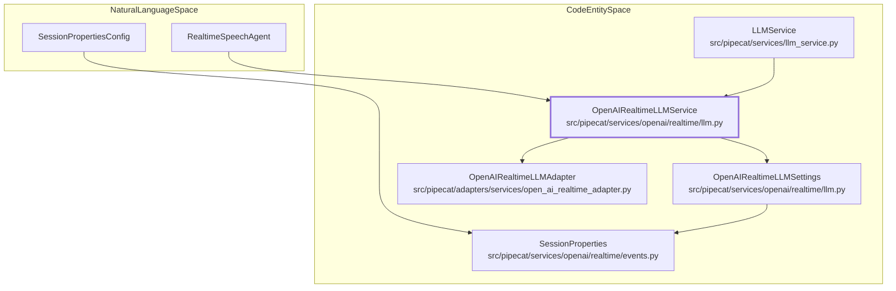
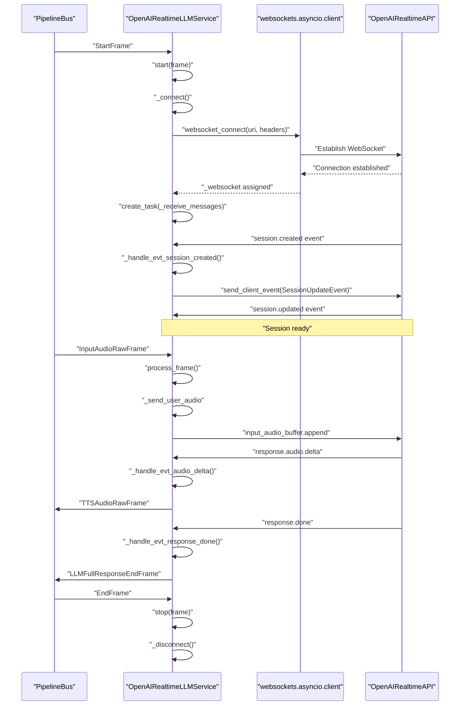
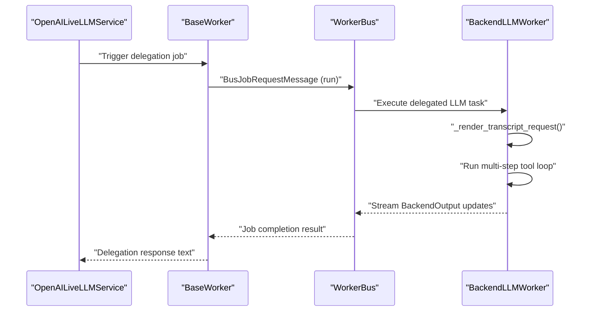

<!-- source: DeepWiki mcp.deepwiki.com · repo pipecat-ai/pipecat · extra page OpenAI Realtime API · fetched 2026-10-26 -->

# OpenAI Realtime API

Relevant source files

The following files were used as context for generating this wiki page:

- [examples/persistent-context/persistent-context-openai-live-responses-delegation.py](examples/persistent-context/persistent-context-openai-live-responses-delegation.py)
- [examples/realtime/realtime-azure-voice-live.py](examples/realtime/realtime-azure-voice-live.py)
- [examples/realtime/realtime-openai-live-client-delegation-speaking-policy.py](examples/realtime/realtime-openai-live-client-delegation-speaking-policy.py)
- [examples/realtime/realtime-openai-live-client-delegation.py](examples/realtime/realtime-openai-live-client-delegation.py)
- [examples/realtime/realtime-openai-live-responses-delegation.py](examples/realtime/realtime-openai-live-responses-delegation.py)
- [scripts/provider-watch/assets/speech-16k.wav](scripts/provider-watch/assets/speech-16k.wav)
- [scripts/provider-watch/inventory.py](scripts/provider-watch/inventory.py)
- [src/pipecat/adapters/services/azure_voice_live_adapter.py](src/pipecat/adapters/services/azure_voice_live_adapter.py)
- [src/pipecat/adapters/services/open_ai_live_adapter.py](src/pipecat/adapters/services/open_ai_live_adapter.py)
- [src/pipecat/services/aws/nova_sonic/llm.py](src/pipecat/services/aws/nova_sonic/llm.py)
- [src/pipecat/services/azure/voice_live/__init__.py](src/pipecat/services/azure/voice_live/__init__.py)
- [src/pipecat/services/azure/voice_live/events.py](src/pipecat/services/azure/voice_live/events.py)
- [src/pipecat/services/azure/voice_live/llm.py](src/pipecat/services/azure/voice_live/llm.py)
- [src/pipecat/services/google/gemini_live/llm.py](src/pipecat/services/google/gemini_live/llm.py)
- [src/pipecat/services/inworld/realtime/events.py](src/pipecat/services/inworld/realtime/events.py)
- [src/pipecat/services/inworld/realtime/llm.py](src/pipecat/services/inworld/realtime/llm.py)
- [src/pipecat/services/openai/live/__init__.py](src/pipecat/services/openai/live/__init__.py)
- [src/pipecat/services/openai/live/events.py](src/pipecat/services/openai/live/events.py)
- [src/pipecat/services/openai/live/llm.py](src/pipecat/services/openai/live/llm.py)
- [src/pipecat/services/openai/realtime/llm.py](src/pipecat/services/openai/realtime/llm.py)
- [src/pipecat/services/ultravox/llm.py](src/pipecat/services/ultravox/llm.py)
- [src/pipecat/services/xai/realtime/llm.py](src/pipecat/services/xai/realtime/llm.py)
- [src/pipecat/workers/llm/__init__.py](src/pipecat/workers/llm/__init__.py)
- [src/pipecat/workers/llm/backend_llm_worker.py](src/pipecat/workers/llm/backend_llm_worker.py)
- [tests/test_azure_voice_live_adapter.py](tests/test_azure_voice_live_adapter.py)
- [tests/test_azure_voice_live_events.py](tests/test_azure_voice_live_events.py)
- [tests/test_azure_voice_live_frames.py](tests/test_azure_voice_live_frames.py)
- [tests/test_azure_voice_live_service.py](tests/test_azure_voice_live_service.py)
- [tests/test_azure_voice_live_text_turns.py](tests/test_azure_voice_live_text_turns.py)
- [tests/test_backend_llm_worker.py](tests/test_backend_llm_worker.py)
- [tests/test_inworld_realtime_context.py](tests/test_inworld_realtime_context.py)
- [tests/test_openai_live_service.py](tests/test_openai_live_service.py)
- [tests/test_realtime_service_tool_sync.py](tests/test_realtime_service_tool_sync.py)
- [tests/test_realtime_tool_result_encoding.py](tests/test_realtime_tool_result_encoding.py)

This document details the OpenAI Realtime API integration in Pipecat, which provides native speech-to-speech capabilities through WebSocket-based real-time communication. The OpenAI Realtime API bypasses traditional STT→LLM→TTS pipelines by handling audio input and output directly, offering lower latency for voice-first applications. This page also covers **OpenAI Live** (`OpenAILiveLLMService`) and **backend LLM worker delegation** (`BackendLLMWorker`).

**Scope**: This page documents `OpenAIRealtimeLLMService` (current stable implementation), WebSocket communication patterns, session configuration, function calling, context management, token usage tracking, truncation on interruption, Azure Realtime, legacy shims, OpenAI Live, and backend LLM worker delegation.

---

## Service Architecture

The OpenAI Realtime API integration is primarily located in the `openai/realtime` namespace. It leverages a specialized adapter (`OpenAIRealtimeLLMAdapter`) to translate Pipecat's universal context into the specific WebSocket event format required by OpenAI.

| Implementation | Module Path | Status | API Version |
|---------------|-------------|---------|-------------|
| `OpenAIRealtimeLLMService` | `src/pipecat/services/openai/realtime/llm.py` | **Current** | Stable (gpt-4o-realtime / gpt-realtime-2) |
| `AzureVoiceLiveLLMService` | `src/pipecat/services/azure/voice_live/llm.py` | Current | Azure-specific authentication |
| `OpenAILiveLLMService` | `src/pipecat/services/openai/live/llm.py` | Current | Full-duplex WebSocket (`gpt-live-1`) |
| `OpenAIRealtimeBetaLLMService` | `pipecat.services.openai_realtime_beta.openai` | **Deprecated** | Beta (2024 versions) |

### Service Class Hierarchy and Core Components

The following diagram bridges the natural language concepts of speech-to-speech streaming agents to the exact code entities (`OpenAIRealtimeLLMService`, `OpenAIRealtimeLLMSettings`, `SessionProperties`, and `OpenAIRealtimeLLMAdapter`) defined in the codebase.

Title: Realtime Service Component Mapping

Sources: [src/pipecat/services/openai/realtime/llm.py:100-112](), [src/pipecat/services/llm_service.py]()

### Core Functionality

The service extends `LLMService` [src/pipecat/services/llm_service.py]() and implements:

- **Bidirectional WebSocket Streaming**: Persistent connection managed via connection routines [src/pipecat/services/openai/realtime/llm.py:462-478]().
- **Direct Audio Processing**: Input via `InputAudioRawFrame` [src/pipecat/frames/frames.py:41](), output via `TTSAudioRawFrame` [src/pipecat/frames/frames.py:57]() (typically 24kHz PCM [src/pipecat/services/openai/_constants.py:10]()).
- **Real-time Transcription**: Emits `TranscriptionFrame` [src/pipecat/frames/frames.py:56]() and `InterimTranscriptionFrame` [src/pipecat/frames/frames.py:37]().
- **Function Calling**: Integration with the LLM service function registry, converting `ToolsSchema` into the Realtime tool format [src/pipecat/adapters/schemas/tools_schema.py]().
- **Context Management**: Uses the universal `LLMContext` [src/pipecat/processors/aggregators/llm_context.py]().

Sources: [src/pipecat/services/openai/realtime/llm.py:462-478](), [src/pipecat/services/openai/_constants.py:10](), [src/pipecat/frames/frames.py:33-63](), [src/pipecat/processors/aggregators/llm_context.py](), [src/pipecat/adapters/schemas/tools_schema.py]()

---

## WebSocket Communication Architecture

The OpenAI Realtime API uses persistent WebSocket connections for bidirectional streaming. Unlike HTTP-based LLM services, this enables continuous audio streaming without request/response overhead.

### Connection Lifecycle & Data Flow

The following sequence diagram bridges natural language client-server interactions to the underlying pipeline methods and asynchronous WebSocket routines.

Title: OpenAI Realtime WebSocket Lifecycle

Sources: [src/pipecat/services/openai/realtime/llm.py:447-495](), [src/pipecat/services/openai/realtime/llm.py:603-639](), [src/pipecat/services/openai/realtime/llm.py:684-700]()

### Connection Details

1. **Connection Initialization** [src/pipecat/services/openai/realtime/llm.py:462-478]()
    * Constructs WebSocket URI: `f"{base_url}?model={settings.model}"`
    * Sets authentication headers: `Authorization: Bearer {api_key}`, `OpenAI-Beta: realtime=v1`
    * Establishes persistent connection via `websockets.asyncio.client.connect` [src/pipecat/services/openai/realtime/llm.py:21]()
    * Creates `_receive_task` via `create_task(self._receive_messages())` [src/pipecat/services/openai/realtime/llm.py:476]()

2. **Session Configuration** [src/pipecat/services/openai/realtime/llm.py:603-614]()
    * Server sends `session.created` event immediately after connection.
    * Service calls `_handle_evt_session_created()` which sends `session.update` event.
    * `SessionUpdateEvent` contains `_settings.session_properties`.
    * `_handle_evt_session_updated()` sets `_api_session_ready = True`.

3. **Disconnection** [src/pipecat/services/openai/realtime/llm.py:481-495]()
    * Triggered by `EndFrame` (via `stop()`) or `CancelFrame` (via `cancel()`).
    * Sets `_disconnecting = True` flag.
    * Closes WebSocket via `await self._websocket.close()`.

Sources: [src/pipecat/services/openai/realtime/llm.py:21](), [src/pipecat/services/openai/realtime/llm.py:462-495](), [src/pipecat/services/openai/realtime/llm.py:603-614]()

---

## Session Configuration & Properties

Session properties control the behavior of the OpenAI Realtime API session. Configuration is provided through `SessionProperties` and managed via `OpenAIRealtimeLLMSettings` [src/pipecat/services/openai/realtime/llm.py:107-120]().

### Bidirectional Synchronization

`OpenAIRealtimeLLMSettings` provides bidirectional synchronization between top-level attributes (`model`, `system_instruction`) and `session_properties` through `_sync_top_level_to_sp` [src/pipecat/services/openai/realtime/llm.py:123-133]() and `apply_update` [src/pipecat/services/openai/realtime/llm.py:136-168]().

Sources: [src/pipecat/services/openai/realtime/llm.py:107-168]()

---

## Interruption Handling & Truncation

When an interruption is detected (e.g., via `input_audio_buffer.speech_started`), the service performs truncation to keep the server's conversation history in sync with what the user actually heard.

The `_truncate_current_audio_response` method calculates the duration of audio actually sent to the user based on the `CurrentAudioResponse` state [src/pipecat/services/openai/realtime/llm.py:88-104]() and sends a truncation event back to OpenAI. Additionally, audio pre-roll constants such as `AUTOSIZED_USER_AUDIO_PREROLL_MARGIN_SECS = 0.3` and `DEFAULT_USER_AUDIO_PREROLL_SECS = 0.5` absorb timing slop [src/pipecat/services/openai/realtime/llm.py:77-84]().

Sources: [src/pipecat/services/openai/realtime/llm.py:77-104](), [src/pipecat/services/openai/realtime/llm.py:617-639]()

---

## Azure Realtime (`AzureVoiceLiveLLMService`)

Azure provides a managed Realtime endpoint via `AzureVoiceLiveLLMService` (`src/pipecat/services/azure/voice_live/llm.py`), using `AzureVoiceLiveLLMSettings` [src/pipecat/services/azure/voice_live/llm.py:109-122](), `DEFAULT_MODEL = "gpt-4o-mini"` [src/pipecat/services/azure/voice_live/llm.py:70-71](), and `DEFAULT_API_VERSION = "2026-07-15"` [src/pipecat/services/azure/voice_live/llm.py:73-74]().

Sources: [src/pipecat/services/azure/voice_live/llm.py:70-122]()

---

## OpenAI Live & Delegation Strategies (`OpenAILiveLLMService`)

Pipecat provides `OpenAILiveLLMService` (`src/pipecat/services/openai/live/llm.py`) for full-duplex speech-to-speech over WebSocket using models like `gpt-live-1` [src/pipecat/services/openai/live/llm.py:75](). Configured via `OpenAILiveLLMSettings` [src/pipecat/services/openai/live/llm.py:97-113](), it supports two primary delegation patterns:

1. **Responses Delegation (`ResponsesDelegation`)** [src/pipecat/services/openai/live/llm.py:153-178](): OpenAI hosts the backend model that the live model delegates to, executing tools using handlers registered in the pipeline's `LLMContext`.
2. **Client Delegation (`ClientDelegation`)** [src/pipecat/services/openai/live/llm.py:181-186](): A Pipecat worker acts as the backend the live model delegates to, leveraging `BackendLLMWorker` [src/pipecat/workers/llm/backend_llm_worker.py]() running under a `WorkerRunner`.

Sources: [src/pipecat/services/openai/live/llm.py:75-186]()

---

## Backend LLM Worker Delegation (`BackendLLMWorker`)

The `BackendLLMWorker` (`src/pipecat/workers/llm/backend_llm_worker.py`) handles two-tier voice agent workflows. A frontend holds the conversation and hands off requests needing specialized tools or reasoning.

- **Jobs & Sessions**: Uses `ATTACH_JOB_NAME` [src/pipecat/workers/llm/backend_llm_worker.py:91]() and `MESSAGE_JOB_NAME` [src/pipecat/workers/llm/backend_llm_worker.py:94]() to coordinate with `_BackendSession`.
- **Spoken Mark**: Uses `SPOKEN_MARK = ">>"` [src/pipecat/workers/llm/backend_llm_worker.py:119]() to mark text that should be spoken to the user versus kept as internal notes.
- **Pairing Instruction**: `BACKEND_PAIRING_INSTRUCTION` [src/pipecat/workers/llm/backend_llm_worker.py:129-150]() configures the assistant persona and streaming output rules.

### Backend LLM Worker Data Flow

Title: Backend LLM Worker Delegation Flow

Sources: [src/pipecat/services/openai/live/llm.py:75](), [src/pipecat/services/openai/live/llm.py:147-186](), [src/pipecat/workers/llm/backend_llm_worker.py:15-150]()

---

## Legacy Shims & Migration

- **`openai_realtime_beta`**: Deprecated namespace for early beta versions.
- **`grok/realtime`**: Deprecated in favor of `xai/realtime` [src/pipecat/services/grok/realtime/llm.py:9-21]().

Sources: [src/pipecat/services/grok/realtime/llm.py:9-21]()

---

