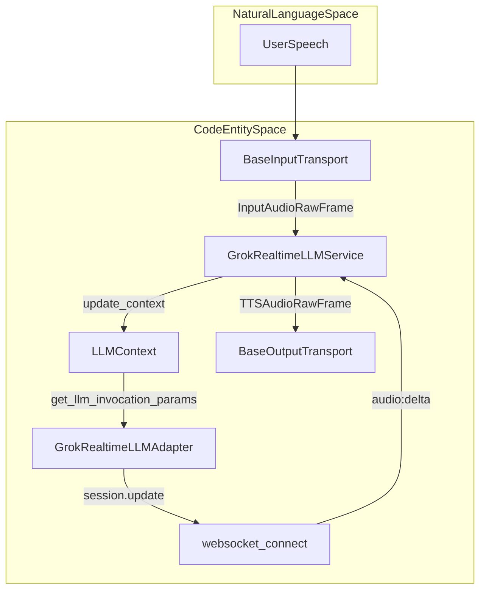
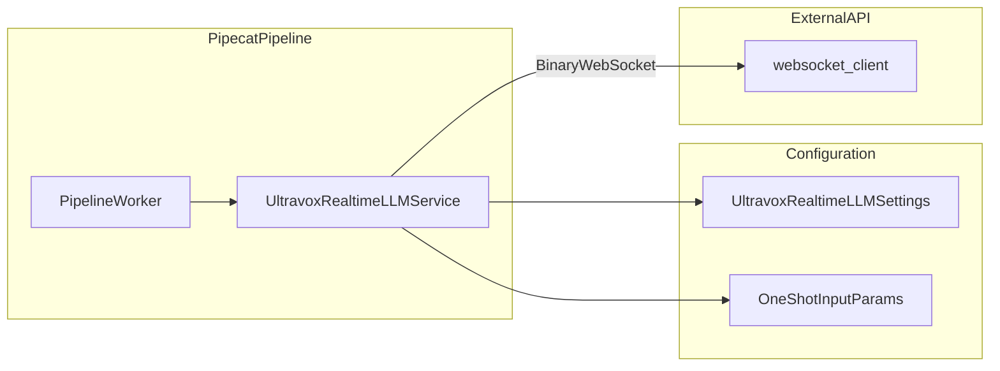
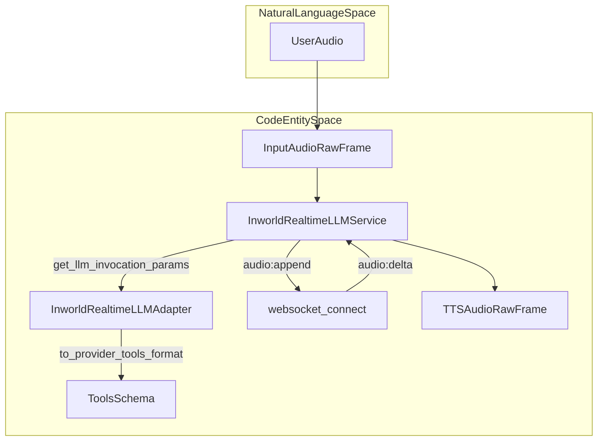

<!-- source: DeepWiki mcp.deepwiki.com · repo pipecat-ai/pipecat · extra page xAI Grok Realtime, Ultravox, and Inworld Realtime · fetched 2026-10-26 -->

# xAI Grok Realtime, Ultravox, and Inworld Realtime

Relevant source files

The following files were used as context for generating this wiki page:

- [examples/voice/voice-xai-http.py](examples/voice/voice-xai-http.py)
- [examples/voice/voice-xai.py](examples/voice/voice-xai.py)
- [pyrightconfig.json](pyrightconfig.json)
- [src/pipecat/services/aws/nova_sonic/llm.py](src/pipecat/services/aws/nova_sonic/llm.py)
- [src/pipecat/services/google/gemini_live/llm.py](src/pipecat/services/google/gemini_live/llm.py)
- [src/pipecat/services/heygen/client.py](src/pipecat/services/heygen/client.py)
- [src/pipecat/services/heygen/video.py](src/pipecat/services/heygen/video.py)
- [src/pipecat/services/inworld/realtime/events.py](src/pipecat/services/inworld/realtime/events.py)
- [src/pipecat/services/inworld/realtime/llm.py](src/pipecat/services/inworld/realtime/llm.py)
- [src/pipecat/services/openai/realtime/llm.py](src/pipecat/services/openai/realtime/llm.py)
- [src/pipecat/services/tavus/video.py](src/pipecat/services/tavus/video.py)
- [src/pipecat/services/ultravox/llm.py](src/pipecat/services/ultravox/llm.py)
- [src/pipecat/services/xai/__init__.py](src/pipecat/services/xai/__init__.py)
- [src/pipecat/services/xai/realtime/events.py](src/pipecat/services/xai/realtime/events.py)
- [src/pipecat/services/xai/realtime/llm.py](src/pipecat/services/xai/realtime/llm.py)
- [src/pipecat/services/xai/tts.py](src/pipecat/services/xai/tts.py)
- [src/pipecat/transports/heygen/transport.py](src/pipecat/transports/heygen/transport.py)
- [tests/test_inworld_realtime_context.py](tests/test_inworld_realtime_context.py)
- [tests/test_xai_realtime_voices.py](tests/test_xai_realtime_voices.py)
- [tests/test_xai_tts.py](tests/test_xai_tts.py)

This page documents the integration of xAI Grok Realtime, Ultravox, and Inworld Realtime within the Pipecat framework. These services provide low-latency, real-time speech-to-speech capabilities using WebSocket-based bidirectional streaming, bypassing traditional discrete STT/LLM/TTS pipeline delays.

---

## xAI Grok Realtime

The xAI Grok Realtime service provides a high-performance voice agent API. It supports built-in tools for web and social media searching, custom function calling, and server-side Voice Activity Detection (VAD).

### Namespace and Adapter

The `grok/realtime` namespace was deprecated and migrated to `xai/realtime` [src/pipecat/services/xai/realtime/llm.py:9-11](). Users should utilize `GrokRealtimeLLMService` from the `pipecat.services.xai.realtime.llm` module [src/pipecat/services/xai/realtime/llm.py:186-187]().

The service utilizes the `GrokRealtimeLLMAdapter` [src/pipecat/adapters/services/grok_realtime_adapter.py:41-46]() to handle conversion between Pipecat's universal `LLMContext` and the specific event schemas required by xAI.

### Implementation Details

`GrokRealtimeLLMService` [src/pipecat/services/xai/realtime/llm.py:186-187]() manages a persistent WebSocket connection for bidirectional audio and text. It uses typed settings (`GrokRealtimeLLMSettings`) [src/pipecat/services/xai/realtime/llm.py:93-104]() to maintain synchronization between high-level instructions and session-level properties.

#### Key Classes and Functions
- **`GrokRealtimeLLMService`**: The primary entry point for Grok's real-time capabilities [src/pipecat/services/xai/realtime/llm.py:186-187]().
- **`GrokRealtimeLLMAdapter`**: Handles internal `Frame` object translation into xAI-specific event schemas [src/pipecat/adapters/services/grok_realtime_adapter.py:41-46]().
- **`SessionProperties`**: Configuration model for the real-time session, including voice selection and tool toggles [src/pipecat/services/xai/realtime/events.py:1-50]().
- **`GrokRealtimeLLMSettings`**: Typed settings syncing `system_instruction` with session-level instructions [src/pipecat/services/xai/realtime/llm.py:93-104]().

### Built-in Tools

Grok Realtime features specialized built-in tools configured via `ToolsSchema`:
- **`web_search`**: Enables real-time web searches.
- **`x_search`**: Enables searching across X (formerly Twitter) for social data.

### Tool Result Serialization
Tool call results are serialized exactly once into the `conversation.item.create` or `response.create` event payload, preventing double-JSON encoding issues.

### Locally Driven Turns

While Grok supports server-side VAD, it can operate in a locally-driven turn mode by disabling server-side `turn_detection` and using local analyzers like `SileroVADAnalyzer`.

**Diagram: Grok Realtime Audio Pipeline (Natural Language to Code Entity Space)**

Sources: [src/pipecat/services/xai/realtime/llm.py:186-187](), [src/pipecat/processors/aggregators/llm_context.py:64-64](), [src/pipecat/adapters/services/grok_realtime_adapter.py:41-46]()

---

## Ultravox Realtime

Ultravox is an audio-native model integration supporting streaming voice-to-voice interactions without discrete STT/TTS pipeline stages.

### Integration Patterns

Ultravox supports initialization via `UltravoxRealtimeLLMService`. It processes audio features directly for reasoning and speech generation [src/pipecat/services/ultravox/llm.py:7-12]().

### Async Tool Result Handling

Ultravox freezes conversations between `client_tool_invocation` and `client_tool_result`. For functions registered with `cancel_on_interruption=False`, Pipecat ships a placeholder result (`_ASYNC_TOOL_STARTED_RESULT`) immediately to unfreeze the conversation [src/pipecat/services/ultravox/llm.py:69-73](). The real result is injected later using `_ASYNC_TOOL_FINAL_RESULT_TEMPLATE` [src/pipecat/services/ultravox/llm.py:78-78]().

### Service Teardown

WebSocket closing logic ensures that network resources and background tasks are cleanly released when the pipeline terminates.

**Diagram: Ultravox Entity Relationship**

Sources: [src/pipecat/services/ultravox/llm.py:87-96](), [src/pipecat/services/ultravox/llm.py:131-163](), [src/pipecat/services/ultravox/llm.py:25-27]()

---

## Inworld Realtime

Inworld Realtime provides a WebSocket-based real-time service designed for low-latency bidirectional communication with semantic VAD support [src/pipecat/services/inworld/realtime/llm.py:7-11]().

### Core Components
- **`InworldRealtimeLLMService`**: Manages WebSocket connections and coordinates frame processing [src/pipecat/services/inworld/realtime/llm.py:187-187]().
- **`InworldRealtimeLLMAdapter`**: Converts Pipecat universal context and tools into Inworld-specific event schemas [src/pipecat/adapters/services/inworld_realtime_adapter.py:28-28]().
- **`InworldRealtimeLLMSettings`**: Typed settings syncing `model`, `system_instruction`, and `temperature` with session properties [src/pipecat/services/inworld/realtime/llm.py:88-100]().

### Tool Result Serialization
Tool call results are transmitted directly without double-JSON encoding, ensuring payload integrity across all realtime providers.

### Locally Driven Turns

Inworld supports a locally-driven turn mode by disabling server-side turn detection and integrating with local VAD analyzers such as `SileroVADAnalyzer`.

**Diagram: Inworld Realtime Architecture (Natural Language to Code Entity Space)**

Sources: [src/pipecat/services/inworld/realtime/llm.py:187-187](), [src/pipecat/adapters/services/inworld_realtime_adapter.py:28-28](), [src/pipecat/services/inworld/realtime/llm.py:24-25]()

---

## Comparison of Real-Time Capabilities

| Feature | xAI Grok Realtime | Ultravox | Inworld Realtime |
| :--- | :--- | :--- | :--- |
| **Namespace** | `pipecat.services.xai.realtime` | `pipecat.services.ultravox` | `pipecat.services.inworld.realtime` |
| **VAD** | Server-side built-in | Server-side built-in | Semantic VAD (Server-side) |
| **Search Tools** | `web_search` & `x_search` | Custom Tools via Schema | Custom Tools via Schema |
| **Primary Class** | `GrokRealtimeLLMService` | `UltravoxRealtimeLLMService` | `InworldRealtimeLLMService` |
| **Adapter** | `GrokRealtimeLLMAdapter` | Internal implementation | `InworldRealtimeLLMAdapter` |
| **Audio Modality** | Native streaming | Audio-native model | Cascade (STT/LLM/TTS) |

Sources: [src/pipecat/services/xai/realtime/llm.py:186-187](), [src/pipecat/services/ultravox/llm.py:168-168](), [src/pipecat/services/inworld/realtime/llm.py:187-187]()

---

