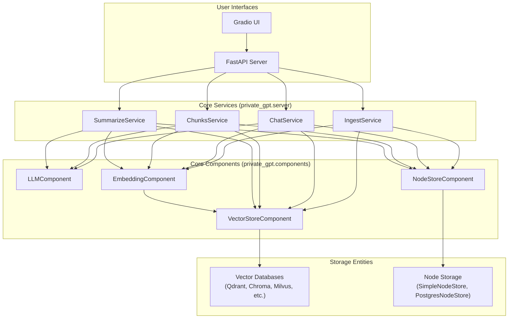
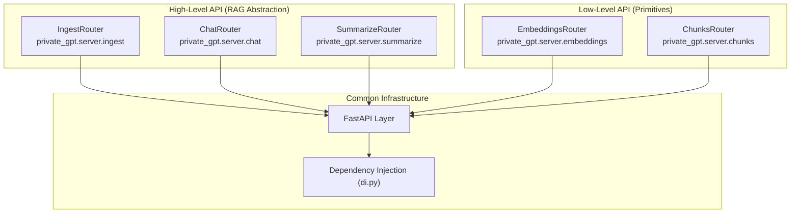

<!-- source: DeepWiki mcp.deepwiki.com · repo zylon-ai/private-gpt · page 1 Overview · fetched 2026-10-26 -->

# Overview

Relevant source files

The following files were used as context for generating this wiki page:

- [.github/release_please/.release-please-manifest.json](.github/release_please/.release-please-manifest.json)
- [CHANGELOG.md](CHANGELOG.md)
- [README.md](README.md)
- [fern/docs/assets/ui.png](fern/docs/assets/ui.png)
- [private_gpt/__init__.py](private_gpt/__init__.py)
- [tiktoken_cache/.gitignore](tiktoken_cache/.gitignore)
- [version.txt](version.txt)

PrivateGPT is a production-ready AI system that enables users to ask questions about their documents using the power of Large Language Models (LLMs), with complete privacy. All processing happens locally, ensuring that no data leaves the execution environment at any point [README.md:12-14]().

The project provides an API offering all the primitives required to build private, context-aware AI applications, following and extending the OpenAI API standard [README.md:21-23]().

## Purpose and Key Features

PrivateGPT addresses a critical concern in AI adoption: **privacy**. It allows organizations and individuals to leverage advanced AI capabilities while maintaining complete control over their data [README.md:48-51]().

Key features include:

| Feature | Description |
|---------|-------------|
| Document Ingestion | Internally managing document parsing, splitting, metadata extraction, embedding generation, and storage [README.md:29-30](). |
| Context-Aware Responses | Generate responses based on document content, abstracting retrieval and prompt engineering [README.md:31-32](). |
| Customizable LLM Support | Use local models (LlamaCPP, Ollama) or connect to cloud providers (OpenAI, Azure, Gemini, SageMaker) [README.md:104-106](), [CHANGELOG.md:35-37](). |
| Flexible Vector Stores | Support for Qdrant, Chroma, Milvus, Postgres/pgvector, and ClickHouse [CHANGELOG.md:39-40](). |
| Privacy-First Design | 100% private; no data leaves the execution environment [README.md:13-14](). |
| API-First Architecture | Built using FastAPI, following OpenAI's API scheme [README.md:83-84](). |
| User Interface | A working Gradio UI client is provided for testing [README.md:38-39](). |

For details, see [Key Features](#1.1).

Sources: [README.md:12-51](), [CHANGELOG.md:35-40]()

## System Architecture

PrivateGPT is an API that wraps a Retrieval Augmented Generation (RAG) pipeline based on **LlamaIndex** [README.md:81-85](). It utilizes a modular design with Dependency Injection to decouple components [README.md:89]().

### High-Level Architecture

Sources: [README.md:81-107](), [CHANGELOG.md:38-40]()

The architecture separates the API layer (routers and services) from the implementation layer (components):
- **Services**: Found in `private_gpt.server.<api>`, these use LlamaIndex base abstractions rather than specific implementations [README.md:97-101]().
- **Components**: Found in `private_gpt.components.<component>`, these provide the actual implementations (e.g., `LlamaCPP` for the `LLM` abstraction) [README.md:102-106]().

For details, see [System Architecture](#1.2).

## API and Service Structure

The system exposes both high-level and low-level APIs to cater to different integration needs.

- **High-level API**: Abstracts the complexity of the RAG pipeline, including ingestion and context-aware chat [README.md:27-32]().
- **Low-level API**: Allows implementation of custom pipelines by exposing embedding generation and contextual chunk retrieval [README.md:34-37]().

Sources: [README.md:25-38](), [README.md:97-101]()

## RAG Pipeline Logic

The core functionality follows the standard RAG lifecycle, managed through `LlamaIndex` abstractions:

1.  **Ingestion**: Documents are parsed, split into chunks, and transformed into embeddings via the `EmbeddingComponent`. These are stored in the `VectorStoreComponent` [README.md:29-30]().
2.  **Retrieval**: During chat or completion, the `ChunksService` retrieves the most relevant text chunks based on the query [README.md:36-37]().
3.  **Generation**: The `ChatService` uses the retrieved context and the `LLMComponent` to generate a response [README.md:31-32]().
4.  **Summarization**: A specialized `SummarizeService` utilizes `SummaryIndex` and `TREE_SUMMARIZE` modes to process documents [CHANGELOG.md:38]().

Sources: [README.md:27-37](), [README.md:85-91](), [CHANGELOG.md:38]()

## Configuration and Deployment

PrivateGPT is designed to be portable and highly configurable. It supports multiple LLM backends and vector stores through a YAML-based configuration system.

- **Environment Control**: Uses `PGPT_PROFILES` to load specific settings (e.g., `settings-ollama.yaml`, `settings-azopenai.yaml`) [CHANGELOG.md:35-37]().
- **Deployment**: Supports Docker via `docker-compose.yaml` with profiles for CPU (Ollama/LlamaCPP) and GPU (CUDA) [CHANGELOG.md:20-21]().
- **Offline Readiness**: Includes a `tiktoken_cache` within the repository to support environments without internet access [private_gpt/__init__.py:26-27]().

Sources: [private_gpt/__init__.py:26-27](), [CHANGELOG.md:20-21](), [CHANGELOG.md:35-37]()

---

