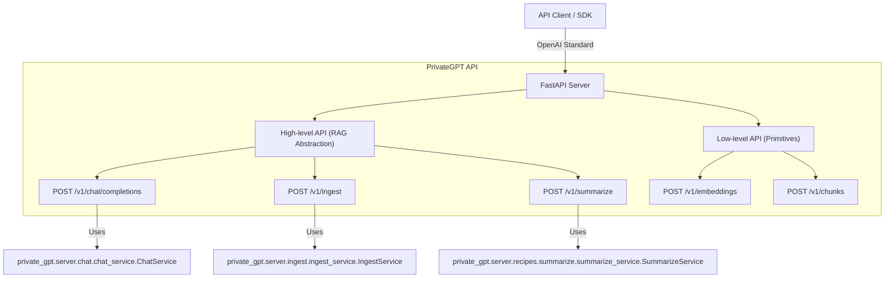
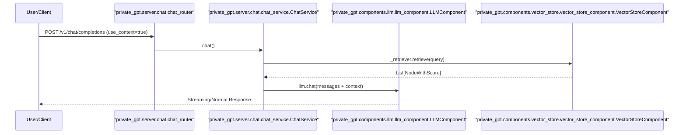

<!-- source: DeepWiki mcp.deepwiki.com · repo zylon-ai/private-gpt · page 1.1 Key Features · fetched 2026-10-26 -->

# Key Features

Relevant source files

The following files were used as context for generating this wiki page:

- [.github/release_please/.release-please-manifest.json](.github/release_please/.release-please-manifest.json)
- [CHANGELOG.md](CHANGELOG.md)
- [README.md](README.md)
- [fern/README.md](fern/README.md)
- [fern/docs/assets/ui.png](fern/docs/assets/ui.png)
- [fern/docs/pages/manual/ingestion.mdx](fern/docs/pages/manual/ingestion.mdx)
- [fern/docs/pages/overview/welcome.mdx](fern/docs/pages/overview/welcome.mdx)
- [settings-mock.yaml](settings-mock.yaml)
- [version.txt](version.txt)

This page details the main features and capabilities of PrivateGPT, a production-ready AI project that enables users to ask questions about their documents using Large Language Models (LLMs) while maintaining complete data privacy. It focuses on the technical aspects of what makes PrivateGPT unique and how these features work together.

For information about the overall system architecture, see [System Architecture](1.2).

## Privacy-First Design

PrivateGPT's primary feature is its ability to provide AI capabilities while ensuring complete data privacy:

- **100% private operation**: By default, no data leaves your execution environment at any point [README.md:12-14]().
- **Fully local execution**: Support for running LLMs and embedding models entirely offline, addressing privacy concerns in sensitive domains like healthcare or legal [README.md:47-52]().
- **Execution Environment**: Data remains under the user's control, making it suitable for regulated industries [README.md:17-19]().

Sources: [README.md:11-14](), [README.md:47-52]()

## API Structure

PrivateGPT provides a comprehensive API that follows and extends the OpenAI API standard [README.md:21-23](). The API is divided into high-level and low-level building blocks:

### API Architecture

Sources: [README.md:21-37](), [README.md:81-85](), [README.md:97-101]()

### High-Level API
The high-level API abstracts the complexity of a RAG (Retrieval Augmented Generation) pipeline [README.md:27-28]():
- **Ingestion of documents**: Manages document parsing, splitting, metadata extraction, embedding generation, and storage [README.md:29-30]().
- **Chat & Completions**: Abstracting retrieval of context, prompt engineering, and response generation [README.md:31-32]().

### Low-Level API
Allows advanced users to implement complex custom pipelines [README.md:34]():
- **Embeddings generation**: Based on a piece of text [README.md:35]().
- **Contextual chunks retrieval**: Returns the most relevant chunks of text from ingested documents given a query [README.md:36-37]().

## RAG Pipeline

PrivateGPT implements a sophisticated RAG pipeline based on `LlamaIndex` [README.md:85]().

### RAG Data Flow (Natural Language to Code Entities)

Sources: [README.md:81-95](), [README.md:97-101]()

## Model and Backend Flexibility

The architecture uses **Dependency Injection** to decouple the API from specific implementations [README.md:89]().

### Supported Backends

| Component | Supported Providers / Implementations |
|-----------|--------------------------------------|
| **LLM** | `llamacpp`, `ollama`, `openai`, `azopenai`, `sagemaker`, `gemini`, `mock` [README.md:105-106](), [CHANGELOG.md:19-35]() |
| **Embedding** | `huggingface`, `openai`, `ollama`, `mistralai`, `sagemaker`, `gemini` [CHANGELOG.md:35-59]() |
| **Vector Store** | `Qdrant`, `Chroma`, `Milvus`, `Postgres (pgvector)`, `ClickHouse` [CHANGELOG.md:39-40]() |

Sources: [README.md:102-106](), [CHANGELOG.md:19-40]()

## Document Processing & Ingestion

PrivateGPT supports a wide range of file formats and ingestion modes.

### Supported File Formats
Supports plain text (`.txt`, `.html`) and specialized formats:
- **Documents**: `.pdf`, `.docx`, `.pptx`, `.md`, `.epub`, `.json`, `.ipynb` [fern/docs/pages/manual/ingestion.mdx:107-125]()
- **Media (Transcription)**: `.mp3`, `.mp4`, `.jpg`, `.png` [fern/docs/pages/manual/ingestion.mdx:114-118]()

### Ingestion Modes
Configurable via `embedding.ingest_mode` [fern/docs/pages/manual/ingestion.mdx:74]():
- `simple`: Sequential ingestion [fern/docs/pages/manual/ingestion.mdx:70]().
- `batch`: Batched reading, parsing, and embedding [fern/docs/pages/manual/ingestion.mdx:71]().
- `parallel`: Parallelized processing (fastest for local setup) [fern/docs/pages/manual/ingestion.mdx:72]().
- `pipeline`: Alternative parallelized implementation [fern/docs/pages/manual/ingestion.mdx:73]().

Sources: [fern/docs/pages/manual/ingestion.mdx:69-74](), [fern/docs/pages/manual/ingestion.mdx:107-125]()

## Summarization Recipe

A specialized "Recipe" for document summarization is available via `POST /v1/summarize` [CHANGELOG.md:38]().
- **Implementation**: Uses `SummarizeService` and `SummaryIndex` [Wiki TOC:4.3]().
- **Modes**: Supports `TREE_SUMMARIZE` response mode for large documents [Wiki TOC:4.3]().

Sources: [CHANGELOG.md:38](), [Wiki TOC:4.3]()

## User Interface

PrivateGPT includes a built-in **Gradio UI** for testing and interaction [README.md:38-40]().
- **Features**: Chat interface, document upload, and context toggle [README.md:39-41]().
- **Light Mode**: Supported UI theme [CHANGELOG.md:50]().

Sources: [README.md:38-41](), [CHANGELOG.md:50](), [fern/docs/assets/ui.png:1-15]()

## Feature Summary

| Feature | Technical Implementation |
|---------|--------------------------|
| **Privacy** | Local LLM/Embedding execution (LlamaCPP/Ollama) |
| **RAG** | LlamaIndex integration with pluggable Vector Stores |
| **Compatibility** | OpenAI-compatible REST API (FastAPI) |
| **Ingestion** | Multi-modal support (Text, PDF, Audio, Images) |
| **Scaling** | Parallel ingestion workers & Batch processing |
| **Recipes** | Built-in Summarization service |

Sources: [README.md:11-41](), [fern/docs/pages/manual/ingestion.mdx:64-90]()

---

