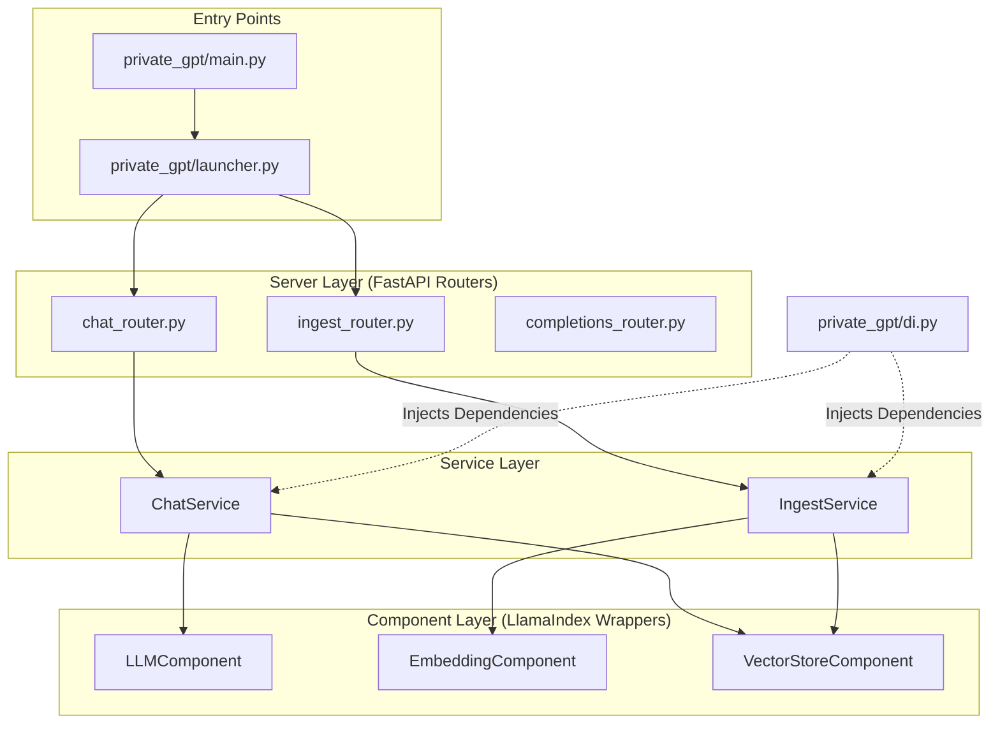
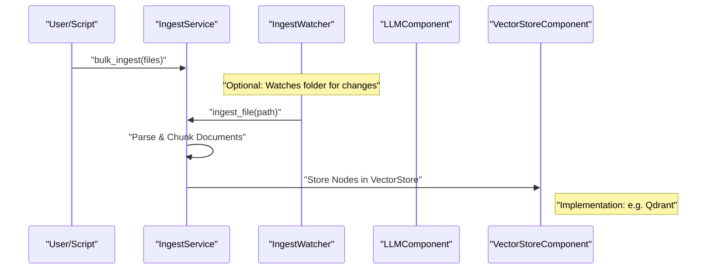

<!-- source: DeepWiki mcp.deepwiki.com · repo zylon-ai/private-gpt · page 1.2 System Architecture · fetched 2026-10-26 -->

# System Architecture

Relevant source files

The following files were used as context for generating this wiki page:

- [.github/workflows/actions/install_dependencies/action.yml](.github/workflows/actions/install_dependencies/action.yml)
- [README.md](README.md)
- [fern/docs/assets/ui.png](fern/docs/assets/ui.png)
- [private_gpt/__main__.py](private_gpt/__main__.py)
- [private_gpt/di.py](private_gpt/di.py)
- [private_gpt/launcher.py](private_gpt/launcher.py)
- [private_gpt/main.py](private_gpt/main.py)
- [private_gpt/paths.py](private_gpt/paths.py)
- [private_gpt/settings/settings_loader.py](private_gpt/settings/settings_loader.py)
- [scripts/ingest_folder.py](scripts/ingest_folder.py)
- [settings-ollama.yaml](settings-ollama.yaml)

This document provides a comprehensive overview of PrivateGPT's system architecture, explaining how its core components interact to provide privacy-focused, retrieval-augmented generation capabilities. It details the implementation of the FastAPI server, the dependency injection pattern, and the integration with LlamaIndex.

## Overview

PrivateGPT is designed as a modular, extensible system that allows users to query their documents using Large Language Models (LLMs) while ensuring data privacy. The architecture follows these key principles:

- **Modularity**: Components are decoupled using dependency injection via the `injector` library [private_gpt/di.py:1-9]().
- **Extensibility**: Usage of LlamaIndex base abstractions like `LLM`, `BaseEmbedding`, and `VectorStore` allows for immediate implementation swaps [README.md:89-91]().
- **Privacy**: 100% private execution environment where no data leaves the system [README.md:12-14]().
- **Compatibility**: The API follows and extends the OpenAI API standard [README.md:21-23]().

The system is divided into two logical blocks: a **High-level API** for RAG pipelines (ingestion, chat, completions) and a **Low-level API** for primitives (embeddings, contextual chunks retrieval) [README.md:25-37]().

## High-Level Architecture

The system is organized into three distinct layers: the **Server Layer** (FastAPI routers), the **Service Layer** (Business logic), and the **Component Layer** (LlamaIndex implementations).

Sources: [README.md:96-107](), [private_gpt/launcher.py:24-69](), [private_gpt/main.py:1-6]()

## Dependency Injection Pattern

PrivateGPT uses the `injector` library to manage component lifecycles and decoupling. A `global_injector` is initialized in `private_gpt/di.py` [private_gpt/di.py:19]().

- **Binding**: The `Settings` class is bound to the `unsafe_typed_settings` loaded from YAML files [private_gpt/di.py:6-9]().
- **Request Lifecycle**: In `launcher.py`, the injector is bound to the FastAPI request state, allowing routers to access services via `request.state.injector` [private_gpt/launcher.py:27-30]().
- **Service Access**: Services and components are retrieved from the injector rather than being instantiated directly, facilitating testing and configuration-based swaps [private_gpt/di.py:12-18]().

Sources: [private_gpt/di.py:1-20](), [private_gpt/launcher.py:24-30]()

## Component Interactions

### FastAPI Server and Routers
The application is created in `private_gpt/launcher.py` using `create_app(root_injector)`. It includes several specialized routers:
- `chat_router`: Handles conversational AI interactions [private_gpt/launcher.py:12]().
- `ingest_router`: Manages document uploads and processing [private_gpt/launcher.py:17]().
- `completions_router`: OpenAI-compatible text completion [private_gpt/launcher.py:14]().
- `summarize_router`: Document summarization recipes [private_gpt/launcher.py:18]().

### Service vs. Component Packages
- **Services** (`private_gpt/server/<api>/<api>_service.py`): Contain the core business logic. They use LlamaIndex base abstractions to remain decoupled from specific provider implementations [README.md:97-101]().
- **Components** (`private_gpt/components/<component>/`): Responsible for providing the actual implementation of LlamaIndex abstractions (e.g., `LLMComponent` providing `LlamaCPP` or `Ollama`) [README.md:102-106]().

## Data Flow: Document Ingestion

The ingestion process moves data from the "Natural Language Space" (raw files) into the "Code Entity Space" (Vector Store Nodes).

Sources: [scripts/ingest_folder.py:15-78](), [scripts/ingest_folder.py:119-135](), [README.md:29-30]()

## Configuration and Environment Profiles

The architecture is highly configurable through YAML files and environment variables.

| Entity | Description | Source |
| :--- | :--- | :--- |
| `PGPT_PROFILES` | Environment variable to select active profiles (e.g., `ollama`, `local`) | [private_gpt/settings/settings_loader.py:25]() |
| `Settings` | Pydantic-based settings model injected into components | [private_gpt/di.py:8]() |
| `settings-*.yaml` | Profile-specific configurations (e.g., `settings-ollama.yaml`) | [settings-ollama.yaml:1-31]() |

The `settings_loader.py` merges the `default` profile with any active profiles specified in `PGPT_PROFILES` [private_gpt/settings/settings_loader.py:50-57]().

## Implementation Details

### Server Entry Point
The server is typically started via `uvicorn`, running the `app` instance defined in `private_gpt/main.py` [private_gpt/__main__.py:5-11]().

### LlamaIndex Integration
PrivateGPT leverages LlamaIndex for its RAG pipeline. Key integrations include:
- **Callback Manager**: Configured in the launcher for observability [private_gpt/launcher.py:41-44]().
- **Storage Context**: Components like `VectorStoreComponent` manage the underlying LlamaIndex `StorageContext` to persist embeddings and document nodes.

### Local Ingestion Worker
For CLI-based ingestion, `scripts/ingest_folder.py` provides a `LocalIngestWorker` that interacts with the `IngestService` to process local directories [scripts/ingest_folder.py:15-21](). It includes a validation step to ensure folders are within allowed paths [scripts/ingest_folder.py:27-41]().

Sources: [private_gpt/launcher.py:41-44](), [scripts/ingest_folder.py:15-62](), [private_gpt/__main__.py:1-11]()

---

