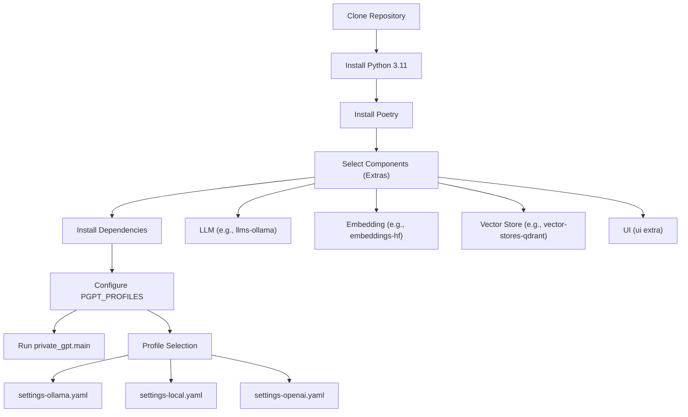
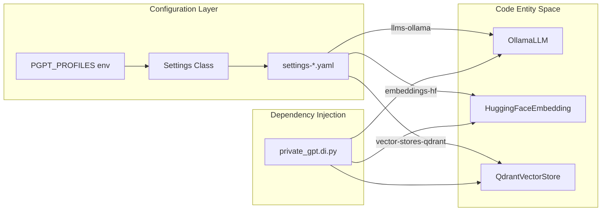

<!-- source: DeepWiki mcp.deepwiki.com · repo zylon-ai/private-gpt · page 2 Installation and Setup · fetched 2026-10-26 -->

# Installation and Setup

<details>
<summary>Relevant source files</summary>

The following files were used as context for generating this wiki page:

- [fern/docs/pages/installation/installation.mdx](fern/docs/pages/installation/installation.mdx)
- [fern/docs/pages/installation/troubleshooting.mdx](fern/docs/pages/installation/troubleshooting.mdx)
- [poetry.lock](poetry.lock)
- [pyproject.toml](pyproject.toml)

</details>


This document provides a comprehensive guide for installing and configuring PrivateGPT. It covers everything from basic requirements to running a fully functional system with your desired components. This page serves as a high-level overview; for detailed configuration logic, see [Configuration System](#2.1), and for containerized or production setups, see [Deployment Options](#2.2).

## System Requirements

Before installing PrivateGPT, ensure your system meets these requirements:

| Requirement | Specification |
|-------------|---------------|
| **Python Version** | 3.11 (earlier or later versions are not supported) [pyproject.toml:8]() |
| **Operating Systems** | Linux, macOS (Intel/Apple Silicon), Windows [fern/docs/pages/installation/installation.mdx:14-25]() |
| **Dependency Manager** | Poetry 1.8.3 (recommended) [fern/docs/pages/installation/installation.mdx:33]() |

Sources: [pyproject.toml:8](), [fern/docs/pages/installation/installation.mdx:12-34]()

## Installation Flow

PrivateGPT's installation involves several key steps, from repository setup to running the system with the appropriate components.



Sources: [fern/docs/pages/installation/installation.mdx:4-56](), [pyproject.toml:63-85]()

## Installation Steps

### 1. Clone the Repository
```bash
git clone https://github.com/zylon-ai/private-gpt
cd private-gpt
```

### 2. Install Python 3.11
It is recommended to use `pyenv` or `pyenv-win` to ensure the correct version is used [fern/docs/pages/installation/installation.mdx:12-25]().

### 3. Install Poetry
PrivateGPT uses Poetry for dependency management [pyproject.toml:1](). Ensure you are using version 1.8.3 to avoid known bugs in earlier versions [fern/docs/pages/installation/installation.mdx:33]().

### 4. Component Selection and Installation
PrivateGPT is modular. Use Poetry's `--extras` flag to install only the dependencies required for your chosen backend. Available extras are defined in `pyproject.toml` [pyproject.toml:63-85]().

```bash
# Example for a local Ollama setup with UI
poetry install --extras "ui llms-ollama embeddings-ollama vector-stores-qdrant"
```

Sources: [fern/docs/pages/installation/installation.mdx:5-56](), [pyproject.toml:63-85]()

## Component Selection

The system supports various providers for LLMs, Embeddings, and Vector Stores. These are mapped to specific `llama-index` integration libraries [pyproject.toml:21-40]().

### Available Modules

| Category | Options (Extras) |
|----------|------------------|
| **LLM** | `llms-ollama`, `llms-llama-cpp`, `llms-openai`, `llms-azopenai`, `llms-sagemaker`, `llms-gemini` |
| **Embeddings** | `embeddings-ollama`, `embeddings-huggingface`, `embeddings-openai`, `embeddings-sagemaker`, `embeddings-azopenai` |
| **Vector Store** | `vector-stores-qdrant`, `vector-stores-milvus`, `vector-stores-chroma`, `vector-stores-postgres`, `vector-stores-clickhouse` |
| **UI** | `ui` (Gradio-based) |

Sources: [pyproject.toml:63-85](), [fern/docs/pages/installation/installation.mdx:62-100]()

## System Architecture Bridge

The following diagram maps high-level installation choices to the internal `private_gpt` code entities and configuration files.



Sources: [pyproject.toml:21-40](), [fern/docs/pages/installation/installation.mdx:111-126]()

## Recommended Setups

### Local Setup with Ollama (Recommended)
This setup uses the Ollama service for both LLM and Embeddings, abstracting GPU complexity [fern/docs/pages/installation/installation.mdx:130-132]().

1. Install and run Ollama (`ollama serve`).
2. Pull models: `ollama pull llama3.1` and `ollama pull nomic-embed-text` [fern/docs/pages/installation/installation.mdx:150-151]().
3. Run PrivateGPT:
   ```bash
   PGPT_PROFILES=ollama make run
   ```

### Local Setup with LlamaCPP
Uses `llama-cpp-python` for direct GGUF model execution [pyproject.toml:22]().
1. Install extras: `poetry install --extras "ui llms-llama-cpp embeddings-huggingface vector-stores-qdrant"`.
2. Run setup script to download models: `poetry run python scripts/setup`.
3. Run: `PGPT_PROFILES=local make run`.

Sources: [fern/docs/pages/installation/installation.mdx:130-236](), [pyproject.toml:22-29]()

## Troubleshooting

### Embedding Dimensions Mismatch
This occurs when the `embedding.embed_dim` in settings does not match the output of the selected model [fern/docs/pages/installation/troubleshooting.mdx:34-38](). For example, `nomic-embed-text` requires 768 dimensions [fern/docs/pages/installation/troubleshooting.mdx:37]().

### Gated Models
For models like Llama 3.1 on HuggingFace, you must provide an `access_token` in `settings.yaml` or via the `HF_TOKEN` environment variable [fern/docs/pages/installation/troubleshooting.mdx:8-17]().

### GPU Support for LlamaCPP
On Windows or Linux with NVIDIA GPUs, you may need to force a reinstall of `llama-cpp-python` with CUDA flags:
```bash
CMAKE_ARGS="-DLLAMA_CUBLAS=on" poetry run pip install --force-reinstall --no-cache-dir llama-cpp-python
```

Sources: [fern/docs/pages/installation/troubleshooting.mdx:1-64](), [fern/docs/pages/installation/installation.mdx:272-300]()

## Next Steps

For a deeper dive into how PrivateGPT manages these configurations and deployments, refer to the child pages:
- For YAML structure and Pydantic models, see [Configuration System](#2.1).
- For Docker and production deployment details, see [Deployment Options](#2.2).

---

