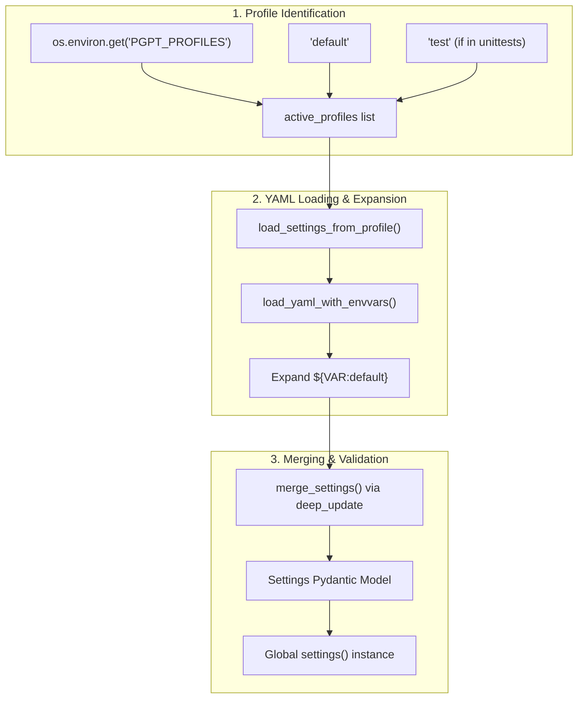
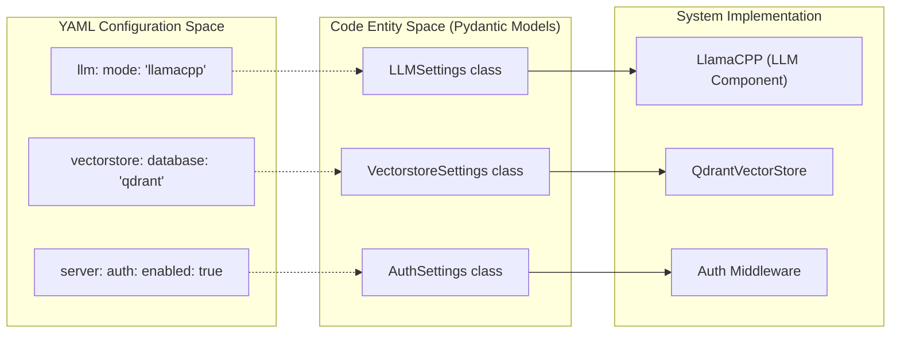
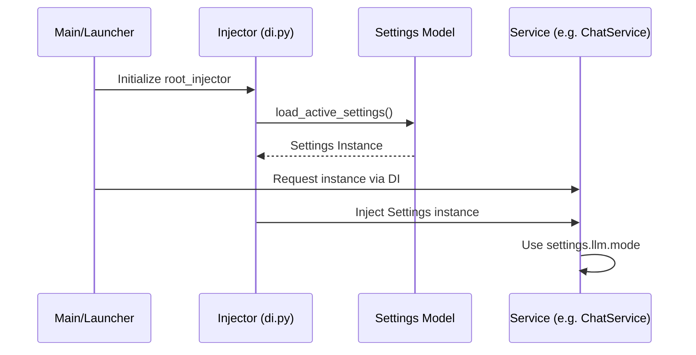

<!-- source: DeepWiki mcp.deepwiki.com · repo zylon-ai/private-gpt · page 2.1 Configuration System · fetched 2026-10-26 -->

# Configuration System

<details>
<summary>Relevant source files</summary>

The following files were used as context for generating this wiki page:

- [.github/workflows/actions/install_dependencies/action.yml](.github/workflows/actions/install_dependencies/action.yml)
- [private_gpt/__main__.py](private_gpt/__main__.py)
- [private_gpt/di.py](private_gpt/di.py)
- [private_gpt/launcher.py](private_gpt/launcher.py)
- [private_gpt/paths.py](private_gpt/paths.py)
- [private_gpt/settings/settings.py](private_gpt/settings/settings.py)
- [private_gpt/settings/settings_loader.py](private_gpt/settings/settings_loader.py)
- [private_gpt/settings/yaml.py](private_gpt/settings/yaml.py)
- [settings-azopenai.yaml](settings-azopenai.yaml)
- [settings-docker.yaml](settings-docker.yaml)
- [settings-gemini.yaml](settings-gemini.yaml)
- [settings-local.yaml](settings-local.yaml)
- [settings-ollama-pg.yaml](settings-ollama-pg.yaml)
- [settings-ollama.yaml](settings-ollama.yaml)
- [settings-openai.yaml](settings-openai.yaml)
- [settings-vllm.yaml](settings-vllm.yaml)
- [settings.yaml](settings.yaml)
- [tests/settings/test_settings_loader.py](tests/settings/test_settings_loader.py)

</details>


The configuration system in PrivateGPT is a robust, YAML-based framework built on Pydantic models. It manages the application's behavior, including LLM and embedding provider selection, vector store connectivity, and server parameters. It supports hierarchical profile merging and environment variable expansion.

## 1. Configuration Architecture and Data Flow

PrivateGPT uses a multi-layered approach to load settings. The system starts with a base configuration and layers profile-specific overrides and environment variables on top.

### 1.1 Settings Loading Process
The loading logic resides in `private_gpt/settings/settings_loader.py`. It identifies active profiles from the `PGPT_PROFILES` environment variable and merges their corresponding YAML files.


Sources:
- [private_gpt/settings/settings_loader.py:16-57]()
- [private_gpt/settings/yaml.py:1-45]()

## 2. Core Configuration Components

The system is defined by a root `Settings` class that aggregates several specialized Pydantic models. This ensures type safety and validation across the entire application.

### 2.1 Key Settings Models

| Model Class | Role | Key Attributes |
|:---|:---|:---|
| `ServerSettings` | FastAPI server config | `port`, `cors`, `auth` |
| `LLMSettings` | LLM behavior | `mode`, `max_new_tokens`, `prompt_style` |
| `EmbeddingSettings` | Embedding behavior | `mode`, `ingest_mode`, `embed_dim` |
| `VectorstoreSettings`| Vector DB selection | `database` (chroma, qdrant, etc.) |
| `DataSettings` | Storage paths | `local_data_folder` |

Sources:
- [private_gpt/settings/settings.py:83-157]()
- [private_gpt/settings/settings.py:97-106]()

### 2.2 Natural Language to Code Entity Mapping
The following diagram bridges the configuration concepts (YAML keys) to the internal Python classes and the LlamaIndex entities they initialize.


Sources:
- [private_gpt/settings/settings.py:108-118]()
- [private_gpt/settings/settings.py:155-157]()
- [private_gpt/settings/settings.py:45-60]()

## 3. Profile Management

Profiles allow environment-specific overrides (e.g., `local`, `docker`, `ollama`).

### 3.1 Profile Precedence
Settings are merged in the order they appear in the `PGPT_PROFILES` variable. The `default` profile (`settings.yaml`) is always loaded first.

1.  **`settings.yaml`**: Base defaults. [settings.yaml:1-153]()
2.  **`settings-{profile}.yaml`**: Overrides specific to the profile. [private_gpt/settings/settings_loader.py:36-47]()
3.  **Environment Variables**: Variables defined within YAML using `${VAR}` syntax. [private_gpt/settings/yaml.py:17-30]()

### 3.2 Common Profiles

| Profile | File | Use Case |
|:---|:---|:---|
| `local` | `settings-local.yaml` | Default local development with LlamaCPP. [settings-local.yaml:1-28]() |
| `docker` | `settings-docker.yaml` | Optimized for containerized environments. [settings-docker.yaml:1-38]() |
| `ollama` | `settings-ollama.yaml` | Configuration for Ollama-managed models. [settings-ollama.yaml:1-31]() |
| `vllm` | `settings-vllm.yaml` | OpenAI-like integration for vLLM backends. [settings-vllm.yaml:1-21]() |

## 4. Injection and Usage

The configuration is integrated into the application using a Dependency Injection (DI) pattern via the `injector` library.

### 4.1 Dependency Injection Flow
The `root_injector` provides the `Settings` singleton to services and routers.


Sources:
- [private_gpt/launcher.py:24-45]()
- [private_gpt/main.py:1-11]()
- [private_gpt/__main__.py:11-11]()

### 4.2 Application Integration
In `private_gpt/launcher.py`, settings are used to conditionally enable features like CORS and the Gradio UI:

*   **CORS**: Configured in `create_app` using `settings.server.cors`. [private_gpt/launcher.py:46-55]()
*   **UI**: Mounted if `settings.ui.enabled` is true. [private_gpt/launcher.py:57-67]()

## 5. Environment Variable Expansion

The system supports dynamic value substitution in YAML files using a custom loader in `private_gpt/settings/yaml.py`.

*   **Syntax**: `${ENV_VAR_NAME:default_value}`
*   **Implementation**: Uses a regex `pattern = re.compile(r"\$\{(\w+)(?::([^}]*))?\}")` to find and replace tokens with values from `os.environ`. [private_gpt/settings/yaml.py:17-30]()

Example from `settings.yaml`:
```yaml
server:
  env_name: ${APP_ENV:prod}
  port: ${PORT:8001}
```
Sources:
- [settings.yaml:5-6]()
- [private_gpt/settings/yaml.py:12-45]()

---

