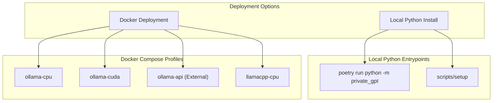
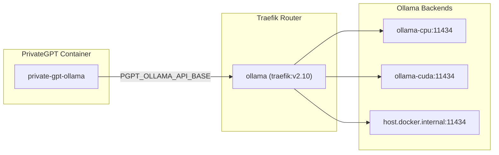
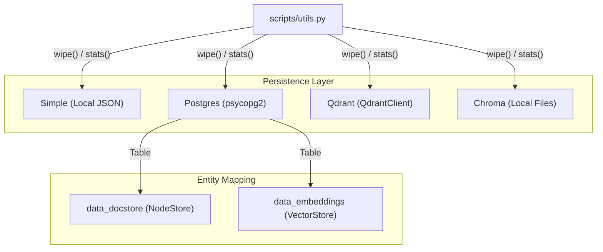

<!-- source: DeepWiki mcp.deepwiki.com · repo zylon-ai/private-gpt · page 2.2 Deployment Options · fetched 2026-10-26 -->

# Deployment Options

<details>
<summary>Relevant source files</summary>

The following files were used as context for generating this wiki page:

- [.docker/router.yml](.docker/router.yml)
- [.github/workflows/generate-release.yml](.github/workflows/generate-release.yml)
- [Dockerfile.llamacpp-cpu](Dockerfile.llamacpp-cpu)
- [Dockerfile.ollama](Dockerfile.ollama)
- [Makefile](Makefile)
- [docker-compose.yaml](docker-compose.yaml)
- [fern/docs/pages/api-reference/api-reference.mdx](fern/docs/pages/api-reference/api-reference.mdx)
- [fern/docs/pages/quickstart/quickstart.mdx](fern/docs/pages/quickstart/quickstart.mdx)
- [scripts/setup](scripts/setup)
- [scripts/utils.py](scripts/utils.py)

</details>


This document details the various deployment methods available for PrivateGPT, explaining how to set up and run the system in different environments. For information about configuring PrivateGPT once deployed, see [Configuration System](2.1).

## Deployment Methods Overview

PrivateGPT offers two primary deployment methods:

1.  **Local Python Installation** - Running directly on your machine using Python and Poetry.
2.  **Docker-based Deployment** - Running in containers using Docker and Docker Compose with specific hardware profiles.



Sources: [docker-compose.yaml:1-116](), [fern/docs/pages/quickstart/quickstart.mdx:1-84]()

## Local Python Installation

The local Python installation provides the most flexibility for development and customization.

### Prerequisites

*   Python 3.11+
*   Poetry 1.8.3+
*   Sufficient hardware resources for your chosen LLM and embedding models.

### Installation and Setup

1.  Clone the PrivateGPT repository.
2.  Install dependencies with extras based on your needs:
    ```bash
    poetry install --extras "ui llms-llama-cpp vector-stores-qdrant embeddings-huggingface"
    ```
3.  **Model Setup**: Run the setup script to download required models from Hugging Face:
    ```bash
    make setup
    ```
    This executes `scripts/setup`, which uses `hf_hub_download` and `snapshot_download` to populate the `models/` directory [scripts/setup:20-53]().

### Running Locally

After installation, run PrivateGPT with:
```bash
make run
```
Or for development with hot-reload:
```bash
make dev
```
The `dev` command sets `PGPT_PROFILES=local` and uses `uvicorn` to launch the application [Makefile:35-43]().

Sources: [Makefile:35-79](), [scripts/setup:1-53](), [fern/docs/pages/quickstart/quickstart.mdx:6-15]()

## Docker Deployment

Docker deployment simplifies setup and ensures consistent environments. It utilizes Docker Compose profiles to manage different hardware backends.

### Docker Compose Profiles

The `docker-compose.yaml` defines several profiles [docker-compose.yaml:26-30]():

| Profile | Description | Hardware | Image/Dockerfile |
| :--- | :--- | :--- | :--- |
| `ollama-cpu` | Ollama backend on CPU | CPU | `Dockerfile.ollama` |
| `ollama-cuda` | Ollama backend with GPU | NVIDIA GPU | `Dockerfile.ollama` |
| `ollama-api` | Uses Ollama on host (MacOS) | CPU/Metal | `Dockerfile.ollama` |
| `llamacpp-cpu` | Local LlamaCPP on CPU | CPU | `Dockerfile.llamacpp-cpu` |

### Traefik Router Setup

For Ollama-based profiles, PrivateGPT uses a Traefik reverse proxy to route requests between different Ollama instances (CPU, CUDA, or Host) [docker-compose.yaml:62-81]().

**Traefik Configuration (`.docker/router.yml`):**
The router defines a load balancer that checks health and routes to the appropriate Ollama service [ .docker/router.yml:1-16]().



Sources: [docker-compose.yaml:60-89](), [.docker/router.yml:1-16]()

## Docker Architecture and Data Flow

### Ollama-based Deployment
The `private-gpt-ollama` service is configured via environment variables to communicate with the Ollama API [docker-compose.yaml:19-24]().

*   **Dockerfile**: `Dockerfile.ollama` installs `llms-ollama` and `embeddings-ollama` extras [Dockerfile.ollama:17-18]().
*   **Data Persistence**: Local data is mounted to `/home/worker/app/local_data` [docker-compose.yaml:15-16]().

### LlamaCPP-based Deployment
The `private-gpt-llamacpp-cpu` service runs everything locally within the container.

*   **Dockerfile**: `Dockerfile.llamacpp-cpu` includes build essentials for `llama-cpp-python` [Dockerfile.llamacpp-cpu:12-18]().
*   **Entrypoint**: It runs `scripts/setup` followed by the `private_gpt` module [docker-compose.yaml:46]().
*   **Volumes**: Mounts both `./local_data` and `./models` [docker-compose.yaml:43-45]().

### Data Persistence and Management

PrivateGPT provides utility scripts to manage persisted data, accessible via `Makefile`:

*   **Wipe Data**: `make wipe` calls `scripts/utils.py` to clear the vector store and node store [Makefile:57-58]().
*   **Storage Stats**: `make stats` provides row counts and sizes for the configured database (Postgres, Qdrant, Chroma, or Simple) [scripts/utils.py:148-176]().



Sources: [scripts/utils.py:39-176](), [Makefile:51-61]()

## CI/CD and Release Management

Docker images are automatically built and pushed to Docker Hub via GitHub Actions when a release is published [ .github/workflows/generate-release.yml:1-5]().

*   **Matrix Strategy**: Builds both `llamacpp-cpu` and `ollama` types [ .github/workflows/generate-release.yml:18-20]().
*   **Tagging**: Images are tagged with semantic versions (e.g., `0.6.2-ollama`) and `latest` for the default type [ .github/workflows/generate-release.yml:56-80]().

Sources: [.github/workflows/generate-release.yml:1-83]()

---

