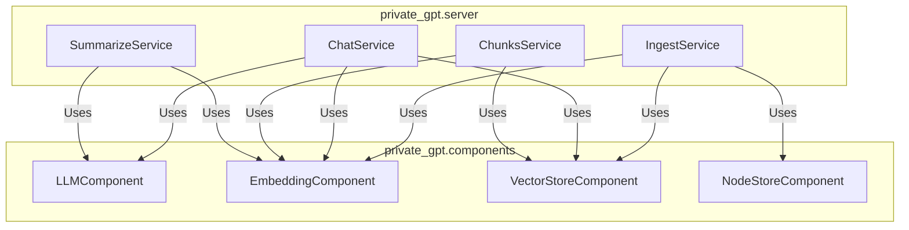
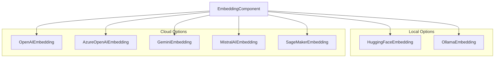
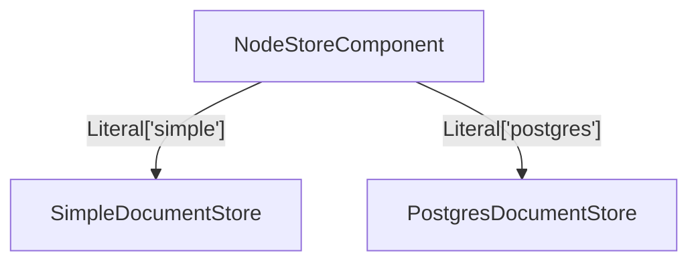
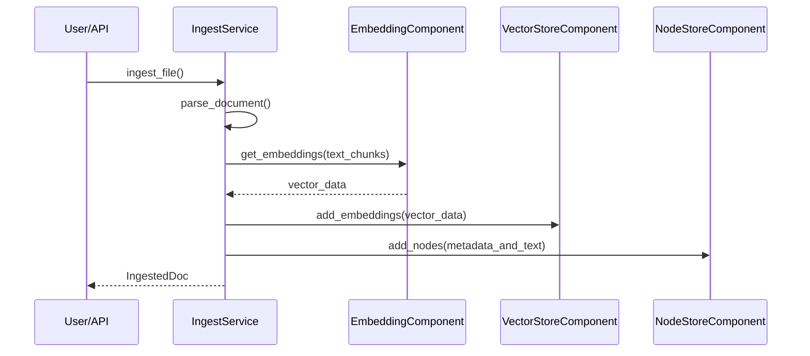

<!-- source: DeepWiki mcp.deepwiki.com · repo zylon-ai/private-gpt · page 3 Core Components · fetched 2026-10-26 -->

# Core Components

Relevant source files

The following files were used as context for generating this wiki page:

- [README.md](README.md)
- [fern/docs/assets/ui.png](fern/docs/assets/ui.png)
- [private_gpt/components/__init__.py](private_gpt/components/__init__.py)

This page provides an overview of the core components that make up PrivateGPT's architecture. These components are the fundamental building blocks that enable the RAG (Retrieval Augmented Generation) pipeline and other essential services within the system.

For information about how these components are configured, see [Configuration System](#2.1). For details on how these components are used by various services, see [Services](#4).

## Overview of Component Architecture

PrivateGPT is built using a modular architecture with several core components that work together to provide powerful AI capabilities. The system follows a dependency injection pattern, where components are abstracted behind interfaces, allowing for flexible implementation swapping based on configuration.

### Component Relationship Diagram

The following diagram bridges the high-level services to the underlying component implementations.

Sources: [README.md:81-107](), [private_gpt/components/__init__.py:1-1]()

The core components are instantiated based on configuration settings and made available to services through dependency injection. This architecture enables flexibility, allowing users to choose the specific implementations that best suit their needs.

## LLM Component

The LLM (Large Language Model) Component is responsible for text generation based on prompts. It abstracts the details of various LLM implementations behind a consistent interface, allowing the rest of the system to interact with different language models using the same API.

### Supported LLM Backends

The LLM Component supports multiple backends for both local and cloud-based inference:

| Backend | Description |
|---------|-------------|
| `llamacpp` | Local inference using Llama.cpp for GGUF models |
| `ollama` | Local inference via an Ollama server instance |
| `openai` | Cloud inference using OpenAI's API |
| `azopenai` | Cloud inference using Azure OpenAI Service |
| `sagemaker` | Cloud inference using AWS SageMaker endpoints |
| `gemini` | Cloud inference using Google Gemini API |
| `mock` | Mock backend for testing purposes |

For details, see [LLM Component](#3.1).

Sources: [private_gpt/settings/settings.py:108-152](), [private_gpt/settings/settings.py:163-335]()

## Embedding Component

The Embedding Component generates vector embeddings from text, which are crucial for semantic search in the RAG pipeline. Like the LLM Component, it provides a common interface that abstracts different embedding model implementations.

### Supported Embedding Backends

The Embedding Component supports various backends:

For details, see [Embedding Component](#3.2).

Sources: [private_gpt/settings/settings.py:198-238](), [private_gpt/settings/settings.py:184-196]()

## Vector Store Component

The Vector Store Component stores and retrieves vector embeddings, providing the database functionality needed for semantic search in the RAG pipeline. It supports multiple vector database backends to meet different scaling and deployment needs.

### Supported Vector Store Backends

PrivateGPT supports the following vector stores as defined in the configuration:

| Database | Settings Class |
|----------|----------------|
| `qdrant` | `QdrantSettings` |
| `chroma` | `ChromaSettings` |
| `postgres` | `PostgresSettings` |
| `milvus` | `MilvusSettings` |
| `clickhouse` | `ClickHouseSettings` |

For details, see [Vector Store Component](#3.3).

Sources: [private_gpt/settings/settings.py:155-156](), [private_gpt/settings/settings.py:515-587]()

## Node Store Component

The Node Store Component stores metadata and original text for document chunks (nodes). While vector stores handle the embeddings for semantic search, the node store preserves the actual content needed to build the context for the LLM.

### Supported Node Store Backends

Sources: [private_gpt/settings/settings.py:159-160](), [private_gpt/settings/settings.py:489-513]()

## Component Interactions in the RAG Pipeline

The core components work together in the RAG pipeline. The interaction between the "Code Entity Space" and the functional "Natural Language Space" is visualized below.

Sources: [README.md:81-107](), [private_gpt/settings/settings.py:184-196]()

This design allows for easy swapping of component implementations without changing the rest of the codebase, making PrivateGPT highly adaptable to different deployment environments and requirements.

---

