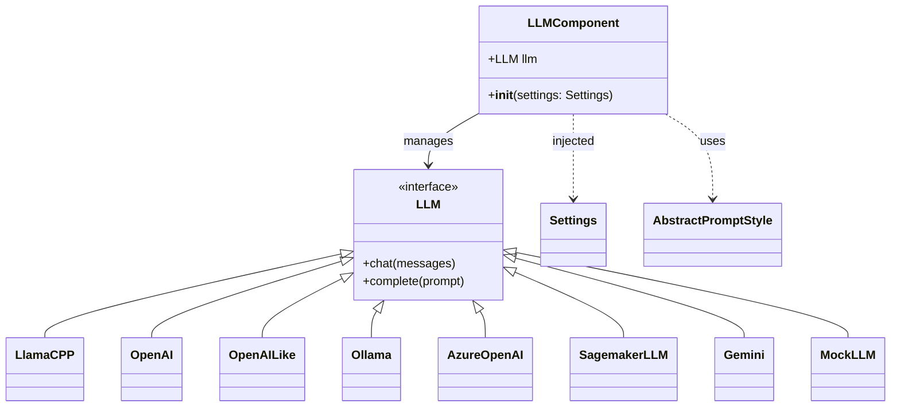
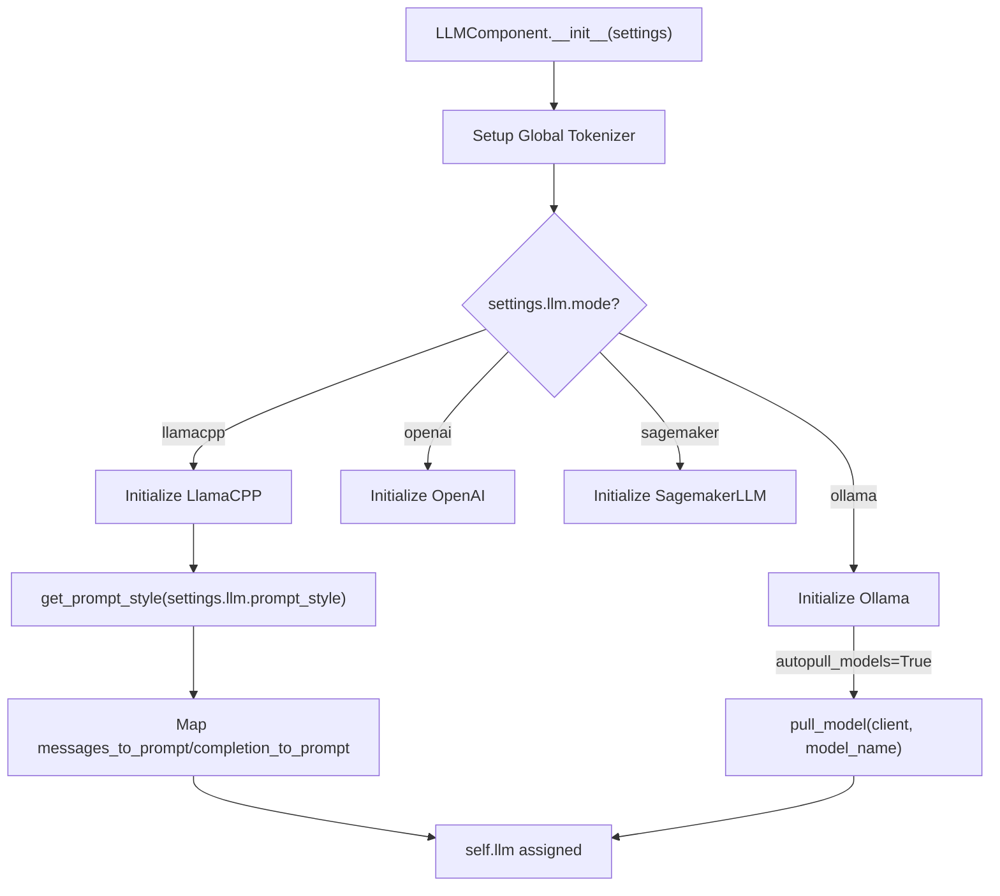
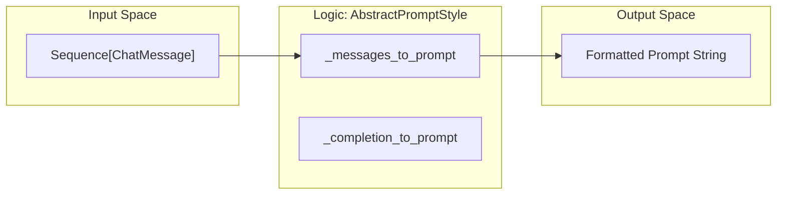

<!-- source: DeepWiki mcp.deepwiki.com · repo zylon-ai/private-gpt · page 3.1 LLM Component · fetched 2026-10-26 -->

# LLM Component

Relevant source files

The following files were used as context for generating this wiki page:

- [fern/docs/pages/manual/llms.mdx](fern/docs/pages/manual/llms.mdx)
- [private_gpt/components/embedding/custom/__init__.py](private_gpt/components/embedding/custom/__init__.py)
- [private_gpt/components/embedding/custom/sagemaker.py](private_gpt/components/embedding/custom/sagemaker.py)
- [private_gpt/components/llm/custom/sagemaker.py](private_gpt/components/llm/custom/sagemaker.py)
- [private_gpt/components/llm/llm_component.py](private_gpt/components/llm/llm_component.py)
- [private_gpt/components/llm/prompt_helper.py](private_gpt/components/llm/prompt_helper.py)
- [private_gpt/utils/ollama.py](private_gpt/utils/ollama.py)
- [private_gpt/utils/retry.py](private_gpt/utils/retry.py)
- [settings-sagemaker.yaml](settings-sagemaker.yaml)
- [tests/test_prompt_helper.py](tests/test_prompt_helper.py)

The LLM Component is a core subsystem of PrivateGPT responsible for initializing, configuring, and interacting with various Language Model providers. It abstracts the differences between local and cloud-based LLM implementations, providing a unified interface for the rest of the system. This component supports multiple LLM backends including local models (Llama.cpp, Ollama) and cloud services (OpenAI, Azure OpenAI, Google Gemini, AWS Sagemaker).

Sources: [private_gpt/components/llm/llm_component.py:18-22]()

## Component Architecture

The LLM Component is implemented as a singleton class that initializes the appropriate LLM implementation based on configuration settings. It leverages the `injector` library for dependency management.

### LLM Implementation Hierarchy

The component uses dependency injection to receive the application `Settings` and initializes the appropriate LLM implementation. It also handles global tokenizer setup and prompt formatting logic.

Sources: [private_gpt/components/llm/llm_component.py:18-44](), [private_gpt/components/llm/llm_component.py:22-23]()

## Initialization Process

The initialization process for the `LLMComponent` follows these steps:

1. **Tokenizer Setup**: If a tokenizer is specified in `settings.llm.tokenizer`, it attempts to load it via `transformers.AutoTokenizer`. This is set globally using `set_global_tokenizer` for more accurate token counting across the LlamaIndex pipeline.
2. **Mode Selection**: It evaluates `settings.llm.mode` to branch into specific provider logic.
3. **Provider Configuration**: Each mode (e.g., `llamacpp`, `ollama`) imports its respective LlamaIndex LLM class and passes parameters like `temperature`, `max_new_tokens`, and `context_window`.
4. **Prompt Style Injection**: For models that require manual prompt templating (like local models), it fetches a `prompt_style` and maps its `messages_to_prompt` and `completion_to_prompt` methods to the LLM instance.

### Data Flow Diagram

Sources: [private_gpt/components/llm/llm_component.py:24-44](), [private_gpt/components/llm/llm_component.py:45-76](), [private_gpt/components/llm/llm_component.py:129-191]()

## Supported LLM Modes

The LLM Component supports multiple LLM backends through different modes:

| Mode | Provider Class | Key Features |
|------|----------------|--------------|
| `llamacpp` | `LlamaCPP` | Full local execution, GGUF support, GPU acceleration |
| `ollama` | `Ollama` | External service interaction, automatic model pulling |
| `openai` | `OpenAI` | Standard OpenAI API integration |
| `openailike` | `OpenAILike` | Compatible with LocalAI, vLLM, or other OpenAI-spec servers |
| `azopenai` | `AzureOpenAI` | Enterprise Azure OpenAI service |
| `sagemaker` | `SagemakerLLM` | Custom implementation for AWS SageMaker endpoints |
| `gemini` | `Gemini` | Google's Generative AI models |
| `mock` | `MockLLM` | Deterministic responses for testing |

Sources: [private_gpt/components/llm/llm_component.py:45-225]()

### Local Models and GPU Offloading

#### Llama.cpp
For `llamacpp`, PrivateGPT defaults to full GPU offloading. It sets `n_gpu_layers` to `-1` and `offload_kqv` to `True` within the `settings_kwargs` passed to the `LlamaCPP` constructor. It loads the model from `models_path / settings.llamacpp.llm_hf_model_file`.

Sources: [private_gpt/components/llm/llm_component.py:60-64]()

#### Ollama
The `ollama` mode supports automatic model pulling via `pull_model` if `ollama_settings.autopull_models` is enabled. It also configures `keep_alive` durations and connection retries.

Sources: [private_gpt/components/llm/llm_component.py:165-171](), [private_gpt/utils/ollama.py:85-91]()

### Custom Provider: SageMaker
PrivateGPT includes a custom `SagemakerLLM` implementation located in `private_gpt/components/llm/custom/sagemaker.py`. It uses `boto3` to invoke SageMaker endpoints and includes a `LineIterator` to handle streaming byte responses from TGI (Text Generation Inference) containers.

Sources: [private_gpt/components/llm/custom/sagemaker.py:39-98](), [private_gpt/components/llm/custom/sagemaker.py:99-115]()

## Prompt Styling

The `prompt_helper.py` module defines how standardized `ChatMessage` sequences are transformed into raw strings for models that do not handle chat templates natively.

### Prompt Style Logic

Available styles include:
* **Llama2**: Uses `[INST]` and `<<SYS>>` tags. [private_gpt/components/llm/prompt_helper.py:72-83]()
* **Llama3**: Uses `<|start_header_id|>` and `<|eot_id|>` tokens. [private_gpt/components/llm/prompt_helper.py:142-158]()
* **Tag**: A simple `<|system|>:`, `<|user|>:`, `<|assistant|>:` format. [private_gpt/components/llm/prompt_helper.py:218-223]()
* **Mistral**: Uses `<s>[INST]` formatting. [private_gpt/components/llm/prompt_helper.py:255-261]()
* **ChatML**: Standard `<|im_start|>` and `<|im_end|>` format. [private_gpt/components/llm/prompt_helper.py:284-289]()

Sources: [private_gpt/components/llm/prompt_helper.py:11-310](), [tests/test_prompt_helper.py:15-24]()

## Tokenizer Configuration

The LLM component attempts to load a HuggingFace tokenizer to improve the accuracy of token counting and context window management. If `settings.llm.tokenizer` is provided, it uses `AutoTokenizer.from_pretrained` and caches it in `models_cache_path`. If loading fails, it logs a warning and falls back to LlamaIndex's default tokenizer.

Sources: [private_gpt/components/llm/llm_component.py:25-42]()

## Configuration Options

Key settings from the `llm` and provider-specific sections of `settings.yaml`:

| Parameter | Description |
|-----------|-------------|
| `llm.mode` | Choice of provider (e.g., `openai`, `llamacpp`). |
| `llm.max_new_tokens` | The number of tokens the LLM will generate. [fern/docs/pages/manual/llms.mdx:39]() |
| `llm.context_window` | Total tokens allowed (input + output). |
| `llamacpp.llm_hf_model_file` | The `.gguf` filename in the `models/` folder. [private_gpt/components/llm/llm_component.py:64]() |
| `ollama.autopull_models` | Whether to pull missing models from Ollama library. [private_gpt/components/llm/llm_component.py:165]() |

Sources: [private_gpt/components/llm/llm_component.py:55-62](), [fern/docs/pages/manual/llms.mdx:34-47]()

---

