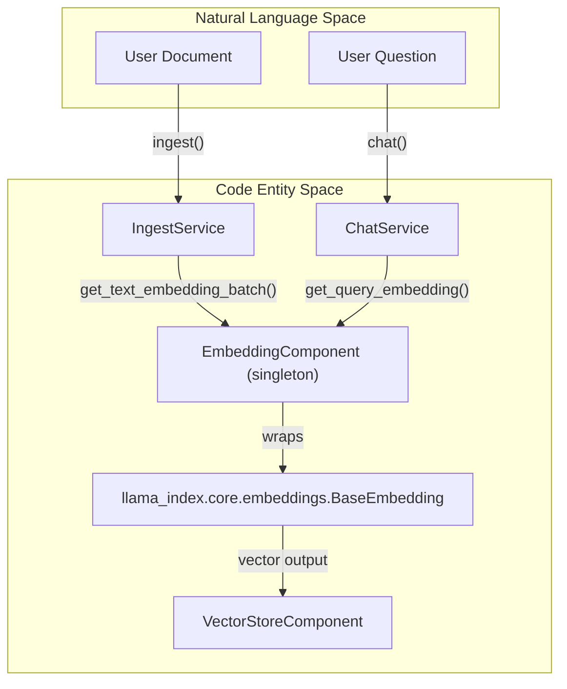
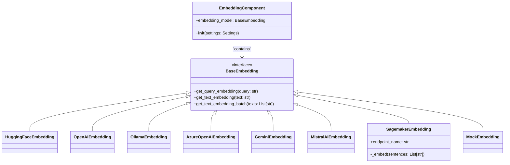

<!-- source: DeepWiki mcp.deepwiki.com · repo zylon-ai/private-gpt · page 3.2 Embedding Component · fetched 2026-10-26 -->

# Embedding Component

<details>
<summary>Relevant source files</summary>

The following files were used as context for generating this wiki page:

- [private_gpt/components/embedding/__init__.py](private_gpt/components/embedding/__init__.py)
- [private_gpt/components/embedding/custom/__init__.py](private_gpt/components/embedding/custom/__init__.py)
- [private_gpt/components/embedding/custom/sagemaker.py](private_gpt/components/embedding/custom/sagemaker.py)
- [private_gpt/components/embedding/embedding_component.py](private_gpt/components/embedding/embedding_component.py)
- [private_gpt/components/llm/custom/sagemaker.py](private_gpt/components/llm/custom/sagemaker.py)
- [settings-sagemaker.yaml](settings-sagemaker.yaml)

</details>


The Embedding Component is responsible for converting text into vector representations (embeddings) that capture semantic meaning. These embeddings are fundamental to the retrieval augmented generation (RAG) functionality, enabling semantic search and relevant document retrieval by representing text in a high-dimensional vector space.

## Purpose and Role

The Embedding Component serves as a critical bridge between textual data and vector representations by:

1.  Converting document chunks into vector embeddings during ingestion.
2.  Transforming user queries into embeddings for semantic search.
3.  Providing a unified interface to multiple embedding providers (local and cloud-based).

### Data Flow: Natural Language to Vector Space

This diagram illustrates how natural language entities are transformed into code entities and processed by the system.



Sources: [private_gpt/components/embedding/embedding_component.py:12-14](), [private_gpt/components/embedding/custom/sagemaker.py:10-10]()

## Architecture

The `EmbeddingComponent` is implemented as a singleton class that encapsulates various embedding model implementations through a common interface provided by LlamaIndex.

### Class Hierarchy and Providers

The component uses dependency injection to provide a consistent `embedding_model` attribute of type `BaseEmbedding`.



Sources: [private_gpt/components/embedding/embedding_component.py:13-167](), [private_gpt/components/embedding/custom/sagemaker.py:10-38]()

## Supported Embedding Providers

The Embedding Component supports several backends, configured via `settings.embedding.mode`.

| Provider | Implementation Class | Configuration Mode |
| :--- | :--- | :--- |
| **HuggingFace** | `HuggingFaceEmbedding` | `huggingface` |
| **OpenAI** | `OpenAIEmbedding` | `openai` |
| **Ollama** | `OllamaEmbedding` | `ollama` |
| **Azure OpenAI** | `AzureOpenAIEmbedding` | `azopenai` |
| **Google Gemini** | `GeminiEmbedding` | `gemini` |
| **Mistral AI** | `MistralAIEmbedding` | `mistralai` |
| **AWS SageMaker** | `SagemakerEmbedding` | `sagemaker` |
| **Mock** | `MockEmbedding` | `mock` |

Sources: [private_gpt/components/embedding/embedding_component.py:20-167]()

## Initialization and Ingest Modes

The `EmbeddingComponent` constructor [private_gpt/components/embedding/embedding_component.py:17-167]() handles the setup for each provider:

*   **HuggingFace**: Loads models locally using `settings.huggingface.embedding_hf_model_name` and caches them in `models_cache_path` [private_gpt/components/embedding/embedding_component.py:31-35]().
*   **OpenAI**: Uses `embedding_api_base` and `embedding_api_key`. If specific embedding keys are missing, it falls back to general OpenAI settings [private_gpt/components/embedding/embedding_component.py:59-69]().
*   **Ollama**: Includes an `autopull_models` feature. If enabled, it uses `private_gpt.utils.ollama.pull_model` to ensure the model exists on the Ollama server before initialization [private_gpt/components/embedding/embedding_component.py:95-113]().
*   **SageMaker**: Utilizes a custom implementation `SagemakerEmbedding` which communicates with AWS via `boto3` [private_gpt/components/embedding/custom/sagemaker.py:10-32]().

### Embedding Dimensions
The embedding dimension is determined by the selected model. For the `mock` provider, a default dimensionality of **384** is used [private_gpt/components/embedding/embedding_component.py:167-167]().

## Custom Implementation: SageMaker

PrivateGPT provides a custom wrapper for SageMaker embedding endpoints in `private_gpt/components/embedding/custom/sagemaker.py`.

*   **Class**: `SagemakerEmbedding` [private_gpt/components/embedding/custom/sagemaker.py:10]()
*   **Mechanism**: It uses the `sagemaker-runtime` client to `invoke_endpoint` [private_gpt/components/embedding/custom/sagemaker.py:30-54]().
*   **Data Handling**: The `_embed` method takes a list of strings, JSON-serializes them as `inputs`, and expects a JSON response containing a `vectors` key [private_gpt/components/embedding/custom/sagemaker.py:45-60]().

### SageMaker Configuration
The SageMaker provider is activated by setting `embedding.mode: sagemaker` in the YAML configuration.

```yaml
embedding:
  mode: sagemaker

sagemaker:
  embedding_endpoint_name: embedding-endpoint-v1
```

Sources: [settings-sagemaker.yaml:12-17](), [private_gpt/components/embedding/embedding_component.py:46-48]()

## Implementation Details

### Dependency Management
The component uses lazy imports within the `match` statement to ensure that heavy dependencies (like `llama-index-embeddings-huggingface` or `boto3`) are only required if that specific mode is active [private_gpt/components/embedding/embedding_component.py:23-25]().

### Ingest Pipeline Logic
While the `EmbeddingComponent` provides the model, the ingestion logic (Simple, Batch, Parallel) is typically managed by the `IngestService` using the `embedding_model` provided here. The `SagemakerEmbedding` implementation specifically supports batching via its `_get_text_embeddings` method [private_gpt/components/embedding/custom/sagemaker.py:80-82]().

Sources: [private_gpt/components/embedding/embedding_component.py:1-168](), [private_gpt/components/embedding/custom/sagemaker.py:1-83]()

---

