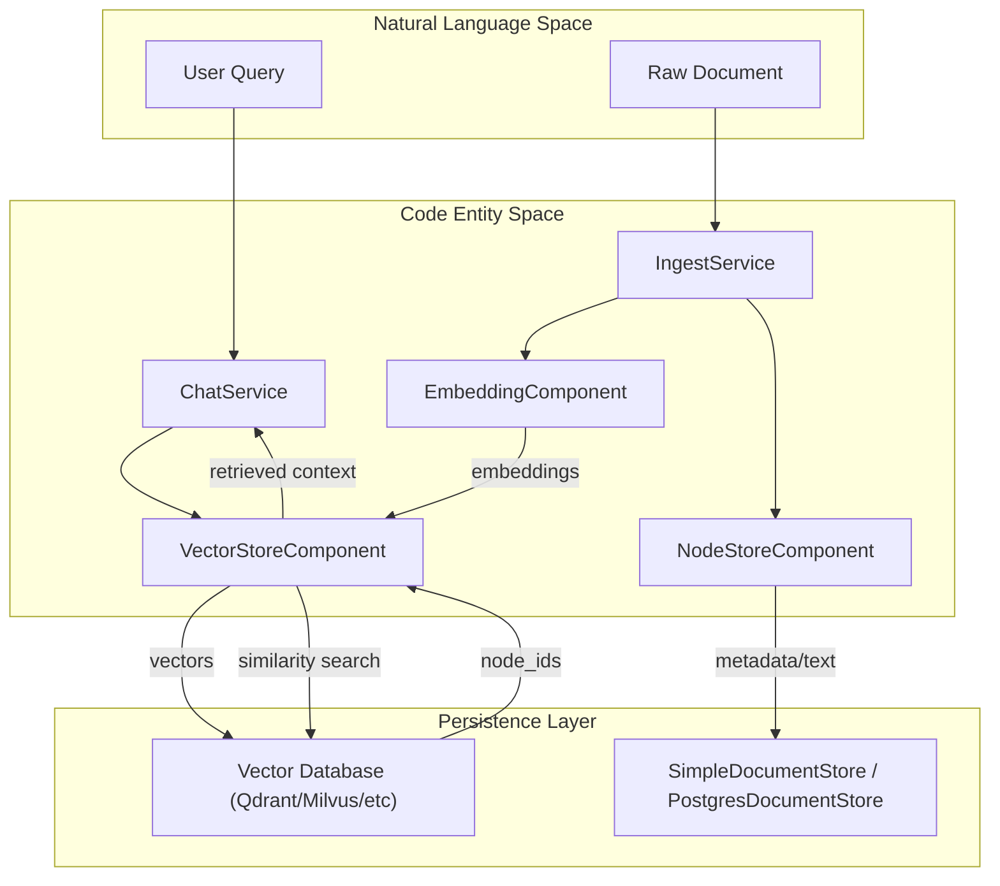
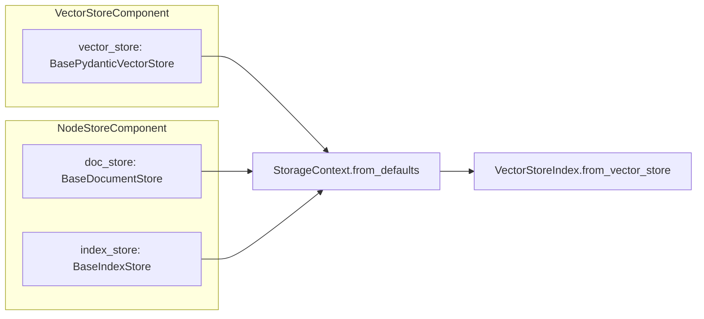

<!-- source: DeepWiki mcp.deepwiki.com · repo zylon-ai/private-gpt · page 3.3 Vector Store Component · fetched 2026-10-26 -->

# Vector Store Component

<details>
<summary>Relevant source files</summary>

The following files were used as context for generating this wiki page:

- [fern/docs/pages/installation/concepts.mdx](fern/docs/pages/installation/concepts.mdx)
- [fern/docs/pages/manual/ingestion-reset.mdx](fern/docs/pages/manual/ingestion-reset.mdx)
- [fern/docs/pages/manual/nodestore.mdx](fern/docs/pages/manual/nodestore.mdx)
- [fern/docs/pages/manual/vectordb.mdx](fern/docs/pages/manual/vectordb.mdx)
- [private_gpt/components/ingest/ingest_component.py](private_gpt/components/ingest/ingest_component.py)
- [private_gpt/components/node_store/node_store_component.py](private_gpt/components/node_store/node_store_component.py)
- [private_gpt/components/vector_store/batched_chroma.py](private_gpt/components/vector_store/batched_chroma.py)
- [private_gpt/components/vector_store/vector_store_component.py](private_gpt/components/vector_store/vector_store_component.py)
- [private_gpt/server/chat/chat_service.py](private_gpt/server/chat/chat_service.py)

</details>


The Vector Store Component in PrivateGPT is responsible for the persistence and retrieval of vector embeddings and their associated metadata. It acts as the bridge between the high-level RAG services and the underlying vector database engines.

## Purpose and Position in System Architecture

The component is a central piece of the RAG pipeline, facilitating both the storage of newly ingested document nodes and the similarity search required for context retrieval.



**Diagram 1: Vector Store and Node Store Data Flow**

Sources: [private_gpt/components/vector_store/vector_store_component.py:32-33](), [private_gpt/server/chat/chat_service.py:79-106](), [private_gpt/components/node_store/node_store_component.py:14-15]()

## Supported Vector Databases

PrivateGPT supports five primary vector store backends. The selection is controlled via `settings.yaml` under `vectorstore.database`.

| Database | LlamaIndex Implementation | Extra Dependency | Persistence Mode |
| :--- | :--- | :--- | :--- |
| **Qdrant** | `QdrantVectorStore` | `vector-stores-qdrant` | Local path or Remote URL |
| **Chroma** | `BatchedChromaVectorStore` | `vector-stores-chroma` | Local directory (`chroma_db`) |
| **Milvus** | `MilvusVectorStore` | `vector-stores-milvus` | Local `.db` file or Remote URI |
| **Postgres** | `PGVectorStore` | `vector-stores-postgres` | `embeddings` table with `pgvector` |
| **ClickHouse** | `ClickHouseVectorStore` | `vector-stores-clickhouse` | Columnar table |

Sources: [private_gpt/components/vector_store/vector_store_component.py:40-195](), [fern/docs/pages/manual/vectordb.mdx:1-168]()

## Component Implementation

### VectorStoreComponent Class
The `VectorStoreComponent` is a `@singleton` class injected with system `Settings`. During `__init__`, it uses a `match` statement to initialize the specific `BasePydanticVectorStore` requested by the configuration.

```python
@singleton
class VectorStoreComponent:
    @inject
    def __init__(self, settings: Settings) -> None:
        self.settings = settings
        match settings.vectorstore.database:
            case "postgres":
                # ... initialization of PGVectorStore
            case "qdrant":
                # ... initialization of QdrantVectorStore
```

Sources: [private_gpt/components/vector_store/vector_store_component.py:32-41]()

### NodeStoreComponent Class
While the vector store handles embeddings, the `NodeStoreComponent` handles the storage of the actual `BaseNode` objects (text and metadata). It supports two modes:
- **Simple**: Uses `SimpleDocumentStore` and `SimpleIndexStore`, persisting to `local_data_path`.
- **Postgres**: Uses `PostgresDocumentStore` and `PostgresIndexStore` for robust, relational storage of document nodes.

Sources: [private_gpt/components/node_store/node_store_component.py:14-68]()

## Persistence and Retrieval Flow

### Initialization and Storage Context
The `ChatService` and `IngestionService` combine these components into a `StorageContext`. This context is then used to create a `VectorStoreIndex`.



**Diagram 2: Storage Context Assembly**

Sources: [private_gpt/server/chat/chat_service.py:94-106](), [private_gpt/components/ingest/ingest_component.py:72-95]()

### Retrieval with Metadata Filtering
Retrieval is handled by `get_retriever`, which creates a `VectorIndexRetriever`. If a `ContextFilter` is provided (e.g., to restrict search to specific documents), the component generates `MetadataFilters`.

- **Qdrant**: Supports direct `doc_ids` pass-through in the retriever.
- **Others**: Uses `_doc_id_metadata_filter` to create a `FilterCondition.OR` across the specified `doc_id` metadata keys.

Sources: [private_gpt/components/vector_store/vector_store_component.py:20-29](), [private_gpt/components/vector_store/vector_store_component.py:197-213]()

## Technical Implementation Details

### Batched Chroma Insertion
For ChromaDB, PrivateGPT implements `BatchedChromaVectorStore` to handle large ingestion tasks. It overrides the `add` method to chunk the incoming nodes based on the client's `max_batch_size`, preventing API limit errors.

Sources: [private_gpt/components/vector_store/batched_chroma.py:28-106]()

### Postgres Schema
When using `postgres` for vector storage, the component creates a table (default name `embeddings`) with the following structure:
- `id`: Primary key.
- `text`: The chunk text.
- `metadata_`: JSON blob of metadata.
- `node_id`: Reference to the node.
- `embedding`: `vector(N)` where N is `settings.embedding.embed_dim`.

Sources: [private_gpt/components/vector_store/vector_store_component.py:56-63](), [fern/docs/pages/manual/vectordb.mdx:105-121]()

### Resource Cleanup
The component provides a `close()` method that is called during application shutdown to gracefully close database connections (supported for Qdrant, Milvus, and ClickHouse clients).

Sources: [private_gpt/components/vector_store/vector_store_component.py:215-218]()

---

