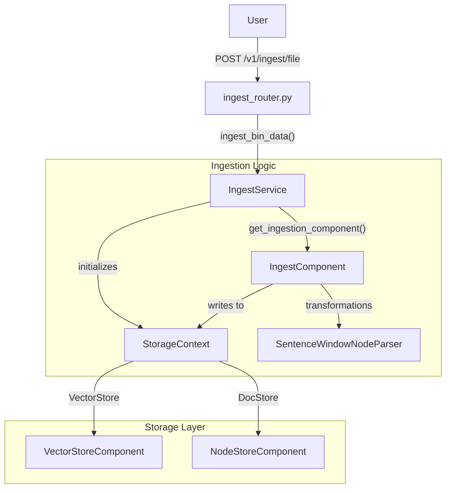
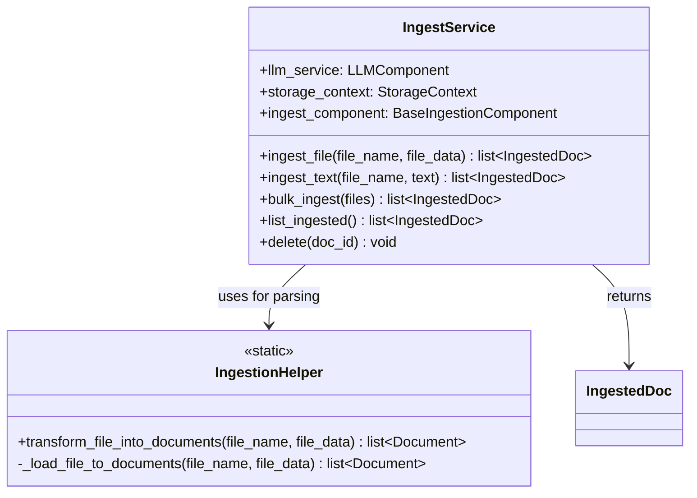
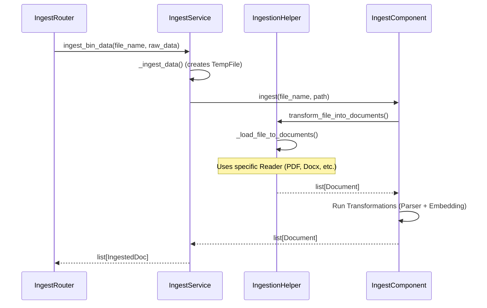

<!-- source: DeepWiki mcp.deepwiki.com · repo zylon-ai/private-gpt · page 4.1 Ingestion Service · fetched 2026-10-26 -->

# Ingestion Service

<details>
<summary>Relevant source files</summary>

The following files were used as context for generating this wiki page:

- [fern/README.md](fern/README.md)
- [fern/docs/pages/manual/ingestion.mdx](fern/docs/pages/manual/ingestion.mdx)
- [fern/docs/pages/overview/welcome.mdx](fern/docs/pages/overview/welcome.mdx)
- [private_gpt/components/ingest/__init__.py](private_gpt/components/ingest/__init__.py)
- [private_gpt/components/ingest/ingest_helper.py](private_gpt/components/ingest/ingest_helper.py)
- [private_gpt/main.py](private_gpt/main.py)
- [private_gpt/server/ingest/ingest_router.py](private_gpt/server/ingest/ingest_router.py)
- [private_gpt/server/ingest/ingest_service.py](private_gpt/server/ingest/ingest_service.py)
- [private_gpt/server/ingest/ingest_watcher.py](private_gpt/server/ingest/ingest_watcher.py)
- [private_gpt/server/ingest/model.py](private_gpt/server/ingest/model.py)
- [scripts/ingest_folder.py](scripts/ingest_folder.py)
- [settings-mock.yaml](settings-mock.yaml)
- [tests/server/ingest/test_ingest_routes.py](tests/server/ingest/test_ingest_routes.py)

</details>


The Ingestion Service is a core component of PrivateGPT that handles the processing and storage of documents. It converts various file formats into vector embeddings and stores them for later retrieval during chat sessions, completions, and chunk queries. This service bridges the gap between raw data (files, text) and the structured vector space used by the RAG pipeline.

## Architecture Overview

The Ingestion Service coordinates between the API layer and the underlying LlamaIndex components. It utilizes dependency injection to access the necessary embedding and storage backends.



Sources: [private_gpt/server/ingest/ingest_service.py:26-49](), [private_gpt/server/ingest/ingest_router.py:40-61]()

## Components and Implementation

The `IngestService` is implemented as a singleton class that orchestrates the data flow from raw input to persisted embeddings.



Sources: [private_gpt/server/ingest/ingest_service.py:26-50](), [private_gpt/components/ingest/ingest_helper.py:63-78]()

### Key Classes and Functions
*   **`IngestService`**: The primary entry point for ingestion logic. It initializes the `StorageContext` using the `VectorStoreComponent` and `NodeStoreComponent` [private_gpt/server/ingest/ingest_service.py:37-41]().
*   **`IngestionHelper`**: A thread-safe utility class that transforms files into LlamaIndex `Document` objects. It handles metadata exclusion (e.g., preventing `doc_id` from being sent to the LLM) [private_gpt/components/ingest/ingest_helper.py:63-112]().
*   **`SentenceWindowNodeParser`**: The default node parser used to create chunks with surrounding context windows [private_gpt/server/ingest/ingest_service.py:42]().

## Ingestion Process Flow

When a file is ingested, the service follows a structured pipeline to ensure data is correctly parsed, chunked, and embedded.



Sources: [private_gpt/server/ingest/ingest_service.py:51-72](), [private_gpt/components/ingest/ingest_helper.py:71-78]()

## API Reference

The Ingestion Service exposes several REST API endpoints through `ingest_router.py`:

| Endpoint | Method | Description |
|----------|--------|-------------|
| `/v1/ingest/file` | POST | Ingests a binary file (e.g., PDF, DOCX) [private_gpt/server/ingest/ingest_router.py:40-61]() |
| `/v1/ingest/text` | POST | Ingests raw text strings [private_gpt/server/ingest/ingest_router.py:64-81]() |
| `/v1/ingest/list` | GET | Returns metadata for all ingested documents [private_gpt/server/ingest/ingest_router.py:84-93]() |
| `/v1/ingest/{doc_id}` | DELETE | Removes a document and its vectors from storage [private_gpt/server/ingest/ingest_router.py:96-104]() |

### Data Models
*   **`IngestResponse`**: A standard wrapper containing a list of `IngestedDoc` objects [private_gpt/server/ingest/ingest_router.py:25-28]().
*   **`IngestedDoc`**: Represents a processed document, containing its unique `doc_id` and curated metadata (excluding internal fields like `window` or `original_text`) [private_gpt/server/ingest/model.py:7-24]().

## Bulk Ingestion and Folder Monitoring

For large datasets, PrivateGPT provides a local ingestion worker and a script to monitor directories.

### LocalIngestWorker
The `LocalIngestWorker` class validates folder permissions based on `local_ingestion.allow_ingest_from` settings and performs recursive file discovery [scripts/ingest_folder.py:15-54]().

### IngestWatcher
The `IngestWatcher` uses filesystem events to trigger ingestion automatically when files are added or modified in a monitored directory [scripts/ingest_folder.py:134-135]().

### Usage via CLI
```bash
# Basic bulk ingestion
python scripts/ingest_folder.py /path/to/folder

# Bulk ingestion with folder watching
python scripts/ingest_folder.py /path/to/folder --watch
```
Sources: [scripts/ingest_folder.py:80-135](), [fern/docs/pages/manual/ingestion.mdx:23-25]()

## Supported File Formats

The system uses `IngestionHelper` to map file extensions to specific LlamaIndex readers.

| Category | Extensions | Reader Class |
|----------|------------|--------------|
| Documents | `.pdf`, `.docx`, `.pptx`, `.hwp` | `PDFReader`, `DocxReader`, `PptxReader`, `HWPReader` |
| Media | `.mp3`, `.mp4`, `.jpg`, `.png` | `VideoAudioReader`, `ImageReader` |
| Data | `.csv`, `.json`, `.ipynb` | `PandasCSVReader`, `JSONReader`, `IPYNBReader` |
| Web/Text | `.md`, `.mbox`, `.epub`, `.html` | `MarkdownReader`, `MboxReader`, `EpubReader` |

*Note: Any unrecognized extension defaults to a plain text `StringIterableReader` [private_gpt/components/ingest/ingest_helper.py:84-92]().*

Sources: [private_gpt/components/ingest/ingest_helper.py:33-60]()

## Optimization and Troubleshooting

### Ingestion Modes
Users can configure `embedding.ingest_mode` to optimize for their hardware:
*   **`simple`**: Sequential processing (default).
*   **`batch`**: Batched reading and embedding.
*   **`parallel`**: Multi-threaded processing (fastest for local setups).
*   **`pipeline`**: Alternative parallel implementation.

The number of concurrent workers is controlled by `embedding.count_workers` [fern/docs/pages/manual/ingestion.mdx:69-81]().

### Memory Management
To ingest large volumes of data without running out of VRAM, use the `mock` profile (`PGPT_PROFILES=mock`). This prevents the LLM from loading while still allowing the Embedding model to utilize GPU acceleration [fern/docs/pages/manual/ingestion.mdx:46-62](), [settings-mock.yaml:5-10]().

Sources: [fern/docs/pages/manual/ingestion.mdx:46-90]()

---

