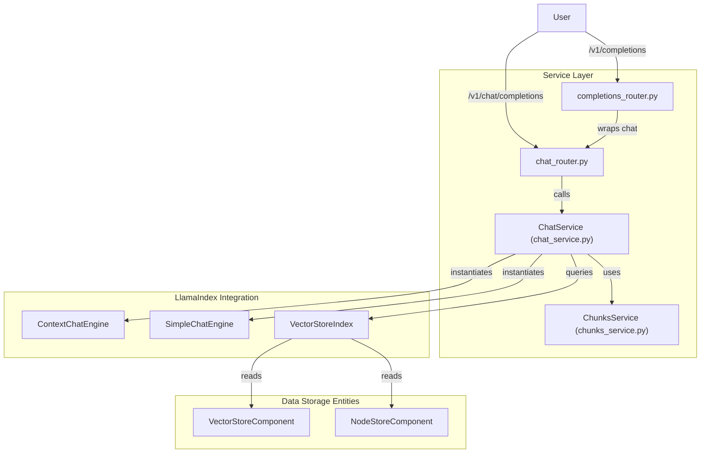
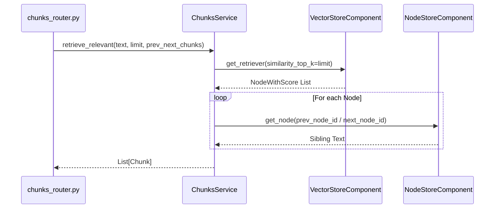

<!-- source: DeepWiki mcp.deepwiki.com · repo zylon-ai/private-gpt · page 4.2 Chat Service · fetched 2026-10-26 -->

# Chat Service

Relevant source files

The following files were used as context for generating this wiki page:

- [fern/docs/pages/manual/reranker.mdx](fern/docs/pages/manual/reranker.mdx)
- [private_gpt/components/ingest/ingest_component.py](private_gpt/components/ingest/ingest_component.py)
- [private_gpt/components/node_store/node_store_component.py](private_gpt/components/node_store/node_store_component.py)
- [private_gpt/components/vector_store/batched_chroma.py](private_gpt/components/vector_store/batched_chroma.py)
- [private_gpt/open_ai/extensions/context_filter.py](private_gpt/open_ai/extensions/context_filter.py)
- [private_gpt/open_ai/openai_models.py](private_gpt/open_ai/openai_models.py)
- [private_gpt/server/chat/chat_router.py](private_gpt/server/chat/chat_router.py)
- [private_gpt/server/chat/chat_service.py](private_gpt/server/chat/chat_service.py)
- [private_gpt/server/chunks/chunks_router.py](private_gpt/server/chunks/chunks_router.py)
- [private_gpt/server/chunks/chunks_service.py](private_gpt/server/chunks/chunks_service.py)
- [private_gpt/server/completions/completions_router.py](private_gpt/server/completions/completions_router.py)
- [private_gpt/server/embeddings/embeddings_router.py](private_gpt/server/embeddings/embeddings_router.py)
- [private_gpt/server/health/health_router.py](private_gpt/server/health/health_router.py)
- [settings-test.yaml](settings-test.yaml)

The Chat Service is a core component of PrivateGPT that provides conversational capabilities with or without context retrieval from ingested documents. This page documents the architecture and functionality of the Chat Service, particularly focusing on its implementation of the Retrieval Augmented Generation (RAG) pipeline, the OpenAI-compatible routers, and the chunk retrieval system.

## Overview

The Chat Service enables users to interact with language models while optionally using document context retrieved from a vector store. It supports both standard conversational responses and context-enhanced responses where relevant document chunks are retrieved and included in the prompt.

### System Architecture Diagram

This diagram bridges the Natural Language space (User Query) to the Code Entity space by showing how specific service classes and components interact.

Sources: [private_gpt/server/chat/chat_router.py:52-115](), [private_gpt/server/completions/completions_router.py:39-92](), [private_gpt/server/chat/chat_service.py:79-106]()

## Chat Routers and API

PrivateGPT provides two main endpoints for chat and completions, both designed to be compatible with the OpenAI API specification.

### Chat Router
The `chat_router.py` handles the `/v1/chat/completions` endpoint. It accepts a `ChatBody` containing a list of `OpenAIMessage` objects and configuration for RAG (`use_context`, `context_filter`).
- **File**: [private_gpt/server/chat/chat_router.py:16-115]()
- **Function**: `chat_completion` [private_gpt/server/chat/chat_router.py:65-115]()

### Completions Router
The `completions_router.py` handles the `/v1/completions` endpoint. It is a wrapper that converts a single prompt into a user message and optionally a system prompt into a system message, then forwards the request to the `chat_completion` logic.
- **File**: [private_gpt/server/completions/completions_router.py:13-92]()
- **Function**: `prompt_completion` [private_gpt/server/completions/completions_router.py:53-92]()

### Response Models
Responses are transformed into OpenAI-compatible formats using utility functions:
- `to_openai_response`: Converts a standard response into an `OpenAICompletion`. [private_gpt/open_ai/openai_models.py:101-109]()
- `to_openai_sse_stream`: Converts a generator into Server-Sent Events (SSE) for streaming. [private_gpt/open_ai/openai_models.py:112-123]()

## Chat Service Core Logic

The `ChatService` class (singleton) manages the lifecycle of the `VectorStoreIndex` and the creation of LlamaIndex chat engines.

### Key Class: ChatService
The service is initialized by injecting LLM, Embedding, and Storage components.

| Entity | Role | Source |
| :--- | :--- | :--- |
| `storage_context` | Combines Vector, Document, and Index stores. | [private_gpt/server/chat/chat_service.py:95-99]() |
| `index` | The `VectorStoreIndex` used for RAG operations. | [private_gpt/server/chat/chat_service.py:100-106]() |
| `_chat_engine` | Factory method for `ContextChatEngine` or `SimpleChatEngine`. | [private_gpt/server/chat/chat_service.py:108-147]() |

### Message Processing
Input messages are parsed by `ChatEngineInput.from_messages` to separate the system prompt, the last user message, and the conversation history.
- **Source**: [private_gpt/server/chat/chat_service.py:50-75]()

## RAG Pipeline and Context Retrieval

When `use_context` is enabled, the `ChatService` constructs a RAG pipeline using several post-processors.

### Retrieval Flow
1. **Retriever**: Obtains nodes from the `VectorStoreIndex` using `similarity_top_k`. [private_gpt/server/chat/chat_service.py:116-120]()
2. **ContextFilter**: Restricts the search to specific document IDs. [private_gpt/open_ai/extensions/context_filter.py:5-13]()
3. **Post-processors**:
    - `MetadataReplacementPostProcessor`: Replaces chunk text with a larger "window" for better LLM context. [private_gpt/server/chat/chat_service.py:122]()
    - `SimilarityPostprocessor`: Drops chunks below a `similarity_cutoff`. [private_gpt/server/chat/chat_service.py:124-129]()
    - `SentenceTransformerRerank`: Re-ranks retrieved chunks using a cross-encoder model if enabled in settings. [private_gpt/server/chat/chat_service.py:131-135]()

### Chunks Service
The `ChunksService` provides a standalone way to retrieve relevant document segments without invoking the LLM. This is used by the `/v1/chunks` endpoint.

Sources: [private_gpt/server/chunks/chunks_service.py:96-125](), [private_gpt/server/chunks/chunks_router.py:26-55]()

## Storage and Node Management

The Chat Service depends on the `NodeStoreComponent` to access the original document content and index metadata.

- **Simple Mode**: Uses `SimpleDocumentStore` and `SimpleIndexStore` persisted to the local filesystem. [private_gpt/components/node_store/node_store_component.py:22-37]()
- **Postgres Mode**: Uses `PostgresDocumentStore` and `PostgresIndexStore` for scalable, persistent storage. [private_gpt/components/node_store/node_store_component.py:39-61]()

### Chunk Model
The `Chunk` class represents a retrieved piece of context, including its similarity score and metadata about the source document.
- **Source**: [private_gpt/server/chunks/chunks_service.py:22-53]()
- **Fields**: `text`, `score`, `document` (IngestedDoc), `previous_texts`, `next_texts`.

## Typical Execution Flow

| Step | Action | Code Reference |
| :--- | :--- | :--- |
| 1 | Router receives `ChatBody` | [private_gpt/server/chat/chat_router.py:65]() |
| 2 | `ChatService.chat` or `stream_chat` is called | [private_gpt/server/chat/chat_service.py:149-217]() |
| 3 | `_chat_engine` builds the RAG pipeline | [private_gpt/server/chat/chat_service.py:108-142]() |
| 4 | LlamaIndex `ContextChatEngine` retrieves nodes | [private_gpt/server/chat/chat_service.py:137-142]() |
| 5 | LLM generates response using retrieved context | [private_gpt/server/chat/chat_service.py:175-178]() |
| 6 | Sources are converted to `Chunk` objects | [private_gpt/server/chat/chat_service.py:179]() |
| 7 | Response is formatted as `OpenAICompletion` | [private_gpt/open_ai/openai_models.py:101-109]() |

Sources: [private_gpt/server/chat/chat_service.py:108-217](), [private_gpt/server/chat/chat_router.py:91-115]()

---

