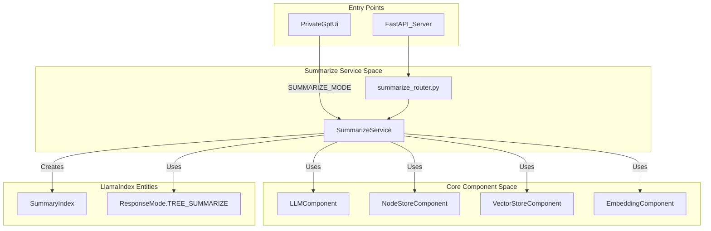
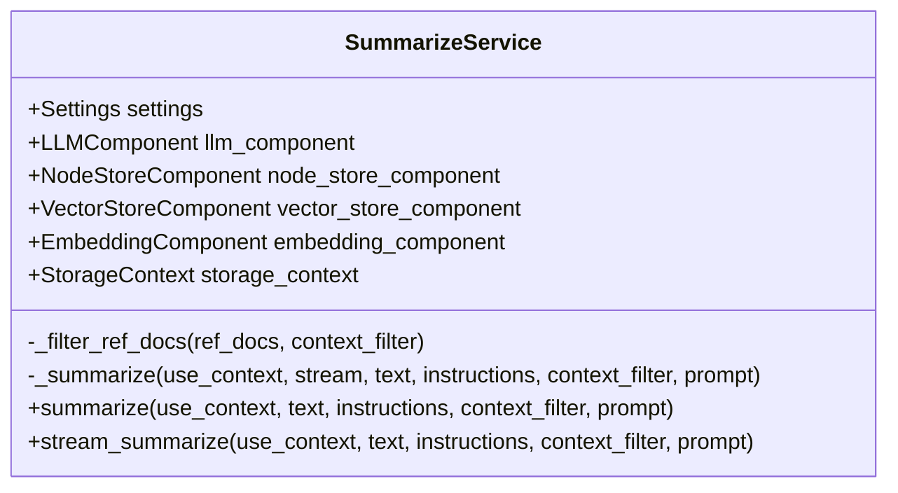
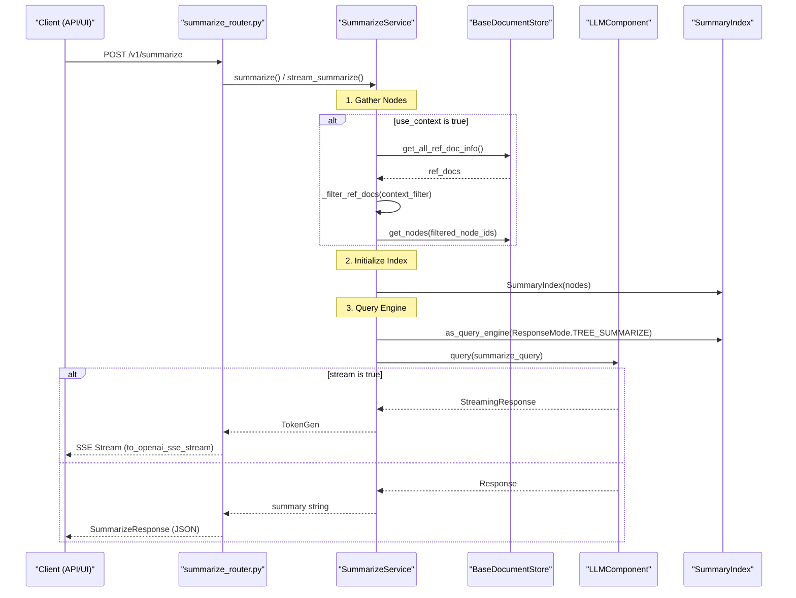

<!-- source: DeepWiki mcp.deepwiki.com · repo zylon-ai/private-gpt · page 4.3 Summarize Service · fetched 2026-10-26 -->

# Summarize Service

Relevant source files

The following files were used as context for generating this wiki page:

- [fern/docs/pages/recipes/quickstart.mdx](fern/docs/pages/recipes/quickstart.mdx)
- [fern/docs/pages/recipes/summarize.mdx](fern/docs/pages/recipes/summarize.mdx)
- [fern/openapi/openapi.json](fern/openapi/openapi.json)
- [private_gpt/server/recipes/summarize/__init__.py](private_gpt/server/recipes/summarize/__init__.py)
- [private_gpt/server/recipes/summarize/summarize_router.py](private_gpt/server/recipes/summarize/summarize_router.py)
- [private_gpt/server/recipes/summarize/summarize_service.py](private_gpt/server/recipes/summarize/summarize_service.py)
- [private_gpt/ui/ui.py](private_gpt/ui/ui.py)
- [tests/server/recipes/test_summarize_router.py](tests/server/recipes/test_summarize_router.py)

The Summarize Service is a core component of PrivateGPT that provides document summarization capabilities. It allows users to generate concise summaries of texts, either directly supplied or from previously ingested documents. This service is implemented as a "Recipe" — a predefined use case that helps users solve specific tasks with PrivateGPT [fern/docs/pages/recipes/quickstart.mdx:1-6]().

## Architecture Overview

The Summarize Service is built on top of the core PrivateGPT components, leveraging the LLM and Node Store to provide context-aware summarization capabilities.

Sources: [private_gpt/server/recipes/summarize/summarize_service.py:34-49](), [private_gpt/ui/ui.py:90-95](), [private_gpt/server/recipes/summarize/summarize_router.py:12-15](), [private_gpt/server/recipes/summarize/summarize_service.py:113-126]()

## Implementation Details

### SummarizeService Class

The `SummarizeService` class is the core implementation of the summarization functionality. It is decorated as a `@singleton` and uses dependency injection to access core components [private_gpt/server/recipes/summarize/summarize_service.py:34-44]().

The service uses LlamaIndex's `SummaryIndex` to manage nodes for summarization [private_gpt/server/recipes/summarize/summarize_service.py:113-117](). It employs the `TREE_SUMMARIZE` response mode, which recursively summarizes chunks of text into a final summary [private_gpt/server/recipes/summarize/summarize_service.py:123]().

Key functionalities:
1. **Document Filtering**: Filters ingested documents based on `doc_id` using the `ContextFilter` [private_gpt/server/recipes/summarize/summarize_service.py:57-67]().
2. **Node Retrieval**: Recovers nodes from the `docstore` for the selected documents [private_gpt/server/recipes/summarize/summarize_service.py:103-108]().
3. **Text Summarization**: Can split and summarize raw text input using `SentenceSplitter` [private_gpt/server/recipes/summarize/summarize_service.py:82-88]().
4. **Customizable Prompts**: Supports a `DEFAULT_SUMMARIZE_PROMPT` or user-provided prompts and instructions [private_gpt/server/recipes/summarize/summarize_service.py:24-31](), [private_gpt/server/recipes/summarize/summarize_service.py:128-130]().

Sources: [private_gpt/server/recipes/summarize/summarize_service.py:34-172]()

### API Endpoint

The service exposes a `/v1/summarize` endpoint via `summarize_router.py` [private_gpt/server/recipes/summarize/summarize_router.py:28-34]().

The endpoint accepts a `SummarizeBody` object:
- `text`: Raw text to summarize [private_gpt/server/recipes/summarize/summarize_router.py:16]().
- `use_context`: Boolean to include ingested documents [private_gpt/server/recipes/summarize/summarize_router.py:17]().
- `context_filter`: Filter for specific document IDs [private_gpt/server/recipes/summarize/summarize_router.py:18]().
- `prompt` / `instructions`: Custom guidance for the LLM [private_gpt/server/recipes/summarize/summarize_router.py:19-20]().
- `stream`: Enables Server-Sent Events (SSE) streaming [private_gpt/server/recipes/summarize/summarize_router.py:21]().

Sources: [private_gpt/server/recipes/summarize/summarize_router.py:15-86]()

### UI Integration

The Summarize Service is integrated into the Gradio UI as `Modes.SUMMARIZE_MODE` [private_gpt/ui/ui.py:44](). When this mode is active, the `_chat` function redirects the request logic to the `_summarize_service` [private_gpt/ui/ui.py:215-233]().

The UI handles the stream by yielding tokens back to the Gradio interface [private_gpt/ui/ui.py:139-143]().

Sources: [private_gpt/ui/ui.py:40-52](), [private_gpt/ui/ui.py:215-233]()

## Request Flow

The following sequence illustrates how a summarization request is processed, bridging the gap between API/UI calls and the internal LlamaIndex logic.

Sources: [private_gpt/server/recipes/summarize/summarize_service.py:69-138](), [private_gpt/server/recipes/summarize/summarize_router.py:60-86](), [private_gpt/server/recipes/summarize/summarize_service.py:92-110]()

## Data Models

### SummarizeBody
The request schema for the `/v1/summarize` endpoint.

| Field | Type | Description |
| :--- | :--- | :--- |
| `text` | `str \| None` | Direct text input to be summarized. |
| `use_context` | `bool` | If true, includes nodes from the system's document store. |
| `context_filter` | `ContextFilter` | Optional filter for document IDs. |
| `prompt` | `str \| None` | Overrides the default summarization prompt. |
| `instructions` | `str \| None` | Appended to the prompt for specific formatting. |
| `stream` | `bool` | If true, returns an OpenAI-compatible SSE stream. |

Sources: [private_gpt/server/recipes/summarize/summarize_router.py:15-21]()

### SummarizeResponse
The non-streaming response schema.

| Field | Type | Description |
| :--- | :--- | :--- |
| `summary` | `str` | The generated summary text. |

Sources: [private_gpt/server/recipes/summarize/summarize_router.py:24-25]()

## Summary of Key Classes and Functions

| Entity | File Path | Role |
| :--- | :--- | :--- |
| `SummarizeService` | [private_gpt/server/recipes/summarize/summarize_service.py:35]() | Main business logic for node gathering and index querying. |
| `_summarize` | [private_gpt/server/recipes/summarize/summarize_service.py:69]() | Internal method handling both sync and async/streaming logic. |
| `summarize` (Router) | [private_gpt/server/recipes/summarize/summarize_router.py:35]() | FastAPI route handler for the summarization endpoint. |
| `to_openai_sse_stream` | [private_gpt/server/recipes/summarize/summarize_router.py:71]() | Utility to format token generation into OpenAI-compatible SSE. |
| `DEFAULT_SUMMARIZE_PROMPT` | [private_gpt/server/recipes/summarize/summarize_service.py:24]() | The base system prompt used if none is provided. |

Sources: [private_gpt/server/recipes/summarize/summarize_service.py:24-172](), [private_gpt/server/recipes/summarize/summarize_router.py:12-86]()

---

