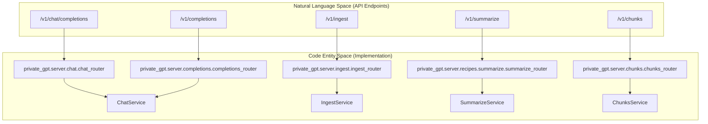
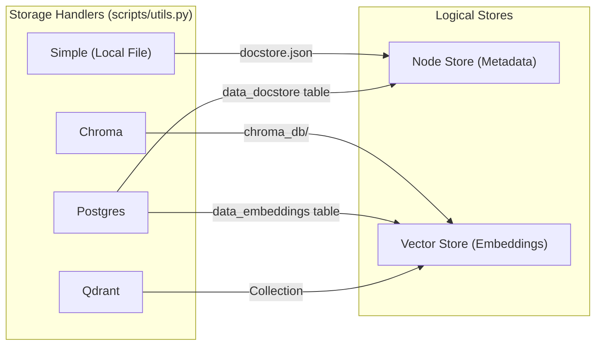

<!-- source: DeepWiki mcp.deepwiki.com · repo zylon-ai/private-gpt · page 5.1 API Reference · fetched 2026-10-26 -->

# API Reference

Relevant source files

The following files were used as context for generating this wiki page:

- [CITATION.cff](CITATION.cff)
- [Makefile](Makefile)
- [fern/docs/pages/api-reference/api-reference.mdx](fern/docs/pages/api-reference/api-reference.mdx)
- [fern/docs/pages/api-reference/sdks.mdx](fern/docs/pages/api-reference/sdks.mdx)
- [fern/docs/pages/recipes/quickstart.mdx](fern/docs/pages/recipes/quickstart.mdx)
- [fern/docs/pages/recipes/summarize.mdx](fern/docs/pages/recipes/summarize.mdx)
- [fern/openapi/openapi.json](fern/openapi/openapi.json)
- [private_gpt/server/chunks/chunks_router.py](private_gpt/server/chunks/chunks_router.py)
- [private_gpt/server/embeddings/embeddings_router.py](private_gpt/server/embeddings/embeddings_router.py)
- [private_gpt/server/health/health_router.py](private_gpt/server/health/health_router.py)
- [private_gpt/server/recipes/summarize/__init__.py](private_gpt/server/recipes/summarize/__init__.py)
- [private_gpt/server/recipes/summarize/summarize_router.py](private_gpt/server/recipes/summarize/summarize_router.py)
- [private_gpt/server/utils/auth.py](private_gpt/server/utils/auth.py)
- [scripts/utils.py](scripts/utils.py)
- [tests/server/utils/test_simple_auth.py](tests/server/utils/test_simple_auth.py)

This document provides a comprehensive reference for the PrivateGPT REST API, detailing all available endpoints, their parameters, request/response formats, and usage examples. For information about available SDKs and client libraries, see the [Available SDKs](#available-sdks) section.

## API Overview

PrivateGPT's API follows RESTful principles and is designed to be compatible with the OpenAI API where appropriate. The API is organized around functional areas such as chat, ingestion, and specialized recipes like summarization.

### Natural Language to Code Mapping
The following diagram bridges the conceptual API space with the internal code entities responsible for handling requests.

Sources: [private_gpt/server/recipes/summarize/summarize_router.py:12-28](), [private_gpt/server/chunks/chunks_router.py:10-26](), [private_gpt/server/embeddings/embeddings_router.py:12-25](), [fern/openapi/openapi.json:8-151]()

## Authentication

Authentication is handled via the `authenticated` dependency in FastAPI routers [private_gpt/server/utils/auth.py:62-69](). 

- **Disabled (Default):** If `settings().server.auth.enabled` is `false`, a dummy mechanism is used that always allows requests [private_gpt/server/utils/auth.py:48-57]().
- **Enabled:** If enabled, it uses `_simple_authentication` which checks the `Authorization` header against the configured `settings().server.auth.secret` using `secrets.compare_digest` to prevent timing attacks [private_gpt/server/utils/auth.py:40-45]().

Sources: [private_gpt/server/utils/auth.py:1-70]()

## API Endpoints

### Contextual Completions

#### POST /v1/chat/completions
Given a list of messages comprising a conversation, return a response. This endpoint supports OpenAI-compatible streaming [fern/openapi/openapi.json:59-65]().

**Key Features:**
- `use_context`: If `true`, uses ingested documents for RAG [fern/openapi/openapi.json:65-65]().
- `context_filter`: Allows filtering context by document IDs [fern/openapi/openapi.json:65-65]().
- `include_sources`: Returns the source chunks used to generate the response [fern/openapi/openapi.json:65-65]().

#### POST /v1/completions
Legacy completion endpoint. Given a prompt, the model returns one predicted completion [fern/openapi/openapi.json:8-14]().

### Context Chunks

#### POST /v1/chunks
Retrieves the most relevant chunks from ingested documents without involving the LLM. This is a fast API because it only uses the embedding model [private_gpt/server/chunks/chunks_router.py:28-32]().

**Parameters [private_gpt/server/chunks/chunks_router.py:13-18]():**
- `text`: The search query.
- `limit`: Max chunks to return (default 10).
- `prev_next_chunks`: Number of adjacent chunks to fetch for surrounding context.

Sources: [private_gpt/server/chunks/chunks_router.py:1-56](), [fern/openapi/openapi.json:110-151]()

### Recipes

#### POST /v1/summarize
Summarizes a provided `text` or content from ingested documents [private_gpt/server/recipes/summarize/summarize_router.py:38-50]().

- **Service:** Handled by `SummarizeService` [private_gpt/server/recipes/summarize/summarize_router.py:60-60]().
- **Streaming:** Supports Server-Sent Events (SSE) via `to_openai_sse_stream` [private_gpt/server/recipes/summarize/summarize_router.py:70-75]().

Sources: [private_gpt/server/recipes/summarize/summarize_router.py:15-87](), [fern/docs/pages/recipes/summarize.mdx:1-15]()

### Embeddings

#### POST /v1/embeddings
Generates vector representations for one or more input strings [private_gpt/server/embeddings/embeddings_router.py:26-31]().

- **Implementation:** Calls `EmbeddingsService.texts_embeddings` [private_gpt/server/embeddings/embeddings_router.py:34-34]().

Sources: [private_gpt/server/embeddings/embeddings_router.py:1-36]()

## Data Persistence & Storage
PrivateGPT interacts with multiple storage backends. The `scripts/utils.py` file provides handlers for managing these stores.

### Storage Architecture

Sources: [scripts/utils.py:39-154]()

## Available SDKs

PrivateGPT uses [Fern](https://www.buildwithfern.com) to generate and maintain client libraries [fern/docs/pages/api-reference/sdks.mdx:1-3]().

| Language | Repository | Status |
| :--- | :--- | :--- |
| **Python** | [zylon-ai/pgpt-python](https://github.com/zylon-ai/pgpt-python) | Recommended |
| **TypeScript** | [zylon-ai/privategpt-ts](https://github.com/zylon-ai/privategpt-ts) | Recommended |
| **Java** | [zylon-ai/private-gpt-java](https://github.com/zylon-ai/private-gpt-java) | WIP |
| **Go** | [zylon-ai/private-gpt-go](https://github.com/zylon-ai/private-gpt-go) | WIP |

Sources: [fern/docs/pages/api-reference/sdks.mdx:5-36]()

## Utility Commands

The API can be managed using the following `make` commands:

- `make api-docs`: Generates the `openapi.json` file using `scripts/extract_openapi.py` [Makefile:48-49]().
- `make wipe`: Clears all data from the configured vector and node stores [Makefile:57-58]().
- `make stats`: Displays storage statistics (row counts, sizes) for the active database [Makefile:54-55]().

Sources: [Makefile:48-79](), [scripts/utils.py:174-184]()

---

